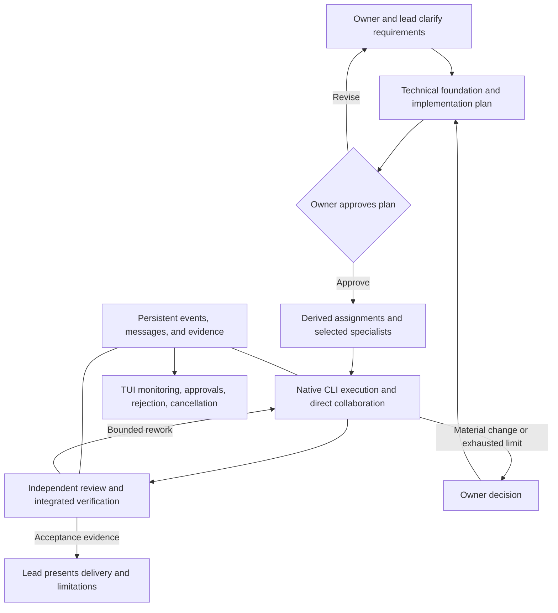
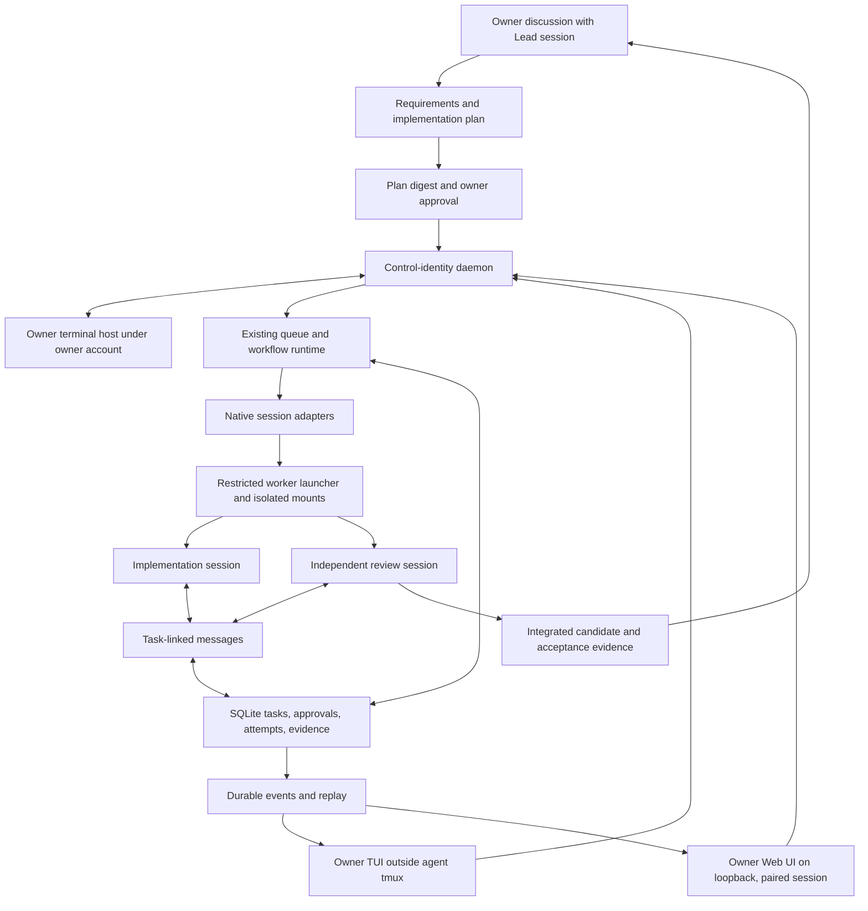

# Multi-Agent Engineering Team - Plan

## Goal Capsule

- **Objective:** Deliver the first local engineering-team milestone: an owner-aligned lead, scoped implementation, independent review, and observable recovery against an approved plan, monitored and controlled from both a local Web UI and the TUI in Chinese or English.
- **Approach:** Extend the owner-selected OpenRig source baseline in `engine/`, using TypeScript / Node.js and its existing daemon, queue, native session adapters, SQLite persistence, React web UI package, and TUI. Rebuild the web presentation against the owner's reference rendering. Compose the pinned engineering framework rather than rebuild it.
- **Authority:** Owner-confirmed product scope governs the plan, including the owner-confirmed product changes recorded in the Planning Contract; this Planning Contract resolves implementation decisions; derived assignments remain subordinate. Runtime records describe observed work, not product acceptance.
- **Decision focus:** Enforced worker/control isolation, plan-bound owner approvals, browser and terminal owner authentication, a single WSL development source, structured peer messages through verified native channels, classified retry and resume safety, a bounded lead wake loop, a daemon mode fixed at startup, a narrowed worker network, and verified candidate/reviewer identity.
- **Verification focus:** A separately scoped demo feature, same-task candidate-engine comparison, rejected-action, instruction-provenance, peer-review, cancellation, and restart cases in WSL2 with both supported native clients, plus browser and terminal acceptance of both owner clients in both languages.
- **Largest risk and stop condition:** A worker, web page, or leaked browser credential could reach control credentials, database files, supervisor sockets, or an owner shell through an unintended path. Because managed sessions run without native prompts or sandboxes (PC7), the worker boundary is the only containment, and KTD23 keeps the host's loopback and overlay networks outside that boundary. The initial WSL isolation probe, browser-session gates, and later real-client adversarial gates must pass before managed work is enabled.
- **Readiness and execution boundary:** Implementation-ready for the local milestone. U1's worker-isolation preflight has passed (recorded in `docs/operations.md`); source import and the later units have not started. Setup/client prerequisites and live-run spending decisions are checked before their affected actions. Distributed operation remains deferred.
- **Delivery ownership:** Execute units in dependency order after the owner selects implementation. That execution owns review, verification and local closeout; commit, push, PR creation, merge, release and deployment require their separate grants.

---

## Product Contract

### Summary

Build a terminal-based engineering team system with a lead that clarifies requirements with the owner, assembles relevant specialists, and coordinates autonomous delivery. All implementation and review work follows an approved plan, with persistent communication, observable execution, and human approval controls.

### Problem Frame

Running several coding CLIs does not establish shared scope, reliable handoffs, consistent interfaces, or evidence of integrated delivery. Terminal scrollback and natural-language progress reports are insufficient for recovering work or distinguishing a finished process from an accepted result.

The project needs coordinated delivery without replacing native coding tools or rebuilding an existing engineering methodology. The initial validation must establish useful teamwork before expanding to a distributed execution platform.

### Key Decisions

- **WSL2 execution first.** Windows hosts the initial Linux environment; the lead, specialists, and coordination services run inside WSL2. This admits tmux-based candidates without requiring native Windows process management. (session-settled: user-directed — chosen over native Windows execution: include Linux and tmux implementations in the initial comparison.)
- **TypeScript / Node.js is the primary stack.** This is an explicit owner constraint for the orchestration product, not a requirement to rewrite every managed project in TypeScript. Runtime versions and permitted supporting components remain planning decisions; Bun-only compatibility does not demonstrate Node.js compatibility.
- **Monitoring with essential controls.** The TUI shows activity and provides approval, rejection, and cancellation controls. Goal submission and detailed discussion remain in the lead's native CLI. (session-settled: user-directed — chosen over monitor-only and full command-center variants: retain useful intervention without replacing the native interfaces.)
- **Plan-governed autonomy.** Approval of an implementation-ready plan authorizes derived task decomposition, scoped specialist execution, and peer review within the agreed limits. Material changes and exhausted limits return to the owner. (session-settled: user-approved — chosen over approval of every routine execution step: permit autonomous delivery within a confirmed contract.)
- **Separate delivery permissions.** Commit, push, pull-request creation, merge, release, and deployment each require the applicable explicit authorization. Plan approval alone does not grant them. The owner holds one standing grant (recorded in `AGENTS.md`, 2026-10-16) for the delivery steps a finished task needs: committing its scoped candidate, pushing its branch, creating or updating its pull request, and the head-bound rebase merge once its acceptance and required review are evidenced. Release, deployment, scope expansion, resource-limit increases and any Windows export remain outside that grant.
- **Reuse the engineering framework.** Select appropriate capabilities from the full suite rather than impose every workflow on every task. Requirements and plans remain durable when the execution engine changes.
- **Reuse an execution engine before replacing one.** Evaluate existing implementations, then adapt or refactor only the gaps supported by evidence. The initial shortlist is research input, not an approved dependency or fork.
- **Task-specific teams, not fixed departments.** Roles are configurable capabilities. The lead chooses the smallest team that covers the task's deliverables, dependencies, and verification needs; roles are not permanently tied to a model or CLI.

### Actors

- A1. **Project owner:** Supplies objectives and constraints, confirms requirements and the implementation plan, and decides escalated product changes and separately gated operations.
- A2. **Lead:** Acts as requirements partner before approval and delivery coordinator afterward; assembles specialists, manages dependencies, handles blockers, and consolidates acceptance evidence.
- A3. **Product and design specialists:** Contribute requirements analysis, user flows, interaction design, UI specifications, and usability review when the assignment needs them.
- A4. **Architecture and implementation specialists:** Define technical boundaries and implement frontend, backend, client, data, or AI functionality within assigned scope.
- A5. **Verification specialists:** Provide independent code review, automated test development, acceptance testing, and performance checks where relevant.
- A6. **Platform and operations specialists:** Contribute build reproducibility, environment readiness, reliability, security, and authorized delivery work.

These actors describe responsibilities, not six mandatory concurrent sessions. The first milestone uses a separately configured lead, an implementation session, and an independent review session; broader rosters are exercised later.

### Requirements

**Requirements, planning, and alignment**

- R1. The lead must collaborate with the owner to establish scope, exclusions, and acceptance criteria before producing an executable assignment.
- R2. The implementation plan must establish applicable architecture, interface contracts, development standards, stack, database design, build environment, and versioning conventions before broad implementation.
- R3. Work on an existing project must inspect and inherit its established technical foundations unless the approved plan changes them.
- R4. Every implementation assignment must identify its source plan, bounded scope, dependencies, and required evidence; a derived task pack must remain subordinate to that plan.
- R5. Assignments must be checked against the current plan before dispatch and continuation, with stale or scope-changing work returned for reconciliation.

**Team execution and communication**

- R6. The lead must select roles and owners according to the task and keep its own model configuration and session separate from execution members.
- R7. Initial execution must support independent Claude Code and Codex CLI sessions with observable launch, output, exit, permission, and recovery behavior.
- R8. Specialists must exchange direct messages, questions, handoffs, and blockers without requiring the owner to relay them.
- R9. Important messages and decisions must persist with project, task, sender, recipient, time, and related artifact references, including lead broadcasts.
- R10. Dependent work must wait for its prerequisites, and overlapping changes must have explicit ownership or coordinated integration.
- R11. Retries and review-rework cycles must respect agreed limits and surface a blocker when progress requires an owner decision or exceeds those limits.

**Controls and observability**

- R12. The TUI must display team and task state, dependencies, messages, execution logs, review outcomes, errors, and pending decisions from execution events and durable records.
- R13. Actions requiring approval must wait for a recorded decision, and rejection must prevent that action from proceeding.
- R14. Cancellation must stop further dispatch for the affected work and report the observed termination outcome rather than infer success from a UI action.
- R15. Important task state, communication, and evidence must survive a restart; recovery must distinguish an active process, a resumable session, and work requiring a new attempt.
- R16. Available Git change references and test output must be associated with the relevant work; cost and token figures must be labeled unavailable when their underlying data is unreliable.

**Verification and governance**

- R17. Required peer review must be performed in a separate reviewer session against the assigned scope and actual changes, with findings returned to the responsible implementer.
- R18. Final delivery must demonstrate applicable integrated acceptance criteria rather than rely solely on specialist completion messages or process exit codes.
- R19. Workflow invocation must preserve its declared scope, readiness, mutation, and approval boundaries across the supported CLIs.
- R20. The primary stack and reuse constraints in Key Decisions must govern candidate evaluation, including license clarity, runtime compatibility, and maintenance cost.
- R21. Role and task context must exclude unrelated project data and raw credentials, and project changes must remain within the authorized repository and file scope.
- R22. The approved limits must govern autonomous execution, with material scope or architecture changes escalated instead of silently changing the source plan.

### Key Flows

- F1. **Agree on the work and technical foundation.**
  - **Actors:** A1, A2, and relevant A3-A6 specialists.
  - **Steps:** Clarify requirements; establish acceptance; inspect the target project; resolve applicable interfaces, architecture, conventions, environment, and verification strategy; present the implementation plan for owner approval.
  - **Outcome:** A confirmed execution contract or named unresolved questions, not premature implementation.
  - **Covers:** R1-R3, R19, R22.

- F2. **Assemble and execute the team.**
  - **Actors:** A2 and selected A3-A6 specialists.
  - **Steps:** Derive bounded work when useful; assign owners; confirm scope and readiness; launch independent sessions; deliver messages; enforce dependencies and change ownership.
  - **Outcome:** Scoped changes and attributable evidence, with blockers visible to the lead.
  - **Covers:** R4-R12, R16, R21.

- F3. **Review, revise, and accept.**
  - **Actors:** A2, A4, A5, and A1 for escalations.
  - **Steps:** Review actual changes independently; return findings; perform bounded rework; verify integration; consolidate delivered scope, evidence, limitations, and unresolved items.
  - **Outcome:** An evidence-backed delivery report without implying permission to publish or deploy.
  - **Covers:** R11, R16-R19, R22.

- F4. **Intervene or recover.**
  - **Actors:** A1, A2, and affected specialists.
  - **Steps:** Show the pending decision or interruption; apply the authorized response; preserve state; reconcile process and plan state before continuation.
  - **Outcome:** A traceable continuation, cancellation, rejection, or blocker; no silent duplicate execution.
  - **Covers:** R5, R11-R15, R21-R22.

The TUI should distinguish team/task overview, task-linked communication, execution details, and pending decisions. Exact pane layout and navigation remain design decisions; these regions do not turn the TUI into a full task-authoring interface.

### Engineering Framework Integration

The inspected suite contains 38 entrypoints. Integration must preserve their different purposes and invocation gates, not flatten them into 38 interchangeable commands. Availability in a host's generated configuration is not proof of working invocation or equivalent enforcement.

| Capability | Relevant existing components | Intended consumer |
|---|---|---|
| Direction and technology assessment | `spec-strategy`, `spec-ideate`, `spec-pov` | Lead and owner when product direction or adoption needs a decision |
| Requirements | `spec-brainstorm`, `spec-prd` | Lead with owner confirmation; route new-product exploration separately from existing-system requirements |
| Architecture and conventions | `spec-project-rules`, `spec-rule-miner` | Lead, architects, and implementers using current project evidence |
| Planning and decomposition | `spec-plan`, `spec-write-tasks`, `spec-doc-review` | Lead and planning specialists; task packs remain derived and optional |
| Implementation and diagnosis | `spec-work`, `spec-debug`, `spec-simplify-code` | Bounded implementers and diagnosis specialists |
| Design and consistency | `spec-prototype`, `spec-polish`, `spec-app-consistency-audit` | Relevant design and product specialists |
| Verification | `spec-code-review`, `spec-dogfood`, `spec-test-browser`, `spec-test-xcode` | Review and QA specialists with appropriate runtime capabilities |
| Measured improvement | `spec-optimize`, `autoresearch` | Specialists working against a checkable metric or success condition |
| Knowledge and continuity | `spec-compound`, `spec-compound-refresh`, `spec-handoff`, `spec-explain` | Requested knowledge capture, refresh, continuity, or explanation |
| Feedback and product operations | `spec-sweep`, `spec-riffrec-feedback-analysis`, `spec-product-pulse`, `spec-promote` | Applicable feedback and product tasks, not every delivery |
| Delivery and isolation | `spec-lfg`, `spec-resolve-pr-feedback`, `spec-commit`, `spec-commit-push-pr`, `spec-worktree` | Authorized callers preserving each helper's scope and side effects |
| Routing and extension | `using-spec-first`, `spec-runtime-setup`, `spec-write-skill` | Workflow selection, runtime readiness, and project-owned skill maintenance |

The implementation plan owns execution scope. A derived task pack owns the decomposition of that scope. Runtime records own observed execution state. The TUI displays those records; none of these surfaces should independently redefine product acceptance.

The framework's worker-dispatch contract is a host-neutral semantic interface, not a ready-made cross-CLI process scheduler. Adapters must demonstrate capability and preserve caller scope. Report-only review stays report-only; user-invoked and separately authorized workflows retain those gates.

### Scope Boundaries

**First validation milestone**

- One owner, one selected repository, and one bounded real software task in WSL2.
- A separately configured lead with Claude Code and Codex CLI exercising implementation and independent review.
- The approved-plan, assignment, direct-message, review, rework, integrated-verification, and recovery cycle.
- TUI monitoring and essential controls from the confirmed interface decision.
- Evidence of plan freshness, approval rejection, cancellation, and restart behavior, not only a happy-path demonstration.
- Candidate and framework versions recorded so observed results can be reproduced.

**Deferred for later**

- Mac and Linux VPS execution nodes, cross-machine identity, transport, reconnect, and remote process termination.
- Full Pi and DSH integration; identify the intended DSH project before making compatibility commitments.
- Concurrent multi-project operation and broad organizational role presets beyond the initial team.
- Execution coverage for every optional workflow, including Mac-only simulator testing and external feedback integrations.
- Full TUI goal authoring, session administration, and direct specialist command-center controls.

**Outside this product's identity**

- A replacement coding model, a mandatory common agent SDK, or a duplicate requirements-management system.
- A requirement to staff every specialty for every task.
- A requirement to rewrite managed projects in the orchestration product's primary language.
- Default approval of every tool request, unbounded repair loops, or automatic publishing and deployment.

### Acceptance Examples

- AE1. **Requirements before execution.**
  - **Given/When:** A task still has unresolved behavior or acceptance decisions and the owner asks for progress.
  - **Then:** The lead clarifies the missing decisions rather than dispatching speculative implementation.
  - **Covers:** R1, R19, R22.
- AE2. **Approved foundation.**
  - **Given/When:** An existing business application needs a feature spanning frontend and backend.
  - **Then:** The plan references current conventions and defines the relevant shared interface before dependent implementation starts.
  - **Covers:** R2-R3, R10.
- AE3. **Task-specific staffing.**
  - **Given/When:** A backend-only assignment has no user-interface work.
  - **Then:** The lead selects implementation and verification capabilities without requiring an unrelated design or frontend session.
  - **Covers:** R6-R7.
- AE4. **Plan drift.**
  - **Given/When:** The source plan changes after a derived assignment was prepared.
  - **Then:** Affected work stops at the continuation check and returns for reconciliation rather than running from a cached approval or stale task pack.
  - **Covers:** R4-R5, R22.
- AE5. **Direct handoff with a dependency.**
  - **Given/When:** One specialist needs another's interface clarification or prerequisite output.
  - **Then:** The task-linked question and answer persist, the lead can inspect them, and dependent work waits without making the owner relay messages.
  - **Covers:** R8-R12.
- AE6. **Rejected approval.**
  - **Given/When:** An operation outside the run's existing permission scope requests approval and the owner rejects it.
  - **Then:** The operation does not execute, the rejection is recorded, and the task remains blocked or continues only through already permitted work.
  - **Covers:** R13, R19, R21-R22.
- AE7. **Cancellation.**
  - **Given/When:** The owner requests cancellation while an implementation session is active.
  - **Then:** No new dependent work is dispatched, termination is requested, and the TUI distinguishes confirmed termination from an unresolved process state.
  - **Covers:** R10, R12, R14.
- AE8. **Restart recovery.**
  - **Given/When:** The terminal or coordination service restarts during a task.
  - **Then:** History and evidence remain available, the system reconciles the existing process and session, and continuation does not silently repeat completed side effects.
  - **Covers:** R5, R9, R15.
- AE9. **Independent review and bounded rework.**
  - **Given/When:** A reviewer finds a defect in the implementation or repeated repair attempts make no progress.
  - **Then:** Findings return to the implementer, the review stays attributable, and exhaustion of the agreed limit produces a visible blocker instead of endless retries.
  - **Covers:** R11, R17, R22.
- AE10. **Integrated acceptance.**
  - **Given/When:** Individual agent tasks report success but an integrated acceptance check fails.
  - **Then:** The lead reports delivery as incomplete and preserves the failing evidence instead of treating process success as acceptance.
  - **Covers:** R12, R16, R18.
- AE11. **Separate publishing authority.**
  - **Given/When:** Implementation and review finish without permission to push, merge, or deploy.
  - **Then:** The lead presents local results and the pending delivery decision without performing those operations.
  - **Covers:** R19, R22.
- AE12. **Evidence gaps and incompatible candidates.**
  - **Given/When:** A candidate advertises TypeScript or CLI support but only demonstrates Bun execution, or a CLI supplies no reliable usage metrics.
  - **Then:** Node.js and native-session compatibility remain unverified, and unavailable metrics remain unknown rather than inferred.
  - **Covers:** R7, R16, R20.
- AE13. **Scoped context and repository ownership.**
  - **Given/When:** Specialists receive different assignments while unrelated local work or credentials exist.
  - **Then:** Each assignment identifies its permitted repository and changes, shared messages exclude secrets, and unrelated work remains untouched.
  - **Covers:** R4, R10, R21.

### Success Criteria

- The first milestone demonstrates F1-F4 and the applicable acceptance examples on one recorded task, with evidence tied to the observed software revisions.
- The owner is not required to relay routine specialist communication; interventions remain attributable to requirements, approvals, material changes, or blockers.
- The delivery report distinguishes implemented, reviewed, integration-verified, and accepted outcomes.
- The candidate comparison records adaptation work, human interventions, failures, recovery behavior, and available time/cost measurements under the same bounded task.
- No numerical performance improvement or productivity claim is made without a measured baseline. Runtime and cost limits are set in the implementation plan before autonomous trials.

### Dependencies / Assumptions

- WSL2 has been selected, not installed or verified by this requirements artifact. Distribution, filesystem placement, terminal behavior, and installed CLI versions require environment inspection.
- Claude Code and Codex require usable WSL-local installations, authentication, and model access. Existing Windows configuration is not assumed to transfer automatically.
- The primary-stack constraint favors TypeScript / Node.js for maintained product logic. Reusing a non-Node process through a narrow boundary is a possibility to evaluate, not an approved exception or an instruction to rewrite upstream software.
- The lead's model/provider and each specialist's runtime are configurable; exact selections and credentials are absent from this document.
- Repository and license evidence is revision-bound. A README, release asset, or generated workflow file does not prove runtime behavior or enforcement parity.
- Source snapshots below were inspected during this conversation. No candidate install, build, execution, WSL verification, or independent runtime review has been performed.

### Outstanding Questions

**Resolve Before Planning**

None. The owner confirmed the product scope and then specified the primary stack. The following questions belong to feasibility and implementation planning, not to a new product-scope approval cycle.

**Deferred to Planning**

- Re-screen existing implementations for the combined WSL2 and TypeScript / Node.js constraints. Determine the smallest maintainable integration or fork and obtain approval for any material non-Node engine dependency.
- Define the first bounded software task, required evidence, concurrency, timeout, retry/review limits, and resource or cost budgets before execution.
- Verify WSL2 distribution and CLI readiness; decide canonical repository placement without moving or replacing the current workspace implicitly.
- Select the Node.js version, package manager, TUI library, persistence mechanism, process/session adapter boundaries, and event model from current evidence.
- Define approval granularity, pending-approval recovery, cancellation escalation, and treatment of uncertain side effects after a crash.
- Define per-task change ownership, isolation, branch/worktree integration, and the separate Git delivery permissions for the first trial.
- Select and pin the framework revision and confirm actual discovery, invocation, output, and approval behavior in the selected CLI versions.
- Identify the intended Pi and DSH variants before extending their compatibility assessment beyond the initial milestone.

The next planning decision is the reuse boundary under the primary-stack constraint. Existing research established several non-Node engines and a Bun-based TypeScript candidate; it did not establish a Node.js-compatible winner. The outcome updates Dependencies / Assumptions and the future technical plan without changing the approved product behavior.

### Sources / Research

**Owner inputs and precedence**

- The original requirements were supplied in `multiagent.md`, dated 2026-10-13. The English source is preserved at [docs/references/multiagent-source.en.md](../references/multiagent-source.en.md).
- The owner supplied an organizational diagram and clarified task-specific teams, the lead's delivery responsibility, and technical foundations before development.
- Later confirmations establish WSL2, essential TUI controls, plan-governed autonomy, reuse-first development, full-suite integration, and the TypeScript / Node.js primary stack. These decisions supersede conflicting provisional selections in the source translation.
- The preserved translation is historical input, not a second active requirements contract. Its SHA-256 is `A2BFA630CDF938D3D7DDB5CC72704F8CC60DB43956A45A400658DE868554851C`.

**Framework snapshot**

The inspected upstream revision is `74655dc86b1270bb52239e0f8bc9517de7a7071c` of `leo-kuang-ai/spec-first`.

- [Runtime capability catalog](https://github.com/leo-kuang-ai/spec-first/blob/74655dc86b1270bb52239e0f8bc9517de7a7071c/docs/catalog/runtime-capabilities.md): 38 bundled entrypoints, host delivery surfaces, and explicit readiness limitations.
- [Task decomposition contract](https://github.com/leo-kuang-ai/spec-first/blob/74655dc86b1270bb52239e0f8bc9517de7a7071c/skills/spec-write-tasks/SKILL.md): derived task packs, plan identity and freshness, scope ownership, and separation from progress or approval state.
- [Execution contract](https://github.com/leo-kuang-ai/spec-first/blob/74655dc86b1270bb52239e0f8bc9517de7a7071c/skills/spec-work/SKILL.md): readiness, scoped implementation, drift checks, review, and authorization-aware closeout.
- [Review contract](https://github.com/leo-kuang-ai/spec-first/blob/74655dc86b1270bb52239e0f8bc9517de7a7071c/skills/spec-code-review/SKILL.md): bounded task/branch review and report-only structured agent output.
- [Worker-dispatch contract](https://github.com/leo-kuang-ai/spec-first/blob/74655dc86b1270bb52239e0f8bc9517de7a7071c/docs/contracts/workflows/worker-dispatch-capability.md): host-neutral request and outcome semantics, not a concrete process scheduler.

**Candidate evidence, not adoption decisions**

| Candidate and inspected revision | Evidence and possible reuse | Primary unresolved fit |
|---|---|---|
| [CLI Agent Orchestrator](https://github.com/awslabs/cli-agent-orchestrator/tree/295b899628b4d7e97209fcfdbeeeca39ad1f44d3) | Apache-2.0; native CLI supervisor/worker coordination and tmux; `pyproject.toml` and `tui/Cargo.toml` identify Python and Rust | WSL2-compatible direction, but a non-Node execution-engine dependency needs evaluation |
| [multiagents](https://github.com/zetbrush/multiagents/tree/03fcf6e875804a21650ed4e45eb9b6624460f7fb) | TypeScript, broker, and TUI; `package.json` requires Bun and declares MIT | Node.js compatibility unverified; no license file in the inspected tree; `orchestrator/codex-driver.ts` automatically accepts approval requests |
| [Squad](https://github.com/mco-org/squad/tree/8146bcc1c38c439aedaf3ff44548c830654c8621) | MIT; Rust/SQLite messaging, roles, tasks, and JSON output | Coordination component rather than a complete TUI/session supervisor; non-Node integration and runtime behavior unverified |
| [Runner](https://github.com/yicheng47/runner/tree/ea5dc0e6212338c9daf399b5d2296338c4a7c758) | MIT; Rust daemon separates native sessions and persistence from its desktop client | Linux/WSL2 support is not established by the inspected Windows/macOS documentation; no Node.js engine or terminal-dashboard fit demonstrated |
| [AgentsCommander](https://github.com/mblua/AgentsCommander/tree/d823839320cc397a5b52f1cf4e52ba2c37885084) | MIT; native terminals, teams, and file-based coordination | Rust/Tauri coupling in `src-tauri/src/commands/pty.rs`; a TypeScript frontend is not a Node.js orchestration engine |
| [Agent Orchestrator](https://github.com/OrchestratorInc/agent-orchestrator/tree/4a499e8d5e4678d5e3ee098bd797c608291b73d5) | Apache-2.0; broad native CLI adapters and dedicated runtime components | Go backend and application-owned workflow; evaluate integration cost and competing task authority |
| [Agent Dashboard](https://github.com/dustinblack/agent-dashboard/tree/7b2559f25981401a31f1842c3454300f948d4a9f) | Apache-2.0; multi-host sessions and an experimental Textual TUI documented in `docs/tui.md` | Python runtime and broader deployment topology; specialist-team semantics and Node.js boundary remain unverified |

Additional screening covered Agency at `b62e995aac7d4204166831b3f4c212181771ead9` (AGPL-3.0), AgentPipe at `26059b746b42db5db2e012b9aec0106d4dabc07f` (MIT; inspected noninteractive Codex adapter bypasses approvals and sandboxing), MCP Agent Mail Rust at `38c9d8a8d4e19ee42534facffeb9b2922310712c` (nonstandard restrictive license rider), and AgentMonitor at `38e2085f112b6725ebfe9f486577c51f9d624f9a` (README license claim without a license file in the inspected tree). None is an approved dependency.

**Freshness and limitations:** The 2026-10-13 research is a bounded source/documentation screen, not an exhaustive market survey or runtime acceptance result. Default-branch snapshots may differ from releases. Recheck licenses, manifests, adapters, and workflow contracts when selecting a different revision. Revalidate runtime behavior when CLI versions, host configuration, process adapters, permissions, or persistence change. The new Node.js constraint requires a refreshed fit assessment even where earlier WSL2 research was favorable.
## Planning Contract

Product Contract unchanged (byte-preserved upstream source slice)

### Authority and Planning Baseline

The owner confirmed the OpenRig implementation direction and subsequently requested the reviewed corrections: enforce worker/control isolation, use safe structured messaging, retain candidate comparison, separate the demo repository, and establish one authoritative WSL checkout. These decisions authorize this document revision, not source import, OS provisioning, live trials, or publication.

`target_repo` is `ronronner02/multi-agent` for engine development, harnesses, and project documents. U8 additionally owns the local-only `work-board` demo repository; its paths are explicitly labeled relative to that repository. No remote demo repository is created by this plan. The original Product Contract remains authoritative and byte-preserved; its historical planning questions are resolved below, but its candidate-comparison success criterion is retained. Its source slice has SHA-256 `0cea6c37dd387cc0c6ed896e54e82bae4211ef9e8342673abeebd9b110dc969c`.

The first release slice is the local validation milestone, not the complete distributed product. Document readiness permits implementation to start after the owner selects execution; it does not assert that WSL tools, provider authentication, or the resulting application are ready.

### Owner-Confirmed Product Changes

On 2026-10-13 the project owner (actor A1) directed the following product changes and chose to record them here rather than reopen the requirements workflow. The Product Contract text stays byte-preserved; where an entry below conflicts with it, the entry governs this milestone. Each entry names the original statement, the decision, its consequence, and the risk the owner accepted.

| ID | Original Product Contract statement | Owner decision | Consequence and accepted risk |
|---|---|---|---|
| PC1 | Key Decision "Monitoring with essential controls" and R12 name the TUI as the monitoring and control surface | Ship a local Web UI and the TUI. Both satisfy R12-R14, and both are owner control clients. | Adds a browser authentication surface (KTD14) and a second client to keep consistent. Accepted for usability and later phone access. |
| PC2 | No language requirement | Bundle Simplified Chinese and English, switchable at runtime in both clients. Chinese is the default. Only interface text is translated; agent messages, logs, evidence and identifiers display as written. | Every new interface string needs both catalog entries. Agent output is not translated. |
| PC3 | Interface regions are listed, but layout is a design decision | `docs/Rendering.png` is the visual and layout benchmark for the Web UI and the information benchmark for the TUI. The generated images under `docs/design/mockups/` are not benchmarks. | Reference elements that conflict with other decisions are adapted as recorded in "Web UI and TUI Experience". |
| PC4 | Goal submission and detailed discussion remain in the lead's native CLI | Unchanged: no Lead chat box in either client. The owner reaches the Lead's native session through an owner-only session view (KTD16). | The reference image's input box is removed. |
| PC5 | Scope Boundaries defer "Full TUI goal authoring, session administration, and direct specialist command-center controls"; the TUI is "not a full task-authoring interface" | Add a read-only workspace browser, a read-only knowledge view, bounded task editing (KTD17), and an interactive owner terminal (KTD16) in this milestone. Goal authoring and session administration stay deferred. | Task editing must not bypass plan authority. The owner terminal is a code-execution surface, so it is local-only and isolated from agents and the daemon. Accepted with those limits. |
| PC6 | Remote nodes are deferred; phone access is not mentioned | Plan for owner monitoring and control from a phone through a domain in a later milestone. This milestone ships a responsive layout reachable only from the local workstation. | Remote exposure, passkey login and an installable app wait for Milestone 2 and its own security design (KTD18). |
| PC7 | "Outside this product's identity" lists "Default approval of every tool request"; the plan kept provider-native tool prompts as an additional layer | Managed sessions run with no per-action native prompts and no native sandbox: Claude Code `bypassPermissions`; Codex `approval_policy = "never"` with `sandbox_mode = "danger-full-access"`. After plan approval the team works unattended. Only orchestration decisions return to the owner: plan approval, scope or limit changes, exhausted limits, non-retryable failures, and commit, push, PR, merge, release and deployment. | The worker boundary (KTD6) becomes the only containment, so its proofs are mandatory and cannot be waived. Inside its assigned tree an agent can delete or rewrite anything and use the network freely; review against the exact candidate and recorded base hashes catch tree damage, and network exfiltration of worker-readable data stays a disclosed residual risk. Accepted to avoid the owner supervising every session. |
| PC8 | KTD5 and KTD17 send every bounded-path change through plan re-approval; review stops after two rounds; client versions are recorded but not enforced | Small, non-core scope additions take one owner decision recorded beside the binding (KTD25). A new file beside the task's own files passes without a click, and listed low-risk development dependencies take the same decision path. Add read-only health status lights (KTD26, U13) and a standalone client version lock (KTD27). Open P0/P1 findings get review rounds 3 and 4 only under a progress gate (Review convergence). | The plan and binding digests no longer change for small additions, so unrelated tasks keep running. The owner approves an extension with less context than a plan review gives; protected paths, other tasks' files and every other dependency change keep the full plan change. |

Settled-decision provenance: PC1, PC2, PC3, PC5 and the removal of the chat box are `user-directed`. PC7 is `user-directed`: on 2026-10-15 the owner chose it over keeping native prompts, over keeping the Codex sandbox with network enabled, and over also removing the worker boundary. The owner chose them after the alternatives (TUI-only, generated mockups, monitor-only, read-only terminal) were shown. PC8 is `user-directed`: on 2026-10-17 the owner chose it over recomputing the plan hash, over directory- or suffix-wide auto-pass, over a flat five review rounds, and over keeping client versions in the worker policy. The evidence-based task fields in "Web UI and TUI Experience" are `user-approved`.

### Key Technical Decisions

- KTD1. **Extend a pinned OpenRig source baseline.** Use revision `cb79b8c980ec120c8db28d5aaf2c4bb3cc540c61`, whose manifest declares version `0.6.10`, as a maintained source import under `engine/`. Preserve upstream license, applicable notices, source provenance, and a reviewable local patch history. This is a source adaptation, not a promise to track every upstream release. (session-settled: user-approved — chosen over selecting another base or starting a replacement engine: reuse existing native sessions, durable coordination, and TUI infrastructure.)
- KTD2. **Keep TypeScript / Node.js throughout maintained orchestration logic.** Standardize on Node.js 24, npm with the imported lockfile, ESM, existing TypeScript compiler settings, and Vitest. Record exact Node/npm versions during the first reproducible build. Retain the existing custom terminal renderer, Hono service with its WebSocket support, SQLite driver, and the React web package (React 19, Vite 6, Tailwind CSS 3, Radix primitives with the shadcn-style component pattern, TanStack Query/Router/Table, `lucide-react`, xterm.js, React Flow). Introducing Ink, another HTTP or UI framework, Tailwind 4, or PostgreSQL would add migration without closing a product gap. The only new runtime library family is i18next (KTD15). The owner permits migration of nonpreferred languages when justified; this baseline does not require such a rewrite.
- KTD3. **Compose the engineering framework; do not reproduce it.** Pin `leo-kuang-ai/spec-first` revision `74655dc86b1270bb52239e0f8bc9517de7a7071c`. Framework source owns workflow meaning, readiness, and task-pack validation. An integration module owns invocation translation, capability reporting, output validation, and failure propagation. OpenRig owns execution records and process management. Disable competing built-in planning prompts and automatic workflow entry for managed runs without deleting unrelated upstream functionality. (session-settled: user-approved — chosen over two competing planning systems: one approved plan governs all assignments.)
- KTD4. **Extend the existing queue and database owners.** Queue items remain the single task-state authority. Add plan bindings, approvals, attempts, dependency links, and evidence relations to the same database; these describe governance or execution identity, not a second task scheduler. The existing workflow runtime and queue pickup paths enforce prerequisites and eligibility. No Redis, message broker, or separate workflow service is introduced.
- KTD5. **Bind approval to exact work, not to a chat phrase.** Register an immutable plan digest, repository identity, allowed scope, policy revision, and execution limits. The owner confirms that binding through an authenticated control action. Task packs and assignments reference it. Recheck before dispatch, resume, rework, and integration; any plan-byte change suspends affected work until reconciliation. This conservative invalidation includes editorial changes and avoids silently deciding that a changed plan is equivalent. Approved scope is the binding scope plus owner-approved KTD25 extensions; extensions bind to the plan and binding digests and never change them.
- KTD6. **Enforce worker/control separation outside native tool policy.** The owner TUI and the local owner Web UI (PC1) are the only orchestration approval clients. Lead and specialist credentials may request decisions but never grant them. Run all managed coding processes under owner-provisioned unprivileged worker identities, distinct from the control identity, with filesystem and process isolation. Under PC7 the launcher itself starts every managed session with native prompts and native sandboxes off (Claude Code `bypassPermissions`; Codex `approval_policy = "never"`, `sandbox_mode = "danger-full-access"`), on fresh launch and resume. The worker boundary is therefore the only containment and must hold without help from the native clients. A session started outside the launcher, or a client that still raises a native prompt, is a launch blocker, not a degraded run. (session-settled: user-approved — chosen over same-user configuration-only separation: agents must not gain owner authority through filesystem, process, or tmux access.)
- KTD7. **Make the WSL checkout the sole development source after cutover.** Initially preserve the Windows workspace as-is. U1 copies an explicit source manifest to a new Linux-filesystem checkout, verifies hashes, and records the authority switch. Thereafter all engine and active-document edits, builds, and tests use that WSL checkout. Windows is an editor through WSL integration or an explicitly requested one-way export, not a second writable source. Use a control-owned tmux namespace for agents; run the owner TUI, owner browser and owner terminal host outside it. Docker and other distributions remain outside scope. (session-settled: user-approved — chosen over two development copies: one source identity must bind edits and test evidence.)
- KTD8. **Isolate changes and review the exact candidate.** Use task worktrees from an owner-established base commit where available. For an unborn repository, use a declared snapshot lane with a hashed baseline and isolated copies; do not manufacture an initial commit. A reviewer receives a read-only candidate snapshot plus base/head identifiers or a complete file manifest and patch. Integration means assembling and testing a local candidate, not automatically running Git merge, committing, or updating the original worktree.
- KTD9. **Bound each approved run without reset on retry.** Support one target repository and at most three live sessions per run, including the lead. Defaults are one diagnosed recoverable retry, two review/rework cycles (extended to at most four for open P0/P1 findings under the progress gate in Review convergence, and only while the remaining run time covers another round), and 60 minutes of cumulative active wall-clock time per approved run, including its drills, retries, and restart continuation; concurrent sessions do not multiply this clock. Pause accounting only when all managed work is stopped and a durable pause receipt exists. An unknown recovery interval counts against the limit. Each additional probe, comparison, or trial run needs its own recorded authorization; creating a new run ID does not grant budget. Ten minutes without progress triggers the bounded-progress rule below. Monetary usage remains unknown when unsupported; record a provider-supported cap or explicit time-only spending posture before any live call.
- KTD10. **Keep upgrades and rollback local and reversible.** No automatic upstream updates, package publication, PR creation, remote writes, or deployment. Version the adapted application independently at `0.1.0` while recording the upstream revision separately. Keep existing internal package identifiers initially to avoid broad rename churn. Upgrade source and schema together only after compatibility checks; retain the previous binary and database backup through the local acceptance cycle.

- KTD11. **Deliver peer messages through the existing durable mailbox API.** The assigned workflow consumes addressed messages at safe tool boundaries and during bounded waits. Do not type peer messages or submit Enter into native terminals. A supported structured client channel may wake an idle session; otherwise retain the message and expose its pending state until the workflow polls or a verified resume boundary is available. This extends the chat owner rather than introducing another message store. (session-settled: user-approved — chosen over terminal injection: message text must never answer a permission prompt.) The safe boundary is daemon-observed, never caller-asserted. (session-settled: user-approved 2026-10-17 — chosen over caller-reported state and over a separate durable lease store: reuse the daemon's existing prompt-state evidence and fail closed when it is missing.)
- KTD12. **Separate the demo and retain comparative acceptance.** Use a local demo repository outside the orchestrator's ancestry and worker write mounts. Compare OpenRig with the already-screened ReevesAgents revision `39ce3ace2dd2f2df451e943c432d505fb61d5946` on the same frozen feature task. Keep OpenRig as the selected base; the comparison measures evidence and adaptation cost, not an implicit re-selection or a requirement to build a second complete product. A manual baseline is optional and never replaces this criterion. (session-settled: user-approved — chosen over a nested demo and substituted manual comparison: preserve instruction isolation and the original success criterion.)
- KTD13. **Extend OpenRig's web package into the reference-benchmark Web UI.** Posture: `extend`. Keep the package's build, router, query client, component primitives and terminal components. Replace its theme with design tokens derived from `docs/Rendering.png`: deep navy surfaces, bordered rounded cards, blue accent, and green/amber/red/purple state colors. Add a managed-run navigation shell. Upstream pages outside that shell stay in source but are unreachable from the managed-run navigation and are not supported product surfaces. The daemon serves the built bundle from its existing UI-serving path on loopback only. (session-settled: user-directed — chosen over a TUI-only product and over the generated mockups: the owner wants a browser console that matches the reference rendering.)
- KTD14. **Authenticate the browser with a paired owner session, never a URL token.** The owner pairs a browser from the TUI or owner CLI, which hold the owner credential. They mint a one-time code that is valid for 60 seconds. It reaches the page in the URL fragment and is exchanged by POST for an `HttpOnly`, `SameSite=Strict`, host-only session cookie, plus a per-session anti-forgery token required on every mutating request and WebSocket upgrade. Sessions expire after 30 minutes idle or 12 hours absolute, and the TUI can revoke them. Disable OpenRig's `?token=` query authentication for managed-run routes. Keep its Host and Origin boundary. Workers cannot mint a pairing code because they cannot read the owner credential.
- KTD15. **Share one language catalog between both clients.** Interface strings live in one shared, typed Chinese/English catalog consumed by i18next in the TUI and by its React binding in the Web UI. Store state, status and event identifiers as stable English codes; translate only at display time. Use Chinese as the default; store the owner's choice in owner client configuration and switch without restart. A missing key falls back to the other language and fails the catalog-parity test. Terminal layout measures display width so Chinese characters occupy two columns.
- KTD16. **Separate the owner terminal from agent sessions.** The interactive terminal (PC5) is a shell owned by an owner terminal host process. That process runs under the owner's own login account, in its own tmux socket, and is started by the owner's TUI or owner CLI session. It is never the daemon's control identity and never a worker identity. The daemon only relays authenticated bytes between an owner client and that host. If the host is not running, the terminal tab reports "unavailable"; the daemon does not fall back to spawning a shell. Agent session views, including the Lead, stream read-only by default. Owner keyboard input into an agent session requires an explicit "take over" action with the owner session, is limited to that session, and is audited with start, end and target. This is how the owner talks to the Lead (PC4) and answers unsupported native prompts. Peer messages still never use terminal input (KTD11). The owner terminal and take-over are disabled for any non-loopback client.
- KTD17. **Bound task editing by plan authority.** Owner edits to priority, assignee role, ordering, notes, and dependency links between existing plan-scoped tasks apply immediately as versioned owner-control actions. An edit that adds or removes a task, or changes a task's scope, bounded paths beyond a KTD25-eligible extension, acceptance criteria or limits, becomes a plan-change request. That request suspends the affected work under KTD5 until the owner approves an updated plan binding. Agents cannot edit tasks. Dependency edits are rejected when they create a cycle or unlock work whose prerequisites lack validated evidence.
- KTD18. **Reserve remote phone access for Milestone 2.** This milestone binds the Web UI to loopback and rejects non-local Host names except the WSL-to-Windows localhost path verified in U1. The responsive layout is built now. Milestone 2 owns exposure through an authenticated tunnel without inbound ports (Cloudflare Tunnel with Access, or Tailscale), passkey login, a fresh passkey check before each approval, read-only default sessions, device revocation, an access audit, and the installable app shell. The owner terminal and take-over stay disabled remotely unless that milestone decides otherwise.
- KTD19. **Adopt structured native channels per client, only after a U4 spike proves them.** Posture: `extend` the runtime adapters and `mailbox-delivery.ts`; no new message store. Channels carry messages and steering only. Under PC7 no native approval should arrive on them; one that does is a configuration fault that blocks the attempt. Candidate channels are Claude Code settings-declared command hooks, which also run in interactive sessions (`PostToolUse` / `PostToolBatch` `additionalContext` for mailbox delivery at tool boundaries), and Codex `app-server --listen stdio://` (`turn/steer`, `turn/interrupt`). A client adopts a channel only when the spike shows that it keeps the KTD16 read-only session view and audited take-over for that client (mandatory for the Lead), runs with the PC7 launch flags, fails closed to "pending" when its configuration is absent or altered, and delivers at least once with a mailbox receipt. Message text enters as context, never as a user turn. A client that fails the spike keeps KTD11 mailbox polling. (session-settled: user-approved — chosen over mailbox polling alone: the owner approved folding in channel patterns from an external reference implementation after the headless-versus-tmux trade-off was shown.) The completed spike adopts PostToolUse context hooks for Claude Code 2.1.296 and Codex 0.160.0; it rejects Codex steering because that creates a user message (see `docs/validation/native-channel-spike.md`). T010 composes the adopted handlers through the existing mailbox owner. Effective managed configuration, selected-source inventory and exactly one mailbox handler must be observed and bound to the immutable projection; a digest of an arbitrary writable configuration file is not enough. Unobserved or shadowed managed policy holds the channel pending.
- KTD20. **Classify every failed attempt before retry or resume.** Each failed attempt records one reason code and a `resume_safe` flag. Platform codes: `runtime_offline`, `daemon_recovery`, `start_timeout`, `run_timeout`, `no_progress`, `environment_prepare_failed`, `resume_rejected`, `agent_blocked`, `canceled`. Client codes, prefixed `agent_error.`: `provider_auth_or_access`, `provider_quota`, `provider_rate_limit`, `provider_server_error`, `provider_network`, `provider_invalid_request`, `model_unavailable`, `context_overflow`, `missing_config`, `missing_executable`, `unsupported_version`, `process_failure`, `unparseable_output`, `unknown`. Only `runtime_offline`, `daemon_recovery`, `run_timeout`, `no_progress` and `agent_error.provider_network` are eligible for KTD9's single recoverable retry; classification decides eligibility and never adds attempts or budget. Every other code, including `unknown`, becomes an owner-visible blocker. `context_overflow`, `provider_invalid_request`, `no_progress` and `resume_rejected` (a rejected or oversized resume) set `resume_safe: false`, so any continuation starts a fresh native session on the same isolated tree, preserving its files. Classify from structured exit and provider evidence first; match text fingerprints only on short terminal output, and when uncertain, choose "not retried".
- KTD21. **Bound the Lead's operating loop.** Each Lead activation receives a system-managed, versioned operating protocol, the run roster (members, roles and mailbox addresses) and the run instructions through the U3 context manifest; agents cannot edit any of them. Under the protocol the Lead requests assignments, records one evaluation per activation, and yields. It does not implement or review assigned scope, and it may propose acceptance but never records it. The daemon enforces wake guards: the Lead's own messages never wake it; at most one wake is pending per Lead; an addressed peer-to-peer message wakes only its recipient; a third agent-only wake cycle on the same task without an owner action or new validated evidence pauses the run with an owner decision; and the Lead is activated at most 12 times per hour per run. A wake refused by the hourly cap keeps its trigger pending, records an owner-visible run blocker, and is delivered when the window allows or the owner acts; it is never dropped. Counters persist through restart. Raising either limit is a resource-limit increase that needs an owner grant. T032 composes the policy at the shared queue wake-send owner in `engine/packages/daemon/src/domain/queue-repository.ts` and at governed Lead-attempt admission in `engine/packages/daemon/src/domain/plan-governance.ts`, not as repeated call-site guards. Pending trigger pointers and counter snapshots extend the existing event log; `team_runs` exposes the blocker. No second task/message store or schema is added. Owner-action and validated-evidence resets are derived from persisted control records, never caller assertions. Refused durable intents remain pending, and unbound legacy work keeps its existing behavior. (session-settled: user-approved 2026-10-17 — chosen over ladder-only guards: immediate and recovered queue sends share an unlisted core, and the owner delegated this bounded scope repair.)
- KTD22. **Fix the daemon's mode at startup and keep legacy work out of managed mode by construction.** The daemon runs in exactly one mode per process. Legacy mode keeps upstream OpenRig behavior and refuses to register managed authority. Managed mode is entered through an explicit owner start option, and is forced whenever the database already holds managed authority. Posture: `extend` the existing boot-time branches in `engine/packages/daemon/src/index.ts` and `startup.ts` and the `/api/*` middleware in `server.ts`. In managed mode, startup starts no legacy background service, boot effect, timer or event subscription (objects whose constructors only hold references may still be built so the shared dependency graph stays intact): the gateway and Slack subsystems, the watchdog, snapshot and compaction schedulers, the context monitor, legacy startup/restore/bootstrap orchestration, cmux/herdr terminal providers, and plugin, bundle and package services. That middleware holds the only allowlist: team-control plus each managed route a later unit adds or extends (for example the U4 mailbox, the event replay used by owner clients, U9 owner sessions and terminal relay, and U12 read-only workspace views). A unit that needs a route reachable in managed mode adds it to this allowlist with an authenticated managed-control check. Every other `/api/*` path returns `managed_control_required`. Shared owners that managed code also uses (the queue repository and the tmux adapter) keep one owner-level check: in managed mode they accept only calls carrying a managed-control grant. Because no legacy work can be running when managed authority exists, call sites need no per-await authority re-checks. Switching mode requires a daemon restart, and pre-existing legacy tmux sessions are left untouched rather than adopted. (session-settled: user-directed — chosen over a live switch that drains legacy work at registration: a fixed mode removes the in-flight race instead of narrowing it.)
- KTD23. **Give the worker sandbox a narrow network, not the host's.** A worker reaches the network only through an explicit, owner-provisioned path carrying its provider and dependency egress; it never shares the host network namespace. From inside the sandbox these must be unreachable: Windows host loopback services (including any remote-control, screen-share or credential-bearing listener), the host's Tailscale or other overlay-network peers and their MagicDNS names, the local LAN, host abstract unix sockets, and control-plane listeners. Egress is limited to the pinned provider endpoints and the package registries a build needs, either by an allowlist inside an isolated namespace or by routing all egress through a control-side filtering proxy reached over a bind-mounted socket. Sharing the host network namespace is not an acceptable posture, because it hands a worker the host's overlay-network identity and every loopback listener on the machine. Posture: `extend` `engine/config/isolation/worker-launch.mjs` and `engine/config/isolation/worker-policy.json`. This is a policy change: it bumps `policy_revision`, is re-provisioned, and must pass the full U1 host preflight — which now enumerates the reachable set from inside the sandbox — before any managed launch. A host whose network posture cannot be narrowed blocks managed launch; there is no fallback to the shared namespace. (session-settled: user-directed — chosen over retaining host-shared networking: on 2026-10-16 mirrored networking made the machine's loopback listeners, including a VNC bridge, and the owner's entire tailnet reachable from inside WSL, which is the unintended control-plane path this plan's largest risk names.) **T010 mailbox-only exception:** a separate, control-owned Unix socket for one admitted worker/session/run/attempt may be mounted at a fixed mailbox path. It accepts only authenticated addressed peer sends/replies, own-mailbox polling, native-boundary delivery and acknowledgments through the existing mailbox owner. It exposes no owner API, supervisor socket, host-network route, target address, command or terminal-input operation. Socket directories and endpoints are private to that worker, verified before descriptor binding, and revoked at stop, cancellation, rebind and daemon restart; stale connections never regain admission. This does not reuse or widen the egress proxy. The source policy revision and separate host-provisioning gate still apply. (session-settled: user-approved 2026-10-19 ? chosen over an unchanged receive-only transport and over exposing the general control listener: addressed peer replies are required, but owner authority remains outside the worker boundary.)
- KTD24. **Project each attempt's context into its own read-only mount.** Before launch, the control side writes the required context (role, plan binding, Lead protocol, roster and run instructions) once into an immutable per-attempt projection at `<paths.context_root>/<worker>/<runId>/<attemptId>/`, with `paths.context_root` = `/var/lib/multi-agent/context`. Each `<worker>` directory is owned by the control identity and readable only by that worker's group, so no worker can read another's context; files are read-only and no directory on their path is worker-owned or worker-writable. The launcher mounts the attempt directory read-only at `/context` (`sandbox.context`) through a verified descriptor, as it mounts the assigned tree, so a path swapped after validation cannot change what is mounted. The pinned framework stays at `/framework`, and both mounts become mandatory: a missing source fails the launch instead of being skipped. Host-to-worker mapping is one pure function derived from the installed policy, with exactly two prefixes: the attempt's projection directory maps to `/context/` and `paths.framework_dir` maps to `/framework/`. The context manifest records the host path and the worker path for every file and discovery root, and the adapter compares the client's observed discovery inside the worker against the worker paths. A file or discovery root that maps through neither prefix is refused when the manifest is built, and again at launch and resume. A resume that keeps its attempt reuses that attempt's projection and must match its hash; a new attempt gets a new projection. Projections are retained with run evidence and never deleted as cancellation cleanup. Posture: `extend` `context-manifest.ts`, `worker-launch.ts`, `engine/config/isolation/worker-launch.mjs`, `worker-policy.json` and `provision-host.sh`. This is a policy change: it bumps `policy_revision`, is re-provisioned, and must pass the full U1 host preflight before any managed launch; serialize it with any other `policy_revision` change in flight. (planner-recommended 2026-10-17 at the owner's request, after the owner deferred the T008 context-mount finding to T010 — chosen over placing per-run context in the shared root-provisioned `/framework` tree, which every worker can read; over a read-only subdirectory of the worker home or assigned tree, whose worker-owned parents let a worker replace it; and over same-path binds, which still need a mapping for `/framework` and expose host layout inside the sandbox.) **T010 managed configuration:** project the exact approved hook configuration and relay executable below this same immutable attempt root. Bind only its fixed native-policy directories read-only at `/etc/claude-code` or `/etc/codex`, with immutable destination ancestors; these are configuration aliases, not a third instruction/context mapping prefix or a caller-selected mount. Keep native homes and session state writable. Use native managed-only enforcement and inventory all selected policy sources, handler exceptions and required activity hooks. Missing, altered, duplicate or shadowed effective configuration blocks channel delivery; observed native prompts still block launch/readiness. Fixed aliases, source identities and relay bytes join the policy/projection evidence. (session-settled: user-approved 2026-10-19 ? chosen over locking a writable native home or layering an editable profile: native state must remain writable without allowing workers to replace the effective channel policy.)
- KTD25. **Record scope extensions beside the binding, never inside it.** The daemon compares each staged candidate diff with the task's effective write scope; out-of-scope paths create one scope-extension request per candidate, recording run, task, attempt, canonical paths with create or modify per path, the worker's stated reason from a structured result field ("no reason given" when absent), the candidate digest and the extension chain head. Agents never file or approve extensions directly. The daemon classifies eligibility: every path canonicalizes, after symlink resolution, inside the binding's `writePaths`; it is not in another task's assignment or extensions (R10); it avoids the protected list (`docs/plans/**`, `docs/tasks/**`, `engine/config/isolation/**`, `engine/config/governance/**`, contract modules, migrations and their registry, the KTD22 governance and admission owners, package manifests and lockfiles, CI configuration, and the sandbox credential-exclusion patterns); and it stays within 5 paths per request and 5 approved extensions per task (owner-adjustable). A new file whose parent directory already holds a file the task owns auto-passes without a decision; it is still recorded, counts toward the caps and appears in the review packet. A manifest and lockfile change is eligible only when a mechanical diff check shows that only `devDependencies` changed, each name matches the owner-maintained `engine/config/governance/low-risk-dev-dependencies.json` (seeded with `vitest`, `supertest`, `@testing-library/*`, `@types/*`, `eslint-plugin-*` and `@*/eslint-plugin`), each version is exact, the lockfile is npm `package-lock.json` v3, every added or changed entry carries `"dev": true`, an `integrity` hash and a KTD23-allowlisted registry and no `hasInstallScript`, and no non-dev entry changes; any other dependency change needs a plan change. Other eligible requests become a pending owner decision through the additive `scope-extension` approval action, bound to the binding digest, task, exact paths and expected chain head; the dialog shows each package, exact version and matched list entry. Ineligible requests return `plan-change-required` with the failing rule. An approved extension appends to that task's chain; its continuation and staging checks use a scope digest of (assignment digest, chain head), and the plan digest, binding digest, implementation approval and other tasks are unchanged. While a decision is pending, only that candidate's staging waits; the run clock keeps running and no attempt is added. A rejection persists through restart and the same path is not re-requested without new evidence. A plan-byte change invalidates pending extensions, and approved extensions do not carry into a new binding unless the owner folds them in. Reviewers receive the extension records, and the delivery report lists them. (session-settled: user-directed — chosen over recomputing the plan hash, which would treat a changed plan as equivalent and stall unrelated tasks, and over directory- or suffix-wide auto-pass such as `src/**/*.ts`, which would let a task change another task's existing files.)
- KTD26. **One read-only health check, shown as status lights.** An owner-authenticated team-control query reports `ok`, `degraded`, `failed` or `unknown`, with last-checked time and evidence reference, for: database (writer lock acquirable by `BEGIN IMMEDIATE` then rollback, migration version, WAL size, free disk); queue and mailbox (pending counts, oldest pending age); control tmux (responds; owned sessions match recorded attempts); worker boundary (installed policy fingerprint and revision match the binding; worker identities exist); sandbox network (result and age of the last KTD23 reachable-set check, rerun on owner request); clients (installed version and executable hash against the KTD27 lock; sign-in per worker home from preflight evidence); and the latest KTD20 reason code per agent. The check repairs, restarts, upgrades and spends nothing. Each probe has a 5-second timeout and the whole check 30 seconds; a hung probe reports `unknown`, never `ok`. Agent credentials cannot read it. Each `failed` state links to a `docs/operations.md` runbook entry.
- KTD27. **Launch only the locked client build.** A root-owned `engine/config/isolation/client-lock.json` records, per client, the exact version string, executable SHA-256 and the adapter contract fixture set captured for that version. Fresh launch and resume refuse a version or hash mismatch with `agent_error.unsupported_version`, which KTD20 treats as non-retryable; there is no compatibility fallback. The launcher turns off client self-update, and workers cannot write the toolchain directory. The lock is separate from `worker-policy.json`: client versions are runtime dependencies, not security-boundary configuration, so a lock change does not bump `policy_revision`; each launch receipt records the lock digest. Changing the lock is an owner action: install the build, capture fixtures, rerun the native adapter contract tests and the full U1 host preflight, then update the lock. (session-settled: user-directed — chosen over keeping versions in the worker policy, where every routine client upgrade would become a security-boundary change.)

### Existing Capabilities and Extension Ownership

The paths in this table refer to their locations after U1 imports the selected source under `engine/`. New files named later are proposed targets, not claims that they exist today.

| Capability | Existing owner | Posture and adaptation |
|---|---|---|
| Native launch, readiness, resume | `engine/packages/daemon/src/domain/runtime-adapter.ts`; Claude/Codex adapters and the tmux adapter | **Extend:** retain native sessions behind a restricted worker launcher; verify effective identity, isolated mounts, permissions and attempt identity |
| Tasks and dependencies | `engine/packages/daemon/src/domain/queue-repository.ts`; `engine/packages/daemon/src/domain/workflow-runtime.ts` | **Extend:** bind approved scope and prerequisites; guard every pickup, continuation, and completion path |
| Persistent communication | `engine/packages/daemon/src/domain/chat-repository.ts`; `engine/packages/daemon/src/routes/chat.ts` | **Extend:** task/recipient references, authenticated mailbox polling and consumption acknowledgements; no peer-text terminal submission |
| Durable events and replay | `engine/packages/daemon/src/routes/events.ts`; existing event persistence and queue transition log | **Extend:** carry run/attempt/plan correlation and control acknowledgements; replay drives projections |
| TUI | `engine/packages/tui/src/daemon-client.ts`; `engine/packages/tui/src/input.ts`; `engine/packages/tui/src/state.ts` | **Extend:** team/task views and typed approval/cancel controls; retain renderer and reconnect behavior |
| Web UI | `engine/packages/ui/src/routes.tsx`, `App.tsx`, `components/ui/*`, `hooks/*`, `lib/query-client.ts`, `lib/theme.ts`, `tailwind.config.ts` | **Extend (KTD13):** managed-run shell and views, reference-derived tokens, shared contracts; legacy pages stay unreachable from the managed-run navigation |
| UI serving and browser boundary | `engine/packages/daemon/src/server.ts` (UI bundle serving, `webUiEnabled`); `engine/packages/daemon/src/middleware/browser-boundary.ts` | **Extend (KTD14, KTD18):** loopback binding, paired session cookie, anti-forgery token; retain Host/Origin checks |
| Live terminal streaming | `engine/packages/daemon/src/routes/terminal-ws.ts`; `engine/packages/daemon/src/terminal/TerminalSessionBroker.ts`; `engine/packages/ui/src/components/terminal/*` | **Extend (KTD16):** read-only by default, owner-session take-over with audit, no query-string token, relay to the owner terminal host |
| Files and workspace | `engine/packages/daemon/src/routes/files.ts`, `routes/workspace.ts`; `engine/packages/ui/src/hooks/useFiles.ts`, `useWorkspace.ts` | **Extend:** read-only browsing limited to the registered target repository, candidate diffs and plan/knowledge documents |
| Stop and recovery | `engine/packages/daemon/src/domain/rig-teardown.ts`; `engine/packages/daemon/src/domain/queue-recovery.ts` | **Extend:** persistent cancellation intent, owned-process checks, uncertain outcomes, and no automatic side-effect replay |
| Framework invocation | Pinned upstream workflows and task validator | **Compose / thin-glue:** translate bounded invocation and outcome; do not copy workflow policy into a parallel interpreter |
| Approved plan and action authority | No inspected owner represents this project's complete approval binding | **New domain boundary:** `engine/packages/daemon/src/domain/plan-governance.ts` coordinates the existing queue with immutable owner grants; existing human attention items remain its display surface, not its authority store |

The restricted worker launcher is a new security boundary under `engine/packages/daemon/src/adapters/worker-launch.ts`, with a reviewed sandbox profile in `engine/config/isolation/worker-policy.json`. Existing tmux and native permission owners do not provide host-identity isolation. Owner-authorized setup provisions a narrowly scoped launcher that can use only approved worker identities and mount profiles; it is not a general privileged command executor. Workers receive no sudo/root capability and cannot change the installed launcher or profile. Record their installed hashes and ownership. The daemon never runs arbitrary model-generated commands as the control identity. U1 owns feasibility and provisioning documentation; U4 owns runtime integration and tests.

### High-Level Technical Design

The lead makes semantic staffing and decomposition decisions; the daemon checks mechanical eligibility and records execution. A staffing proposal contains the required capabilities and assignment owners. In the first milestone these map to lead, implementer, and reviewer; role configuration supports later expansion without launching every specialty.

The plan remains canonical in the selected repository. Registered copies are immutable evidence of what was approved, not writable replacements. Native session output is an observation, never an instruction to mark a task accepted. Conflicting output, malformed handoffs, or missing evidence leave work blocked or incomplete.

### Interface Contracts

U2 creates the shared additive contract module `engine/packages/daemon/src/contracts/team-control.ts` and a package export through `engine/packages/daemon/src/team-control-surface.ts`; U6 verifies its TUI consumer and U11 its Web UI consumer. Extend the existing daemon package export pattern, not a duplicate client schema. Complete executable validators belong in source, not this document.

| Interface / mode | Consumers and canonical owner | Contract and compatibility | Verification owner |
|---|---|---|---|
| Plan binding and assignments / greenfield | Lead integration, queue, TUI; `engine/packages/daemon/src/domain/plan-governance.ts` and `engine/packages/daemon/src/contracts/team-control.ts` | Plan reference/digest, repository identity, bounded paths, dependencies, roles, limits, policy revision; malformed or stale inputs reject without dispatch. Task packs keep the upstream schema and validator. KTD25 adds a per-task extension ledger and a scope digest of (assignment digest, extension chain head); the binding digest is unchanged. | U2/U3: schema, drift, and dispatch contract tests; U5: KTD25 extension tests |
| Owner controls / greenfield | Owner TUI and local Web UI; `engine/packages/daemon/src/routes/team-control.ts` | Local authenticated requests carry action ID, expected entity version, and idempotency key. Agent capabilities can request but never grant approvals. Responses distinguish accepted request, pending execution, conflict, denial, and observed outcome. Empty approval lists are successful empty results, not unknown state. Task edits (KTD17) use the same envelope and return either `applied` or `plan-change-required`. KTD25 scope-extension decisions use the same envelope and add an `extension-pending` response; the KTD26 health query is an owner-authenticated read. | U2/U6/U11/U12: actor permissions, races, retries, lost acknowledgement, edit classification |
| Browser session / greenfield | Web UI; `engine/packages/daemon/src/routes/owner-session.ts` and the browser boundary | One-time pairing exchange, session cookie, anti-forgery token, idle/absolute expiry, revocation list. Requests without a valid session and token are denied before any route runs. No credential in a URL query, log or event. | U9: pairing, expiry, revocation, forgery and replay |
| Session attach / evolution | Web UI and TUI terminal views; existing terminal WebSocket route | Read-only stream by default. A take-over frame requires the owner session and names one session. Input frames without an active take-over are rejected and audited. The owner terminal channel relays only to the owner terminal host. | U9: read-only default, take-over audit, host absence |
| Interface language catalog / greenfield | Web UI and TUI; `engine/packages/i18n/` workspace package | Keyed Chinese/English messages with interpolation. Status codes map to labels; unknown codes render the raw code, never a guessed label. Both locales must define the same keys. | U10: key parity, fallback, width |
| Task messages / evolution | Lead, specialists, TUI; existing chat repository and routes | Add task, recipient, reply-to, attachment references and client message ID. An attachment is absent/null or an array of artifact references `{ taskId, runId, artifactId, hash }` (all strings, no other keys); every entry's `taskId` and `runId` must equal the message's, and any other shape is rejected with `attachment_scope_mismatch` or `invalid_mailbox_input`. Workers poll a capability-scoped mailbox and acknowledge consumption; pending messages survive reconnect. The daemon, not the caller, admits a poll or consume: it reads the recipient seat's prompt state from its own seat-activity and runtime-hook evidence, the same reader the wake ladder uses. The reading is `clear` only from fresh evidence, observed after the daemon started, that the seat moved on; a prompt raised while the daemon was down left no hook it could see, so older or absent evidence reads `unknown`. A caller-supplied session state is optional and may only narrow delivery, never authorize it. Poll returns message bodies only on a `clear` reading; a `blocked` or `unknown` reading returns status and pending count only and keeps the message pending with no consumption receipt. The mailbox keeps no session-state cache of its own. Consume re-reads the state and is the single admission point, under the KTD22 admission rule; a prompt that appears after admission is an observed outcome, never a reason to type into the terminal. The mailbox capability is a secret: it is returned once, to the sender, in the send response, and never in any poll, history, latest, search, watch, event or log output. Generic chat history, latest, search and watch exclude mailbox rows; mailbox content is read only through the capability-scoped poll. In a managed-mode daemon the worker mailbox route joins the KTD22 managed allowlist only with its own authenticated worker check (U4 scenario 21), never by admitting the legacy chat routes. A KTD19-verified channel may also push a message as context and records the same consumption receipt. No message body is terminal input, a user turn or an approval response. Delivery is at-least-once with deduplication. Lead wakes carry their trigger chain for KTD21 guards. | U4/U6: recipient isolation, prompt-active delivery, channel receipts, wake guards, acknowledgements and replay |
| Session attempts / evolution | Scheduler, runtime adapters, recovery, TUI; existing runtime-adapter contract plus attempt records | Bind native session token, tmux server/pane or structured-channel identity, observed process identity, generation, and policy fingerprint. A failed attempt carries a KTD20 reason code and `resume_safe`; new codes are additive and unknown codes are treated as non-retryable. Unsupported permissions or resume semantics are structured blockers, not successful launches. | U4/U7: native adapter characterization, classification and recovery tests |
| Events and evidence / evolution | CLI/TUI projections, delivery report; existing event store plus `engine/packages/daemon/src/contracts/team-control.ts` | Versioned envelope with event ID, entity version, run/task/attempt IDs and payload. Unknown major versions block control use; optional fields are additive. Unavailable usage is null with reason, never zero. | U2/U6/U8: replay, compatibility and final evidence binding |

Upstream endpoints keep their behavior only in a legacy-mode daemon (KTD22). A managed-mode daemon serves team-control and managed routes only; every other `/api/*` path returns `managed_control_required` from one middleware. A new guarded endpoint alongside a reachable legacy path is a failed integration. Direct SQLite access is internal to the daemon, not an agent API. During the local compatibility window, new fields are additive and all bundled consumers ship from the same revision. Older clients may read compatible projections but must not control managed runs without the required protocol version; retain old schema fields until a current consumer inventory establishes zero use.

Use a local loopback listener with authenticated reads and writes and strict allowed origins. Browsers authenticate only through the paired owner session in KTD14. Owner and per-session capabilities are separate, short-lived, revocable, and excluded from logs and generated documents. Only the owner TUI and owner CLI hold the owner control credential; the browser holds a derived, revocable session. The daemon, its database and tmux supervisor use a control identity; all coding processes, including the lead, use restricted worker identities. The threat model includes agent-launched shell commands, test runners, and their children. It trusts the human workstation administrator and does not claim protection against a compromised host kernel or administrator; that exclusion does not exempt managed agents.

### Worker Isolation and Source Transfer

The worker sandbox exposes only its assigned target tree, an isolated home/provider configuration, read-only pinned framework, role and approved plan-binding files (the per-attempt context projection and fixed native-policy aliases, KTD24), read-only toolchain dependencies, run-local scratch space, and the separately authenticated mailbox-only endpoint admitted by KTD23. An implementer's assigned tree is writable; a reviewer's candidate is read-only. The control state directory, owner tokens, browser session store, SQLite database/WAL/shared-memory files, backups, daemon source, supervisor sockets, the owner terminal host socket, and other workers' private data are neither mounted nor reachable through alternate paths. Preserve restrictive ownership as a second layer. Do not inherit control file descriptors, unrestricted host process access, Windows-mounted paths, or Windows executable interoperation that would reopen these resources.

Agent processes do not receive the managed tmux socket or owner terminal device. The control-side launcher creates and monitors sessions without exposing a raw terminal-control API to workers. A worker API permits only its assigned mailbox, evidence submission, status reporting, and decision requests. Native provider prompts remain distinct: only verified request/decision channels may carry owner decisions, and peer messages never use that channel.

U1 first checks that Ubuntu supports the selected identity/filesystem/process isolation and that both installed native clients can operate within it. U1 recorded that the native protections still work inside the boundary; under PC7 managed sessions run with them off, so the boundary alone must hold. Use owner-approved setup and minimal probes, with no business task or publication credentials. No automatic fallback to a weaker identity, shared socket, full-access flag, or alternative host is permitted. Missing capability blocks adaptation dependent on it and returns the failed prerequisite to the owner. U4 repeats the tests through the actual managed launch paths and after resume.

The isolation protects control-plane authority, not the confidentiality of what a worker can read. Each worker home must hold that worker's provider sign-in for the native client to run, and the worker reaches only the provider and dependency endpoints KTD23 allows (see `docs/operations.md`); that reachable set is deliberately narrower than the host's, so a mirrored or host-shared namespace is not used. A compromised worker can therefore send its own provider credentials, its assigned tree and its context files off the machine. Mitigate rather than deny: give each worker identity its own provider sign-in, never place owner, publication or unrelated credentials in a worker home, and rotate a worker's provider sign-in after any containment incident. A redirected home that leaves the native client signed out is a launch blocker, not a degraded run.

Before cutover, U1 lists the bootstrap source files and hashes, plus explicitly preserved/excluded personal and generated material. Transfer only the approved set; do not copy credentials, dependency installations, caches, or build output. Verify identical source hashes before recording WSL as authoritative. No Git commit is needed for this manifest. Keep repository metadata separately scoped; do not overwrite an existing checkout. After cutover, Windows edits are conflicts, not sync input. Requested WSL-to-Windows exports compare destination hashes with the previous export manifest and stop on external edits, changed deletions, or path escapes; no bidirectional synchronization or implicit mirror deletion.

### State, Persistence, and Approval Invariants

- Use the existing `pending`, `in-progress`, `blocked`, `done`, `failed`, `denied`, `canceled`, and `handed-off` queue states. Preserve the upstream archive-terminal predicate, which is not an execution-success test. Only a completed task with validated result/evidence satisfies a managed dependency. Handoff transfers responsibility and never satisfies a dependency by itself; the referenced successor must complete successfully. Failed, denied and canceled tasks do not unlock consumers.
- Record a queue transition, related authority/evidence changes, and its event in one SQLite transaction. Publish after commit. Use entity-version compare-and-set for competing decisions, and unique keys for message and control deduplication. SQLite is local to WSL, never a shared network database.
- Approval lifecycle is `pending -> approved | rejected | expired | invalidated`. An approved operation has a separate consumption record; a consumed or ambiguous action is never blindly replayed. Approval binds the action payload and target digest, not only a human-readable summary. Only the owner's control session through the TUI can grant orchestration approval; no agent credential can approve any request.
- Native and orchestrator approvals are distinct records: granting one never satisfies the other implicitly. Cancellation or plan invalidation revokes unused grants before further dispatch; an already started effect remains an observed outcome to reconcile, not something cancellation promises to undo.
- A plan grant permits only the recorded local implementation scope plus approved KTD25 extensions. Commit, push, PR creation, merge, release, deployment, scope expansion, and resource-limit increases each need the relevant owner grant. A rejection persists through restart and blocks the requested operation.
- Native prompts are off for managed sessions (PC7), so owner decisions cover orchestration actions only: plan approval, scope or limit changes, and commit, push, PR, merge, release and deployment. These are enforced structurally, not by native prompts: workers hold no publication or remote-write credentials, their mounts exclude repository metadata outside the assigned tree, and integration happens only on the control side. If a client still raises a native prompt, block the attempt as a configuration fault and never type an answer into it. TUI and Web UI plan and orchestrator action controls remain fully supported.
- Prompt instructions and broad shell-command allowlists are not containment. Enforce the Worker Isolation contract on its own; under PC7 there is no native-denial layer beneath it. The same real worker, running with the PC7 flags, must demonstrate an allowed in-scope edit and denied control-token read, database/WAL mutation, supervisor-socket connection, and owner-pane input attempt. Run these checks through ordinary shell/test-process execution. Missing or failed containment disables managed launch.
- Owner client actions, browser pairing, take-over and task edits are owner-control records with entity versions and idempotency keys. A task edit classified as `plan-change-required` suspends affected work under the same transaction as the edit request. Terminal input into an agent session without an active take-over record is rejected. Take-over ends on explicit release, session revocation, client disconnect or 15 minutes without input.
- Canonicalize repository roots and resolve symlinks before scope decisions. Preserve unrelated dirty files. Child process environments include only selected provider configuration and run capabilities; unrelated project data and owner control credentials are excluded. Malformed personal configuration is reported and left byte-identical.
- At restart, reconcile the recorded attempt with the native session and owned tmux/process identity before any continuation. Distinguish an active session, a resumable stopped session, and an unknown outcome. Lease expiry permits investigation, not a duplicate launch. Completed side effects require receipts or owner reconciliation. A stopped session with `resume_safe: false` is never resumed (KTD20).
- Attempt phase, not queue state, records start-up progress: `starting` fails as `start_timeout` after 5 minutes without native readiness, and `waiting_workspace_lock` waits without its own timeout while another attempt holds the assigned tree. Waiting time counts against the KTD9 run clock. A completed attempt or exited process never marks a task accepted; acceptance still needs validated evidence (R18).
- Admission is checked once, when an effect starts, at the owner KTD22 names. An admitted effect runs to completion or is cancelled through its owner, and its outcome is always recorded: recording, observation and receipt writes are never subject to admission. A later revocation, plan invalidation or cancellation stops new admissions only. Reviewers and tests judge race findings against this rule.
- Cancellation first records intent and closes dispatch, then requests graceful stop. After 5 seconds escalate only against the recorded owned process group/session; after 15 seconds report unresolved termination if identity or exit remains uncertain. Keep `cancel_requested` as attempt/control state until observed termination; do not mark the queue canceled merely because a button was pressed. Do not delete worktrees, history, or service data as cancellation cleanup.

### Framework and Native-Session Integration

U3 records all 38 upstream entrypoints with supported, gated, or deferred status in `engine/packages/daemon/src/integrations/framework/catalog.ts`. This inventory is availability metadata, not a second routing policy. Changes to the framework pin require a catalog and contract recheck.

| Integration group | First-milestone treatment |
|---|---|
| Requirements, planning, execution, review | Live end-to-end coverage for new-product clarification, implementation planning, execution, diagnosis when needed, and report-only independent code review. Existing-project PRD routing receives contract coverage. |
| Optional decomposition | Use the upstream task-pack producer and validator only when useful; direct plan-unit execution remains supported. A missing validator prevents using a task pack but does not invent a replacement schema. |
| Architecture, rules, document review, simplification | Pass bounded artifact/repository scope to the relevant workflow; verify caller ownership and mutation posture with recorded outcomes. |
| Explicitly invoked, delivery, knowledge, optimization workflows | Discoverable with their original invocation/authorization gates. Availability never grants commit, landing, knowledge promotion, or unbounded loops. |
| Browser/mobile, external feedback, remote nodes, other CLIs | Capability-gated or deferred; show the reason and prerequisite. Mac-only simulator execution is deferred to a Mac node. |

Generate runtime projections from the pinned source inside an application-prepared, worker-readable isolated configuration boundary; do not copy the orchestrator's generated skill trees into it. Keep pinned instructions, skills, role context and plan-binding files immutable and read-only to workers, including through their parent directories; store mutable native-client state separately. Keep the current root `.agents/`, `.claude/`, `.codex/`, `.opencode/`, and `.pi/` trees intact. Each launch/resume manifest records the framework revision, projected-file hashes, role/plan context, native configuration roots, instruction-discovery scope, and any permitted global configuration. Compare observed client discovery with that manifest where exposed and run negative contamination fixtures for parent/global instructions. An unaccounted instruction source blocks managed work; file existence alone is not proof of what the client loaded. U3 owns manifest generation and U4 verifies both clients.

Use Claude Code as implementer and Codex as independent reviewer for the complete primary demonstration. Verify the reverse assignment through targeted native-contract checks: permitted edits, denied control access, mailbox delivery during a pending prompt, instruction provenance, and resume. The reverse pairing does not repeat the full feature task in this milestone. The lead remains a separate configurable session. Bounded workers do not spawn another team or invoke full-delivery workflows by default.

### Web UI and TUI Experience

`docs/Rendering.png` is the benchmark (PC3). The Web UI reproduces its layout and visual language at desktop width: a top bar, a left navigation rail with a current-plan card, a header with the run stepper, a task list beside a task detail pane, a right column of agent and system status plus recent activity, and a bottom panel. The TUI presents the same information as bordered panels with keyboard controls. Where the rendering conflicts with an owner decision or a Product Contract rule, the adaptation below governs.

| Reference region | Data source and behavior | Adaptation from the rendering |
|---|---|---|
| Top bar | Application version, WSL status, clock, daemon connection with last-sync age, pending-decision count, language toggle | Window min/max/close icons are browser chrome and are omitted. Connection state and a pending-decisions badge are added. |
| Navigation rail | Overview, Task management, Workspace, Agent monitor, Review & decisions, Logs, Knowledge base, Settings | "审查中心" becomes "审查与决策" and holds pending approvals as well as review records. |
| Current-plan card | Plan title, digest prefix, approval state (approved, stale, invalidated), approval time, readiness | Replaces "版本 v1.0.0" with digest and approval state; a stale or invalidated plan shows a warning and disables approve controls. |
| Run stepper (0-6) | Run-level projection from durable state: setup checks, plan approved, assignments derived, execution, review, integration verification, delivery decision. The current stage is the earliest stage with unfinished required work; counts show tasks in later stages. | Stage 6 "交付发布" reads "等待交付决定" until the owner records a decision. It never implies that publishing ran (Product Contract separate delivery permissions). Integration verification completes only with executed end-to-end evidence (real HTTP requests or a browser journey) bound to the final integrated candidate digest; per-side unit tests do not satisfy it. |
| Task list | All tasks of the run with search and sort. Filter tabs cover every queue state including blocked, failed, denied, canceled and handed-off. | Priority badge P0-P2 is set by the owner or Lead. The progress bar shows verified acceptance criteria out of the total (for example 3/4), never an agent's self-reported percentage. |
| Task detail tabs | Details (description, acceptance criteria with verification state, dependencies, owners, timestamps), Discussion (task-linked messages, read-only to the owner), Changes (candidate diff), Tests (test evidence), Review record | "预计完成" appears only as "Lead 估计" with its author and time, or is hidden. Approve, reject and cancel controls appear in the header when applicable. |
| Agent status | Role, runtime, configured model label, and session state: active, idle, awaiting native prompt, resumable, unknown outcome, blocked | "在线" (online) is replaced by these states. A "view session" action opens the read-only session view (KTD16). |
| System status | Target repository (branch, or snapshot lane when no commit exists), WSL environment, database, task queue/mailbox, owner clients, plus the KTD26 lights: sandbox network, worker sign-in, client versions against the KTD27 lock, and control tmux | "消息队列" becomes "任务队列/邮箱", since no broker exists (KTD4). "TUI 界面" becomes owner-client connections. |
| Recent activity | Durable events, newest first, linked to run, task and attempt | No change. |
| Bottom panel | Terminal (owner terminal plus session views), Logs (task- and attempt-scoped), Review conversation | The "talk to Lead" input box is removed (PC4). The terminal tab follows KTD16. |
| Pending decisions | Owner approvals, including KTD25 scope extensions, and native-prompt notices | Not in the rendering. Shown as a highlighted card at the top of the right column when non-empty, and in "审查与决策". Native requests without a verified channel show "open session" instead of approve. |

**Component boundary:** reuse the web package's primitives (`button`, `card`, `tabs`, `dialog`, `badge`, `table`, `tooltip`, terminal components) restyled through the new tokens. New components are limited to the managed-run shell, run stepper, task row, decision card and status cards, each fed by the shared contracts. The TUI reuses its attention model and renderer.

**State matrix (both clients):**
- Loading shows placeholders.
- With no active run, the overview shows a "no active run" state and setup status.
- An unreachable daemon shows a banner and disables controls.
- Data older than 5 seconds without a heartbeat is labeled stale and disables approve and reject.
- An expired browser session prompts for re-pairing without losing the current view.
- A version conflict on a control or task edit shows the newer state and asks again.
- Duplicate clicks are coalesced by idempotency key.
- A pending control shows "requested" until the daemon reports the observed outcome.

**Accessible interaction:**
- Every control is reachable by keyboard, with visible focus and focus restored after dialogs close.
- Status always pairs color with text or a glyph.
- Text and controls meet WCAG AA contrast on the navy surfaces.
- Glow and progress animations stop under reduced-motion preferences.
- Dialogs carry labels and announce errors.
- The TUI shows its key hints persistently.

**Responsive behavior:**
- At 1440 px and wider, the three-column layout matches the rendering.
- From 1024 to 1439 px, the right column moves below the detail pane.
- Below 768 px, a single column with a bottom tab bar (overview, tasks, decisions, logs, settings) prepares the Milestone 2 phone experience. The owner terminal is hidden at this width.
- Touch targets are at least 44 px.

**Runtime verification owner:** component and projection tests run under the existing jsdom setup. Real-browser checks are required at 1440, 1024 and 390 px widths in both languages, through the browser-testing workflow or an equivalent harness. If no browser capability is available, record the claim limit; do not report the UI as verified. The TUI is verified in a real terminal at two sizes in both languages.

### Implementation Scope Boundaries

**Included:** local engine adaptation, build standards, durable authority and messaging, worker isolation, native session coordination, independent review, TUI and local Web UI monitoring and controls, Chinese/English interface catalogs, paired browser sessions, owner terminal and audited session take-over, read-only workspace and knowledge views, bounded task editing, restart/cancel handling, and comparative validation against a separate demo repository. Maintained orchestrator code and evaluation harnesses belong in `engine/`; project plans and reports remain in root `docs/`. Only U8 owns the separately scoped demo seed and agent-produced feature.

**Preserved but inactive:** upstream web UI pages outside the managed-run navigation, remote-host transports, gateways, optional runtimes, and bundled methods not selected for this milestone. Do not launch them or include their administration in either client's managed-run surface. Retaining source for a reproducible baseline does not imply product support.

**Deferred:** broader role presets and simultaneous workers after the first team passes acceptance; Mac/VPS support after local recovery works; Pi/DSH after exact-project identification and adapter proofs; hosted multi-user administration and protection against hostile host administrators after a separate design. Isolation of managed agent processes is required now, not deferred. Milestone 2 covers remote phone access through a domain: tunnel, passkeys, a fresh passkey check per approval, an installable app, and push notifications (KTD18). TUI goal authoring and session administration remain deferred (PC5). The project owner owns later expansions.

### Resource, Data, and Operational Boundaries

Progress means a completed tool step, a meaningful task-state transition, or newly validated evidence. Heartbeats and repeated status text prove liveness, not progress. A supervised long-running test with a recorded deadline remains in a waiting-for-tool state until that deadline, rather than tripping the generic ten-minute inactivity rule. Unknown/unbounded subprocesses receive no exemption. Tool deadlines are capped by the remaining run budget; inactivity, timeout and budget exhaustion stop new dispatch and expose distinct blockers without blind retry. Persist budget accounting before launch/resume and enforce each worker deadline outside the daemon's in-memory timer; controller restart or absence grants no extra runtime. U7 owns that enforcement together with the privileged-launcher change it needs; U4 records and forwards each attempt deadline but never owns the independent timer. Budget expiry invokes the owned-process cancellation procedure as well as closing dispatch.

- Maximum managed queue size is 100 tasks for the first milestone. Reject dependency cycles before admission. Retry only the failing eligible attempt; never restart the whole team automatically.
- Retain at most 64 MiB of raw execution logs per run and 256 MiB of aggregate run artifacts before pausing new dispatch for owner action. Keep durable decisions and evidence references intact; report omitted/truncated log segments. No automatic history deletion in the initial release. Owner-requested export/pruning is explicit and excludes active runs.
- Treat source snippets, prompts, provider output, local paths, and test logs as potentially sensitive. Redact credentials before shared logs/events and avoid full environment or home-directory capture. Generated artifacts never contain authentication secrets. Native provider retention remains outside the application's control and must be disclosed at setup.
- Watch for pending approvals, lost session identity, stale plans, idle deadlines, failed persistence, and exhausted limits. The local owner responds through the TUI; each signal links to its run/task/attempt and recovery action. Do not collect high-cardinality raw prompt text as metrics.
- TUI and Web UI event updates should be visible within two seconds in a bounded local replay test of 1,000 events; disconnected or stale data must be labeled.
- Audit records for take-over, owner-terminal open/close, browser pairing and revocation are durable decisions, not raw logs. Owner-terminal keystrokes and output are not stored by the daemon. This is an acceptance target for the control surface, not a productivity claim or a guarantee of model response speed.

### Evidence & Limitations

Research was inspected on 2026-10-13; the multica, Claude Code hooks and pinned Codex rows were added on 2026-10-15. Repository source and manifests establish existing interfaces and declared dependencies, not successful execution. No candidate installation, build, live provider test, or independent runtime review has occurred during planning.

| Evidence | Decision impact and limitation |
|---|---|
| [OpenRig source snapshot](https://github.com/mvschwarz/openrig/tree/cb79b8c980ec120c8db28d5aaf2c4bb3cc540c61), root/workspace manifests and Apache-2.0 license | Supports KTD1/KTD2; manifest version is not proof that this default-branch commit equals the release tag |
| [Native adapter contract](https://github.com/mvschwarz/openrig/blob/cb79b8c980ec120c8db28d5aaf2c4bb3cc540c61/packages/daemon/src/domain/runtime-adapter.ts), Claude/Codex adapters, `kernel-authority.ts`, `yolo-mode.ts` | Supports reuse and KTD6; effective launch defaults and automatic trust/configuration writes require adaptation and native-client verification |
| [Queue owner](https://github.com/mvschwarz/openrig/blob/cb79b8c980ec120c8db28d5aaf2c4bb3cc540c61/packages/daemon/src/domain/queue-repository.ts), chat repository, event replay route, workflow runtime, teardown | Supports KTD4 and recovery design; presence of these modules does not prove complete plan-bound authorization or crash safety |
| [ReevesAgents snapshot](https://github.com/mertkayacs/reevesagents/tree/39ce3ace2dd2f2df451e943c432d505fb61d5946), native launches and JSON approval records | A smaller Node/tmux candidate; inspected approval storage did not by itself establish action enforcement. Not selected because more team-governance and recovery infrastructure would need to be added |
| Earlier candidate matrix in Product Contract | Migration is permitted, but Python/Rust/Bun candidates offer no demonstrated advantage sufficient to replace the selected Node baseline. Archived Overstory is not the preferred maintenance base |
| Pinned framework catalog, task-pack validator and worker-dispatch contract in Product Contract sources | Supports KTD3; generated host discovery is not proof of working invocation. Installed local mirrors can differ from the pin |
| Read-only WSL inventory | Ubuntu and docker-desktop are registered as WSL2 and were stopped. Ubuntu toolchain, tmux, CLI versions and authentication remain unverified; do not infer WSL is absent |
| Local repository inventory | `master` has no commits and the workspace contains untracked user/runtime/document files. Import must be additive; no broad staging, reset, replacement, or inferred initial commit |
| [OpenRig web package](https://github.com/mvschwarz/openrig/blob/cb79b8c980ec120c8db28d5aaf2c4bb3cc540c61/packages/ui/package.json) and its `src/` tree | Supports KTD2/KTD13: React 19, Vite 6, Tailwind 3, Radix, TanStack, xterm.js, React Flow, lucide. Its current "vellum" theme differs from the reference, so tokens are replaced rather than reused. No i18n library is present. |
| OpenRig `server.ts`, `browser-boundary.ts`, `routes/terminal-ws.ts`, `terminal/TerminalSessionBroker.ts` | Supports KTD14/KTD16 and changes them: the UI is served only when `webUiEnabled` is on; the terminal WebSocket forwards client input into tmux sessions and accepts a bearer token through `?token=`. Both are restricted for managed runs. The Host check already recognizes a Tailscale MagicDNS name, which is relevant to Milestone 2, not this one. |
| Owner reference rendering `docs/Rendering.png` | Owner-supplied visual and layout benchmark (PC3). It is a design input, not a behavior source; conflicts are resolved in "Web UI and TUI Experience". |
| Generated mockups `docs/design/mockups/*.png` | Explored adaptations during planning. Not a benchmark (PC3); kept only as a record of the explored adaptations. |
| [multica](https://github.com/multica-ai/multica) default branch, inspected 2026-10-15 (last push 2026-10-14): `server/pkg/agent/claude.go`, `claude_supplement.go`, `codex.go`; `server/internal/daemon/poisoned.go`; docs `tasks.mdx`, `squads.mdx`, `security-model.mdx`; `docs/engineering/issue-wakeups.md` | Pattern source only for KTD19-KTD21 and the attempt-phase invariant. It is Go/PostgreSQL and its license is Apache 2.0 plus conditions on hosted and commercial-embedded use, so no code is imported (KTD2, R20). Its daemon-user execution with no outer boundary is rejected under KTD6; its no-prompt client flags are adopted under PC7, but only inside our worker boundary. Source reading only; no multica build or run. Its headless drivers do not show that the channels work with our interactive tmux panes, which the U4 spike must establish. |
| Claude Code hooks reference (code.claude.com/docs/en/hooks), read 2026-10-15 | Supports KTD19: settings-declared hooks return `additionalContext` (`PostToolUse`, `PostToolBatch`, `PostToolUseFailure`). Its `PermissionRequest` decision hook is not used, because PC7 turns native prompts off. Documentation is not proof for the pinned client `2.1.296` inside the worker boundary; U4 verifies it. |
| Pinned Codex CLI `0.160.0` (`docs/operations.md`) | `app-server` method names come from multica's driver, not from the pinned client. U4 verifies that they exist, that they work with the PC7 flags, and whether an interactive session view can coexist. |
| T004 run evidence and current source at `19eb791` plus the uncommitted T004 diff, read 2026-10-15 | Supports KTD22 and the admission invariant. Five review rounds each found new P1 races of one class (authority registered while a legacy effect was in flight). The T004 file list grew from 8 to 185, and `assertLegacyOperationAllowed` reached 296 call sites in 37 files, while the `/api/*` middleware in `engine/packages/daemon/src/server.ts` already refused legacy routes. `startup.ts` starts about 40 legacy services in the same process, and authority can be registered at runtime (`domain/plan-governance.ts`). This is a read-only diagnosis; no fix has been run. The exact list of services is confirmed by U2's startup wiring test, not by this reading. |

### Demo Ownership and Comparative Acceptance

U8 registers `work-board` as a separate local target repository outside the orchestrator's directory ancestry. Resolve its physical path at execution and reject nested/aliased roots. Workers receive only that repository's assigned snapshot and pinned context; orchestrator source and unrelated repositories are not writable or visible. The engine harness remains control-side and accesses the demo through an explicit registered target, not a relative parent-directory assumption.

The seed owner creates package/build/test configuration, a minimal SQLite schema with fixed sample rows, a list-only API, and a list-only browser view. Baseline tests cover those existing capabilities. Freeze a seed manifest before any evaluated agent work. The agents add status filtering, completion mutation and persistence, request validation, UI interactions, and their feature tests; the seed must not already implement those changes. The control-side acceptance harness checks the fixed feature contract without giving a worker write access to the harness or its expected outcomes.

Run the frozen feature task on OpenRig and the pinned ReevesAgents comparison baseline with fresh copies of the same seed, matching available models, role assignments, acceptance checks and run caps. Use the same worker/control protection boundary. Record every material configuration difference, necessary glue change, adaptation effort, owner intervention, failure, recovery outcome, elapsed time and reliable usage/cost measurement. Unknown cost is unknown. An observed incompatible or blocked scenario is a comparison result with its evidence, not a passing capability; do not replace an unattempted comparison with source inspection. Do not weaken isolation to make a candidate run. The completed comparison report and its limitations are required for milestone closeout; a manual-coordination baseline is optional additional evidence.

### Risks and Execution Prerequisites

The largest unproven risk is end-to-end authority preservation across agent-launched code, native prompts, restart, legacy control paths, and the browser and owner-terminal surfaces. U1 checks host and client isolation feasibility before substantial adaptation. U2, U4 and U9 then prove enforcement through the adapted launch, API, browser and terminal paths. A web-page defect that executes script in the owner's browser can act with the owner session; the anti-forgery token, inert rendering of agent text, loopback binding and the absence of the owner terminal and take-over from non-loopback clients limit that exposure, and Milestone 2 must not widen it. A failed proof blocks the dependent work rather than weakening policy. KTD22 removes legacy in-flight effects from managed mode; the remaining exposure is a legacy service started outside the startup path, which U2's daemon-mode startup test must catch.

Three narrower risks are carried explicitly. First, with native prompts and sandboxes off (PC7), the worker boundary is the only containment: an agent can damage its own assigned tree, which review of the exact candidate and recorded base hashes must catch, and any boundary defect is directly exploitable. Second, worker isolation does not prevent network exfiltration of worker-readable data, including each worker's own provider sign-in; "Worker Isolation and Source Transfer" records the mitigation, and no check in this plan claims otherwise. KTD23 narrows which network the worker exfiltrates into and keeps it off the host's overlay and loopback surfaces, but it grants no confidentiality claim about data a worker can already read. Third, a structured native channel can trade away the interactive pane the owner relies on for take-over. KTD19 makes that trade a failing spike result, not an adaptation choice, and the fallback is the existing KTD11 mailbox polling.

The owner confirmation resolves the base-project choice and planning scope. These remaining prerequisites do not change the architecture and are checked at execution, before the affected action:

- **U1 owner:** inspect Ubuntu, record a new Linux checkout and separate demo-root allocation, and verify identity/sandbox/client compatibility before substantial adaptation. Confirm that a Windows browser reaches the WSL loopback listener through WSL localhost forwarding without binding to other interfaces. Provisioning identities or a privileged launcher requires explicit setup scope; do not modify OS accounts or privileges merely because this document is ready. Preserve the Windows workspace and verify the source-manifest cutover.
- **U4 owner:** record exact native CLI versions, select lead/member models and supported isolated configuration, and verify that each worker identity is signed in from its own worker home. Do not embed credentials, copy the owner's sign-in, or auto-upgrade the clients. The KTD19 spike runs under its own recorded budget grant.
- **U1/U4/U8 owner:** record spending posture before any live compatibility probe or trial. Offline checks need no model budget. Each separately approved run has its own 60-minute cumulative limit; retries, drills, and daemon restarts do not reset it. An additional comparison or reverse-contract run needs another explicit grant.
- **Future expansion owner:** identify DSH and decide remote identity/transport only when those deferred milestones are selected.

## Implementation Units

### U1. Establish the pinned source and reproducible WSL foundation

- **Goal:** Establish one verified WSL development source and prove the required isolation/client foundation before substantial engine adaptation.
- **Requirements:** R2, R3, R7, R13, R20, R21; F1, F4; AE2, AE6, AE12, AE13; KTD1, KTD2, KTD6, KTD7, KTD10, KTD23.
- **Dependencies:** None. Inspect current state again before writing.
- **Files:** `engine/` (new pinned source tree), `engine/package.json`, `engine/package-lock.json`, `engine/packages/daemon/package.json`, `engine/packages/tui/package.json`; `engine/config/isolation/worker-policy.json`, `engine/test/project-baseline.test.mjs`, `engine/test/worker-isolation-preflight.test.mjs` (new); `docs/development.md`, `docs/upstream-baseline.md` and `docs/operations.md`. All paths are in the orchestrator repository; no demo source is created in this unit.
- **Approach:** Check Ubuntu, restricted identities, isolated mounts/process access, and both native clients before adapting the engine. Use minimal owner-approved probes and record unsupported capabilities without changing host or weakening protection. Audit the pinned archive and lifecycle scripts before import/install; reject escaping entries. Transfer the approved source manifest, verify hashes, then make the WSL checkout the only development authority. Preserve the Windows files and licenses/notices. Document narrowly scoped launcher provisioning and verify installed ownership/hashes; workers cannot edit it. Provisioning also installs the narrowed worker network path KTD23 requires, and the preflight enumerates what a sandboxed process can actually reach so the recorded reachable set is evidence rather than assertion. Provisioning also creates the pinned framework tree at the policy's `framework_dir`, which the U4 sandbox mounts read-only; a missing framework tree blocks live managed acceptance but not adapter implementation.
- **Test scenarios:** (1) preexisting Windows files remain byte-identical; (2) bootstrap hashes match and changed Windows exports are rejected; (3) an archive/symlink escape is rejected; (4) actual worker identity denies owner token, database/WAL and supervisor socket access while allowing its assigned scratch file; (5) no host-process or Windows-interoperation path bypasses the boundary; (6) both clients start inside that boundary, and their native sandboxes still enforce when invoked (capability evidence only; PC7 runs managed sessions with them off); (7) missing kernel capability, tool, identity or authentication is reported distinctly and blocks dependent adaptation; (8) a clean WSL install builds daemon/CLI/TUI with the recorded SQLite ABI; (9) from inside the sandbox, a real process reaches the provider and dependency endpoints it needs, while Windows host loopback services, overlay-network peers and their MagicDNS names, the local LAN and host abstract sockets are all unreachable, and the recorded reachable set is enumerated rather than assumed.
- **Verification:** Run the Node baseline and OS-isolation preflight harnesses against the proposed setup, then the audited imported build/typecheck/test scripts. Record source hashes and exact OS, kernel, Node/npm and client versions. Pure filesystem/process probes use no model; any native probe that contacts a provider requires a recorded budget grant. No substantive autonomous feature task runs here. A preflight receipt is valid only for the host networking and policy revision it was taken under: any change to either invalidates it and requires a re-run before the next managed launch.

### U2. Establish plan-bound authority and durable control contracts

- **Goal:** Make approved scope and action permissions enforceable before dispatch exists in the adapted product, with legacy work excluded from managed mode by construction.
- **Requirements:** R1, R4, R5, R13, R19, R21, R22; F1, F4; AE1, AE4, AE6, AE11, AE13; KTD4-KTD6, KTD22.
- **Dependencies:** U1.
- **Files:** `engine/packages/daemon/src/contracts/team-control.ts`, `engine/packages/daemon/src/team-control-surface.ts`, `engine/packages/daemon/src/routes/team-control.ts` (new); `engine/packages/daemon/package.json`, `engine/packages/daemon/src/domain/plan-governance.ts`, `engine/packages/daemon/src/index.ts`, `engine/packages/daemon/src/startup.ts`, `engine/packages/daemon/src/server.ts`, `engine/packages/daemon/src/domain/queue-repository.ts`, `engine/packages/daemon/src/adapters/tmux.ts`, `engine/packages/daemon/src/domain/event-bus.ts`, `engine/packages/daemon/src/middleware/auth-bearer-token.ts`, `engine/packages/daemon/src/middleware/browser-boundary.ts`, `engine/packages/daemon/src/db/migrations/104_team_governance.ts` (new at the pinned baseline), `engine/packages/daemon/src/db/all-migrations.ts`, `docs/operations.md`; tests `engine/packages/daemon/test/team-governance.test.ts`, `engine/packages/daemon/test/team-control-auth.test.ts`, `engine/packages/daemon/test/team-migration.test.ts`, `engine/packages/daemon/test/daemon-mode.test.ts` (new), `engine/packages/daemon/test/startup-wiring-pins.test.ts`.
- **Approach:** Define and validate shared contracts before consumers. Add governance records and transactional event publication. Enforce KTD22. Resolve the daemon mode once at startup in the existing boot branches. In managed mode, start no legacy service and leave every legacy route to the one `/api/*` middleware refusal. In legacy mode, refuse managed-authority registration. Keep a single managed-grant check at the queue repository and the tmux adapter. Apply the admission invariant in State, Persistence, and Approval Invariants: check once when an effect starts and always record outcomes. Bind approval to content and expected version; refuse agent-supplied owner identity. Include the verified provider-policy capability in eligibility rather than assuming it from launch flags. Document the managed start option, the restart needed to switch modes, and the managed-mode responses (legacy `/api/*` paths return `managed_control_required`; legacy pages return 404) in `docs/operations.md`.
- **Execution note:** Start from the existing uncommitted T004 work. Keep the governance contracts, team-control routes, migrations, credential middleware changes, the `/api/*` middleware, and the owner-level checks in the queue repository and tmux adapter. Save the full current diff as a patch in the run evidence. Then revert the per-call-site `assertLegacyOperationAllowed` and admission checks inside legacy services and routes that KTD22 makes unreachable, along with tests that only exercise those races. A legacy-service check that also protects a managed path stays only if it sits at a KTD22 owner.
- **Test scenarios:** (1) unapproved/requirements-only plans cannot dispatch; (2) plan/repository drift invalidates grants; (3) no agent token approves any request or changes limits through team-control or any legacy route; (4) actual restricted workers cannot read the owner credential, write database/WAL/shared-memory files, connect to supervisor tmux, or send owner-pane input; (5) rejection survives restart and duplicate decisions do not execute twice; (6) competing approve/cancel decisions have one ordered outcome; (7) persistence failure acknowledges no action; (8) additive migrations preserve old messages and a paired backup restores correctly; (9) a managed-mode daemon starts none of the KTD22 legacy services, checked against the startup wiring inventory in both `createDaemon` and `startServer`, and every legacy `/api/*` path returns `managed_control_required`; (10) a legacy-mode daemon refuses managed-authority registration and its own services behave as before; (11) a daemon whose database already holds managed authority starts in managed mode without the start option; (12) in managed mode, every state-changing queue repository method (including claim release, fallback routing and wake-intent delivery) and every tmux session create, input and kill without a managed-control grant is refused at the owner, while the same call inside a grant succeeds; (13) an effect admitted before a revocation still records its outcome afterwards, while the revocation refuses the next admission. API tests and direct worker-process attacks are separate required cases.
- **Verification:** Focused Vitest contracts and route tests, migration fixtures, and daemon-mode startup coverage of the managed and legacy modes. Per-route legacy guard tests are not required, because the mode makes those routes unreachable. Native-tool enforcement is finalized by U4 before live work.

### U3. Connect the full framework catalog to bounded team assignments

- **Goal:** Translate approved plans into scope-preserving native workflow assignments without a second methodology.
- **Requirements:** R1-R6, R11, R18, R19, R21, R22; F1, F2; AE1-AE4, AE11, AE13; KTD3-KTD6, KTD21.
- **Dependencies:** U2.
- **Files:** `engine/packages/daemon/src/integrations/framework/catalog.ts`, `engine/packages/daemon/src/integrations/framework/invocation.ts`, `engine/packages/daemon/src/integrations/framework/context-manifest.ts`, `engine/packages/daemon/src/domain/team-assignment.ts` (new); `engine/packages/daemon/src/domain/workflow-runtime.ts`; application-owned role/configuration source under `engine/config/team/` (new), including the versioned Lead operating protocol `engine/config/team/lead-protocol.md` (new); tests `engine/packages/daemon/test/framework-catalog.test.ts`, `engine/packages/daemon/test/framework-invocation.test.ts`, `engine/packages/daemon/test/framework-context-manifest.test.ts`, `engine/packages/daemon/test/team-assignment.test.ts`, `engine/packages/daemon/test/lead-protocol.test.ts` (new).
- **Approach:** Derive the catalog from the pinned source and explicitly classify support. Let the lead request capabilities and bounded work; validate repository, plan identity, dependencies, outputs and permissions. Use upstream task validation for optional packs. Keep framework semantics in their original owner and disable conflicting default planning content for managed runs. Report-only and user-invoked boundaries survive translation. Deliver the KTD21 protocol, roster and run instructions as read-only manifest entries on every Lead activation. The protocol owns only orchestration conduct (request, record, yield); workflow meaning stays with the framework.
- **Test scenarios:** (1) all pinned entrypoints are accounted for without aliases; (2) backend-only work omits unrelated roles; (3) invalid/stale task packs stop before execution while direct plan assignments work; (4) reviewer invocation cannot grant writes; (5) gated/deferred capabilities preserve their prerequisites; (6) malformed output remains incomplete; (7) launch manifests match pinned/generated instruction and skill hashes, and workers cannot modify or replace their read-only context files; (8) conflicting parent/global instructions and runtime mirrors are excluded, and an unexpected source or resume-time hash change blocks the assignment; (9) every Lead activation manifest carries the current protocol version, roster and run instructions, and a roster change after a reassignment appears on the next activation; (10) a Lead request to write in an assigned tree, submit a review outcome or record acceptance is rejected with no state change; (11) an activation that ends without a recorded evaluation is visible as incomplete, not silently accepted.
- **Verification:** Catalog equality, upstream validator receipts where applicable, and bounded invocation contract tests for both native clients. Exact native execution proof follows U4/U8.

### U4. Adapt native sessions and persistent peer communication

- **Goal:** Launch separate scoped sessions and deliver task-linked communication with observable identity and permissions.
- **Requirements:** R6-R9, R11-R13, R15, R16, R19, R21; F2, F4; AE3, AE5, AE6, AE8, AE12, AE13; KTD3, KTD6, KTD7, KTD11, KTD16, KTD19, KTD21, KTD23, KTD24, KTD27.
- **Dependencies:** U2, U3.
- **Files:** `engine/packages/daemon/src/domain/runtime-adapter.ts`, Claude/Codex adapters, `engine/packages/daemon/src/server.ts` (T010 managed mailbox, prompt/channel reader and bridge composition only; legacy behavior is unchanged), `engine/packages/daemon/src/adapters/kernel-authority.ts`, `engine/packages/daemon/src/adapters/yolo-mode.ts`, `engine/packages/daemon/src/adapters/tmux-server.ts`, existing chat repository/routes; `engine/packages/daemon/src/adapters/worker-launch.ts`, `engine/packages/daemon/src/domain/mailbox-delivery.ts`, `engine/packages/daemon/src/domain/lead-wake-policy.ts` (new); `engine/packages/daemon/src/domain/queue-repository.ts` (T032 shared wake-send only) and `engine/packages/daemon/src/domain/plan-governance.ts` (T032 Lead-attempt admission; T010 command-bound native-start admission and observed reconciliation only); `engine/packages/daemon/src/integrations/framework/context-manifest.ts` (shared with U3, for the KTD24 projection and mapping); `engine/config/isolation/client-lock.json` (new, KTD27) with test `engine/packages/daemon/test/client-lock.test.ts` (new); `engine/config/isolation/worker-policy.json`, `engine/config/isolation/worker-launch.mjs`, `engine/config/isolation/provision-host.sh` and `engine/test/worker-isolation-preflight.test.mjs` for the KTD24 context mount (the policy file also if the spike needs a read-only managed-settings mount); tests `engine/packages/daemon/test/managed-native-policy.test.ts`, `engine/packages/daemon/test/worker-control-isolation.test.ts`, `engine/packages/daemon/test/team-messaging.test.ts`, `engine/packages/daemon/test/native-session-contract.test.ts`, `engine/packages/daemon/test/native-channel-contract.test.ts`, `engine/packages/daemon/test/lead-wake-policy.test.ts` (new), plus existing adapter tests; spike record `docs/validation/native-channel-spike.md` (new).
- **Approach:** Launch every coding session through the restricted worker boundary established in U1. Verify actual UID, mounts, effective policy, native session identity, loaded-context manifest and readiness on fresh launch and resume. Do not inherit broad access or owner credentials. Extend the existing chat API with addressed mailbox polling and consumption receipts; workers poll at safe tool boundaries and bounded waiting steps. Never submit peer text or Enter to a terminal. Run the KTD19 spike before building either channel adapter, and record per client: the channel, whether the session view and take-over survive, whether the native sandbox survives, how the worker is kept from editing channel configuration, and the delivery receipt. Adopt only passing channels; otherwise preserve queued messages and expose the pending state. Start every session with the PC7 flags from the launcher only. Detect any residual native prompt as a configuration fault that blocks the attempt. Enforce the KTD21 wake guards in `lead-wake-policy.ts` on every wake path, including the existing legacy wake routes guarded under U2. When boundary or identity verification fails after start, or a later readiness check drifts, the control side quiesces the started attempt through the authenticated `WorkerLaunchControl.quiesce` operation, bound to the attempt's recorded identity and owned process group (or to the immutable command when a start was ambiguous). The blocked transition completes only with a `terminated` or `quarantined` receipt recorded in the blocked event. A failed or unconfirmed quiesce stays an unresolved blocker for U7 reconciliation and is never reported as stopped. This is an internal U4 repair (owner decision 2026-10-16); it never takes a target from worker output and does not take over U7's independent deadline.
- **Execution note:** Timebox the spike to one recorded budget grant and keep it ahead of adapter work. A failing result is a valid outcome that keeps KTD11 polling for that client, not a reason to relax KTD16 or the sandbox. Independent worker-deadline enforcement is U7's obligation (KTD9, U7 scenario 9), not U4's: U4 records and forwards each attempt deadline, and must not be blocked on the privileged launcher or its policy, which remain U1-provisioning and U7-enforcement owners. Required context must resolve inside an admitted worker mount, using the KTD24 projection and mapping. The owner deferred this work from T008 to T010 (2026-10-16): T010 implements KTD24 across context generation, provisioning and adapter validation, re-provisions, passes the full U1 host preflight, and proves scenario 20. Until then T008 does not claim that context outside the admitted mounts is refused.
- **Test scenarios:** (1) fresh/resumed clients keep distinct identities/configuration and the expected pinned instruction manifest; (2) login/trust/update/permission prompts are not mistaken for readiness; (3) actual native shell and test subprocesses fail owner-token reads, database/WAL mutation, supervisor-socket access and owner-pane injection while an allowed edit succeeds; (4) launch flags come only from the launcher, and a session whose effective mode differs from PC7 (still prompting, native sandbox on, or started outside the worker boundary) is refused; (5) personal configuration remains byte-identical; (6) duplicate/reconnected mailbox delivery produces one stored message and idempotent consumption; (7) a message containing prompt-answer text, newlines or terminal control sequences during a permission prompt causes no terminal input or approval, remains pending, and is later consumed as data; (8) prompt-state changes between observation and delivery never fall back to terminal submission; (9) cross-task attachments, unexpected parent/global instructions and owner secrets remain inaccessible; (10) all isolation checks repeat after resume; (11) each worker identity reaches its provider from its own worker home, and a signed-out client is reported as a launch blocker; (12) on a passing channel, a message delivered mid-run arrives as context exactly once with a consumption receipt and never becomes a user turn; (13) a session with the PC7 flags runs a shell command, a file edit and a network package install with no prompt, while the worker-boundary denials in (3) still hold; a client that prompts anyway is blocked and nothing is typed into it; (14) when the worker removes or edits the channel configuration, delivery falls back to "pending"; (15) the Lead's own message does not wake it, duplicate triggers produce one pending wake, and an addressed peer-to-peer message wakes only its recipient; (16) a third agent-only wake cycle on the same task without an owner action or new evidence pauses the run with an owner decision, and the thirteenth activation within an hour is refused while its trigger stays pending behind an owner-visible blocker; (17) wake counters survive a daemon restart; (18) a real managed session reaches its provider and package endpoints while Windows host loopback services, overlay-network peers, LAN hosts and host abstract sockets are unreachable, on fresh launch and again after resume; (19) a worker that fails boundary or identity verification after start, or drifts after readiness, is quiesced with a `terminated` or `quarantined` receipt before its blocked transition completes, an ambiguous start is located by its command, and a failed observation, evidence write or quiesce leaves an unresolved blocker rather than a running, unverified attempt; (20) a context file or discovery root whose host path maps through neither KTD24 prefix is refused when the manifest is built and again on fresh launch and resume; the client's discovery observed inside the worker matches the manifest's worker paths; a missing `/framework` or `/context` source fails the launch; and a worker cannot read another worker's context projection; (21) in a managed-mode daemon a worker reaches only its own mailbox through an allowlisted, worker-authenticated route; the legacy chat routes stay `managed_control_required`, and a missing or foreign capability is refused; (22) chat history, latest, search and watch return no mailbox rows and no capability, and poll and consume responses never echo the capability; (23) an attachment that is not an array of `{ taskId, runId, artifactId, hash }` references, carries an extra or nested key, or names another task or run is rejected and nothing is stored; (24) a consume with no prior poll, a caller claiming `ready` while the daemon observes a prompt or has no evidence, a reconnect or ready poll racing an observed prompt, and a consume right after a daemon restart each leave the message pending with no receipt, until the daemon observes the seat clear. A managed worker whose client produces no seat or hook evidence stays pending; T009 records that as a blocker for T010 rather than widening admission. (25) A client version or executable hash that differs from the KTD27 lock refuses fresh launch and resume with `agent_error.unsupported_version` and no retry, including a matching version string with a different hash; (26) a lock entry without a fixture set for its version fails the contract suite; (27) client self-update is off in every launched worker, and a lock change leaves `policy_revision` unchanged while the launch receipt records the new lock digest.
- **Verification:** Run adapter, isolation, manifest, channel, wake-policy and mailbox tests. Isolation verification includes the KTD23 reachable-set denial, measured from inside the worker rather than read from launch flags. Native probes use both installed clients and observe actual filesystem/database/socket outcomes, not only mocked launch flags. The spike record names the pinned client versions and states pass or fail per client against each KTD19 condition. Any change to `engine/config/isolation/worker-policy.json`, including the PC7 launch flags, bumps `policy_revision`, is re-provisioned, and must pass the full U1 host preflight before managed launch. Verify pending-message persistence and later safe consumption without owner relay. No broader live trial before these gates pass; a client unable to meet the interaction contract remains blocked.

#### T010 production composition and bounded sequence

This amendment completes U4 scenarios 1-24 only, split between T010 and T037 as the owner split below records; T008/T009/T031/T032 retain their contracts, and scenarios 25-27 remain with their existing task owner. The Product Contract and independent deadline enforcement are unchanged. Source implementation is approved; installing a changed policy or changing host services requires a separate owner grant.

- **Compose, do not duplicate:** `worker-launch.ts` remains the launch validator; the new `engine/packages/daemon/src/adapters/worker-launch-control.ts` supplies real control-owned preflight, process/native observation, evidence and confirmed quiescence. `engine/packages/daemon/src/startup.ts` injects it through the existing managed boundary into both fresh and both resume adapters. It verifies the current governed assignment, installed policy/preflight, worker/provider identity, pinned executable, projection and exact previous receipt rather than copying expected fixture values. An ambiguous start remains bound to the immutable command; a failed start/observation/evidence write must not leave an unverified executing attempt or fabricate a stopped receipt.
- **Governed start admission:** extend `engine/packages/daemon/src/domain/plan-governance.ts`, the existing transaction and admission owner, rather than copy its guards into launch-control. Before any native effect, persist a one-shot intent bound to the immutable command, run, assigned task/session and attempt. Reuse approval/binding eligibility, live-session limits, Lead self-wake and wake-budget checks, versioning and idempotency; consume a Lead activation at most once. Unresolved intents count toward live-session and active-time limits across restart and block further dispatch. Reconcile only that admitted attempt and command from control-observed native identity, exact previous identity/generation for resume, or confirmed quiescence. Cancellation or binding drift never grants continuation, but still permits recording an observed stopped or confirmed no-start outcome. A no-start outcome closes the durable command intent without inventing a native identity; ambiguous starts remain unresolved. Reuse existing command/event records and attempt rows, without schema changes or a second authority. Keep legacy attempt/usage APIs unchanged. (session-settled: user-approved 2026-10-19 - chosen over registering after the process starts or persisting a null-identity attempt with no reconciliation path.)
- **Mailbox transport owner:** the new `engine/packages/daemon/src/adapters/worker-mailbox-bridge.ts` owns bounded Unix framing and endpoint admission, not a message store or authentication policy. Extend `engine/packages/daemon/src/middleware/auth-bearer-token.ts` solely to expose the existing credential resolver; HTTP keeps its real loopback guard and current statuses. Existing authentication tests run unchanged; new resolver-parity checks belong to the already-declared mailbox bridge test. Bind every operation to the authenticated worker/session/run/attempt and an admitted task and recipient. Reuse `MailboxDelivery` and `ChatRepository` for send/reply, attachment validation, capabilities, polling, handouts, acknowledgments and idempotency. A foreign/missing capability or identity changes no pending row or receipt. Sender identity comes from authentication, never request text. The existing managed HTTP poll/consume allowlist stays narrow; the new socket is not a generic HTTP proxy.
- **Lifetime and failure:** one control-owned endpoint exists per active attempt. Validate directory/socket owner, group, type and identity before the privileged launcher binds its exact descriptor. Endpoint replacement, token revocation, plan/run cancellation, attempt/generation mismatch, quiescence and daemon restart close admission, invalidate outstanding connections and leave undelivered messages pending. Restart requires fresh control observation and endpoint registration; an old handout is not a new consumption right. No worker-supplied destination, filesystem path, process identifier, ready flag or channel digest becomes control authority. Keep credentials out of argv, logs, immutable instruction/configuration projections and persisted acceptance artifacts; transport bootstrap material uses the existing worker-credential authority, not provider sign-in copies or a parallel credential policy.
- **Context-only relay:** the new `engine/packages/daemon/assets/managed-native-channel-relay.cjs` connects only to the fixed mailbox endpoint, emits the adopted hook's additional context and acknowledges only prior output. Interrupted output remains eligible for redelivery. It never submits terminal text, generates a user turn, answers a prompt, or asserts readiness. `server.ts` composes the real prompt and channel readers with the single mailbox owner; `engine/packages/daemon/src/domain/mailbox-delivery.ts` may receive only the typed control-observation seam needed for that composition. Prompt races are rechecked at the owner. Required activity evidence must come from the approved immutable hook set or the actual control observer; managed-only enforcement must not silently disable the only readiness source.
- **Effective configuration:** extend `context-manifest.ts` and the launch composition, reusing the existing native hook installers/digests rather than changing legacy adapter behavior. Project `/etc/claude-code/managed-settings.json` with managed-only hooks and `/etc/codex/requirements.toml` with managed-only hooks, the pinned hooks feature and an immutable managed directory. Bind source selection, all effective hook handlers and selection controls into the digest; inventory managed drop-ins, remote/system policy and native exception classes. A higher-priority source is a visible blocker, not a policy to override. The two instruction/context prefixes remain exact. The original adapter and chat-route files remain read-only reuse unless a further named scope change is approved.
- **Additional T010 files:** the three new source/asset paths and existing startup/authentication/mailbox/governance owners named above; new `engine/packages/daemon/test/managed-native-startup.test.ts` and new `engine/packages/daemon/test/worker-mailbox-bridge.test.ts`. Existing T010 projection, policy, provisioner, preflight and native/mailbox test files remain in scope, including the previously declared `engine/packages/daemon/test/worker-control-isolation.test.ts`.
- **Reproducible import owner:** `tools/upstream-import.mjs` is in T010 scope only for five exact `LOCAL_ENGINE_PATHS` entries, relative to `engine/`: `packages/daemon/src/adapters/worker-launch-control.ts`, `packages/daemon/src/adapters/worker-mailbox-bridge.ts`, `packages/daemon/assets/managed-native-channel-relay.cjs`, `packages/daemon/test/managed-native-startup.test.ts` and `packages/daemon/test/worker-mailbox-bridge.test.ts`. Serialize this shared-owner change before adding those files. Preserve the upstream pin, archive validation, all other entries and subtree restrictions; verify that the five names are admitted and an unlisted sibling is still rejected.

| Dependency-ordered T010 slice | Exact write owners in addition to the existing T010 boundary | Verification checkpoint |
| --- | --- | --- |
| Shared credential resolution | `src/middleware/auth-bearer-token.ts`, `test/worker-mailbox-bridge.test.ts` under the daemon package | Same owner/worker/conflict semantics; real HTTP loopback denial remains intact. |
| Authenticated mailbox transport | `src/adapters/worker-mailbox-bridge.ts`, `test/worker-mailbox-bridge.test.ts` under the daemon package | Real Unix requests with durable mailbox state; peer send/reply, own scope, malformed/oversized frames and revocation. |
| Channel relay and admission | `assets/managed-native-channel-relay.cjs`, `src/domain/mailbox-delivery.ts`, `test/worker-mailbox-bridge.test.ts`, `test/native-channel-contract.test.ts` under the daemon package | Context-only output, prompt race, interrupted output/redelivery, safe acknowledgments and unchanged pending state after denial. |
| Immutable effective configuration | `src/integrations/framework/context-manifest.ts`, `src/adapters/worker-launch.ts`, `test/framework-context-manifest.test.ts`, `test/native-channel-contract.test.ts` under the daemon package | Fixed source inventory/digest, missing/altered/duplicate hooks, unchanged two-prefix mapping and writable native state. |
| Fixed policy mounts and observation support | `engine/config/isolation/worker-policy.json`, `worker-launch.mjs`, `provision-host.sh` in the same directory; `engine/test/worker-isolation-preflight.test.mjs` | Descriptor/ownership/replacement denial, mailbox-only surface, read-only fixed aliases and offline policy tests; serialize the revision change. |
| Governed pre-start admission and reconciliation | `src/domain/plan-governance.ts`, `test/managed-native-startup.test.ts` under the daemon package | No effect before owner admission; exact-command replay/conflict, session/Lead limits, cancellation/drift, restart accounting, observed identity on the same attempt and confirmed no-start/stop without fabricated identity. |
| Real launch preflight and start | `src/adapters/worker-launch-control.ts`, `test/managed-native-startup.test.ts` under the daemon package | Current governance/provider/policy evidence, registered immutable command, native identity and failed/ambiguous start handling. |
| Observation, readiness and quiescence | `src/adapters/worker-launch-control.ts`, `src/adapters/worker-launch.ts`, `test/managed-native-startup.test.ts`, `test/native-session-contract.test.ts` under the daemon package; `engine/config/isolation/worker-launch.mjs` if privileged observation is needed | OS/native facts, no worker-asserted clear/ready, exact resume, drift and confirmed full process quiescence; deadline forwarding only. |
| Production startup and daemon composition | `src/startup.ts`, `src/server.ts`, `test/managed-native-startup.test.ts` under the daemon package | Both fresh/resume clients receive the real implementation; a real fixture daemon restart preserves durable messages and wake limits, but invalidates stale admission. |
| Installed-client and task-wide acceptance | Existing declared T010 test files, especially `test/worker-control-isolation.test.ts`; run-local logs and handover | Separately approved provisioning and fresh full host preflight, then bounded fresh/resume checks for both installed clients; focused tests, daemon typecheck, one final package run and candidate-bound independent review. |

The table names execution checkpoints inside T010, not new tasks or a replacement graph. Each edit slice stays within roughly 300 changed lines and eight files; pause for scope refinement rather than absorb another behavior when that bound is reached. Run focused verification after each slice, keep one test process at a time, and preserve legacy expectations.

**Owner split (2026-10-19).** T010 closes at the reviewed source and host-provisioning share of this sequence; T037 owns the rest.
- **T010 closes with:** table rows 1-6; from rows 7-8, the governed start with its terminal-write authority recheck (the `tmux.ts` `beforeWrite` callback only), persisted seat resolution and the privileged process snapshot in `worker-launch.mjs`; Rev-5 installed with a passing full host preflight. Its done signal is source-level: focused tests for those slices, the daemon typecheck, one final daemon package run with no task-caused failure, the host preflight receipt bound to the installed launcher hash, and candidate-bound review. T010 claims no live-client, daemon-mediated, channel or restart outcome.
- **T037 owns:** the command-bound process reader, starting from the patch saved at T010's closeout; that review found two P1s it must close first. One: the native process is chosen from forgeable `ps` rows instead of privileged snapshot structure. Two: a fresh Codex session ID is adopted from a file the worker can rewrite. A second reviewer added three more P1s: the native executable is not authenticated, a recycled PID can be adopted after lineage selection, and a changed live pane process goes undetected. T037 also owns the full `WorkerLaunchControl` lifecycle (the remaining preflight, start, readiness, drift and confirmed quiescence of rows 7-8) and row 9: production startup and daemon composition, proved by an offline fixture-daemon process restart. Its done signal is source-level, as T010's is. It makes no provider call and claims no installed-client outcome.
- **T038 owns:** row 10 (installed-client and task-wide acceptance), the absent `worker-control-isolation.test.ts`, and the daemon-mediated and live share of scenarios 1-24 named in T010's former done signal. It runs the fresh full host preflight that row names and inherits the unused live allowance (four native invocations, 150,000 reported tokens, 1,200 seconds) without reset. A live failure that needs a source change returns to the plan owner; it does not reopen T037.
- **Dependencies:** T037 depends on T010 and T034, so the composed launch path checks the client lock. T038 depends on T037. T026, the first task that launches real managed sessions, depends on T038. T011, T013 and T034 depend on T010 only. T037 and T017 share the launcher and policy owners; serialize them like any other `policy_revision` change.
- **Scope rule:** if T037 or T038 finds that a done-signal component has no owner among its listed files, it stops and returns a plan question; it does not prepare a further scope amendment.
- **Second split (owner decision, 2026-10-20):** T037 was split before it started. Its remaining work was unlikely to fit the 1,200-line task budget in one task, and the live gate has a different owner, grant and failure mode from source composition.
- **Budget transition:** the task-level budget in `AGENTS.md` applies to T037, T038 and every task not yet started. T010 already exceeds it, so its closeout is owner-decided: one review round of the unreviewed process-reader delta, then delivery. A P0/P1 from that round moves the slice to T037 as a saved patch rather than opening another T010 round. That round returned two P1s, so the process reader moved to T037.

(session-settled: user-approved 2026-10-19 - chosen over keeping T010 open behind another partial PR. Across nine runs and seven sessions, each review round opened a new slice and each newly found production gap became a scope amendment, so T010's live gate never ran.)

**Acceptance and evidence:** use the actual daemon startup and worker processes, not substituted launch or prompt readers. Record source/policy/build/executable/projection/session identities, native terminal state and correlated control observations. Repeat the filesystem, database, socket, owner-pane and prohibited-network denials after exact resume. Exercise lower-trust hook override/disable sentinels; missing, altered or untrusted configuration stays pending. A restart means restarting the fixture daemon process, not reopening repositories inside one process. Report token consumption without a spending ledger, enforce the separately approved cumulative time/invocation/token limits without resetting them, and keep host provisioning separate. These acceptance obligations belong to T038; the offline fixture-daemon restart belongs to T037. Each task's PR and accessible handover follow only after that task's own required gates close.

**Source grounding and remaining proof:** candidate `a661b0d` has no production `WorkerLaunchControl`, no startup injection and no production native-channel reader. The existing mailbox and launch owners provide the reusable validation/receipt boundaries. Credential-free, network-disabled diagnostics on Claude Code 2.1.296 and Codex 0.160.0 recognize the fixed managed-policy sources; Codex enforces the pinned hooks feature against a command-line disable, and both diagnose malformed managed fields. This is selector/parser evidence, not actual hook execution, provider readiness or installed-policy acceptance. Those remain required checks in the bounded implementation and live gates. The current governance registration applies live-session and Lead wake guards but requires a native identity for known states; usage observation neither replaces identity nor permits unknown-to-running continuation. The existing attempt-table constraint also requires identity for a stopped row (`plan-governance.ts`; `db/migrations/104_team_governance.ts`). This grounds the narrow command-intent extension above; no schema relaxation is authorized.

### U5. Enforce dependencies, isolated changes, and independent review

- **Goal:** Coordinate implementation and bounded review/rework against the same approved candidate.
- **Requirements:** R4-R6, R10, R11, R16-R18, R21, R22; F2, F3; AE2-AE5, AE9-AE11, AE13; KTD4, KTD8, KTD9, KTD25.
- **Dependencies:** U3, U4.
- **Files:** `engine/packages/daemon/src/domain/workflow-runtime.ts`, queue repository/pickup/recovery; `engine/packages/daemon/src/domain/team-workspace.ts`, `engine/packages/daemon/src/domain/review-evidence.ts` (new); for KTD25 `engine/packages/daemon/src/domain/scope-extension.ts` and `engine/config/governance/low-risk-dev-dependencies.json` (new), a new additive migration and `engine/packages/daemon/src/db/all-migrations.ts`, and the `scope-extension` action in `engine/packages/daemon/src/contracts/team-control.ts` and `engine/packages/daemon/src/routes/team-control.ts`; tests `engine/packages/daemon/test/scope-extension.test.ts` (new), `engine/packages/daemon/test/team-dependencies.test.ts`, `engine/packages/daemon/test/team-workspace.test.ts`, `engine/packages/daemon/test/team-review-cycle.test.ts` (new).
- **Approach:** Reject cyclic dependencies and conflicting write ownership before launch. Use worktrees where an approved baseline exists, otherwise declared snapshot isolation. Stage candidate changes without modifying unrelated files or merging branches. Bind reviewer output to the candidate digest and separate reviewer identity. Require verified prerequisite outputs rather than task completion text. When one task produces an interface another consumes, its declared output includes a typed schema with examples; the consumer depends on it (R10), starts only from the verified schema, and both sides' tests validate against it. Persist retry/review counters and return exhausted work to the owner. Reviewer output records each finding's severity, cited KTD or invariant, file and category, so the daemon evaluates the Review convergence progress gate. The candidate staging check reads the task's effective KTD25 scope and creates extension requests.
- **Test scenarios:** (1) failed/denied/canceled prerequisites never unlock consumers; (2) handed-off work unlocks nothing until its referenced successor completes with validated evidence; (3) overlapping writes and escaping symlinks are rejected; (4) unborn repositories use snapshot evidence without commits; (5) reviewers see the exact candidate including untracked files and cannot write it; (6) post-review changes invalidate review; (7) defects cause bounded rework and counters survive restart; (8) integrated failure prevents delivery despite successful process exits; (9) an approved KTD25 extension lets the task stage its candidate while the plan digest, binding digest, implementation approval and another running task's checks are unchanged; (10) a path in another task's scope, on the protected list, outside the binding's `writePaths`, over a cap, or escaping through `..` or a symlink returns `plan-change-required` with the failing rule; (11) no agent credential approves an extension, and a stale chain head returns a version conflict; (12) a rejection survives restart and a candidate still containing the path is not staged; (13) a plan-byte change invalidates pending extensions, and approved ones are absent from the new binding until the owner folds them in; (14) a new `types.ts` beside an owned file auto-passes and is recorded, while a modified neighbouring file, a new file in a directory where the task owns nothing, and a new file under a protected path do not; (15) an exact-version `@types/node` devDependency with only `"dev": true` lockfile entries is eligible, while the same package under `dependencies`, an unlisted name, a range or tag, an entry with `hasInstallScript`, without `integrity` or from an unlisted registry, a change to a non-dev entry, a scripts or `overrides` change and a non-npm lockfile each return `plan-change-required`; (16) the review packet and delivery report list every extension; (17) after round 2, a P0/P1 count falling from 2 to 1 starts round 3, while an unchanged count, a reappearing closed P0/P1 or too little remaining run time returns the task to the owner; P2/P3-only findings never start round 3, and no fifth round starts.
- **Verification:** Dependency, snapshot/worktree and review-state tests, plus source-bound candidate/evidence checks. Inspect original dirty-worktree hashes before and after.

### U6. Add observable team views and owner controls to the TUI

- **Goal:** Make task state and essential intervention usable in the terminal without replacing the lead's native conversation, carrying the same information as the reference-benchmark Web UI.
- **Requirements:** R9, R12-R14, R16; F4; AE5-AE7, AE10, AE12; KTD4-KTD6, KTD15, KTD16; PC1-PC4.
- **Dependencies:** U2, U4, U5, U9, U10, U13.
- **Files:** `engine/packages/tui/src/daemon-client.ts`, `engine/packages/tui/src/input.ts`, `engine/packages/tui/src/state.ts`, `engine/packages/tui/src/live-events.ts`, `engine/packages/tui/src/render.ts`, `engine/packages/tui/src/attention/attention-model.ts`, `engine/packages/tui/src/terminals/terminal-model.ts`, `engine/packages/tui/package.json`; tests `engine/packages/tui/test/team-controls.test.ts`, `engine/packages/tui/test/team-projection.test.ts`, `engine/packages/tui/test/team-language.test.ts` (new), existing event/input/action tests.
- **Approach:** Provide the reference regions as panels: run stepper, task list with all states and evidence-based progress, task detail, pending decisions, agent and system status, recent activity, and task/attempt logs. Logs show stream/source, timestamps, redaction, truncation and reconnect gaps. Render messages, logs and errors as inert text, never executing terminal escape sequences. The TUI holds the owner credential, runs outside agent tmux, starts the owner terminal host, and mints one-time browser pairing codes. Controls use shared typed contracts and show target and scope before confirmation. Add a language key, read-only session views, and a take-over key that opens the audited take-over. Display requested versus observed cancellation, stale data, unknown metrics and pending native decisions. Rehydrate and deduplicate durable events; hide unsupported native approval controls.
- **Test scenarios:** (1) approve/reject binds the displayed version and only an owner control credential; (2) double input, reconnect and lost acknowledgements do not duplicate actions; (3) resize and mixed Chinese/English text keep columns aligned and the selection intact; (4) stale data disables misleading controls; (5) unknown usage is not zero; (6) a failing native command appears with its task/attempt, stderr and exit outcome; (7) redacted/truncated logs and reconnect gaps are visible without executing control sequences; (8) 1,000 events produce the correct final projection within the local visibility target; (9) worker-side tmux access cannot reach or type into the owner TUI; (10) the language switch changes labels immediately and keeps state codes, identifiers and agent text unchanged; (11) a pairing code expires after 60 seconds and works once; (12) session view input is ignored until take-over, and take-over start and end are audited.
- **Verification:** TUI unit/projection tests, input transcripts, and a real terminal acceptance run at two window sizes in both languages. Screenshots or recordings supplement daemon receipts rather than replace them.

### U7. Make cancellation, restart, and data rollback reliable

- **Goal:** Recover durable coordination without duplicate work or false termination claims.
- **Requirements:** R5, R9-R15, R18, R21, R22; F4; AE4, AE6-AE9, AE13; KTD4-KTD9, KTD20.
- **Dependencies:** U4-U6.
- **Files:** `engine/packages/daemon/src/domain/rig-teardown.ts`, `engine/packages/daemon/src/domain/queue-recovery.ts`, `engine/packages/daemon/src/daemon-shutdown.ts`, `engine/packages/daemon/src/adapters/worker-launch.ts`, existing session identity owners; `engine/packages/daemon/src/domain/team-reconciliation.ts`, `engine/packages/daemon/src/domain/attempt-failure.ts` (new); `engine/config/isolation/worker-launch.mjs` and `engine/config/isolation/worker-policy.json` only when an independent deadline needs a new launcher option or policy key, in which case `policy_revision` bumps, the launcher is re-provisioned and the full U1 host preflight re-runs; tests `engine/packages/daemon/test/team-recovery.test.ts`, `engine/packages/daemon/test/team-cancellation.test.ts`, `engine/packages/daemon/test/attempt-failure.test.ts` (new) with captured client-error fixtures; `docs/operations.md`.
- **Approach:** Persist control intent before process effects. Fence attempts by generation, check process lineage, and reuse existing teardown without data deletion. On startup reconcile unknown outcomes and pending approvals before enabling dispatch. Use the existing migration runner with a consistent SQLite backup taken while dispatch is quiesced; do not copy only a live database file while ignoring its WAL. Classify every failed attempt under KTD20 in one place (`attempt-failure.ts`) and route retry and resume decisions through it; recovery, cancellation and the U5 rework counter consume its result instead of re-deriving eligibility. Enforce the `starting` and `waiting_workspace_lock` attempt phases from the state invariants. Document every reason code with its owner action in `docs/operations.md`. Enforce the KTD9 attempt deadline at an owner that survives daemon absence: persist each attempt's deadline before launch or resume, and let the privileged launcher, not a daemon timer, terminate an expired attempt through its recorded process group, so a controller restart or absence grants no extra runtime (U7 scenario 9).
- **Test scenarios:** (1) crash around dispatch/acknowledgement never repeats an ambiguous action; (2) restart finds an active session without duplicating it; (3) PID/pane reuse produces an identity blocker; (4) cancellation closes dispatch and reports resistant children as unresolved; (5) rejected approval, stale plan, mailbox state and worker isolation persist through resume; (6) disk-full/corrupt state preserves evidence and blocks dispatch; (7) a matching binary/database backup restores with external receipts reconciled; (8) no-progress differs from a supervised silent tool within its deadline; (9) retries/restarts cannot reset the cumulative 60-minute run budget or mint a new authorization, and workers hit their recorded deadline even while the daemon is unavailable; (10) each reason code in the captured fixtures maps to its expected code and retry eligibility; (11) a `provider_network` failure retries once and a second failure becomes a blocker, with no third attempt; (12) auth, quota, configuration, missing-executable and `unknown` failures never retry and surface an owner-visible blocker naming the action to take; (13) after `context_overflow` or `provider_invalid_request`, the continuation starts a fresh native session on the same tree with its files intact and never resumes the prior session; (14) a long completed answer that quotes a failure marker is not classified as failed; (15) an attempt with no native readiness after 5 minutes in `starting` fails as `start_timeout`, while `waiting_workspace_lock` waits and resumes when the lock is released; (16) an attempt that exits with success but without validated evidence leaves the task unaccepted.
- **Verification:** Fault-injection integration tests and opt-in real-process restart/cancel drills. Record all owned and unrelated sessions before/after; unrelated tmux, Docker and workstation processes must remain untouched.

### U9. Secure the browser and terminal owner surfaces

- **Goal:** Let an owner browser and the owner terminal act safely on loopback, with no URL credentials, read-only agent session views and an isolated owner shell.
- **Requirements:** R12-R14, R19, R21, R22; F4; AE6, AE13; KTD6, KTD14, KTD16, KTD18; PC1, PC4, PC5.
- **Dependencies:** U2, U4.
- **Files:** `engine/packages/daemon/src/routes/owner-session.ts`, `engine/packages/daemon/src/domain/owner-session.ts`, `engine/packages/daemon/src/domain/terminal-takeover.ts`, `engine/packages/daemon/src/terminal/owner-terminal-host.ts` (new); `engine/packages/daemon/src/server.ts`, `engine/packages/daemon/src/middleware/browser-boundary.ts`, `engine/packages/daemon/src/routes/terminal-ws.ts`, `engine/packages/daemon/src/terminal/TerminalSessionBroker.ts`, `engine/packages/daemon/src/db/migrations/105_owner_sessions.ts` (new), `engine/packages/daemon/src/db/all-migrations.ts`; tests `engine/packages/daemon/test/owner-session.test.ts`, `engine/packages/daemon/test/terminal-takeover.test.ts`, `engine/packages/daemon/test/owner-terminal-host.test.ts` (new).
- **Approach:** Implement the pairing exchange, session cookie, anti-forgery token, expiry and revocation from KTD14 behind the existing browser boundary. Turn off query-string tokens for managed-run routes. Bind the listener to loopback. Make terminal streaming read-only unless an owner take-over record is active for that session. The owner terminal host runs under the owner account on its own tmux socket; the daemon relays only authenticated bytes to it and never spawns a shell itself. Disable owner terminal and take-over for non-loopback clients.
- **Test scenarios:** (1) a valid one-time code yields a session once, and reuse or expiry is denied; (2) a mutating request or WebSocket upgrade without the anti-forgery token is denied; (3) a cross-origin page cannot read state or send controls; (4) a `?token=` URL is rejected for managed-run routes; (5) idle and absolute expiry and TUI revocation end the session within one request; (6) input to an agent session without take-over is rejected and audited; (7) take-over ends on release, disconnect, revocation or 15 minutes without input; (8) owner terminal requests fail with "unavailable" when the host is not running, and no shell starts under the control or worker identity; (9) a worker process cannot mint a pairing code, read the session store or reach the owner terminal socket; (10) a non-loopback Host is refused.
- **Verification:** Route and middleware tests, real-process identity checks for the owner terminal host, and a browser check that pairing works from the Windows host through WSL localhost forwarding.

### U10. Share the Chinese/English interface catalog

- **Goal:** Give both clients one language catalog with Chinese as default and runtime switching.
- **Requirements:** R12; KTD15; PC2.
- **Dependencies:** U1.
- **Files:** `engine/packages/i18n/package.json`, `engine/packages/i18n/src/index.ts`, `engine/packages/i18n/src/catalogs/zh-CN.json`, `engine/packages/i18n/src/catalogs/en.json`, `engine/packages/i18n/src/display-width.ts` (new); `engine/package.json` (workspace entry); tests `engine/packages/i18n/test/catalog-parity.test.ts`, `engine/packages/i18n/test/display-width.test.ts` (new).
- **Approach:** Create a small workspace package that owns message keys, both catalogs, the status-code-to-label map, interpolation and display-width measurement. Clients import it; neither keeps its own string table for managed-run views. Persist the owner's choice in owner client configuration. Missing keys fall back to the other language and fail parity tests.
- **Test scenarios:** (1) every key exists in both catalogs with the same interpolation variables; (2) an unknown status code renders the raw code; (3) switching language does not change stored codes or event payloads; (4) display width counts Chinese characters as two columns and handles emoji and combining marks; (5) a missing translation falls back and is reported by the parity test.
- **Verification:** Package tests plus consumption tests in U6 and U11.

### U11. Build the reference-benchmark Web UI

- **Goal:** Deliver the owner Web UI with the layout and visual language of `docs/Rendering.png`, driven by durable state and owner controls.
- **Requirements:** R9, R12-R16, R18; F2-F4; AE5-AE7, AE9, AE10, AE12; KTD2, KTD13-KTD16; PC1-PC4, PC6.
- **Dependencies:** U2, U5, U9, U10, U13.
- **Files:** `engine/packages/ui/src/routes.tsx`, `engine/packages/ui/src/App.tsx`, `engine/packages/ui/src/globals.css`, `engine/packages/ui/tailwind.config.ts`, `engine/packages/ui/src/lib/theme.ts`, `engine/packages/ui/src/lib/status-colors.ts`, `engine/packages/ui/package.json`; new `engine/packages/ui/src/team/` (shell, overview, run stepper, task list, task detail, decision card and dialog, agent status, system status, activity, bottom panel, settings language section) and `engine/packages/ui/src/hooks/useTeamRun.ts`, `useTeamEvents.ts`, `useOwnerSession.ts`; new skin files `engine/packages/ui/src/skins/shuimo-danqing/` (skin CSS and `ATTRIBUTION.md`) and `engine/packages/ui/public/skins/shuimo-danqing/` (background video and paper textures); tests `engine/packages/ui/src/team/__tests__/overview.test.tsx`, `task-detail.test.tsx`, `decisions.test.tsx`, `responsive.test.tsx`, `skins.test.tsx` (new).
- **Approach:**
  - Replace the theme with reference-derived tokens.
  - Add an optional skin layer over those tokens. A skin is a token-override block scoped to `html[data-skin="<id>"]`, plus optional background media under a readability scrim and its own keyframes and transitions. Skins register in `src/lib/theme.ts` next to the themes, need no component edits, and persist only the selection. The reference rendering stays the default look. Ship one skin, `shuimo-danqing`, adapted from the DSH skin of the same name. Its media is served as static files outside the JS bundle, and animations use only `transform` and `opacity`.
  - Skin assets: the background video and textures are by stushansusu, used for personal, non-commercial purposes with the creator's permission, and credited in the skin's `ATTRIBUTION.md`. They stay in this private repository; remove or re-license them before the repository is ever made public.
  - Add the managed-run navigation shell and the regions in "Web UI and TUI Experience".
  - Give each navigation item a page. Overview; Task management (list and detail, with editing added by U12); Agent monitor (agent status and read-only session views); Review & decisions (pending decisions and review records); Logs (task- and attempt-scoped logs); Settings (language and paired browser sessions). U12 adds the Workspace and Knowledge pages.
  - Reuse the existing primitives and terminal components.
  - Hydrate from durable state, then apply deduplicated live events.
  - Controls show target and scope, then send the versioned owner-control envelope, and show "requested" until the daemon reports the outcome.
  - Task progress comes from verified acceptance criteria; estimates appear only as labeled Lead estimates.
  - The decision dialog shows the requester, action, affected files, plan digest and request version. For a KTD25 scope extension it also shows the task, each path with create or modify, the worker's reason and the classification; for a dependency change, each package, exact version and matched list entry.
  - Add the language toggle in the top bar and in Settings.
  - Implement the three responsive layouts.
- **Test scenarios:**
  - (1) The overview renders every reference region from a fixture run in both languages.
  - (2) All queue states appear under their filters.
  - (3) Progress for a task with 3 of 4 verified criteria shows 3/4, regardless of agent claims.
  - (4) Approve in a stale view is disabled, and a version conflict re-renders and asks again.
  - (5) A double click sends one control.
  - (6) The delivery stage shows "awaiting delivery decision" when every earlier stage is complete.
  - (7) A native request without a verified channel offers "open session" and no approve button.
  - (8) An unknown cost displays as unknown, not zero.
  - (9) A daemon disconnect shows the banner and disables controls.
  - (10) Keyboard-only navigation reaches every control and dialogs restore focus.
  - (11) Reduced motion disables animations.
  - (12) At 390 px the single-column layout hides the owner terminal.
  - (13) Switching between the default look and a skin changes no layout or data, and only the selection persists across reload.
  - (14) Under reduced motion, the skin's background video is paused on a still frame and its keyframes and transitions stop.
  - (15) Text and controls keep WCAG AA contrast over both extremes of the skin's background video: the bright paper phase and the dark ink phase.
- **Verification:**
  - Component tests under the existing jsdom setup.
  - Real-browser checks at 1440, 1024 and 390 px in both languages against a fixture run and a live run.
  - A side-by-side comparison with `docs/Rendering.png` that records each adaptation listed in the plan.

### U12. Add workspace, knowledge and task-editing views

- **Goal:** Let the owner browse the target repository and plans read-only and edit tasks within plan authority.
- **Requirements:** R4, R5, R12, R16, R21, R22; AE4, AE13; KTD5, KTD17; PC5.
- **Dependencies:** U3, U5, U11.
- **Files:** `engine/packages/daemon/src/routes/files.ts`, `engine/packages/daemon/src/routes/workspace.ts`, `engine/packages/daemon/src/domain/task-edit.ts` (new), `engine/packages/daemon/src/routes/team-control.ts`; `engine/packages/ui/src/team/workspace/`, `engine/packages/ui/src/team/knowledge/`, `engine/packages/ui/src/team/task-edit/` (new); tests `engine/packages/daemon/test/task-edit.test.ts`, `engine/packages/daemon/test/workspace-scope.test.ts`, `engine/packages/ui/src/team/__tests__/task-edit.test.tsx` (new).
- **Approach:** Workspace browsing is read-only and limited to the registered target repository, its candidate snapshots and diffs; canonical paths and symlink resolution prevent escape. The knowledge view reads plans, requirements and solution documents of the registered target and the orchestrator's `docs/`, rendered as inert Markdown. Task editing classifies each edit per KTD17 on the daemon side. Scope-changing edits create a plan-change request and show the affected tasks that will pause. The task view lists each task's KTD25 extensions with their decision or auto-pass state.
- **Test scenarios:** (1) path traversal and symlink escapes outside the target are refused; (2) files matching the credential exclusion list of the worker sandbox policy are not served; (3) a priority or notes edit applies with a version check; (4) adding a task or changing acceptance criteria returns `plan-change-required` and suspends the affected work; (5) a cycle-creating dependency edit is rejected; (6) an agent credential cannot edit tasks; (7) Markdown with embedded HTML or scripts renders inert.
- **Verification:** Daemon route tests, UI component tests, and a browser check that an edit's classification and suspension are visible.

### U13. Add read-only system health checks

- **Goal:** Show the owner which fragile component is failing without reading logs.
- **Requirements:** R12, R16; AE12; KTD20, KTD23, KTD26, KTD27; PC8.
- **Dependencies:** U1, U2, U4.
- **Files:** `engine/packages/daemon/src/domain/system-health.ts` (new); `engine/packages/daemon/src/contracts/team-control.ts`, `engine/packages/daemon/src/routes/team-control.ts`, `docs/operations.md`; test `engine/packages/daemon/test/system-health.test.ts` (new).
- **Approach:** Implement the KTD26 checks by reading the existing owners (database, queue and mailbox repositories, tmux adapter, installed policy, provider sign-in evidence, the KTD27 lock and KTD20 attempt records) instead of adding probes beside them. Inspect the imported `domain/health-*.ts` modules first and extend what fits. Expose one owner-authenticated query that the U6 and U11 status cards consume. Each check returns a state, last-checked time and evidence reference; bounds and the `unknown` rule follow KTD26. Add one runbook entry per `failed` state to `docs/operations.md`.
- **Test scenarios:** (1) fixture faults turn exactly the matching light `failed`: database lock held, tmux socket missing, worker signed out, installed client version differing from the lock, policy fingerprint mismatch; (2) a hung probe returns `unknown` within its timeout, and `unknown` never renders as `ok`; (3) a health check changes no database rows, files, sessions or host state and starts no provider session; (4) an agent credential is refused; (5) every `failed` state has a runbook entry.
- **Verification:** Fault-fixture tests and a before/after comparison of database, file and session state around a full check.

### U8. Prove the complete local workflow and document delivery

- **Goal:** Prove the complete local workflow on a separately scoped demo and fulfill the original same-task candidate-comparison criterion.
- **Requirements:** R1-R22; F1-F4; AE1-AE13; Product Contract Success Criteria, including candidate comparison; KTD1-KTD27; PC1-PC8.
- **Dependencies:** U1-U7, U9-U13.
- **Files:** Orchestrator target `ronronner02/multi-agent`: `engine/test/team-e2e.test.mjs`, `engine/test/candidate-comparison.test.mjs`, `engine/test/fixtures/team-failure-cases/` (new), `docs/validation/first-team.md`, `docs/validation/candidate-comparison.md`, `docs/development.md`, `docs/operations.md`. Separate local target `work-board`: `package.json`, `src/contract.ts` (new; the typed API schema shared by server and client), `src/server.ts`, `src/client.ts`, `test/api.test.ts`, `test/client.test.ts` and its data/schema setup (new). Demo paths are relative to that repository, not to `engine/`; runtime data is excluded from source manifests.
- **Approach:** Register the separate demo and create only the frozen list-only seed described in Demo Ownership. Through the product, agree the feature plan before agent dispatch: `GET /items` filters `status=open|done`; `PATCH /items/:id` changes status; invalid input returns 400, missing items return 404, and updates survive restart. Agents implement those additions and tests. Run the complete primary workflow with Claude implementing and Codex reviewing, then the specified reverse-pairing native contracts. Run the same frozen feature task through pinned ReevesAgents under matching protections and record the comparative outcomes; do not integrate a second production engine. Hash baseline/candidates, keep each run separately authorized, and never create commits or remote repositories implicitly.
- **Test scenarios:** (1) no feature work precedes an approved plan; (2) seed provenance proves the requested feature was absent; (3) both clients load only the recorded context and cannot access orchestrator source/control state; (4) primary implementation/review produces a usable UI/API with persistent updates; (5) a planted defect receives bounded repair; (6) plan drift, direct control-access attempts, prompt-active messages, rejection, cancellation and restart exercise real gates; (7) reverse pairing runs the defined native-contract subset, not an unspecified second full task; (8) integrated failure prevents acceptance, and integration verification completes only with executed end-to-end HTTP and browser evidence bound to the final integrated candidate digest; (9) both candidate attempts use the same frozen seed/task and disclose configuration differences, adaptation, interventions, failure/recovery and available time/cost; (10) no report substitutes an unattempted comparison or a manual baseline for the required engine comparison; (11) the owner monitors and controls the primary run from both the Web UI and the TUI in both languages, including pairing, a decision, cancellation, Lead discussion through take-over, a read-only workspace diff, and a task edit that triggers re-approval.
- **Verification:** Run final adapted regressions and the opt-in end-to-end/comparison harnesses against explicitly registered demo roots. The owner exercises filtering, completion, restart persistence, logs and control actions in the demo, and the Web UI and TUI flows in scenario (11). Require source-bound primary acceptance, reverse-contract results, and a comparative report with observed results or evidenced blocked scenarios for each candidate. Record unavailable measurements and avoid productivity claims unsupported by a measured baseline. The optional manual baseline is additional evidence only.

## Verification Contract

### Proof Authority and Required Coverage

Product Contract confirmation is **inherited** from the owner's requirements decisions; the implementation direction is **confirmed** by the owner's selection in this conversation. The plan was authored and checked in one session. This is not independent implementation review or runtime acceptance.

| Proof intent | Status | Required evidence and owner |
|---|---|---|
| Scope, framework routing, plan/task freshness | required | U2/U3/U8 contract cases and live plan approval; covers AE1-AE4 |
| Distinct native clients and addressed collaboration | required | U4/U8 actual client receipts, persistent mailboxes, no input during pending native prompts, later safe consumption and specified reverse-pairing contracts; covers AE3, AE5, AE12 |
| Structured native channels and Lead wake bounds | required | U4 spike record with a per-client pass or fail against every KTD19 condition, channel delivery and approval receipts for passing clients only, fallback evidence for failing ones, and U3/U4 Lead protocol and wake-guard tests; a skipped spike leaves both clients on KTD11 polling and is recorded as such |
| Rejection, permission separation, context boundaries | required | U1/U2/U3/U4/U5 actual worker token/database/WAL/socket/owner-pane attacks run under the PC7 launch flags, PC7 launch-mode refusal, loaded-context manifest checks and workspace comparisons; covers AE6, AE11, AE13 |
| Independent review and integrated acceptance | required | U5/U8 exact candidate diff/digests, separate reviewer outcome and user-flow results; covers AE9-AE10 |
| Cancellation and restart, including ambiguity | required | U7/U8 observed process outcomes and fault-injection receipts, plus KTD20 classification fixtures, retry-eligibility and fresh-session-after-poisoning cases; covers AE4, AE6-AE8 |
| Reproducible build and persistence rollback | required | U1/U7 canonical WSL source/transfer hashes, clean build, schema fixtures, paired binary/database restore and preserved Windows source |
| TUI interaction and event latency | required | U6/U8 owner-only control, task/attempt logs/errors, redaction/truncation, reconnect behavior, replay timing and durable state comparison |
| Web UI against the reference benchmark | required | U11/U12/U8 component tests, real-browser runs at 1440/1024/390 px in both languages, the recorded comparison with `docs/Rendering.png`, and live-run owner flows |
| Browser session and owner terminal safety | required | U9 pairing/forgery/expiry/revocation tests, read-only session default, audited take-over, owner terminal host identity, loopback-only refusal, and worker attempts against session store and owner terminal socket |
| Language switching | required | U10 catalog parity and width tests; U6/U11 runtime switching without changing stored codes or agent text |
| Bounded task editing | required | U12 edit classification, re-approval suspension, cycle rejection and agent denial |
| Scope extensions and progress-gated review | required | U5 KTD25 eligibility, auto-pass, dependency fast-path, rejection-persistence and invalidation tests; review-gate round tests; U8 delivery report listing every extension |
| System health status | required | U13 fault-fixture lights, `unknown` on timeout, no-mutation check and agent denial; U6/U11 status cards rendering them |
| Client version lock | required | U4 version and hash mismatch refusal on launch and resume, fixture-set check and launch receipts carrying the lock digest |
| Remote phone access through a domain | deferred | Milestone 2 (KTD18); this milestone proves only loopback refusal of non-local hosts and the responsive layout |
| Same-task candidate-engine comparison | required | U8 frozen seed/task, OpenRig and pinned ReevesAgents attempts, adaptation/intervention/failure/recovery records, available timing/cost and configuration differences; fulfills Product Contract Success Criteria |
| All optional workflows and remote-node execution | deferred | Owner selects subsequent milestones and supplies appropriate hosts/integrations; no current compatibility claim |
| Publication, deployment, hostile-administrator containment | not applicable | Outside this local milestone. Managed worker isolation is required above; this exclusion applies only to host administrators/kernel compromise |

**Review convergence.** A transport or provider failure is not a review round and is retried once. A finding must cite the KTD or invariant it violates; one that cites none is advisory. Findings of the same class count as one item and are fixed at the owner the cited KTD names, not at each call site. Each task gets two review rounds, counted across all of its slices and runs, so a slice-level review is a round of its task; after that, P2/P3 findings become recorded residuals. Open P0/P1 findings get up to two more rounds while the progress gate holds: the open P0/P1 count is strictly lower than after the previous round (new P0/P1 findings count), and no P0/P1 closed in an earlier round reappears (same cited KTD or invariant, same location); in a managed run, the remaining KTD9 time must also cover another round, estimated from the longest round so far. Those rounds fix only the open P0/P1 findings. When the gate fails, or a P0/P1 remains after round 4, the task returns to its plan owner. When the plan owner records a fix decision for a returned P0/P1, the fix gets one further review round over the refreshed candidate; a P0/P1 that survives it returns to the owner again. Verification loops are bounded the same way: at most two fix-and-rerun cycles per failing check, and a failure that also occurs at the task's base commit is recorded as pre-existing rather than fixed inside the task.

### Commands and Evidence Binding

Commands here describe execution-time checks; none has been run as part of planning. Engine commands run from `engine/` in the authoritative WSL checkout. U8 invokes the registered demo repository's API/client tests in that repository, never by searching the orchestrator's ancestry. Offline baseline/manifest/process checks must not contact providers; live client and comparison probes are explicit opt-in runs with their own grants.

- `npm ci`, `npm run build`, `npm run lint`, `npm test`, and `npm run test:ui` establish the retained baseline and final regression state. `npm run test:ui` now covers the active managed-run Web UI as well as retained upstream pages; U10 adds the language package to the workspace test set.
- Real-browser checks run through the browser-testing workflow or an equivalent harness against the loopback daemon. Absence of a browser capability limits the UI claim and is recorded; it is not a pass.
- Run changed Vitest files through the relevant workspace test script, for example `npm run test -w packages/daemon -- test/team-governance.test.ts` and `npm run test -w packages/tui -- test/team-controls.test.ts`.
- Node verification includes the baseline, worker-isolation preflight, team end-to-end and candidate-comparison harnesses named in U1/U8. Their live-client branches are opt-in; default/offline execution must not start provider sessions or spend quota. U1 documents the concrete harness invocations once those files exist.
- U1 must verify these commands against the actual imported manifests before use. Any adapted script contract is documented with its source change; a missing script is not a passing check. There is no assumed `release:validate` command or publication gate in this baseline.

Every result records the executed command or interaction, environment/client versions, source commit or source-manifest digest, plan digest, run/task/attempt identity, exit/outcome, and redacted evidence path. A fixture pass is source-bound offline evidence; a native launch receipt is provider/process evidence. Neither alone proves end-to-end acceptance on the final candidate. Re-run affected gates whenever source, policy, CLI version, configuration, or candidate changes.

Before declaring the milestone complete, reconcile every required proof intent against an actual result. Missing, skipped, stale, or ambiguous required proof prevents a verified/complete claim. Any deviation requires owner resolution, not relabeling a failed requirement as deferred. Persistent P0/P1 defects in authority, data preservation, termination or integrated functionality block delivery.

### Local Rollout and Rollback

U1 first proves host/client isolation feasibility and establishes a hash-verified WSL development baseline. U2-U7 and U9-U12 keep automatic managed dispatch disabled until their gates pass. The Web UI stays off (`webUiEnabled` false) until U9's session gates pass, and it binds to loopback only throughout this milestone. U8 enables one separately registered target repository per authorized run and collects the required comparison evidence. The observation window includes the complete primary task, targeted reverse contracts and restart/cancel drills, not merely successful startup.

On unauthorized action, configuration corruption, lost evidence, duplicate work, or uncontained cancellation: close dispatch, preserve diagnostics, stop only confirmed owned processes, and return control to the owner. Restore the previous binary/database pair after reconciliation. Files or external actions produced by agents are not undone by restoring SQLite; preserve them for explicit comparison and recovery. Do not reset user worktrees, discard patches, or erase history to make a check green.

The application owner operates the local runbook. No CI workflow is activated remotely and no artifact is published by this plan. Commit, push, PR, merge, release and deployment remain separately scoped decisions.

## Definition of Done

- U1-U13 meet their stated goals, test scenarios, and verification gates at the final source revision; progress and execution receipts are tracked outside this plan.
- The owner Web UI reproduces the reference rendering's layout and visual language with the recorded adaptations, and both clients show the same run state in Chinese and English. Browsers authenticate only by paired session, agent session views are read-only unless an audited take-over is active, the owner terminal runs only under the owner account, and task edits that change scope pause work until re-approval.
- The Product Contract remains the requirements authority, and every managed assignment/review is traceable to an owner-approved plan and exact candidate.
- The separate work-board repository has a frozen list-only seed and an agent-produced feature that passes owner-visible acceptance. The primary pairing completes the task; the reverse pairing passes the explicitly scoped native contracts. Neither worker instructions nor writable mounts expose the orchestrator repository.
- Managed sessions run with the PC7 flags and never raise a native prompt, and real managed processes still fail owner-token reads, database/WAL/shared-memory mutation, supervisor-socket access and owner-pane injection on fresh launch and resume. Pending-prompt peer messages cause no approval or terminal submission. Rejection, stale plans, recovery, configuration preservation and unrelated-work preservation have observed negative-case evidence.
- Each native client uses a structured channel only if the recorded spike shows it passed every KTD19 condition; otherwise it stays on mailbox polling. Failed attempts carry KTD20 reason codes, only eligible codes retry within KTD9's cap, and poisoned sessions are never resumed. The Lead runs under its KTD21 protocol and wake guards. The network-exfiltration residual risk is disclosed rather than claimed as contained.
- The full pinned catalog and effective instruction/skill manifests are accounted for without unintended ancestor/global content, unsupported compatibility claims, or duplicate framework semantics. Both owner clients expose task/attempt logs and errors as well as messages and owner decisions.
- The WSL checkout is the sole development source after a verified cutover; test evidence binds its hashes, and requested Windows exports preserve external edits.
- The same-task OpenRig/ReevesAgents comparison report includes observed attempts, adaptation effort, interventions, failures, recovery, timing/cost where available, and limitations. A manual baseline or source-only screen does not satisfy this criterion.
- Required-proof reconciliation has no unexplained gaps and no unresolved delivery-blocking defects. Unknown metrics, unsupported actions, remaining risks and unperformed publication steps are stated accurately.
- Upstream provenance, applicable licenses/notices, reproducible build instructions, local operations/rollback guidance and evidence references are present. No abandoned experiments, unused replacement schedulers, accidental credentials, or generated personal runtime files remain in the delivery diff.
- The owner receives the local candidate, its review and acceptance evidence, and an explicit next delivery decision. Nothing is committed, pushed, merged, released or deployed without the corresponding authorization.
