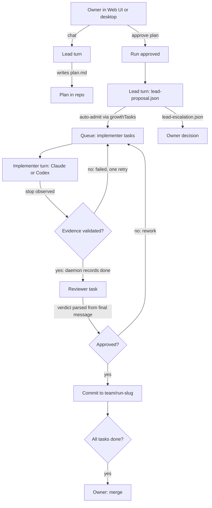

# Autonomous Engineering Team - Plan

## Goal Capsule

- **Objective:** Turn the shipped multi-agent MVP into a team the owner can use on their own repositories. The owner acts as the board and the lead agent as the manager: they agree the plan in a chat, the team delivers it, and only big problems and the final merge come back to the owner.
- **Approach:** Reuse what the MVP built: the run, the queue, candidate trees, the review loop, the lead proposal file and the completion sweep. Remove the owner from every step except plan approval, escalations and merge, add Codex as a first-class client, and rebuild the Web UI around a lead chat with readable names.
- **Authority:** The owner's 2026-11-05 decisions in the Product Contract govern. The old plan (`docs/plans/2026-10-13-001-feat-multi-agent-team-plan.md`, partially shipped) and `docs/amendments/` stay the record of the MVP. This plan supersedes their rule that the owner observes every task outcome (R18).
- **Decision focus:** What the lead may decide alone (KTD1). How agents finish work without the owner (KTD3, KTD4). How finished work reaches the owner's repository (KTD7).
- **Verification focus:** Focused tests and a demo per unit, smoke CI on every PR, the full daemon suite once at wrap-up, and one live acceptance run where the owner only chats, approves the plan and merges.
- **Largest risk:** Automatic completion records work as done that is wrong. Mitigation: completion still requires the daemon's own validated evidence and an independent review. The owner reviews the integration branch once before merging.
- **Stop conditions:** A change that would let an agent merge into the owner's branch or approve its own plan. A client that can't run headless with the owner's local configuration. A P0/P1 that survives its review rounds.
- **Execution profile:** Small slices, each one branch and one PR, run by subagents and Codex workers in `~/scratch/<slice>/worktree`. The orchestrator reviews and lands each slice with smoke CI green.

---

## Product Contract

### Summary

The owner opens the Web UI or the desktop app, picks a repository, and talks with the lead to form a plan. Once the owner approves the plan, the lead breaks it into tasks, implementers and reviewers on Claude Code and Codex carry them out, and every reviewed task lands on one integration branch. The lead handles small changes and stuck work itself. The owner hears back only when a decision is beyond the team, and when the branch is ready to merge.

### Problem Frame

The MVP proved the loop with real agents, but it needs the owner at every step: marking each task done, deciding each lead proposal, copying reviewer findings into files, and unblocking stuck runs by hand. Teams can only be created by demo scripts writing database rows. Codex can't run a managed turn. Finished work can't be read after a daemon restart. The UI shows raw ids such as `task-1-review-1` and run UUIDs. The owner wants to use the system on other projects and can't yet.

### Requirements

**Team and clients**
- R1. The owner creates a team for any local git repository from the Web UI, the desktop app or the CLI, choosing each seat's role (lead, implementer, reviewer) and client (Claude Code or Codex). No seed script is involved.
- R2. Every agent runs its own native CLI with the owner's local configuration (`~/.claude`, `~/.codex`). The daemon adds nothing beyond per-launch flags.
- R3. Codex runs managed turns the way Claude Code does: one headless turn per attempt, with resume.

**Owner and lead**
- R4. The owner and the lead form the plan in a chat panel in the Web UI. The desktop app wraps the Web UI, so it gets the same panel. The owner approves the plan once, and that starts the run.
- R5. After approval the lead breaks the plan into tasks, assigns seats and decides small out-of-plan changes without asking the owner.
- R6. The owner decides only: plan approval, escalations the team can't resolve (a spec conflict, exhausted budgets, a failed merge), and the final merge.
- R7. The owner can also create a task directly from the Web UI or the desktop app.

**Autonomous delivery**
- R8. A task completes automatically when the daemon's evidence check validates it. A reviewer's verdict is recorded automatically from the reviewer's own report.
- R9. Retries, rework and recovery from stuck states happen without the owner, within the run's budgets. A state the team can't recover reaches the owner as one escalation from the lead.
- R10. Each approved task lands as a commit on one integration branch per run in the owner's repository. The owner's checkout and base branch are untouched until the owner merges.
- R11. Finished work stays diffable and mergeable across a daemon restart.

**Presentation**
- R12. The UI shows readable names for runs, tasks and agents. Internal ids never appear on screen.
- R13. The Web UI is redesigned with the `oil-ui` design skill. It keeps zh-CN and English, follows the UI copy rule in `docs/development-standards.md` section 9, and works at desktop and mobile widths.

**Simplicity**
- R14. Isolation is light: a git worktree per task plus each client's own sandbox, with no separate OS accounts and no bubblewrap.

### Scope Boundaries

- Out: hardened isolation (T038 stays parked), token and cost accounting, multiple machines, the TUI, and memory shared across runs.
- Out: agents merging into the owner's branch, or approving their own plan.
- Deferred: running the lead on Codex is allowed by the setup form, but acceptance proves only a Claude Code lead.

---

## Planning Contract

### Key Technical Decisions

- KTD1. **The owner is the board; the lead is the manager.** The lead decides alone: the task breakdown, seat assignment, rework routing, a follow-up task after an exhausted review, and changes that stay inside the approved plan's goal and repository. The owner decides: plan approval, a change to the goal or write scope, a budget increase, an unresolvable spec conflict, and the merge. (session-settled: user-directed — chosen over per-step owner approval: "I'm like a company director, I can't be asked about everything.")
- KTD2. **The lead talks through files and its final message, with no new agent API.** The lead keeps the C3 protocol: it writes `lead-proposal.json` and, new here, `lead-escalation.json` in its own tree. The daemon reads both at turn end through `readWorkspacePath`. A lead proposal is admitted at once, without an owner approval, and is still validated by `growthTasks` against the approved binding. Escalations become owner decisions. Posture: `extend` (`lead-proposal.ts`, `proposeLeadTasks`/`applyLeadProposal`). A lead CLI with a scoped worker token was rejected: the file protocol already exists and is proven, and a token adds a credential surface for no new capability.
- KTD3. **The daemon records outcomes as their own observer.** `attempt-completion.ts` records the outcome right after it records the stop, for implementer and lead tasks, using the existing evidence functions in `task-completion.ts`. It records under a daemon actor, `observedBy: "daemon"`. Validated evidence records `done`. Anything else records `failed` with the classifier's code, which routes to one retry and then to the lead. `recordTaskOutcome` accepts the daemon actor alongside the owner. This supersedes R18 of the old plan. Every task still has the daemon's evidence check, and every implementer task still has an independent review.
- KTD4. **Reviewer verdicts are parsed from the reviewer's final message.** The reviewer charter already asks for a JSON findings block. The daemon extracts the last such block from the turn's final output: Claude's stream-json `result`, or Codex's `--output-last-message` file. It feeds that block through the existing `parseFindings`. A missing or malformed block is a failed attempt, which gets one retry, not an owner task.
- KTD5. **Codex gets a one-turn path that mirrors Claude's.** `nativeArgs` for `codex` builds `codex exec --json -o <last-message-file>` with the prompt on stdin, and `codex exec resume <thread>` for a continuation. The sandbox is `workspace-write`, with network on and the candidate tree as the workspace. The thread id comes from the first `thread.started` event. `--effort` maps to `-c model_reasoning_effort=…`. The binary comes from the PATH the daemon gives the pane, with `/opt/multi-agent/toolchain/clients/bin` added to it.
- KTD6. **The owner's local configuration is used as-is.** No launch overrides `CODEX_HOME` or Claude's config directory. The setup form's per-seat model is the only per-launch setting. (session-settled: user-directed — "all CLI configuration uses my local configuration.")
- KTD7. **Delivery goes to an integration branch.** When a task's review approves, the daemon applies its patch in a daemon-owned worktree of the owner's repository on branch `team/<run-slug>`, and commits it with the task's display name. The owner's merge is one action. It fast-forwards when it can, otherwise it makes a merge commit. It refuses a dirty checkout or a conflict, and then the lead creates a conflict-resolution task. (session-settled: user-approved — chosen over committing to the current branch or patch-only.)
- KTD8. **Names for display, ids for storage.** Each run gets a display name from its goal, each task from its title, and each seat from its role and client ("Reviewer · Codex"). Duplicates get a numeric suffix. Ids stay in the database, the URLs and the logs, and the UI never renders them. Posture: `new` small module plus one migration, because no current owner stores display names.
- KTD9. **Recovery is automatic within budgets, with one owner escape hatch.**
  - The daemon counts automatic outcomes as progress for the lead-wake guard.
  - It renews the implementation approval while the run is active, instead of letting the 24-hour window lapse.
  - It sends "review limit exhausted" to the lead as an event, and the lead escalates or adds a follow-up task.
  - Every blocked run shows one owner action, "Resume", which clears the block reason once and lets dispatch try again.
  - Candidate reads re-adopt from disk whatever the run state is (R11).
- KTD10. **Light isolation.** Each task keeps its own candidate worktree. Claude runs with `bypassPermissions`, confined to the tree by the daemon's existing scope check. Codex runs in its `workspace-write` sandbox. There are no new accounts, containers or launcher. (session-settled: user-directed — "don't over-defend.")
- KTD11. **The UI redesign follows the `oil-ui` skill on the existing stack** (React, Tailwind, Radix, `skins/shuimo-danqing`). The lead chat becomes the home screen of a run. Tasks, reviews and the integration branch are secondary views. The copy rule in `docs/development-standards.md` section 9 applies: structure explains, and there is no helper copy.

### High-Level Technical Design

### Implementation Constraints

- Each new migration sorts after 110 and goes into `migrationsForFullTestDb` in `engine/packages/daemon/test/helpers/test-app.ts`. Each new `updateWithinTransaction` call goes into the P34 `SANCTIONED` list. Smoke CI checks neither, so each unit's focused tests must include both guards.
- Units that touch `plan-governance.ts` land one at a time. Whichever lands second rebases and reruns its focused tests.
- No new route outside `/api/team-control`: the managed-mode allowlist stays as it is.

### Assumptions

- The relay serving the owner's Codex configuration has capacity for several concurrent turns. It returned 502 "high demand" for `gpt-6-astra` on 2026-11-05, so runs should not depend on one model.

### Sequencing

| Wave | Units | Notes |
|---|---|---|
| A | U1, U2, U3, U9 | Independent. U2 is already in progress. |
| B | U4, U5 | U4 needs U1 for Codex verdicts. U5 needs U3. |
| C | U6, U7, U8 | Each touches `plan-governance.ts`; they land one at a time. |
| D | U10 | Design exploration starts in wave A; implementation follows the APIs. |
| E | U11 | Acceptance run, docs and the full suite. |

Reserved migration numbers: U2 111 (only if needed), U9 112, U5 113, U7 114.

### Evidence & Limitations

- The code facts come from a read of `origin/main` at `c9a58f9`, the commit before this plan's parent `636d58b` (a docs-only change). Key refs:
  - the managed allowlist, `MANAGED_ROUTE_PREFIXES` in `engine/packages/daemon/src/server.ts`;
  - the owner-only outcome gate, `recordTaskOutcome` in `engine/packages/daemon/src/domain/plan-governance.ts`;
  - the post-stop hook in `engine/packages/daemon/src/domain/attempt-completion.ts`;
  - candidate re-adoption gated on `run.state === "approved"` in `engine/packages/daemon/src/domain/workflow-runtime.ts`;
  - the interactive Codex `nativeArgs` in `engine/packages/daemon/src/adapters/direct-worker-launch.ts`;
  - raw ids rendered in `engine/packages/ui/src/team/*.tsx`.
- Codex headless turns, resume and the owner's ported configuration were proven by hand on 2026-11-05 (`codex exec` returned a reply; `codex exec resume` continued a session). The daemon has not run them yet.

---

## Implementation Units

| U-ID | Title | Key files | Depends on |
|---|---|---|---|
| U1 | Codex one-turn path | `adapters/direct-worker-launch.ts`, `assets/agent-turn-view.mjs` | — |
| U2 | Finished work survives a restart | `domain/workflow-runtime.ts`, `routes/team-result.ts` | — |
| U3 | Team setup for any repository | `routes/team-setup.ts` (new), `cli/src/commands/team.ts` | — |
| U4 | Daemon-recorded outcomes and verdicts | `domain/attempt-completion.ts`, `domain/plan-governance.ts`, `domain/review-loop.ts` | U1 |
| U5 | Lead chat and plan approval | `routes/team-lead.ts`, `domain/lead-chat.ts` (new) | U3 |
| U6 | Lead as manager | `domain/lead-proposal.ts`, `domain/lead-wake-policy.ts`, `domain/plan-governance.ts` | U4, U5 |
| U7 | Integration branch and merge | `domain/integration-branch.ts` (new), `routes/team-merge.ts` (new) | U4 |
| U8 | Automatic recovery and Resume | `domain/plan-governance.ts`, `domain/task-dispatch.ts`, `domain/lead-wake-policy.ts` | U4 |
| U9 | Display names | `domain/display-names.ts` (new), migration 112 | — |
| U10 | Web UI redesign | `engine/packages/ui/src/team/**`, `engine/packages/i18n/src/catalogs/*.json` | U3, U5, U9 |
| U11 | Acceptance run and wrap-up | `docs/validation/`, `docs/operations.md`, `README.md` | all |

Paths under `domain/`, `adapters/` and `routes/` are relative to `engine/packages/daemon/src/`.

### U1. Codex one-turn path

- **Goal:** A managed Codex attempt is one headless turn that exits by itself, and a continuation resumes the same thread.
- **Requirements:** R2, R3; KTD5, KTD6.
- **Files:** `engine/packages/daemon/src/adapters/direct-worker-launch.ts`, `engine/packages/daemon/assets/agent-turn-view.mjs`, `engine/packages/daemon/src/domain/attempt-completion.ts`, `engine/packages/daemon/test/direct-worker-launch.test.ts`, `engine/demo/team/scripts/codex-turn-demo.ts` (new).
- **Approach:**
  - Replace the interactive Codex argv with `codex exec --json -o <attempt dir>/last-message.txt`, with the prompt on stdin, the candidate tree as `-C`, the sandbox `workspace-write` with network on, and `-c model_reasoning_effort=` in place of `--effort`.
  - A continuation uses `codex exec resume <thread>`. The thread id is read from the first `thread.started` event and stored as the seat's resume token, the same slot Claude's session id uses.
  - The pane wrapper keeps the exit code, as it does for Claude.
  - Binary resolution adds `/opt/multi-agent/toolchain/clients/bin` to the pane PATH.
- **Patterns to follow:** the Claude branch of `nativeArgs` and its `agent-turn-view.mjs` wrapper (PR #116).
- **Test scenarios:**
  - A first attempt for a `codex` seat builds `exec --json -o …` with stdin input and no `--effort` flag.
  - A continuation with a stored thread id builds `exec resume <thread>`.
  - A hostile resume token (whitespace, leading dash) is refused, matching the Claude guard.
  - Integration, with a stub `codex` that prints `thread.started` and exits 0: the sweep records the stop and the resume token.
- **Verification:** the focused tests pass. `codex-turn-demo.ts` runs one real Codex turn on a throwaway repo through a managed daemon, and the attempt is observed `stopped`.

### U2. Finished work survives a restart

- **Goal:** `rig team diff` and `rig team apply` work for a finished task after a daemon restart, whatever state the run is in.
- **Requirements:** R11; KTD9.
- **Files:** `engine/packages/daemon/src/domain/workflow-runtime.ts`, `engine/packages/daemon/src/routes/team-result.ts`, `engine/packages/daemon/test/team-result.test.ts`.
- **Approach:** read-only candidate reads re-adopt an intact on-disk candidate through `adoptCandidate` without the `approved` gate. Writes keep the gate. A migration is added only if re-adoption lacks a fact (number 111).
- **Test scenarios:**
  - A finished task in a `blocked` run, with the in-memory maps cleared, returns its manifest and patch.
  - A candidate tree changed on disk after the record is refused with a named reason.
  - A new attempt staging into a non-approved run is still refused.
- **Verification:** the focused test fails without the fix, as shown by reverting it, and passes with it.

### U3. Team setup for any repository

- **Goal:** The owner creates a team (a rig with lead, implementer and reviewer seats) for any local git repository, through the managed daemon.
- **Requirements:** R1, R2; KTD6, KTD8.
- **Files:** `engine/packages/daemon/src/routes/team-setup.ts` (new, mounted under `/api/team-control`), `engine/packages/daemon/src/server.ts`, `engine/packages/cli/src/commands/team.ts`, `engine/packages/daemon/test/team-setup.test.ts`, `engine/packages/cli/test/team-setup.test.ts`.
- **Approach:**
  - `POST /api/team-control/teams` takes a repository path and seat list (role, client, optional model). It creates the rig, nodes and sessions with `RigRepository.createRig`, `addNode` and `SessionRegistry.registerSession`, exactly as the demo seeds do, with the seat names derived from the role and the rig. `GET` lists the teams.
  - Refuse a path that is not a git repository with at least one commit, and refuse a second team on the same repository root.
  - Under `workers.isolation: none` nothing is launched at setup: the first start launches seats, as it does today.
  - The CLI is `rig team create <repo> [--lead claude] [--implementers codex,codex] [--reviewer claude]`. The defaults are one Claude lead, two implementers (Claude and Codex) and one reviewer.
  - The demo seed scripts call the same domain function, so the demos keep working.
- **Patterns to follow:** `engine/demo/team/scripts/acceptance-rework-seed.ts` `seedSeats`; owner-only auth as in `routes/team-start.ts`.
- **Test scenarios:**
  - A valid repository creates one rig with the requested seats and returns their display names.
  - A non-repository path, a repository with no commit, and a duplicate root are each refused with a named reason.
  - A worker token is refused, so the route is owner-only.
  - Integration: `rig team create` followed by `rig team start` launches on the created seats, with a stub client.
- **Verification:** focused daemon and CLI tests pass. `rig team create` works on a scratch repository against a managed daemon with no seed script.

### U4. Daemon-recorded outcomes and verdicts

- **Goal:** Tasks complete without the owner: the daemon records each implementer and lead outcome from its own evidence, and each reviewer verdict from the reviewer's report.
- **Requirements:** R8, R9; KTD3, KTD4.
- **Files:** `engine/packages/daemon/src/domain/attempt-completion.ts`, `engine/packages/daemon/src/domain/plan-governance.ts`, `engine/packages/daemon/src/domain/task-completion.ts`, `engine/packages/daemon/src/domain/review-loop.ts`, `engine/packages/daemon/test/attempt-completion.test.ts`, `engine/packages/daemon/test/review-loop.test.ts`, `engine/demo/team/scripts/review-demo.ts`.
- **Approach:**
  - After the sweep records a stop, it computes the evidence with `taskCompletionEvidence` or `leadCompletionEvidence` and records the outcome through `recordTaskOutcome` with a daemon actor. `recordTaskOutcome` accepts the owner or the daemon.
  - For a reviewer, the sweep reads the turn's final message: the Claude stream-json `result`, or the Codex `last-message.txt` from U1. It extracts the last JSON findings block and records `done` with those findings, which runs the existing approve or rework path.
  - Invalid evidence, or a missing or malformed findings block, records `failed` with a classifier code, so the existing retry applies.
  - Owner `rig team done` and "Mark done" stay as overrides.
- **Execution note:** start with a failing integration test. A stub implementer exits, then a stub reviewer exits with a findings block, and the run reaches an approved review with no owner call.
- **Test scenarios:**
  - A validated implementer stop records `done` with `observedBy: "daemon"` and creates the review task.
  - An implementer stop that moves a path outside the assignment records `failed` and no review.
  - A reviewer final message with a cited P1 reopens the implementer task. One with only P2/P3 findings approves.
  - A reviewer message with no JSON block records `failed` and triggers one retry. A second failure escalates to the lead (U6) or, before U6 lands, blocks with a named reason.
  - A replayed sweep records nothing twice.
  - The P34 guard and migration fixture tests still pass.
- **Verification:** `review-demo.ts` runs end to end with no hand-recorded outcome, and the focused tests pass.

### U5. Lead chat and plan approval

- **Goal:** The owner and the lead form the plan in a conversation, and approving it starts the run.
- **Requirements:** R4, R6; KTD1, KTD2.
- **Files:** `engine/packages/daemon/src/domain/lead-chat.ts` (new), `engine/packages/daemon/src/routes/team-lead.ts`, `engine/packages/daemon/src/routes/team-start.ts`, `engine/packages/daemon/src/db/migrations/113_lead_chat.ts` (new), `engine/packages/daemon/test/lead-chat.test.ts`.
- **Approach:**
  - A run can start in a `planning` state with only a goal and a team: migration 113 adds the state and a chat message table keyed by run.
  - Each owner message is stored, then starts one lead turn that resumes the lead's session, with the message in the prompt. The lead's final message is stored as its reply.
  - In planning the lead may write only `plan.md` in its candidate tree. `POST …/plan/approve` reads that file through `readWorkspacePath`, binds the run to it with the existing `bindingForGoal` path, records the implementation approval, and moves the run to `approved`.
  - After approval the same chat carries the lead's status messages and escalations (U6).
  - A start with a goal but no chat keeps today's behaviour.
- **Patterns to follow:** `routes/team-lead.ts` proposal read/decide; C3's lead activation and roster in `domain/lead-proposal.ts`; durable chat storage in the existing chat owner (`chat_messages`).
- **Test scenarios:**
  - An owner message starts exactly one lead turn, and a second message while the turn runs is queued, not doubled.
  - The lead's reply is stored and listed in order.
  - Approval with no `plan.md` is refused. Approval with one binds the run and records the approval.
  - A lead write outside `plan.md` during planning is refused by the scope check.
  - Restart during a planning turn: after restart the chat lists every message, and the next owner message resumes the same lead session.
- **Verification:** focused tests pass. A demo with a stub lead goes through chat, plan written, approval and run approved.

### U6. Lead as manager

- **Goal:** After plan approval the lead runs the team. Its task breakdown is admitted without the owner, and only real escalations reach the owner.
- **Requirements:** R5, R6, R9; KTD1, KTD2.
- **Files:** `engine/packages/daemon/src/domain/lead-proposal.ts`, `engine/packages/daemon/src/domain/plan-governance.ts`, `engine/packages/daemon/src/domain/lead-wake-policy.ts`, `engine/packages/daemon/src/routes/team-lead.ts`, `engine/packages/daemon/test/lead-manager.test.ts`, `engine/demo/team/scripts/lead-demo.ts`.
- **Approach:**
  - At the lead's turn end, a valid `lead-proposal.json` is admitted at once through `growthTasks`/`admitTask` against the approved binding, with no approval row.
  - A proposal that needs a wider write scope or a new goal is refused, and the refusal is sent back to the lead as its next prompt. The lead can then shrink the change or escalate.
  - `lead-escalation.json` (a question plus two to four options) becomes one owner decision shown in the chat. The owner's answer is the lead's next prompt.
  - The daemon wakes the lead with a short event prompt on: a task failed after its retry, a review limit exhausted, a merge conflict (U7), or all tasks done. The lead-wake guard counts daemon-recorded outcomes as progress.
- **Test scenarios:**
  - A valid proposal admits its tasks with no approval row, and they dispatch.
  - A proposal naming a path outside the binding is refused and reopens the lead with the reason.
  - An escalation file creates one owner decision. Answering it resumes the lead with the answer.
  - Two daemon-recorded outcomes between lead wakes do not trip `lead-wake:cycles`. Two wakes with no outcome still do.
  - An exhausted review on one task wakes the lead once, not once per sweep.
- **Verification:** `lead-demo.ts` runs from approval to all tasks done with no owner call besides plan approval.

### U7. Integration branch and merge

- **Goal:** Every approved task lands as a commit on `team/<run-slug>`, and the owner merges once.
- **Requirements:** R10; KTD7.
- **Files:** `engine/packages/daemon/src/domain/integration-branch.ts` (new), `engine/packages/daemon/src/routes/team-merge.ts` (new, under `/api/team-control`), `engine/packages/daemon/src/domain/plan-governance.ts`, `engine/packages/daemon/src/db/migrations/114_integration_branch.ts` (new), `engine/packages/cli/src/commands/team.ts`, `engine/packages/daemon/test/integration-branch.test.ts`.
- **Approach:**
  - On the run's first approved review, create a daemon-owned worktree of the owner's repository at the run's base commit, on `team/<run-slug>`. Migration 114 records its path and branch on the run.
  - Each approved task's patch, from the candidate's own manifest and patch (as `rig team apply` uses), is applied with `git apply --3way` and committed with the task's display name.
  - Later tasks in the run use the integration branch head as their base, so they build on earlier work.
  - A failed apply marks the task `conflict` and wakes the lead (U6), which creates a resolution task based on the branch head.
  - `POST …/merge` (CLI: `rig team merge <run>`) refuses a dirty owner checkout. It fast-forwards the owner's current branch when possible, otherwise it creates one merge commit, and it reports a conflict without changing anything.
- **Patterns to follow:** the `rig team apply` patch path in `engine/packages/cli/src/commands/team.ts`; the plain-git-over-a-copy rule from T054 (`docs/amendments/` and `engine/packages/daemon/src/domain/workflow-runtime.ts`).
- **Test scenarios:**
  - Two approved tasks produce two commits on the branch, in approval order, and the owner's checkout is unchanged.
  - A second task whose patch conflicts with the first is marked `conflict` and wakes the lead.
  - Merge into a clean checkout fast-forwards. Merge into a dirty checkout is refused. A diverged base produces one merge commit.
  - Restart between two approvals: the branch and worktree are found again from the run record.
- **Verification:** focused tests pass, and a stub-runner demo ends with `rig team merge` landing two commits in a scratch repository.

### U8. Automatic recovery and Resume

- **Goal:** No run stays stuck silently. The team recovers what it can, and the owner has one Resume action for the rest.
- **Requirements:** R9; KTD9.
- **Files:** `engine/packages/daemon/src/domain/plan-governance.ts`, `engine/packages/daemon/src/domain/task-dispatch.ts`, `engine/packages/daemon/src/domain/lead-wake-policy.ts`, `engine/packages/daemon/src/routes/team-control.ts`, `engine/packages/daemon/test/run-recovery.test.ts`.
- **Approach:**
  - Renew the implementation approval while the run is active, instead of letting the 24-hour window close dispatch.
  - Extend seat recovery to `attention_required` seats once per dispatch.
  - Make `resume` apply to any `blocked` run. It clears the block reason, records the owner's resume, and dispatches pending work. A budget block resumes only with a budget increase in the same action.
  - Every block reason is mapped to a short owner-facing label for the UI.
- **Test scenarios:**
  - A run past 24 hours keeps dispatching.
  - A `lead-wake:cycles` run resumes and dispatches its pending task.
  - A `review limit exhausted` run resumes after the lead adds a follow-up task.
  - A wall-clock budget block refuses a plain resume, and resumes with an increase.
  - An `attention_required` seat is recovered once, then reported.
- **Verification:** focused tests pass. Every block reason in `plan-governance.ts` has a test that ends in a running or escalated run.

### U9. Display names

- **Goal:** Every run, task and seat has a readable name. Ids stay internal.
- **Requirements:** R12; KTD8.
- **Files:** `engine/packages/daemon/src/domain/display-names.ts` (new), `engine/packages/daemon/src/db/migrations/112_display_names.ts` (new), `engine/packages/daemon/src/domain/owner-read-model.ts` (or the current owner read projection), `engine/packages/daemon/test/display-names.test.ts`.
- **Approach:**
  - Migration 112 adds a `display_name` to runs and tasks. Names are derived at creation:
    - a run from its goal, trimmed to a short title;
    - a task from its title or the first line of its body;
    - a reviewer task as "Review: <task name>";
    - a seat from its role and client ("Implementer · Codex"), with a number when the role repeats.
  - The owner read model exposes the names next to the ids, so the UI can drop the ids.
  - Rows created before the migration get names on read.
- **Test scenarios:**
  - A long goal yields a short name without a cut-off word.
  - Two implementers on Codex are "Implementer · Codex 1" and "… 2".
  - A review task of "Add titleCase" is "Review: Add titleCase".
  - An old row with no stored name gets one on read.
- **Verification:** focused tests pass. The read model returns a name for every run, task and seat in a demo run.

### U10. Web UI redesign

- **Goal:** A run's home is the lead chat. Teams and tasks are created from the UI, everything is shown by name, and the look comes from one `oil-ui` design direction.
- **Requirements:** R4, R7, R12, R13; KTD11.
- **Files:** `engine/packages/ui/src/team/**` (shell, overview, tasks, reviews, new-task, plus new `chat.tsx` and `team-setup.tsx`), `engine/packages/ui/src/skins/shuimo-danqing/skin.css`, `engine/packages/i18n/src/catalogs/en.json`, `engine/packages/i18n/src/catalogs/zh-CN.json`, `engine/packages/ui/src/team/__tests__/*`.
- **Approach:**
  - Run the `oil-ui` skill on the current screens. It recommends one direction, which the orchestrator accepts or tightens. Then implement it on the existing React, Tailwind and Radix stack.
  - The screens are:
    - **Teams:** list and create (U3).
    - **Run:** the chat with the lead, including plan approval and escalation decisions inline, beside a compact task board that shows names and states.
    - **Task detail:** the diff, review findings and attempts.
    - **Integration branch:** commits and the Merge action (U7).
  - Remove every raw id from rendered text, taking names from U9. The internal ids stay in URLs and keys.
  - Remove the CLI-command copy from the result panel.
- **Execution note:** design first, with screenshots at desktop and mobile widths reviewed before implementation. After implementation, a real-screen review in a running daemon.
- **Test scenarios:**
  - The chat renders owner and lead messages in order. The approve-plan action appears only when the lead has written a plan. An escalation renders its options as buttons and sends the chosen one.
  - The team setup form submits seats and shows the created team by name, and refuses a non-repository path with the daemon's reason.
  - No rendered text in any team screen matches a UUID or a `task-\d+` id. This is enforced by a test over the rendered DOM.
  - zh-CN and English both render every new string, checked by the i18n tests.
  - Mobile width: chat and task board stack without horizontal scroll.
- **Verification:** UI tests and i18n tests pass. Screenshots of each screen at 1440 and 390 width are reviewed against the `oil-ui` direction.

### U11. Acceptance run and wrap-up

- **Goal:** Prove the whole loop live, and leave the docs matching the product.
- **Requirements:** all.
- **Files:** `docs/validation/2026-11-xx-autonomous-team/` (new bundle), `docs/operations.md`, `README.md`, `desktop/README.md`.
- **Approach:**
  - One live run on a fresh demo repository:
    - The team is created in the UI: a Claude Code lead, a Claude Code implementer, a Codex implementer and a reviewer.
    - The owner forms the plan in the chat and approves it.
    - The team delivers at least two tasks. One goes through rework if a review asks for it, and nothing is planted to force it.
    - The daemon is restarted mid-run.
    - The owner merges the integration branch.
  - Count and record every owner action.
  - Then update the docs, and run the full daemon suite once.
- **Test scenarios:** Test expectation: none -- this unit is evidence and docs. It runs the suites below and records the live run.
- **Verification:**
  - The bundle records the event export, the chat transcript, the integration branch log and the owner action count.
  - The only owner actions are chat messages, plan approval, any escalation answers, and the merge.

---

## Verification Contract

| Gate | Command | When |
|---|---|---|
| Focused daemon tests | `npx vitest run <files>` in `engine/packages/daemon` | Every unit |
| Focused CLI tests | `npm run test -w packages/cli -- <files>` in `engine/` | U3, U7 |
| UI and i18n tests | `npm run test -w packages/ui`, `npm run test -w packages/i18n` in `engine/` | U9, U10 |
| Migration and P34 guards | `npx vitest run test/migration-fixture-parity.test.ts test/p34-call-site-allowlist.test.ts` | Every unit that adds a migration or a queue writer |
| Smoke | `npm run smoke` in `engine/`, plus smoke CI on the PR | Every PR |
| Full daemon suite | per `docs/operations.md` "Full daemon suite" | Once, in U11 |
| Live acceptance | U11 run | Once |

- Each fix that claims a failing-before test shows it failing with the fix reverted.
- Each UI unit includes screenshots at 1440 and 390 width, taken in a running daemon.
- Known environment failures do not count against a unit: HG-4 DNS (`auth-bearer-token.test.ts`) and `seat-fresh-launch.test.ts`, both failing before this plan.

## Definition of Done

- Every unit's verification holds, and each unit landed as its own PR with smoke CI green.
- The U11 live run shows the owner creating the team, chatting, approving the plan and merging, and doing nothing else except answering escalations.
- A fresh clone can follow `README.md` to create a team for its own repository with no seed script.
- The full daemon suite has no failure beyond the two known environment failures.
- No abandoned code from discarded approaches remains in the diff. Demo seed scripts call the same setup function as the product.
