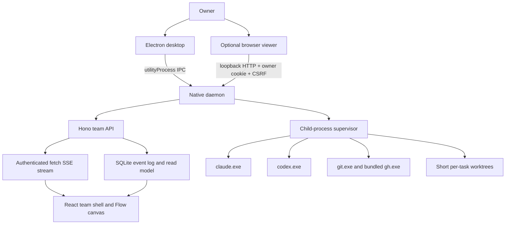
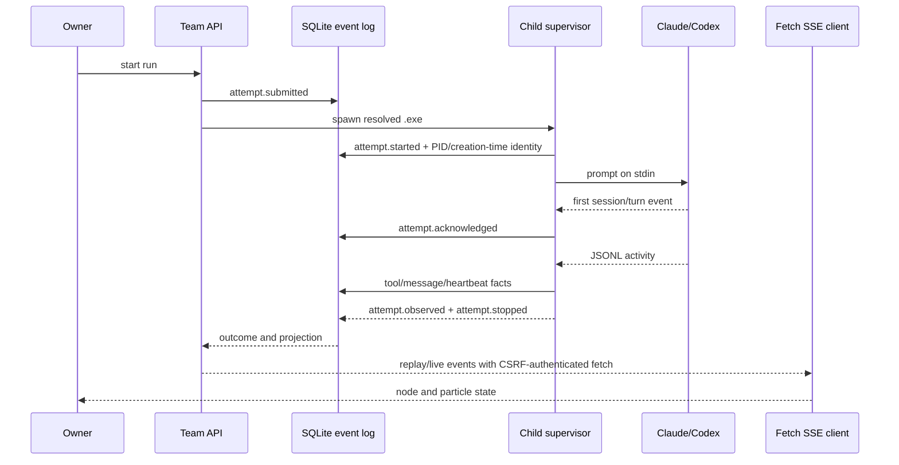
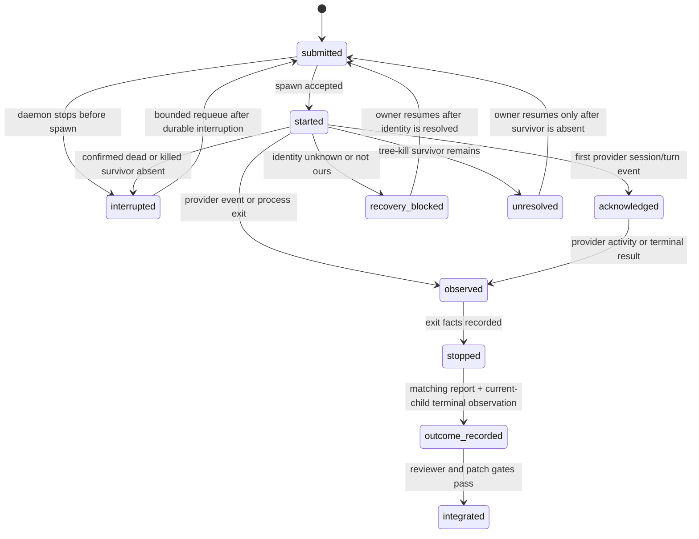

# Windows-Native Desktop - Plan

## Goal Capsule

- **Objective:** Ship Multi-Agent as a native Windows desktop application that owns its local engine, runs Claude Code and Codex as direct child processes, and lets an owner create a team, watch real work, and receive the result without WSL or tmux.
- **Approach:** Build the native execution path beside the current path, move the desktop to an Electron-owned daemon, cut the old wiring, delete the inherited OpenRig surface, then rename the remaining product and finish the Flow view, installer, and clean-profile acceptance.
- **Authority:** The owner decisions dated 2026-11-09 in this Product Contract govern product behavior. Existing team contracts and the current event log govern compatibility until a unit replaces them. The current UI amendment governs command-center layout and motion.
- **Decision focus:** Child-process supervision and restart recovery, Electron hosting and authentication, the fresh schema boundary, Windows path and GitHub behavior, the SSE-to-Flow contract, and the deletion order that keeps `main` usable.
- **Verification focus:** Focused Vitest or Node tests, touched-package typechecks, `npm run smoke` on Linux and Windows, a native Windows run with a stub agent, an unsigned NSIS install smoke, and a clean-profile acceptance pass.
- **Largest risk:** A worker can outlive or lose its daemon without a pane that can be reattached. The plan records process identity, treats unknown liveness as unknown, kills confirmed survivors, and requeues only from durable facts.
- **Stop conditions:** A unit needs a new public contract or a new isolation architecture, the same fix fails twice, native recovery remains unmeasured after 30 minutes of Windows probing, or a P0/P1 remains after its review round.
- **Execution profile:** One small unit per PR, with Windows workers handling Electron, process, packaging, and installer work and Linux/WSL workers handling engine deletion, renames, and OS-neutral tests. Every unit leaves `main` green until the native desktop cutover.
- **Tail ownership:** U17 owns the Flow renderer, U18 owns the installer artifact and retention proof, U23 owns two-OS CI and smoke accounting, and U19 owns clean-profile acceptance, README quick start, and residual documentation.

---

## Product Contract

### Summary

Multi-Agent is a local team workspace for an owner who assigns a goal to a small set of Claude Code and Codex workers. The Windows desktop starts the engine, creates or opens a local project, starts a run, shows live task evidence, and exposes the resulting diff and merge action. The same HTTP API remains available to a small `multi-agent` CLI and to an optional authenticated browser viewer. The shipped target is native Windows; the engine remains portable because its worker host uses ordinary child processes and platform-specific process termination.

### Problem Frame

The desktop currently finds WSL, starts a bash script, pairs through a WSL helper, and assumes a fixed daemon port. The daemon starts each headless turn by typing a command into a tmux pane, reads pane state for exit and liveness, and carries POSIX path, uid, mode, shell, and `/proc` assumptions through the team path. The UI polls a durable event log even though the daemon already serves replayable SSE. The repository still carries the inherited OpenRig TUI, gateways, topology screens, terminal surfaces, CLI verbs, migrations, names, and data paths. GitHub setup can create a remote and then lose the push error, bootstrap can read every file into memory and hash one file at a time, and Windows paths are rejected before native execution can begin.

### Requirements

**Native execution and lifecycle**

- R1. The shipped desktop runs the daemon natively on Windows with no WSL, tmux, bash, or Linux installer dependency.
- R2. Each Claude or Codex turn runs as a direct child process with piped stdin, stdout, and stderr, and the daemon emits one normalized event vocabulary for both clients.
- R3. The supervisor resolves and spawns the real `.exe` with `shell: false`, accepts one prompt on stdin, parses bounded JSONL output, records provider session and process facts, and kills the entire process tree on cancellation and shutdown.
- R4. A running turn has durable submitted, started, acknowledged, observed, stopped, and outcome facts. Acknowledgment means the first provider session or turn event. A daemon restart never fabricates completion from an unobserved process, stale report, or ambiguous identity.
- R5. A seat remains a durable role identity while its process is a replaceable occupant with `resolved`, `none`, or `ambiguous` truth.
- R6. The default worker posture is light isolation: one Git worktree per task, Codex under `workspace-write`, and Claude implementers under `bypassPermissions` with the task worktree as their working directory. Native Windows Claude Code has no sandbox, so a Claude worker can reach files outside its worktree; the documentation states this. Reviewers keep the read-only posture (`plan` mode and read tools for Claude, `read-only` for Codex). No sandbox, account, or container is added.

**Desktop, backend, and authentication**

- R7. Electron starts and stops the daemon itself through a crash-isolated child process, receives its loopback origin dynamically, and keeps one engine per user session.
- R8. The daemon binds only to loopback on an OS-assigned port, reports readiness through the desktop bridge, and serves the same UI to Electron and an optional authenticated browser.
- R9. Desktop and browser pairing use a short, one-time local code that exchanges for the existing HttpOnly owner cookie and CSRF token; credentials do not enter URLs, logs, or persistent settings. The browser boundary and cookie-plus-CSRF rule remain unchanged.
- R10. First run detects Claude Code, Codex, and Git for Windows with the shared executable resolver and explains missing dependencies with their resolved paths when found; the installer bundles `gh.exe`, so GitHub sign-in needs no separate GitHub CLI install.

**Product and interfaces**

- R11. The team UI keeps the command-center shell, readable names, owner actions, task evidence, reviews, integration result, and responsive behavior defined by the command-center amendment.
- R12. Active runs consume the existing replayable SSE stream through a `fetch()` streaming client that sends the `X-Multi-Agent-CSRF` header, reconnects with `Last-Event-ID`, and handles gap events; polling remains only for low-frequency projections that do not need live attention.
- R13. The Flow view maps durable assignment, acknowledgment, tool activity, review, delivery, waiting, and error events to agent nodes and particles. `attempt.started` renders as started, `attempt.acknowledged` renders as acknowledgment, and no-response is shown separately. The view has a visible pause control, keyboard access, and a static reduced-motion mode.
- R14. The `multi-agent` CLI calls the same HTTP API and keeps team create/start/chat/approve/merge, local daemon start/stop lifecycle commands, and GitHub sign-in; a read-only result or diff command may remain where it is required to retrieve a patch.

**Windows paths, Git, and GitHub**

- R15. Repository, worktree, relative-file, and project-browser paths accept Windows separators, drive roots, UNC rules, case-insensitive comparisons, and forward-slash protocol values without string-prefix path bugs.
- R16. Task worktrees use a short configurable root, enforce a measured preflight length ceiling below Git for Windows' observed limit including Git admin-directory headroom, set `core.longpaths=true` for worktree creation, and report a named refusal before creation can fail.
- R17. Project bootstrap checks file size before reading, hashes and stages without one synchronous child process per file, records regular files as `100644` on Windows, preserves supported symlinks as `120000`, and never loads a file over 100 MiB.
- R18. GitHub setup uses the bundled `gh.exe` by default, honors an explicit configured path and proxy settings, retries only the bounded transient `repo view` and `git push` steps, preserves bounded stderr, and creates the team row only after a successful push.
- R19. The initial push authenticates through `gh auth git-credential`, scoped to that one git command, as today. `gh` keeps its own credential store; the application never stores a GitHub token.

**Data, deletion, packaging, and verification**

- R20. The renamed product starts with one fresh team-product schema baseline after every legacy deletion batch and does not read or migrate old `~/.openrig` data.
- R21. The final source tree contains no OpenRig brand, `OPENRIG_*` runtime contract, `rig` CLI product surface, WSL desktop path, tmux worker path, or deleted legacy subsystem wiring.
- R22. CI runs the smoke set on Linux and Windows from a checked-in manifest that classifies every current smoke test as retained, ported, or deleted with a reason. The Windows job also runs an installer smoke with a stub agent in a clean user profile.
- R23. The NSIS installer bundles the daemon and UI, unpacks native modules as required, replaces binaries on upgrade, leaves `%LOCALAPPDATA%\Multi-Agent` and `%APPDATA%\Multi-Agent` user data and recovery records on uninstall, documents the unsigned SmartScreen warning, and does not publish a release.
- R24. README and operations documentation describe native setup, dependency detection, first run, browser viewing, GitHub sign-in, data location, cancellation, recovery, and the light-isolation posture.

### Acceptance Examples

- AE1. **Native first run:** On a clean Windows profile with Git for Windows, Claude Code, and Codex installed, opening the installed app creates a fresh Multi-Agent data directory, starts one daemon child, reports a dynamic loopback URL, and opens `/team` without invoking WSL.
- AE2. **One managed turn:** A stub Claude or Codex executable receives one prompt, emits JSONL, exits zero, writes a task report, and produces ordered `attempt.submitted`, `attempt.started`, `attempt.acknowledged`, worker activity, `attempt.observed`, and `task.outcome` events that the UI receives over authenticated SSE. Completion also requires the current attempt report.
- AE3. **Restart during work:** If the daemon stops after `attempt.started`, startup reconciles the stored process identity. A confirmed live child is tree-killed and recorded as interrupted only after its recorded identity is absent; a stubborn survivor persists as `unresolved`/`recovery_blocked` with the owner reason and is not requeued; a confirmed dead child is recorded as interrupted; an unknown probe blocks recovery with a named reason. No path records success without a terminal worker observation.
- AE4. **GitHub transient failure:** If `gh repo create` succeeds but the first `gh repo view` or push times out, the bounded retry rechecks the remote, preserves stderr in the structured failure, and leaves no normal team row until the push succeeds.
- AE5. **Flow accessibility:** A task assignment creates one bounded particle burst, a tool event creates a local activity pulse, a review verdict creates a reviewer edge event, and delivery creates a final particle. With reduced motion or the visible pause control active, the view stops animation and exposes the same facts as a readable event list.
- AE6. **Installer smoke:** The Windows job installs the NSIS artifact in an isolated profile, opens the app, accepts a stub-agent executable through the test harness, creates a project, completes one run, and verifies that an N+1 upgrade replaces binaries, uninstall removes binaries, and both user data roots retain their recovery records.

### Scope Boundaries

- **In scope:** Native Windows desktop and daemon, portable child-process engine, team API and small CLI, fresh team schema, path and GitHub fixes, SSE-first active UI, Flow view, NSIS packaging, Linux and Windows smoke CI, and documentation for the shipped path.
- **Deferred:** Hardened isolation, account separation, containers, Codex app-server approval flows, multi-host orchestration, token and cost accounting, remote execution, macOS support, and release publication.
- **Outside this product's identity:** TUI, Slack gateway, cmux, topology and mission-control screens, terminal relay, snapshot/restore machinery, seat/rig verbs, inherited package/bundle/discovery/spec frameworks, and their tests.
- **Compatibility boundary:** The WSL desktop and old worker path remain only until U12. No new feature is added to that path. U12 is the deliberate cutover after which WSL and tmux are deleted.
- **Data boundary:** Existing `~/.openrig` or other legacy state is not migrated. A native install starts with an empty Multi-Agent data directory.

### Success Criteria

- A clean Windows user can install the NSIS artifact, start the app without WSL, create a local project, run one stub-agent task, view the live event stream, and inspect the resulting patch.
- A real Claude Code and a real Codex headless turn complete through the same supervisor contract on Windows, with no tmux or PTY dependency.
- A daemon restart test proves the interrupted-turn policy and never reports an unobserved success.
- The focused tests, touched-package typechecks, and `npm run smoke` pass on both operating systems for every merged unit.
- A source scan finds no kept-path dependency on `process.getuid`, `/proc`, POSIX-only worker paths, WSL startup, tmux, or `OPENRIG_*`.
- Active-run UI updates come from SSE replay and live events, reconnect after a gap, and remain understandable with motion disabled or paused.
- GitHub setup records distinct remote-view, push, proxy, and stderr outcomes and leaves no orphaned normal team row after a failed upload.
- The installer is unsigned by design, the SmartScreen warning is documented, and no release publication claim is made.

---

## Planning Contract

### Key Technical Decisions

- KTD1. **Use a pipe-based child-process supervisor, not a PTY.** Claude and Codex already expose headless JSONL modes, so a PTY would add ConPTY lifecycle, screen scraping, and terminal cleanup without adding a product capability. The supervisor writes the prompt to stdin, parses provider events, and keeps a bounded raw tail for diagnostics. ConPTY and `node-pty` stay out unless a measured structured-output gap requires them.
- KTD2. **Use one shared real-executable resolver.** `claude`, `codex`, `gh`, and `git` all resolve through one module. Resolution order is explicit configured path, bundled resource for `gh` only, then PATH probing with `PATHEXT`. The resolver follows npm shims and per-user npm global folders to a real `.exe`, handles spaces, and rejects `.cmd` and `.ps1` as spawn targets. First-run detection calls this same resolver and reports the resolved path. All launches use `shell: false`.
- KTD3. **Use one internal event vocabulary modeled on ACP, with direct provider adapters.** The canonical contract is a small local TypeScript union for session, turn, tool, message, permission, error, heartbeat, and completion facts. Claude stream-json and Codex `exec --json` remain the transports. ACP vocabulary is a pattern-only reference; official ACP packages are not added.
- KTD4. **Treat the event log as the source of truth and derive display status.** Durable facts are `submitted`, `started`, `acknowledged`, provider activity, `observed`, `stopped`, and outcome. `attempt.acknowledged` is recorded at the first provider session or turn event. A delivered message is not acknowledgment, and `attempt.started` is rendered as started. A no-response state remains explicit. Display state is computed from facts at read time.
- KTD5. **Recover by reconciliation with a PID-plus-creation-time witness.** Capture the child PID and process creation time at spawn. On Windows, recovery queries that pair through CIM/WMI. Access denied, query timeout, a missing witness, or a mismatched creation time is `unknown` or `not-ours`, never dead and never an automatic requeue. After `taskkill /T /F`, verify that the recorded identity is absent. If a stubborn child or grandchild remains, persist `unresolved` with `recovery_blocked` evidence and the owner-facing reason; do not requeue. Confirmed absence or a confirmed dead child may record interruption, and only an owner resume or a bounded requeue after durable interruption can submit again.
- KTD6. **Host the daemon in Electron's `utilityProcess.fork`.** The utility process starts after `app.whenReady()`, isolates a daemon crash from the renderer, and reports readiness over a narrow IPC bridge. In-main hosting is rejected because a daemon error would take down the window. Node `fork` is rejected because Electron's utility-process lifecycle is the required crash boundary.
- KTD7. **Bind loopback on port zero and make the desktop origin data-driven.** The daemon binds `127.0.0.1` with an OS-assigned port, sends the final origin to Electron, and never probe-binds a fixed port. Host validation accepts only the current loopback origin. The portable Windows resolver uses `%LOCALAPPDATA%\Multi-Agent` for mutable state and `%APPDATA%\Multi-Agent` for user configuration, with Electron path APIs and a test override as sources of truth.
- KTD8. **Keep the existing owner-session and browser boundary; use fetch-streaming SSE.** The daemon mints a short one-time pairing code. The desktop's “Open in browser” action displays and copies the code, opens the existing browser pairing page, and never places a code or token in a URL. The owner pastes the code into that page, which POSTs it to the existing exchange route. The exchange still yields the HttpOnly owner cookie and CSRF token, and Origin/Host checks remain authoritative. The UI uses `fetch()` with the `X-Multi-Agent-CSRF` header to read the SSE body and reconnect with `Last-Event-ID`; native `EventSource` is not used because it cannot send the required CSRF header.
- KTD9. **Create the fresh schema baseline after legacy deletion.** U13, U20, U21, U22, and U14 remove their source, route, test, and migration consumers first. U10 then writes one baseline transaction containing only the kept team tables, owner sessions, event log, queue, attempts, telemetry, documents, integration, and settings. Fresh databases are verified by introspection; old state is ignored rather than transformed.
- KTD10. **Use one short worktree policy helper.** The Windows default is `%LOCALAPPDATA%\Multi-Agent\wt\short-id`, configurable. The helper owns worktree creation for `plan-branch.ts`, `integration-branch.ts`, and `team-workspace.ts`, passes `-c core.longpaths=true`, and preflights candidate, plan, integration, and Git admin-directory paths with headroom below the measured Git limit. Linux uses `~/.multi-agent/wt`. Protocol paths use `/`; local comparisons use `node:path`, with case folding only on Windows.
- KTD11. **Bundle `gh.exe` and use the shared resolver and tree-kill.** GitHub CLI is MIT-licensed and ships in the installer. The resolver permits an explicit configured path, then the bundled resource, then PATH. The existing device-code sign-in and scoped `gh auth git-credential` push remain. The login child uses the shared tree-kill on stop, timeout, and quit, with post-kill identity verification. A configured proxy is passed to `gh` and `git` and checked once before upload. The installer adds the `gh` license to `NOTICE`.
- KTD12. **Fix bootstrap as one bounded external operation.** Stat every candidate before reading, refuse any file over 100 MiB, use Git's batch path input or an off-event-loop boundary instead of synchronous one-process-per-file hashing, and set Windows file modes explicitly. Create the team row only after the remote exists and the push has succeeded. Bootstrap checkpoints remain recovery records.
- KTD13. **Drive active UI from authenticated SSE and render Flow with Canvas2D.** The existing replay/gap stream is the server contract. A single fetch-streaming client sends the `X-Multi-Agent-CSRF` header, merges replay and live records by sequence, reconnects with `Last-Event-ID`, and feeds the Flow ring buffer. Canvas2D is sufficient for tens of agents and hundreds of bounded particles. A static DOM timeline is the fallback and the reduced-motion representation.
- KTD14. **Cut in a strangler sequence with the schema boundary last.** Build native foundations and parallel API paths first, cut the desktop to native in U12, delete daemon legacy surfaces in U13/U20/U21/U22, delete UI and CLI legacy surfaces in U14, create the fresh baseline in U10, then rename packages, variables, brand, and data paths in U15. U10 depends on every deletion batch and U14; U15 depends on U10. Each pre-cutover unit preserves the current WSL path and focused tests. U12 is the only unit that changes the shipped desktop runtime.
- KTD15. **Keep the CLI thin with local lifecycle exceptions.** `daemon start` and `daemon stop` are local because they must operate when no daemon is ready. Every other command, including `daemon status`, uses HTTP after readiness. `github sign-in` calls the existing login route. Team commands serialize team-control requests and do not grow a second domain implementation.
- KTD16. **Use an unsigned assisted NSIS installer and a two-OS manifest-driven CI gate.** electron-builder packages the UI and daemon, places the bundle and native dependencies under `resources/engine/`, unpacks the required native paths, and installs per user while preserving data on uninstall and upgrade. x64 is the shipped architecture; arm64 is deferred. The CI unit owns the cross-platform runner, checked-in smoke manifest, Windows job, and installer-smoke job that consumes the U18 artifact. Signing, auto-update, and publishing remain outside scope.

### Interface Contracts

| Interface | Consumers | Canonical artifact and owner | Contract decision | Compatibility and verification |
|---|---|---|---|---|
| Worker event vocabulary / greenfield | Supervisor, attempt completion, event log, UI Flow, CLI diagnostics | `engine/packages/daemon/src/contracts/worker-events.ts`, owned by the daemon adapter unit | ACP-shaped session, turn, tool, message, permission, heartbeat, error, completion, and durable `attempt.acknowledged` facts with provider, attempt, sequence, timestamp, and bounded raw summary; unknown provider events remain diagnostic data | Additive tagged union with `protocolVersion`; parser tests cover Claude and Codex fixtures, malformed lines, unknown events, first-session acknowledgment, and no-response |
| Worker launch argv | Child supervisor, provider adapters, stub fixtures, recovery reader | `engine/packages/daemon/src/adapters/direct-worker-launch.ts:283-301`, frozen by U3 | Fresh and continuation matrices preserve provider flags. Claude implementer fresh: `claude -p --permission-mode bypassPermissions --output-format stream-json --verbose --include-partial-messages [--model M] [--effort E] --session-id SID`; Claude reviewer fresh uses `plan`, `--tools Read,Glob,Grep`, and `--strict-mcp-config`. Claude continuation replaces `--session-id` with `--resume SID`. Codex implementer fresh: `codex exec --json -o last-message.txt -C WORKTREE -s workspace-write -c sandbox_workspace_write.network_access=true -c check_for_update_on_startup=false -c sandbox_workspace_write.writable_roots=[REPORT_DIR] [ -m M ] [ -c model_reasoning_effort=E ] -`; Codex reviewer fresh uses `-s read-only -c approval_policy=never` and no writable roots. Codex continuation prefixes `resume`, uses `-o last-message.txt`, `-c sandbox_mode=workspace-write|read-only`, the same approval/update/model settings, appends SID, and ends with `-`. Claude `-p` consumes the prompt from stdin; Codex keeps the final `-` stdin marker. Both paths retain session/thread identity. | U3 fixture assertions pin every fresh/continuation and implementer/reviewer variant, `last-message.txt`, thread/session id, and `task-report.json`; changes require an explicit contract update |
| Team SSE stream / evolution | Team UI, optional browser, diagnostics | `engine/packages/daemon/src/routes/events.ts`, owned by the event-log reader | Existing `seq`, `runId`, `action`, task/attempt identity, bounded body, replay pages, `Last-Event-ID`, and explicit `gap`; active consumers use a `fetch()` streaming reader with the `X-Multi-Agent-CSRF` header and cookie credentials | Browser boundary and cookie-plus-CSRF rule stay unchanged. No field removal or sequence reinterpretation; stream tests prove subscribe-before-replay, gap, reconnect, CSRF rejection, and dedupe |
| Team HTTP API / evolution | `multi-agent` CLI, Electron renderer, browser viewer | `engine/packages/daemon/src/contracts/team-control.ts`, owned by daemon routes | Keep owner-scoped requests and named error codes; accept Windows absolute paths at the boundary and retain forward-slash relative paths inside payloads | Additive request fields where possible; breaking legacy routes are deleted only after CLI/UI consumers migrate and a zero-use search is recorded |
| Desktop engine bridge / greenfield | Electron main, utility process, preload, first-run UI | `desktop/src/engine-bridge.js`, owned by desktop host unit | IPC messages are readiness, origin, pairing code handoff, shutdown, dependency status, and bounded diagnostics; no renderer receives process handles or secrets | Internal versioned message names; Node tests cover duplicate instance, crash, port, shutdown, browser handoff, and secret non-persistence |

### High-Level Technical Design

The native runtime keeps the daemon as the owner of state and exposes one loopback origin to both Electron and the browser. The renderer never starts a worker and never reads the database. Electron shows a short one-time code for browser handoff; the browser page posts it to the existing exchange route and then uses the normal cookie-plus-CSRF boundary.

A turn has one durable admission path and one provider-independent observation path. The first provider session or turn event records `attempt.acknowledged`; provider output is parsed before it becomes a `team.control` event. Completion also requires an attempt-matching report and a terminal provider observation from the current child.

Restart recovery is an explicit state machine. It never uses display status as evidence, never requeues from an unknown or unresolved identity, and requires post-kill absence before an interruption becomes requeue-eligible.

### Implementation Scope Boundaries

- The supervisor owns process launch, stdin, JSONL parsing, provider acknowledgment, cancellation, liveness, and process-tree cleanup. The daemon event log owns durable facts. The UI owns only a local event reducer and presentation state.
- Electron owns daemon lifetime and origin discovery. The daemon owns HTTP authentication, database access, task dispatch, Git, and GitHub operations.
- The shared executable resolver owns all four executable lookups and first-run reporting. No caller shells out to PATH or accepts a `.cmd`/`.ps1` target.
- One worktree policy helper owns all three worktree-creation call sites and Git long-path preflight.
- The fresh baseline owns the final team schema after deletion batches. There is no compatibility reader for old OpenRig tables and no data migration.
- The Flow renderer owns particles, pause, reduced motion, and static fallback. It does not become a general topology graph or terminal surface.
- The installer owns packaging and first-run dependency guidance. It does not install Claude Code, Codex, Git, WSL, a runtime account, or a service.
- Reviewers use read-only evidence and the existing task-report contract. No new worker sandbox or privileged helper is introduced.

### Sequencing and Parallel Work

| Wave | Units | Parallelism and gate |
|---|---|---|
| A. Native foundations | U1, U2, U7 | Parallel. U1 includes the shared executable resolver; U3 waits for U1 and U2, U8 waits for U7. |
| B. Runtime and desktop | U3, U4, U5, U6 | U3 first; U4 and U5 can run in parallel after U3; U6 follows U5. |
| C. Project, GitHub, and CLI | U8, U9, U11 | U8 follows U7; U9 follows U1, U7, and U8; U11 follows U6 and U9. |
| D. Native cutover and deletion | U12, U13, U20, U21, U22, U14 | U12 first. U13/U20/U21/U22 can be prepared in parallel on disjoint subsystem closures after U12. They land one at a time, each rebased, because all four touch `server.ts` and `startup.ts` wiring. U14 waits for all four deletion batches. |
| E. Schema and rename | U10, U15 | U10 waits for U4, U8, U9, U13, U14, U20, U21, and U22; U15 waits for U10. |
| F. Presentation and artifact | U16, U17, U18 | U16 follows U15, U17 follows U16, U18 follows U15 and U17. |
| G. CI and acceptance | U23, U19 | U23 consumes the U18 artifact and owns both OS jobs; U19 is the final clean-profile gate after U23. |

### Evidence & Limitations

- **Source authority:** The implementation baseline is `origin/main` at `353796a`, the current daemon, UI, CLI, desktop, tests, and `.github/workflows/smoke.yml`. The existing SSE contract is in `engine/packages/daemon/src/routes/events.ts`; the current team surface is mounted in `engine/packages/daemon/src/server.ts`; the current turn path and argv matrix are in `engine/packages/daemon/src/adapters/direct-worker-launch.ts`.
- **Owner research:** The Windows probes and landscape notes were produced on 2026-11-09 and the owner-reference review on 2026-11-10. They are advisory inputs, not repository artifacts. Load-bearing probe facts are real `.exe` availability, Claude and Codex headless success, `taskkill /T /F` tree cleanup, better-sqlite3 N-API loading in Electron, the observed Git worktree ceiling, and surviving-grandchild behavior.
- **Product Contract confirmation:** inherited from the owner's settled decisions dated 2026-11-09. This plan has no independent owner-approval receipt.
- **Evidence authority:** repository facts are source-bound to the stated revision; probe facts are owner-supplied and are not re-run in this WSL worktree.
- **Largest unproven risk:** native supervisor recovery and installer behavior on a clean Windows profile. Required proof is deferred to U3, U4, U5, U18, U23, and U19.
- **Required proof intents:** native boot and child lifecycle, interruption and requeue safety, owner-session privacy, Windows path/worktree behavior, GitHub failure classification, fresh-schema creation, authenticated SSE reconnect/gap behavior, Flow acknowledgment and reduced-motion behavior, and installer upgrade retention. Each intent is reconciled in the Verification Contract.
- **Limitations:** No Windows process, Electron, or NSIS run can be executed from this WSL worktree. No release, signing, or publishing evidence is claimed.

### Reuse and Source Ownership

- **CAO status vocabulary and coalescing:** Apache-2.0 source, pattern-only. Use its `idle|processing|completed|waiting_user_answer|error|unknown` distinction and bounded publication idea in U2 and U3; copy no Python or terminal code.
- **OpenRig seat identity and occupant truth:** Apache-2.0 source already represented in the inherited repository, pattern-only for the native rewrite. Keep a thin durable seat identity and the `resolved|none|ambiguous` occupant result in U4; delete snapshot and restore machinery.
- **dsh-superagent:** MIT source, pattern-only. Its orchestration shapes inform U3 only; no direct code vendor.
- **scion `agent-viz`:** Apache-2.0 source, vendor/adapt in U17. Port only renderer choreography, preserve applicable headers in `NOTICE`, and replace its replay transport with the team SSE reducer.
- **openspawn particle formulas:** MIT source, pattern-only in U17. Reuse log-scaled edge width, heat tiers, and bounded particle counts without importing its dashboard context.
- **LobeHub and AGPL/GPL or source-available projects:** reference-only. Record behaviors when useful; copy no code or framework.
- **Existing team event bus, SSE route, task-report reader, integration branch, and command-center tokens:** reuse/extend the repository owners in U2, U4, U7, U16, and U17. No parallel event store, auth store, or design system is created.
- **GitHub CLI:** MIT binary/resource, vendor as the bundled `gh.exe` with its license in `NOTICE`; do not copy its source into the repository.

### Risks

| Risk | Mitigation and observable recovery |
|---|---|
| A provider changes JSONL fields or writes an unknown event | Keep provider adapters thin, retain unknown events as bounded diagnostics, and fail the attempt only when no terminal fact can be established. Adapter fixture tests pin current Claude and Codex shapes. |
| A child process survives daemon loss or PID is reused | Persist PID plus creation time, verify through CIM/WMI before action, use `taskkill /T /F` on Windows and process-group cleanup on POSIX, verify post-kill absence, and treat access denied, timeout, mismatch, or survivor as unknown/unresolved rather than dead. |
| Native Claude has no sandbox | Document the light-isolation posture, use per-task worktrees and reviewer read-only policy, and keep secrets out of prompts and worker-written reports. Hardened isolation remains deferred. |
| A stale or foreign report fabricates success | Clear the per-attempt output directory before spawn, require the report attempt id to match, require a terminal provider observation from the current child, and reject completion without both facts. |
| A task is integrated twice after retry or restart | Give integration a durable task/commit key, make the integration check idempotent, and require stopped/outcome facts before applying a patch. |
| GitHub remote creation succeeds while view or push fails | Bound the retry to transient view/push failures, preserve stderr, check remote identity before retry, and create the team row only after push. |
| Windows paths exceed Git's internal worktree limit | Derive a short root, include Git admin-directory headroom in preflight, pass `core.longpaths=true`, reject before creation, and expose the configured root in first-run diagnostics. |
| The fresh baseline omits a live team table | Complete deletion batches first, build a table-usage inventory, create the baseline from the final kept schema, and run fresh-database route and smoke tests. |
| Canvas animation overwhelms a low-end device or loses events | Cap the event ring and concurrent bursts, coalesce same-edge activity, pause on blur and explicit pause, and expose a static DOM event list whenever animation is unavailable. |
| Unsigned installer is blocked by SmartScreen | Keep signing and publishing out of scope, document the exact user action, and make installer smoke run the locally built artifact rather than claim distribution readiness. |

## Implementation Units

| U-ID | Title | Key files | Depends on |
|---|---|---|---|
| U1 | Windows platform boundary, identity, and executable resolver | `engine/packages/daemon/src/domain/platform.ts`, `engine/packages/daemon/src/domain/executable-resolver.ts`, `engine/packages/daemon/src/domain/process-termination.ts`, `engine/packages/daemon/src/domain/team-workspace.ts` | — |
| U2 | Worker event contract and provider adapters | `engine/packages/daemon/src/contracts/worker-events.ts`, `engine/packages/daemon/src/adapters/worker-event-normalizer.ts` | — |
| U3 | Pipe-based child-process supervisor and launch contract | `engine/packages/daemon/src/adapters/child-process-supervisor.ts`, `engine/packages/daemon/src/adapters/direct-worker-launch.ts`, `engine/packages/daemon/test/fixtures/` | U1, U2 |
| U4 | Durable attempt recovery and seat occupants | `engine/packages/daemon/src/domain/attempt-completion.ts`, `engine/packages/daemon/src/domain/session-registry.ts`, `engine/packages/daemon/src/domain/seat-*.ts` | U3 |
| U5 | Electron utility-process engine host | `desktop/src/main.js`, `desktop/src/engine-bridge.js`, `engine/packages/daemon/src/index.ts` | U1, U3 |
| U6 | Native pairing and optional browser viewer | `desktop/src/main.js`, `desktop/src/preload.js`, `engine/packages/daemon/src/routes/owner-session.ts` | U5 |
| U7 | Windows paths and short worktree roots | `engine/packages/daemon/src/domain/worktree-policy.ts`, `engine/packages/daemon/src/domain/plan-branch.ts`, `engine/packages/daemon/src/domain/integration-branch.ts`, `engine/packages/daemon/src/domain/team-workspace.ts` | — |
| U8 | Safe project bootstrap | `engine/packages/daemon/src/domain/project-bootstrap.ts`, `engine/packages/daemon/test/project-bootstrap.test.ts` | U7 |
| U9 | GitHub integration and upload failures | `engine/packages/daemon/src/domain/github-cli.ts`, `engine/packages/daemon/src/routes/team-github.ts`, `engine/packages/daemon/test/github-cli.test.ts` | U1, U7, U8 |
| U10 | Fresh team schema baseline | `engine/packages/daemon/src/db/baseline.ts`, `engine/packages/daemon/src/db/all-migrations.ts`, `engine/packages/daemon/test/helpers/test-app.ts` | U4, U8, U9, U13, U14, U20, U21, U22 |
| U11 | Thin CLI and HTTP contract reduction | `engine/packages/cli/src/index.ts`, `engine/packages/cli/src/commands/team.ts`, `engine/packages/cli/src/commands/daemon.ts`, `engine/packages/cli/src/commands/github.ts` | U6, U9 |
| U12 | Native desktop cutover | `desktop/src/main.js`, `desktop/src/wsl.js`, `desktop/README.md`, `engine/packages/daemon/src/server.ts` | U5, U6, U7, U9, U11 |
| U13 | Daemon deletion: gateways, Slack, and cmux | `engine/packages/daemon/src/domain/gateway/`, `engine/packages/daemon/src/domain/cmux-*.ts`, gateway routes and tests | U12 |
| U14 | UI and CLI legacy deletion | `engine/packages/ui/src/components/`, `engine/packages/ui/src/hooks/`, `engine/packages/ui/src/routes.tsx`, remaining CLI command modules | U12, U13, U20, U21, U22 |
| U15 | Multi-Agent rename and data paths | `engine/package.json`, `engine/packages/*/package.json`, `engine/packages/daemon/src/openrig-compat.ts`, `engine/packages/cli/src/openrig-compat.ts` | U10 |
| U16 | SSE-first command-center shell | `engine/packages/ui/src/hooks/useTeamEvents.ts`, `engine/packages/ui/src/team/`, `engine/packages/ui/src/team/team.css` | U2, U6, U12, U15 |
| U17 | Flow view and accessible particle renderer | `engine/packages/ui/src/team/flow/`, `engine/packages/ui/src/team/shell.tsx`, `NOTICE` | U16 |
| U18 | NSIS packaging artifact and retention | `desktop/package.json`, `desktop/electron-builder.yml`, `desktop/src/engine-host.js`, `desktop/test/packaged-engine.test.js`, `desktop/test/installer.test.js` | U12, U15, U17 |
| U19 | Clean-profile acceptance and documentation | `README.md`, `desktop/README.md`, `docs/operations.md`, `desktop/test/acceptance/` | U18, U23 |
| U20 | Daemon deletion: terminal and tmux | `engine/packages/daemon/src/domain/terminal/`, `engine/packages/daemon/src/adapters/tmux*.ts`, terminal routes and tests | U12 |
| U21 | Daemon deletion: topology, mission-control, and hosts | `engine/packages/daemon/src/domain/topology/`, host and mission-control routes and tests | U12 |
| U22 | Daemon deletion: snapshots, packages, bundles, discovery, specs, watchdog, and remainder | retained daemon route/startup wiring, `engine/packages/daemon/src/domain/{snapshot,package,bundle,discovery,spec,watchdog}/`, tests and migrations | U12 |
| U23 | Two-OS CI, smoke manifest, and installer job | `.github/workflows/smoke.yml`, `engine/scripts/smoke.mjs`, `engine/scripts/smoke-manifest.json`, CI fixtures | U18 |

### U1. Windows platform boundary, identity, and executable resolver

- **Goal:** Make the daemon boot on Windows and give all kept code one boundary for paths, identity, liveness, temporary data, process termination, and executable discovery.
- **Requirements:** R1, R3, R4, R10, R15; KTD2, KTD5, KTD10.
- **Dependencies:** None.
- **Files:** `engine/packages/daemon/src/domain/platform.ts`, `engine/packages/daemon/src/domain/executable-resolver.ts`, `engine/packages/daemon/src/domain/unisolated-roots.ts`, `engine/packages/daemon/src/domain/process-termination.ts`, `engine/packages/daemon/src/domain/attempt-completion.ts`, `engine/packages/daemon/src/domain/team-workspace.ts`, `engine/packages/daemon/src/domain/native-process-executable.ts`, `.github/workflows/smoke.yml`, and focused daemon tests.
- **Approach:** Add a minimal `windows-latest` job to the existing workflow. It runs the daemon typecheck and the native-platform test files that each unit tags for Windows. Later units add their Windows-relevant tests to that job, and U23 replaces it with the full two-OS smoke. Replace unconditional uid/gid and `/proc` assumptions with explicit Windows and POSIX branches. Capture PID plus process creation time at spawn and query that pair through CIM/WMI during recovery. Access denied, timeout, missing data, or mismatched creation time returns `unknown` or `not-ours`; it never becomes dead or requeue-eligible. Use `taskkill /T /F` on Windows and the existing process-group path on POSIX. Implement one resolver for `claude`, `codex`, `gh`, and `git`: explicit configured path, bundled resource for `gh` only, then PATH plus PATHEXT; follow npm shims and per-user npm global folders to a real `.exe`, handle spaces, and reject `.cmd` and `.ps1`. First-run detection uses the same resolver and reports the resolved path.
- **Patterns to follow:** Existing boundary validation in `team-workspace.ts`; CAO's unknown status is Apache-2.0 pattern-only. No external code is copied.
- **Test scenarios:** Mocked Windows process APIs boot; access-denied, timeout, mismatched creation time, and PID-reuse fixtures never requeue or kill another process; executable resolution covers explicit paths, bundled `gh.exe`, PATH/PATHEXT, npm shims, spaces, per-user globals, and `.cmd`/`.ps1` rejection; first-run output includes resolved paths.
- **Verification:** Focused daemon tests with one Vitest process and `--maxWorkers=2`, daemon typecheck, and smoke. A native Windows worker verifies boot, CIM/WMI identity, cancellation, resolver output, and no uid/gid access.

### U2. Worker event contract and provider adapters

- **Goal:** Normalize Claude and Codex JSONL into one provider-independent event contract with durable acknowledgment.
- **Requirements:** R2, R4, R12, R13; KTD3, KTD4.
- **Dependencies:** None.
- **Files:** `engine/packages/daemon/src/contracts/worker-events.ts`, `engine/packages/daemon/src/adapters/worker-event-normalizer.ts`, provider adapters, `engine/packages/daemon/test/worker-event-normalizer.test.ts`, and `engine/packages/daemon/src/contracts/team-control.ts`.
- **Approach:** Define tagged events for session start, turn start, tool start/update/complete, agent message, permission state, heartbeat, provider error, and terminal result. Map current Claude and Codex records and emit `attempt.acknowledged` exactly once at the first provider session or turn event. Preserve provider and attempt identity, sequence, timestamps, bounded summaries, and unknown-event diagnostics.
- **Patterns to follow:** ACP vocabulary and CAO status names are Apache-2.0 pattern-only. Do not depend on provider frameworks.
- **Test scenarios:** Current fixtures normalize to the same lifecycle; first provider event emits acknowledgment while a child that emits nothing remains no-response; malformed JSON is bounded as a parser error; unknown records do not reorder known events; final-message and resume-token extraction remain deterministic.
- **Verification:** Focused adapter tests, daemon typecheck, and smoke. Record the protocol version and acknowledgment rule in contract evidence.

### U3. Pipe-based child-process supervisor and launch contract

- **Goal:** Replace pane typing and pane scraping with direct child processes that provide prompt input, structured output, cancellation, and bounded diagnostics.
- **Requirements:** R2, R3, R4, R6; KTD1, KTD2, KTD3, KTD4.
- **Dependencies:** U1 and U2.
- **Files:** `engine/packages/daemon/src/adapters/child-process-supervisor.ts`, `engine/packages/daemon/src/adapters/direct-worker-launch.ts`, `engine/packages/daemon/src/domain/task-cancellation.ts`, launch-contract fixtures, and stub executable fixtures.
- **Approach:** Implement the Worker launch argv contract from the Interface Contracts table. Resolve real `.exe` files through U1, spawn with `shell: false`, clear the per-attempt output directory before spawn, write exactly one prompt, parse lines incrementally, publish normalized events, retain bounded stderr, and record exit code and signal. Preserve Claude permission mode, read-only tools, partial messages, model, effort, `--session-id`/`--resume`; preserve Codex `exec`/`resume`, `--json`, `-o last-message.txt`, sandbox and approval configuration, writable roots, model, effort, continuation session id, and the trailing stdin marker. Reports remain worker-written and need no atomic-write protocol.
- **Patterns to follow:** dsh-superagent is MIT pattern-only because its interactive transport does not fit this headless path. CAO coalescing is Apache-2.0 pattern-only. Existing `task-report.json` remains the result contract.
- **Test scenarios:** Fixture assertions cover fresh and continuation implementer/reviewer argv for both providers, `last-message.txt`, thread/session id, `task-report.json`, prompt delivery, malformed lines, bounded output, and one exit/signal fact. A child with a grandchild is fully terminated on Windows.
- **Verification:** Focused daemon tests and typecheck on Linux; a native Windows test runs real stub `.exe` processes, one real Claude turn, one real Codex turn, and a tree-kill fixture. U3 is not complete until Windows child and cancellation evidence is captured.

### U4. Durable attempt recovery and seat occupants

- **Goal:** Make turn admission, acknowledgment, process identity, restart recovery, seat identity, stale-report rejection, and integration idempotent without a pane.
- **Requirements:** R4, R5, R6, R12, R13; KTD4, KTD5.
- **Dependencies:** U3.
- **Files:** `engine/packages/daemon/src/domain/attempt-completion.ts`, `engine/packages/daemon/src/domain/attempt-failure.ts`, `engine/packages/daemon/src/domain/session-registry.ts`, seat identity modules, `engine/packages/daemon/src/domain/workflow-runtime.ts`, `engine/packages/daemon/src/domain/integration-branch.ts`, and focused recovery tests.
- **Approach:** Record `attempt.submitted` before spawn and `attempt.started` only after child identity is known. Record `attempt.acknowledged` from the first provider event, then provider facts and `attempt.observed`. Clear output before spawn; completion requires a report whose attempt id matches the current attempt and a terminal provider observation from the current child. On boot, reconcile submitted and started attempts using PID-plus-creation-time results. After tree-kill, verify identity absence. Persist `unresolved` with `recovery_blocked` evidence and an owner reason for a stubborn child or surviving grandchild; never requeue automatically. Requeue only from a durable interrupted fact and keep integration idempotent by task and commit identity.
- **Patterns to follow:** OpenRig seat identity and occupant truth are Apache-2.0 pattern-only. Snapshot/restore code is deleted. CAO delivery-versus-acknowledgment is Apache-2.0 pattern-only.
- **Test scenarios:** Crash before spawn, crash after spawn, first provider event acknowledgment, no-response, confirmed dead process, PID reuse, access-denied and timeout probes, stubborn child, surviving grandchild after tree-kill, duplicate restart sweep, interrupted-task requeue, an old successful report left in the output directory, reviewer outcome after requeue, and duplicate integration.
- **Verification:** Focused daemon recovery tests, baseline guard if event shape changes, daemon typecheck, and smoke. Windows verification proves unknown and unresolved states cannot requeue and confirms no orphan process remains before recovery proceeds.

### U5. Electron utility-process engine host

- **Goal:** Let Electron own the daemon lifecycle and discover a dynamic loopback origin.
- **Requirements:** R1, R7, R8, R23; KTD6, KTD7, KTD16.
- **Dependencies:** U1 and U3.
- **Files:** `desktop/src/main.js`, `desktop/src/engine-bridge.js`, `desktop/src/engine-host.js`, `desktop/src/preload.js`, `engine/packages/daemon/src/index.ts`, `engine/packages/daemon/src/server.ts`, `engine/packages/daemon/src/domain/daemon-shutdown.ts`, and desktop/daemon tests.
- **Approach:** Start one utility process after Electron readiness, pass an explicit data directory and `127.0.0.1:0`, receive the bound port and health identity over IPC, and load the UI only after readiness. Use `requestSingleInstanceLock` and focus the existing window on a second launch. Closing the last window while attempts run asks for confirmation and states that agents stop and Resume continues on the next start. On confirmed quit, stop accepting work, cancel active attempts, wait for the bounded shutdown receipt, then terminate remaining child trees.
- **Patterns to follow:** Electron UtilityProcess is used directly; no external packaging module is reused.
- **Test scenarios:** Utility start after `app.whenReady()`, dynamic port, second-instance focus, daemon crash state, quit confirmation with cancel, clean shutdown, and no LAN fallback.
- **Verification:** Desktop Node tests, daemon build/typecheck, and a native Windows run that inspects the loopback origin and process tree.

### U6. Native pairing and optional browser viewer

- **Goal:** Replace WSL pairing with a one-time local handoff shared by Electron and an optional browser.
- **Requirements:** R8, R9, R11; KTD8.
- **Dependencies:** U5.
- **Files:** `engine/packages/daemon/src/routes/owner-session.ts`, `engine/packages/daemon/src/domain/owner-session.ts`, `engine/packages/daemon/src/server.ts`, `desktop/src/main.js`, `desktop/src/preload.js`, `desktop/src/first-run.html`, and auth/desktop tests.
- **Approach:** Keep the owner-session cookie, CSRF token, route authorization, and revocation semantics. Add a daemon-owned short code held in memory until exchanged, expiring after one use and accepted only from the current loopback origin. The desktop “Open in browser” action displays and copies the code, opens the existing browser pairing page, and never puts code or token in a URL. The owner pastes the code; the page POSTs it to the existing exchange route. Electron exchanges through the main process and gives the renderer only its CSRF value.
- **Patterns to follow:** Existing owner-session routes are extended rather than duplicated. No external auth module is added.
- **Test scenarios:** Handoff success, reuse rejection, expiry, Origin mismatch, wrong Host, cookie attributes, CSRF failure, browser reconnection, revocation, and no secret in URL/log/settings/SSE.
- **Verification:** Focused daemon and desktop tests, daemon typecheck, smoke, and a native Windows browser/Electron runtime check.

### U7. Windows paths and short worktree roots

- **Goal:** Make every team boundary accept and compare native Windows paths safely and route every worktree creation through one policy helper.
- **Requirements:** R15, R16; KTD10.
- **Dependencies:** None.
- **Files:** `engine/packages/daemon/src/contracts/team-control.ts`, `engine/packages/daemon/src/routes/team-setup.ts`, `engine/packages/daemon/src/domain/worktree-policy.ts`, `engine/packages/daemon/src/domain/plan-branch.ts`, `engine/packages/daemon/src/domain/integration-branch.ts`, `engine/packages/daemon/src/domain/team-workspace.ts`, and path/worktree tests.
- **Approach:** Use `node:path` for absolute and relative checks, canonicalize existing paths with `realpath`, compare roots with case folding on Windows, serialize relative paths with `/`, and refuse traversal after normalization. One helper owns `git worktree add` for all three named call sites, passes `-c core.longpaths=true`, and preflights candidate, plan, integration, and Git admin-directory lengths with headroom. Default the Windows root to `%LOCALAPPDATA%\Multi-Agent\wt` and keep Linux at `~/.multi-agent/wt`.
- **Patterns to follow:** Existing folder-browser and project-root ownership are extended. No shell quoting or POSIX path helper is reused.
- **Test scenarios:** Drive-letter, UNC, mixed separators, case variants, traversal, symlink roots, short-root success, long-root refusal, and per-call-site tests for plan, integration, and team workspace.
- **Verification:** Focused path/worktree tests, daemon/CLI typechecks, smoke, and native Windows NTFS tests against a deliberately long repository path.

### U8. Safe project bootstrap

- **Goal:** Make project inspection and the initial commit bounded and correct on NTFS.
- **Requirements:** R15, R17; KTD10, KTD12.
- **Dependencies:** U7.
- **Files:** `engine/packages/daemon/src/domain/project-bootstrap.ts`, `engine/packages/daemon/src/domain/project-documents.ts`, bootstrap tests, and fixtures.
- **Approach:** Stat and classify every candidate before reading; reject files over 100 MiB; use Git batch path input or an off-event-loop boundary instead of synchronous one-process-per-file hashing; read each accepted file once; set regular-file mode to `100644` on Windows and preserve `100755` only for a meaningful executable bit; preserve safe symlinks as `120000`. Keep checkpoint state outside the normal team row until upload succeeds.
- **Patterns to follow:** Existing Git index construction is extended rather than replaced. No external module is reused.
- **Test scenarios:** 100 MiB boundary, over-limit file, Windows regular file, supported and escaping symlinks, large file never loaded, and retry from a checkpoint.
- **Verification:** Focused daemon tests, typecheck, smoke, and native Windows NTFS bootstrap with `core.fileMode=false`.

### U9. GitHub integration and upload failures

- **Goal:** Make GitHub setup observable, proxy-aware, and safe after transient remote failures.
- **Requirements:** R18, R19, R24; KTD2, KTD11, KTD12.
- **Dependencies:** U1, U7, and U8.
- **Files:** `engine/packages/daemon/src/domain/github-cli.ts`, `engine/packages/daemon/src/routes/team-github.ts`, settings store, GitHub tests, fake-`gh` fixtures, and first-run dependency checks.
- **Approach:** Resolve `gh.exe` through U1, with explicit configuration first, bundled resource second, and PATH fallback in development and CI. Keep device-code sign-in and scoped `gh auth git-credential` push. Pass proxy settings to `gh` and `git`. Retry only transient `gh repo view` and `git push` failures once after verifying remote identity. Preserve bounded stderr and distinct error codes. Move team-row creation after successful push. Route login stop, timeout, and quit through shared tree-kill and verify the process tree is gone.
- **Patterns to follow:** Existing `GithubCli` and checkpoint repository are extended. No GitHub SDK or token store is added.
- **Test scenarios:** Bundled and override resolution, missing PATH fallback, proxy, account failure, view timeout, push timeout then success, permanent auth failure, stderr truncation, remote mismatch, no row after failed push, and fake `gh` with a grandchild killed on stop, timeout, and quit.
- **Verification:** Focused daemon tests, typecheck, smoke, and native Windows fake-`gh.exe`/fake-remote tests.

### U10. Fresh team schema baseline

- **Goal:** Replace the inherited migration chain with one fresh schema after every legacy deletion consumer is gone.
- **Requirements:** R20, R21; KTD9, KTD14.
- **Dependencies:** U4, U8, U9, U13, U14, U20, U21, and U22.
- **Files:** `engine/packages/daemon/src/db/baseline.ts`, migration registry and files, seed, test-app helper, retained migration tests, and the final SQL inventory.
- **Approach:** Inventory final SQL reads and writes after U13/U20/U21/U22/U14, write one baseline transaction for the kept team tables, and make fresh startup create only that baseline. Remove legacy migration imports and old table-only tests after baseline route tests pass. Do not read or transform old OpenRig data.
- **Patterns to follow:** Existing SQLite transaction and foreign-key checks are reused. No second migration framework is introduced.
- **Test scenarios:** Fresh database, foreign-key/index checks, one complete team flow, old data ignored, and schema failure without partial initialization.
- **Verification:** Focused schema/route tests, daemon typecheck, smoke, and Windows packaged fresh-profile boot.

### U11. Thin CLI and HTTP contract reduction

- **Goal:** Reduce the command surface and make `multi-agent` a thin client of the final team API.
- **Requirements:** R14, R21, R24; KTD15.
- **Dependencies:** U6 and U9.
- **Files:** CLI index, team/daemon/GitHub commands, HTTP client, package metadata, and CLI tests.
- **Approach:** Keep team create/start/chat/approve/merge, local `daemon start` and `daemon stop`, `daemon status` over HTTP after readiness, `github sign-in` through the existing login route, and a read-only result helper if needed. Every non-lifecycle command waits for readiness before HTTP. Preserve named errors and JSON output, and remove legacy verbs after consumer searches are zero.
- **Patterns to follow:** Existing client, timeout, and daemon lifecycle helpers are reused. No CLI domain duplicate is created.
- **Test scenarios:** Run kept commands with daemon stopped and running; start/stop manage local lifecycle; other commands wait for readiness; sign-in sends the login request; Windows paths round trip; deleted commands cannot invoke legacy paths.
- **Verification:** Focused CLI tests, CLI typecheck, daemon smoke, and a Windows PowerShell invocation.

### U12. Native desktop cutover

- **Goal:** Switch the shipped desktop from WSL startup to the native engine while keeping browser and CLI clients on the same API.
- **Requirements:** R1, R7, R8, R9, R10, R21; KTD6, KTD7, KTD8, KTD14.
- **Dependencies:** U5, U6, U7, U9, and U11.
- **Files:** `desktop/src/main.js`, `desktop/src/wsl.js` (deleted), first-run and preload files, desktop docs, `engine/packages/daemon/src/server.ts`, and desktop tests.
- **Approach:** Remove WSL probing, cloning, pairing, fixed-port assumptions, and WSL folder conversion. First-run checks dependencies through U1's resolver and opens a native folder picker. The desktop starts the utility daemon, exchanges a handoff, loads the dynamic origin, and exposes stop/reconnect actions. Delete the old WSL path only after native acceptance passes.
- **Patterns to follow:** Existing navigation allowlist, context isolation, and native folder dialog are retained. No WSL compatibility layer remains after cutover.
- **Test scenarios:** No WSL executable, actionable missing-dependency guidance with resolved paths, dynamic origin, Windows folder selection, second-instance focus, session reconnect, and no worker child after engine stop.
- **Verification:** Desktop tests, daemon typecheck, smoke, and a native Windows source run with WSL disabled.

### U13. Daemon deletion: gateways, Slack, and cmux

- **Goal:** Remove gateway, Slack, cmux, and their route and startup wiring after native cutover.
- **Requirements:** R21; KTD14.
- **Dependencies:** U12.
- **Files:** `engine/packages/daemon/src/domain/gateway/`, `engine/packages/daemon/src/domain/cmux-*.ts`, gateway routes, startup registration, and scoped tests.
- **Approach:** Delete only gateway, Slack, and cmux imports, routes, settings, migrations, and tests. Keep the team API, owner session, event log, GitHub, project bootstrap, and integration paths mounted. Record the retained-route list before and after this batch.
- **Patterns to follow:** Existing route registration and import graph are the source of truth. No external module is reused.
- **Test scenarios:** Daemon startup succeeds; retained routes pass contract tests; deleted gateway and cmux prefixes return 404; a scoped source scan finds no kept import.
- **Verification:** Focused startup and route tests, daemon typecheck, smoke, negative 404 tests, and a scoped source scan. Main stays green.

### U14. UI and CLI legacy deletion

- **Goal:** Remove inherited UI screens, hooks, components, and remaining legacy CLI surface after all daemon deletion batches.
- **Requirements:** R11, R14, R21; KTD14, KTD15.
- **Dependencies:** U12, U13, U20, U21, and U22.
- **Files:** `engine/packages/ui/src/components/`, `engine/packages/ui/src/hooks/`, `engine/packages/ui/src/routes.tsx`, remaining CLI command modules, route tests, and i18n catalogs.
- **Approach:** Keep the command-center team shell, task/evidence/review/integration screens, required hooks, query client, and i18n strings. Delete topology, mission-control, terminal, files, specs, workflows, packages, bundles, discovery, rig, and TUI screens plus unused imports and tests. Preserve retained URLs until replacement routes are verified, then remove aliases.
- **Patterns to follow:** The command-center amendment and design tokens are the local UI source of truth. No external UI framework is imported.
- **Test scenarios:** Startup succeeds; retained routes pass contract tests; deleted routes return 404 or the named command error; a scoped source scan finds no deleted import; retained routes have no legacy data dependency.
- **Verification:** Focused UI/CLI tests and typechecks, smoke, retained-route contract tests, negative 404/command tests, and a scoped source scan. Main stays green.

### U15. Multi-Agent rename and data paths

- **Goal:** Rename the final source, packages, variables, executable, brand, and state directory after the fresh baseline is in place.
- **Requirements:** R20, R21, R24; KTD9, KTD14.
- **Dependencies:** U10.
- **Files:** package manifests and lockfile, compatibility modules, shared imports and environment constants, desktop metadata, README, operations docs, and tests.
- **Approach:** Rename package scopes to `@multi-agent/*`, the CLI binary to `multi-agent`, variables to `MULTI_AGENT_*`, and data roots to the Multi-Agent resolver. Windows mutable state is `%LOCALAPPDATA%\Multi-Agent` and configuration is `%APPDATA%\Multi-Agent`; non-Windows default is `~/.multi-agent`. Do not read legacy data.
- **Patterns to follow:** Existing home resolver is extended into one canonical module. No compatibility alias remains after the fresh-install boundary.
- **Test scenarios:** Fresh and override paths, no legacy environment fallback, package exports, CLI binary, desktop data location, and a source scan that finds legacy names only in historical documentation.
- **Verification:** Focused package and desktop tests, typechecks, smoke, and a fresh Windows profile.

### U16. SSE-first command-center shell

- **Goal:** Replace active-run polling with one CSRF-authenticated replaying SSE client and finish the command-center state contract.
- **Requirements:** R11, R12, R13; KTD4, KTD8, KTD13.
- **Dependencies:** U2, U6, U12, and U15.
- **Files:** `engine/packages/ui/src/hooks/useTeamEvents.ts`, team hooks/shell/clients/styles/tests, and i18n catalogs.
- **Approach:** Replace native `EventSource` with a `fetch()` streaming client that sends credentials and the `X-Multi-Agent-CSRF` header. Start from the replay cursor, merge records by sequence, reconnect with `Last-Event-ID`, handle `gap` by replaying, and invalidate server projections after accepted events. Keep slow lists on bounded polling. Map only `attempt.acknowledged` to acknowledgment; render `attempt.started` as started and a missing provider event as no-response.
- **Patterns to follow:** Existing event hooks, owner session hook, and command-center tokens are reused. No second cache or event store is introduced.
- **Test scenarios:** Reducer replay/live/gap/dedupe and action states; end-to-end real handoff, stream open, reconnect with `Last-Event-ID`, and request without CSRF rejected; closed stream, permission failure, remount, duplicate action, pause, and no-response.
- **Verification:** Focused UI and daemon route tests, UI typecheck, smoke, and browser/Electron runtime evidence for authenticated reconnect, focus, 200-percent reading, mobile reflow, and reduced motion. No active-run code uses native `EventSource`.

### U17. Flow view and accessible particle renderer

- **Goal:** Add a dedicated live Flow view that turns the real event stream into bounded, accessible motion.
- **Requirements:** R11, R13; KTD4, KTD13 and the frontend-engineering lens.
- **Dependencies:** U16.
- **Files:** Flow view, renderer, event mapping, styles, shell, Flow tests, and `NOTICE`.
- **Approach:** Render one node per durable seat and a bounded particle ring on Canvas2D. Map assignment, `attempt.started` to started, `attempt.acknowledged` to acknowledgment, tool activity, review, integration, chat/lead wake, waiting/error, and no-response to distinct visual and DOM states. Adapt only the Apache-2.0 scion choreography; use openspawn's MIT formulas pattern-only. Provide labels, an event list, keyboard focus, explicit Pause, pause-on-blur, reduced-motion static rendering, a Canvas2D fallback, and coalescing.
- **Patterns to follow:** scion `agent-viz` is Apache-2.0 vendor/adapt; openspawn is MIT pattern-only. Do not import their app or motion framework.
- **Test scenarios:** Started/acknowledged/no-response mapping, every event once, particle cap, dedupe, pause/resume, reduced motion, canvas fallback, keyboard selection, accessible names, mobile layout, and background-tab pause.
- **Verification:** Focused UI tests, typecheck, smoke, and browser/Electron low- and high-density runtime checks with measured frame time.

### U18. NSIS packaging artifact and retention

- **Goal:** Produce the unsigned x64 Windows installer with a verifiable packaged daemon, native database module, bundled `gh.exe`, and retention-safe lifecycle.
- **Requirements:** R1, R10, R23; KTD6, KTD7, KTD11, KTD16.
- **Dependencies:** U12, U15, and U17.
- **Files:** `desktop/package.json`, `desktop/electron-builder.yml`, `desktop/src/engine-host.js`, dependency probe, packaged-engine test, installer test, bundled `gh.exe` resource, and `NOTICE`.
- **Approach:** Put the daemon bundle and a `node_modules` tree under `resources/engine/`. That tree includes `better-sqlite3` and `prebuilds/win32-x64.node`, installed prebuild-only with no node-gyp. The utility process resolves modules from that folder and opens the real database before any UI test. Ship x64 only; arm64 is deferred. Specify explicit `asarUnpack` paths for `resources/engine/node_modules/better-sqlite3/**`, its `prebuilds/win32-x64.node`, `resources/engine/**/*.node`, and the bundled `gh.exe`. Build per-user NSIS with publishing disabled and document SmartScreen. Preserve both Multi-Agent data roots on uninstall.
- **Patterns to follow:** Existing electron-builder configuration is extended. Native packaging follows the measured Electron prebuild probe; no node-gyp build is introduced.
- **Test scenarios:** Packaged-app test forks the built utility process, resolves modules from `resources/engine/`, opens a real better-sqlite3 database, and only then loads the UI test. Installer tests install version N, create data and an interrupted attempt, install N+1 over it, verify binaries are replaced while `%LOCALAPPDATA%`/`%APPDATA%` data and recovery records remain, then uninstall and verify data remains.
- **Verification:** Engine build/typecheck, desktop tests, packaged utility/database test, and unsigned NSIS build on native Windows x64. No arm64, signing, SmartScreen reputation, or release publication claim.

### U19. Clean-profile acceptance and documentation

- **Goal:** Prove the shipped user journey and leave quick-start and operations guidance aligned with the native product.
- **Requirements:** R1, R8, R10, R11, R13, R18, R22, R23, R24.
- **Dependencies:** U18 and U23.
- **Files:** `README.md`, `desktop/README.md`, `docs/operations.md`, acceptance harness, retained native fixtures, and evidence configuration.
- **Approach:** On a clean Windows profile, install the U18 artifact through U23, verify dependency guidance, create a project in the short root, sign in through `gh`, run a stub task, watch Flow, inspect report and diff, exercise cancel/resume, and stop the engine. Document browser code handoff, CSRF stream, data locations, external dependencies, SmartScreen, proxy, recovery, and light isolation. Leave no daemon, worker, or test process.
- **Patterns to follow:** Existing desktop and team fixtures are reused where contracts survive. No external code is reused.
- **Test scenarios:** Clean profile, existing project, bundled `gh`, missing dependencies, proxy failure, Windows path, long-root refusal, real-client smoke when credentials exist, stub fallback, restart, Flow acknowledgment/no-response, browser pairing, cancel/resume, upgrade retention, and uninstall data retention.
- **Verification:** Focused acceptance harness, desktop tests, engine typechecks, both smoke jobs, and installer smoke. Reconcile every proof intent and record unverified network or real-client items as limitations.

### U20. Daemon deletion: terminal and tmux

- **Goal:** Remove terminal relay and tmux adapters, routes, startup wiring, and tests after native child supervision is green.
- **Requirements:** R21; KTD1, KTD14.
- **Dependencies:** U12.
- **Files:** terminal domain, `engine/packages/daemon/src/adapters/tmux*.ts`, terminal routes, startup registration, and scoped tests.
- **Approach:** Delete terminal and tmux imports, route registration, settings, migrations, fixtures, and tests. Keep U3 as the only worker launch path and retain the team event stream and task-report reader.
- **Patterns to follow:** Existing route registration and import graph are the closure mechanism. No PTY or terminal replacement is added.
- **Test scenarios:** Startup succeeds; retained routes pass contract tests; deleted routes return 404; scoped scan finds no tmux or terminal import; a team run uses U3.
- **Verification:** Focused startup/route tests, typecheck, smoke, negative 404 tests, and scoped source scan. Main stays green.

### U21. Daemon deletion: topology, mission-control, and hosts

- **Goal:** Remove inherited topology, mission-control, and host surfaces without changing retained team behavior.
- **Requirements:** R21; KTD14.
- **Dependencies:** U12.
- **Files:** topology domain, host and mission-control routes, startup wiring, settings, and scoped tests.
- **Approach:** Delete only topology, mission-control, and host imports, route registration, SQL consumers, migrations, and tests. Keep team task, event, owner-session, GitHub, project, and integration routes.
- **Patterns to follow:** Existing route contracts and import closure are the source of truth. No replacement topology model is added.
- **Test scenarios:** Startup succeeds; retained routes pass contract tests; deleted prefixes return 404; scoped scan finds no kept import or SQL consumer.
- **Verification:** Focused startup/route tests, typecheck, smoke, negative 404 tests, and scoped source scan. Main stays green.

### U22. Daemon deletion: snapshots, packages, bundles, discovery, specs, watchdog, and remainder

- **Goal:** Remove the remaining inherited daemon subsystems and schema consumers before the fresh baseline.
- **Requirements:** R20, R21; KTD9, KTD14.
- **Dependencies:** U12.
- **Files:** snapshot, package, bundle, discovery, spec, watchdog domains, remaining inherited routes, startup wiring, migrations, and scoped tests.
- **Approach:** Delete snapshot/restore, package, bundle, discovery, specs, watchdog, and remaining OpenRig-only route or domain imports. Prove that only team-product SQL consumers remain before U10 writes the baseline.
- **Patterns to follow:** Route registration, SQL inventory, and source scans are the closure mechanism. Snapshot/restore remains pattern-only.
- **Test scenarios:** Startup succeeds; retained routes pass contract tests; every deleted prefix returns 404; scoped source and SQL scans find no remainder.
- **Verification:** Focused startup/route tests, typecheck, smoke, negative 404 tests, scoped source scan, and SQL consumer report. Main stays green.

### U23. Two-OS CI, smoke manifest, and installer job

- **Goal:** Make cross-platform smoke coverage explicit and make the Windows job consume the packaged artifact.
- **Requirements:** R22, R23; KTD16.
- **Dependencies:** U18.
- **Files:** `.github/workflows/smoke.yml`, `engine/scripts/smoke.mjs`, `engine/scripts/smoke-manifest.json`, smoke wrapper, CI fixtures, and artifact upload/download configuration.
- **Approach:** Replace U1's minimal Windows job and the bash-only runner with a platform-neutral Node runner. Check in a manifest classifying every current smoke test as retained, ported, or deleted with a reason. Compare the manifest with discovered tests, fail on any unclassified or missing test, and print retained/ported/deleted counts. Add Linux and Windows jobs with the same smoke intent, plus a Windows installer-smoke job that consumes U18's NSIS artifact, installs in a clean profile, runs the stub flow, and records evidence. Do not install tmux after U20.
- **Patterns to follow:** Existing smoke intent is preserved; the manifest is the compatibility ledger. No CI framework is imported.
- **Test scenarios:** Discovery catches unclassified, missing, or duplicate entries; counts print on both OSes; both execute the same retained/ported set; installer job downloads U18 and runs install, first run, task, shutdown, and uninstall retention.
- **Verification:** Validate on Linux and native Windows with stdin detached and one Vitest process, run installer job against U18, and retain manifest/count artifacts. Main stays green.

## Verification Contract

Every unit runs focused tests with stdin detached, one Vitest process at a time, and `--maxWorkers=2` where Vitest is used. Each unit also runs the touched package typecheck and `npm run smoke` in `engine/` once the runner is available. No unit leaves a Vitest process, tmux server, worker process, or daemon fixture running.

| Proof area | Required evidence | Owner units | Claim ceiling |
|---|---|---|---|
| Product Contract confirmation | Owner decision set dated 2026-11-09 is recorded as inherited confirmation; no independent approval is implied | Plan and U19 | Product scope is owner-settled, not independently re-approved in this plan |
| Windows daemon boot | Native Windows build starts the daemon utility child, binds loopback port zero, and reports health | U1, U5, U12, U19 | Does not prove every Windows edition or future Electron version |
| Executable resolution | One resolver handles explicit paths, bundled `gh.exe`, PATH/PATHEXT, npm shims, spaces, and per-user globals; first-run reports resolved paths | U1, U9, U12 | Does not claim support for `.cmd` or `.ps1` spawn targets |
| Worker argv and lifecycle | Fresh/continuation implementer/reviewer matrices, stdin, report paths, session/thread ids, JSONL, exit, cancellation, and tree kill | U2, U3, U4 | Does not prove provider schema stability beyond pinned fixtures |
| Restart recovery | Tests cover before-spawn, after-spawn, dead, PID reuse, live survivor, unknown identity, stubborn child, surviving grandchild, unresolved, requeue, stale report, and duplicate integration | U1, U4 | Unknown and unresolved states never become automatic requeue |
| Auth and privacy | One-time code handoff, success/reuse/expiry/Origin mismatch, cookie/CSRF, Host checks, authenticated fetch SSE, replay rejection, and no secret persistence | U6, U12, U16, U19 | Does not claim remote-network security; bind remains loopback |
| Paths and worktrees | Windows path matrix, shared helper coverage for plan/integration/team worktrees, short-root preflight with admin headroom, long-root refusal, mode behavior, and NTFS fixture | U7, U8, U19 | Does not lift Git's measured internal path ceiling |
| GitHub integration | Deterministic fake-`gh`/fake-remote failures, stderr, proxy, bounded retry, delayed team row, and login tree-kill | U9, U19 | Real GitHub success is optional and credential-dependent |
| CLI lifecycle | `daemon start/stop` work with daemon stopped; all other commands wait for readiness and use HTTP; `github sign-in` uses login route | U11, U19 | Does not claim an independent CLI domain implementation |
| Fresh schema | Fresh database introspection and one complete team flow after all deletion batches, with old data ignored | U10, U19 | No legacy migration or data-preservation claim |
| SSE and UI state | Fetch-stream replay/live/gap/reconnect with `Last-Event-ID`, CSRF rejection, dedupe, action pending states, mobile reflow, focus, and reduced motion | U16, U17 | jsdom tests do not prove full browser rendering |
| Flow semantics and performance | Started/acknowledged/no-response mapping, target-scale frame time, pause control, static fallback, and accessible event list | U17, U19 | Canvas2D remains chosen unless measured target-scale proof fails |
| Packaged artifact | `resources/engine` layout, prebuild-only better-sqlite3 x64 load, utility-process database open before UI, bundled `gh.exe`, NSIS build, install/upgrade/uninstall retention | U18 | Does not claim arm64, signing, SmartScreen reputation, or release publication |
| CI coverage | Checked-in manifest has no missing/unclassified tests, prints counts, Linux and Windows jobs run the same smoke intent, and installer job consumes U18 artifact | U23, U19 | CI environment is not a substitute for every owner's local dependency configuration |

Required commands after the relevant files exist are:

- `npm run build` in `engine/`.
- `npm run lint` in `engine/`.
- Focused package tests through the daemon, UI, and CLI workspaces with `--maxWorkers=2`.
- `npm test` in `desktop/` for desktop boundary tests.
- `npm run smoke` in `engine/` on Linux and Windows.
- The Windows packaging job runs the repository build and typecheck, desktop tests, an unsigned NSIS build with publishing disabled, the packaged utility/database test, and the clean-profile installer harness.
- `release:validate` is not applicable because publishing and signing are outside scope.
- Behavioral evaluation is required for U6, U16, and U17: browser code handoff, keyboard navigation, focus restoration, duplicate-action behavior, pause/resume, reduced motion, background-tab pause, 200-percent reading, and mobile reflow.

Required-proof reconciliation happens at U19. Each proof intent above is marked passed, not applicable with a reason, deferred with an owner and unblock condition, or unverified with a claim limit. A green command list alone does not close an omitted proof intent.

## Definition of Done

- The Product Contract, Planning Contract, all 23 units, Verification Contract, and risk limits are internally consistent and have no blocking open question.
- Every unit has a focused test or explicit runtime proof, a touched-package typecheck, and the repository smoke check once available.
- Native Windows verification covers daemon boot, shared executable resolution, direct child processes, launch argv, provider acknowledgment, tree cancellation, PID-reuse-safe recovery, unresolved survivors, dynamic port, owner session, browser code handoff, path/worktree rules, GitHub failure handling, packaged better-sqlite3, installer first run, upgrade retention, and clean-profile journey.
- Linux verification keeps the portable engine green and exercises the same manifest-driven smoke intent after tmux and WSL wiring are gone.
- The final UI exposes the required command-center screens, authenticated fetch-driven active run, Flow view, distinct started/acknowledged/no-response states, pause control, keyboard path, reduced-motion static representation, and mobile behavior.
- The final CLI and HTTP API expose only the retained team, daemon lifecycle, and GitHub actions, with daemon start/stop as local exceptions and no duplicate domain logic.
- The fresh baseline is created after every daemon and UI deletion batch, starts clean, old OpenRig data is ignored, and no compatibility reader or legacy migration remains.
- The source tree and package metadata contain no kept-path OpenRig, WSL, tmux, POSIX-only process, or deleted subsystem dependency.
- The installer is unsigned by design, bundles the x64 engine and `gh.exe`, loads the prebuild-only native database module, replaces binaries on upgrade, preserves `%LOCALAPPDATA%` and `%APPDATA%` Multi-Agent data and recovery records on uninstall, documents SmartScreen, and makes no release-publication claim.
- The smoke manifest classifies every current test, the runner fails on missing or unclassified entries, and Linux/Windows/installer jobs publish counts and evidence.
- Every borrowed module has its license and reuse mode recorded; vendored scion code carries the required `NOTICE` entry.
- Abandoned supervisor, PTY, app-server, PixiJS, migration, or compatibility experiments are removed before completion; no dead-end code remains in the diff.
- U19 completes proof reconciliation and records any residual limitation in the PR description rather than silently treating missing evidence as success.
