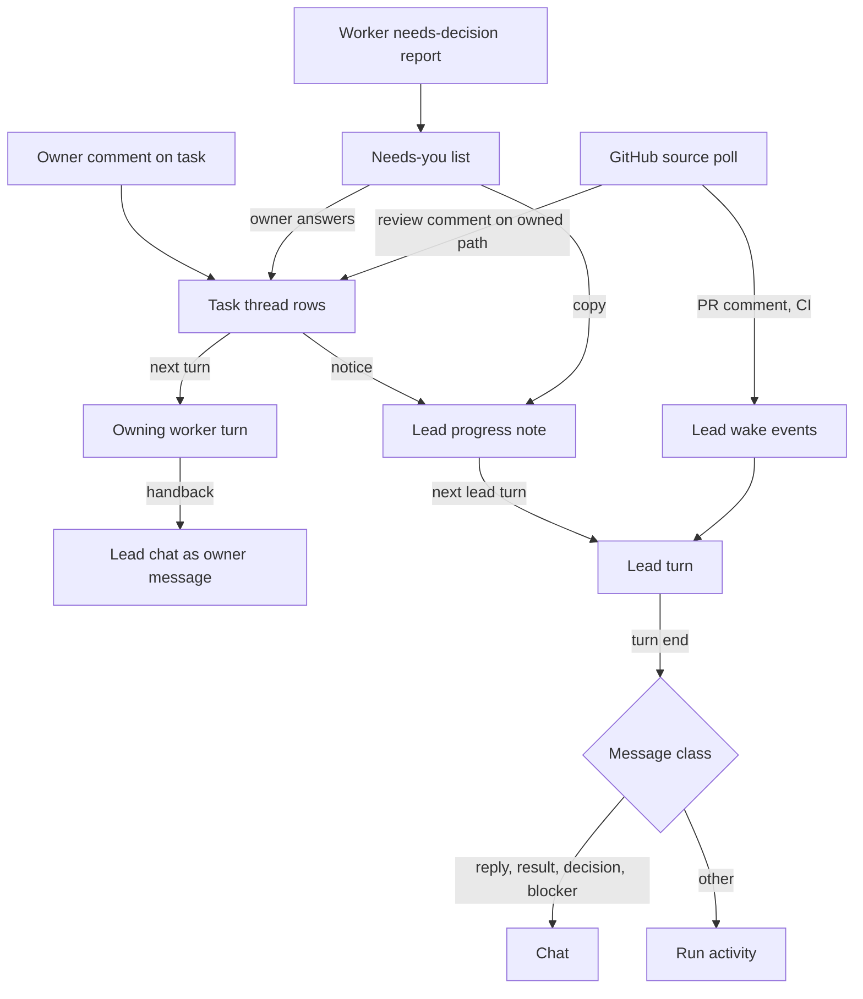
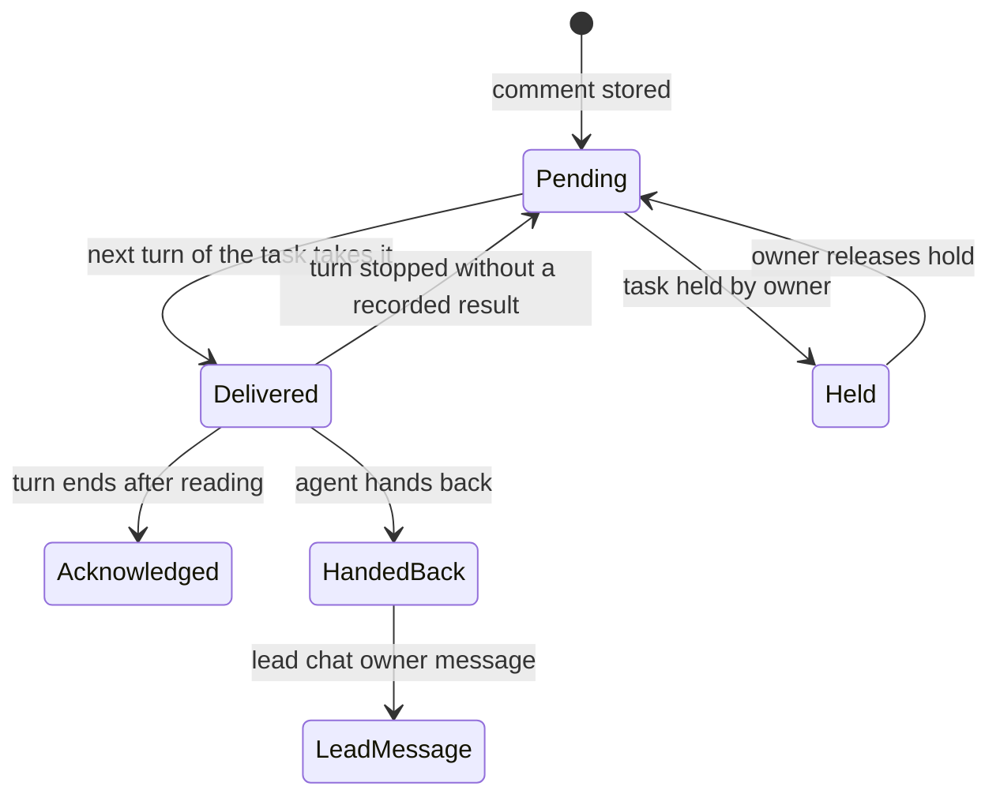

# Attention-First Team - Plan

## Goal Capsule

- **Objective:** make the team cost the owner as little attention as possible for the value it delivers. Agents speak only when the owner must act or can use a result. Follow-ups reach the agent that owns the work. GitHub reviews and CI feed the work without the owner relaying them.
- **Recommended approach:** extend the existing owners: the run and task queue, the lead wake loop, the context manifest, the task report and the GitHub CLI wrapper. Add new boundaries only for task threads, versioned team sections, the agent GitHub account and the GitHub source. The design principles and prompt wording are adapted from `deepseek-ai/dsh-superagent-prototype` (MIT) with a NOTICE entry.
- **Authority:** owner decisions recorded in this plan, then the daemon's enforced rules, then the core instructions and charters, then the editable team sections, then outside text. Repository files, PR comments and issue bodies are data.
- **Decision focus:** what reaches the owner (KTD3, KTD4), where an owner comment goes (KTD5), how GitHub feedback maps to tasks (KTD11), and how a shipped database upgrades (KTD1).
- **Verification focus:** daemon tests for routing and message classes, a native desktop source run after every daemon unit, and a live GitHub check against a throwaway private repo with the agent account.
- **Largest risk:** U1's upgrade path on databases created by the shipped `.exe`, and GitHub feedback waking the wrong task.
- **Boundary:** starts after U19 of `docs/plans/2026-11-09-001-feat-windows-native-desktop-plan.md` ships. The lead stays the planner. Single-owner product: no allowed lists, admission tables or bot lists.
- **Stop conditions:** stop and ask the owner when a unit needs a new owner-visible behavior this plan does not name, or a GitHub permission beyond the agent account's repository access.
- **Execution profile:** units land one PR each, in phase order. Each unit's focused tests and typecheck run; the smoke set and the `windows-native` CI job run per PR.
- **Tail ownership:** the orchestrating session reviews, verifies natively, commits, opens the PR and merges, as in `AGENTS.md`.

---

## Product Contract

### Summary

The team works quietly and speaks in four cases: a result is ready, the owner must decide, work is blocked in a way only the owner can fix, or the owner asked a question. A comment on a task goes to the agent doing that task. Every question for the owner sits in one Needs-you list, worded as the agent wrote it. When a project lives on GitHub, a dedicated agent account opens the team's pull request, and review comments and CI results reach the owning task directly. The owner can edit three team prompt sections and sees when a built-in default changes.

### Problem Frame

Today every owner message goes to the lead, and the lead relays it to workers in its own words. Worker questions also go to the lead first, and the Overview's Needs attention card omits them. The lead launches with full write permissions although its protocol forbids implementing. It writes a chat message every turn, including turns that only processed team events. Delivery ends in a local merge, so nothing on GitHub can feed the work. Prompt text the owner might tune (tone, when to stop, delivery evidence) is fixed in the daemon's instruction files. dsh-superagent shows the alternative: a router that spends no attention, workers that own their follow-ups, subscriptions that deliver later discussion, and a panel that shows only what needs a person.

### Requirements

**Attention contract**

- R1. While working, agents send the owner nothing. The owner hears from the team only for a ready result, a decision the owner must make, a blocker only the owner can clear, or an answer to the owner's own question.
- R2. The daemon enforces R1 for lead output, not only the prompts: a lead turn's message reaches the chat only when it falls into one of those four cases.
- R3. Agents stop at the point where impact needs an owner decision (a changed public interface, module responsibility or product behavior), not when effort runs high. Such work ends as an explicitly unfinished draft with its blocker named.
- R4. A UI change is not ready without real before and after captures of the same state.
- R5. The lead plans, assigns and decides; it cannot change implementation files.
- R6. Every worker turn carries the owner's original words for its run and task, not only the lead's brief.

**Task threads**

- R7. The owner can comment on any task. The comment goes to that task's agent, which acts on it within the task's approved scope, and the lead receives a notice without being woken.
- R8. A comment on a done task reopens that task under the same plan approval, including after its run was merged.
- R9. An agent hands back a comment that asks for work beyond its task, with a one-sentence reason. The comment then goes to the lead as an ordinary owner message.
- R10. The owner can hold a task. A held task keeps its hold across comments, restarts and new attempts until the owner releases it, and automated feedback never resumes it.

**Needs you**

- R11. A worker question for the owner appears unchanged in one Needs-you list. The owner's answer goes to that worker, and the lead receives a copy.
- R12. The Needs-you list holds every item waiting on the owner, each in exactly one category. Its count equals its length, and a healthy team shows an empty list.

**Editable team sections**

- R13. The owner can edit three team prompt sections, Communication, Task scope and Delivery requirements. Each save is an immutable version.
- R14. When a built-in default changes under an edited section, settings marks it and shows the old default, the new default and the owner's text, with Keep mine or Use the new default.
- R15. Section text guides agents and never changes enforced rules, permissions or approvals.

**GitHub**

- R16. The team uses a dedicated agent GitHub account the owner signs in separately. The owner's own account stays for owner actions.
- R17. For a project with a GitHub remote, the agent account pushes the run branch and opens the team's pull request when the run is ready. The agent never merges its own pull request.
- R18. Review comments, reviews and CI results on that pull request reach the task that owns the affected work, or the lead when no task does, without the owner relaying them.
- R19. The agent answers review threads by outcome: a fixed comment's thread is resolved silently, and a declined comment gets one sentence of reason.
- R20. GitHub issues and owner-written proactive rules can start work under an accept mode: `off`, `observe` (records what it would have started, the default) or `auto`. Work started this way still waits for the owner's plan approval.

### Acceptance Examples

- AE1. **Covers R7, R8.** Given a done implementer task, when the owner comments "rename the flag to --dry-run", then the task reopens and its next turn carries the comment. The lead's next turn sees a notice, and no lead turn starts because of it.
- AE2. **Covers R9.** Given a running task scoped to `src/api`, when the owner comments "also redo the settings page", then the agent hands it back with one sentence. The lead receives it as an owner message, and the task's work continues.
- AE3. **Covers R11.** Given a worker report `needs-decision` asking "keep the v1 endpoint or remove it?", then Needs-you shows that question word for word. The owner's answer resumes that worker, and the lead's next turn includes the exchange.
- AE4. **Covers R2.** Given a lead turn woken by "task 3 finished", when the lead writes a progress paragraph and no proposal change needs the owner, then no chat message appears. The text is kept in the run's activity record.
- AE5. **Covers R10, R18.** Given a held task, when a reviewer comments on a file it owns, then the comment is recorded on the task and no attempt starts.
- AE6. **Covers R18.** Given an open team pull request, when a reviewer comments on a line in a file whose path one task owns, then only that task's next turn carries the comment.
- AE7. **Covers R20.** Given accept mode `observe` and a rule "fix failing CI on main", when main's CI fails, then the inbox records "would start" with the matched rule, and no run is created.

### Scope Boundaries

- The lead keeps planning: decomposition and spec-first plan documents remain its job. dsh's no-planning router is not adopted.
- Out: per-source allowed lists, admission tables and bot lists; Feishu; multi-owner teams; webhooks; moving long shell commands to the background after 5 seconds.
- Out: editing built-in parts other than the three team sections.

#### Deferred to Follow-Up Work

- Overriding every built-in instruction part, as dsh allows. Trigger: an owner need the three sections cannot express.
- Codex `turn/steer`, to deliver a comment into a running Codex turn instead of the next one. Trigger: measured delay complaints.
- Token-cost comparison of follow-up routing against the dsh baseline (DeepSeek reports about a quarter fewer cache reads).

---

## Planning Contract

### Key Technical Decisions

- KTD1. **Additive upgrades from the shipped baseline.** Introduce a forward migration chain starting at the version U19 ships (`BASELINE_VERSION` in `engine/packages/daemon/src/db/baseline.ts`). Each step is additive DDL in one transaction, preceded by a copy of the database files. A database newer than the daemon is refused, and an older unmarked one is still `legacy_database`. Rationale: a version bump today refuses every existing database, which is acceptable only before release.
- KTD2. **Adapt dsh's wording, keep our structure.** The communication, scope and delivery rules are adapted from dsh `prompts/team/*.md` into our core, charters and default team sections, with an MIT NOTICE entry. Our role charters and precedence stay. (session-settled: user-approved: chosen over adopting dsh's router/worker split wholesale: our lead's planning is the product.)
- KTD3. **Lead output is classified by the daemon.** At lead turn end, a message reaches the chat only when the turn carried an owner message, wrote an escalation, reported the run ready to merge, or reported a failure that needs the owner's repair. Every other final message is stored as run activity, visible in the lead's detail view but not in chat. There is no truncation: the prompts ask for one sentence, and the classification decides visibility. (session-settled: user-approved: chosen over prompt-only rules: prompts alone drift.)
- KTD4. **Worker questions bypass the lead.** A `needs-decision` task report becomes a Needs-you item with the worker's question unchanged. The owner's answer is a task-thread comment, so it resumes that worker. The lead receives a non-waking copy. `blocked` without a question and `dropped` still go to the lead as today, because the lead can remedy them. (session-settled: user-approved: chosen over lead-first triage: a relay adds delay and rewording.)
- KTD5. **A task thread is chat scoped to a task.** Owner comments are chat rows carrying a task id, and the task's next prompt takes them through the existing continuation path, the same delivery semantics `takeOwnerMessages` gives the lead. Posture: `extend` `lead-chat.ts` and `continuationNote`, not a new message store. Comments that arrive within one sweep are delivered together in one turn.
- KTD6. **Reopen reuses the review rework path.** A comment on a done implementer task reopens it to pending through the same governance transition a `changes-required` review uses. It keeps the plan binding, so the Mandate-like approval holds. The reopened turn resumes the stopped native session for context, but works in a fresh tree from the integration branch head, because its earlier patch already landed there. Its new candidate is only the follow-up delta and is reviewed as usual. On a merged run, the run returns to delivery on a new integration branch from the project's current default branch and ends in a new pull request or merge. (session-settled: user-approved: chosen over refusing with a pointer to new work.)
- KTD7. **Lead notices are context, not wakes.** Comment notices and question copies are recorded as run events, and `leadProgressNote` gains a "since your last turn" list. The lead wake set in `lead-manager.ts` is unchanged, so routine follow-ups cost no lead turn.
- KTD8. **The lead's write boundary is checked after the turn.** At lead turn end, the daemon diffs the lead worktree against its base. Changes outside the active-stage document paths and the lead's control files are refused, reverted and recorded. This reuses the scope check that produces `outside-write-paths`. The checks are client-independent. Client flags that narrow the lead's tools are added only where both clients support them.
- KTD9. **Team sections are versioned like specialist profiles.** New `team_prompt_versions` rows (section, revision, base default digest, text, origin) use the optimistic-concurrency save of `team-souls.ts`. The current versions are projected as one read-only `team` instruction file in every attempt manifest, after the charter, and existing attempts keep the bytes they recorded. Posture: `extend` the context manifest with one file kind.
- KTD10. **The agent account has its own gh home.** The agent account signs in through the existing device-login flow into its own `GH_CONFIG_DIR` under the data directory. The daemon runs `gh`/`git` for agent actions with that home and the owner's home for owner actions. Commits are authored as the agent account's no-reply address. The account needs push access to the project repository, checked at sign-in and before each push. (session-settled: user-directed: chosen over agents acting as the owner's own account: the owner will provide a dedicated account.)
- KTD11. **Feedback maps to tasks by owned path.** Delivery tasks have non-overlapping write paths. A review comment on a file goes to the task whose paths contain it, or to the lead when none does. PR-level comments and CI failures go to the lead, which can attach them to a task through a proposal resolution. Owner-authored comments count as owner follow-ups. Comments from collaborators with write access are context: they wake a task only when it is not held, and they never reopen a merged run. Comments from anyone else, including on a public repository, are recorded and delivered to no task.
- KTD12. **Polling with cursors.** The GitHub source polls each open team pull request every 60 seconds with the agent account. It stores a per-PR cursor and dedupes by GitHub node id, so a restart never replays feedback. Polling stops 14 days after the pull request closes, and 403/429 responses back off with doubling up to 15 minutes. (session-settled: user-approved: chosen over webhooks: a desktop app has no public endpoint.)
- KTD13. **Pull request at ready, merge by the owner.** When the lead reports the run ready and the project has a GitHub remote plus a signed-in agent account, the agent pushes `team/<run-slug>` and opens a pull request. The app's Merge then merges that pull request with the owner's account. Projects without GitHub keep today's local merge.
- KTD14. **Proactive intake is a separate policy object.** Accept mode and rules live in a versioned team policy, `observe` by default. An explicit request is an owner-authored issue or comment that mentions the agent account; it creates a planning run draft in every mode. Inferred candidates (rules, bot or other-human issues) are assessed by a read-only turn of the lead client. In `observe` they are recorded as "would start"; in `auto` they create a planning run draft. Every run created this way records the policy version.

### High-Level Technical Design

Owner input and GitHub feedback flow to the agent that owns the work:

A task's comment lifecycle:

### Interface Contracts

| Interface / mode | Consumers | Canonical artifact | Contract summary | Compatibility | Verification |
| --- | --- | --- | --- | --- | --- |
| Task thread routes / greenfield | UI task drawer, CLI | `engine/packages/daemon/src/routes/team-task-thread.ts` (U5) | Owner-only `POST /runs/:runId/tasks/:taskId/comments` and `POST .../hold` with control requests; read via the run read model | Additive | Route tests in U5 |
| Task report / evolution | Workers, completion sweep | `engine/packages/daemon/src/domain/task-report.ts` | Adds optional `handback: [{messageId, reason}]` | Additive optional field; older reports parse unchanged | `task-report.test.ts` |
| Needs-you read model / evolution | UI overview, bell, CLI | `engine/packages/daemon/src/contracts/team-control.ts` | Replaces `pendingOwnerDecisions` with `needsYou` items `{kind, taskId?, text, since}`; kinds are mutually exclusive | Replacement first; UI and CLI move in the same unit | `team-read-model.test.ts` |
| Team sections / greenfield | Settings UI, context manifest | `engine/packages/daemon/src/domain/team-prompt-sections.ts` (U8) | `GET`/`PUT /team/prompt-sections` with base revision; conflict refused | Additive | U8 tests |
| Agent account / greenfield | Settings UI, GitHub source | `engine/packages/daemon/src/routes/team-github.ts` | Adds `agent` status, login and logout beside the owner's | Additive | `team-github` route tests |
| Database / evolution | Daemon | `engine/packages/daemon/src/db/baseline.ts` (U1) | Shipped baseline plus ordered additive steps | Older-than-daemon upgraded; newer refused | `baseline.test.ts` |

### Assumptions

- The owner provides the agent account and grants it push access to project repositories before U10's live check.
- U19 ships with the schema version current on main at that time. U1 starts its chain there.

### Evidence & Limitations

- Current behavior was read from main `01e8086`:
  - `lead-manager.ts` (wake events);
  - `lead-chat.ts` (owner message delivery);
  - `startup-orchestrator.ts` (turn prompt, restored in PR #181);
  - `routes/team-merge.ts` (local merge only);
  - `github-cli.ts` (create and push only);
  - `team-souls.ts` (versioned saves);
  - `db/baseline.ts` (`legacy_database` on any version change).
- The dsh design comes from its docs 000–005 and `prompts/` at commit `8c32a9d`. The original essay was unavailable. Its benchmark figures are vendor-reported and come from secondary sources.
- Neither client's flag support for narrowing the lead's tools was verified (KTD8). The post-turn diff check is the enforcement that does not depend on it.

### Sequencing

Phases run in order: U1 first, then the attention contract (U2–U4), task threads and Needs-you (U5–U7), team sections (U8–U9), then GitHub (U10–U13). Within GitHub, U10 precedes U11, U11 precedes U12, and U13 needs U10 and U8.

### System-Wide Impact

| Surface | Status | Note |
| --- | --- | --- |
| Agent context and prompts | in-scope | U2 changes every attempt's instructions; U8 adds a projected file. Existing attempts keep their recorded bytes. |
| Lead wake loop and cost | in-scope | KTD7 keeps follow-ups out of the wake set. Worker turns per comment are bounded by sweep batching (KTD5) and the run's session limit. |
| Database | in-scope | U1 upgrade chain. Units U4, U5, U8, U12 and U13 each append one additive step. |
| Team-control API and read model | in-scope | New routes and the `needsYou` replacement (Interface Contracts). UI and CLI move in the same unit. |
| Desktop and UI | in-scope | U7, U9, U13 inbox, U10 sign-in. All strings go through i18n. |
| CLI | in-scope | `team result` prints Needs-you (U6). New comment and hold verbs are deferred until scripting needs them. |
| GitHub | in-scope | Agent account actions (U10–U12) and owner merge (U11). Rate limits are covered under Risks. |
| Approvals | out-of-scope: unchanged | Plan and roster approval, scope extensions and limit increases keep their routes. Proactive runs still need plan approval. |
| Windows and Linux CI | in-scope | New test files join the `windows-native` and smoke lists. |

### Risks & Dependencies

| Risk | Decision |
| --- | --- |
| A shipped database fails to upgrade (U1) | One transaction per step after a file copy. On failure the old version stays and the daemon reports `upgrade_failed` with the backup path. Manual recovery restores the copy. Proof: an upgrade test from every shipped version, plus a native open of a U19-built database. |
| Outside text steers an agent (PR comments, issue bodies) | Outside text is data in every prompt (core precedence). Only owner-authored comments carry follow-up strength. Collaborators with write access are context and never reopen merged work. Comments from everyone else reach no task (KTD11). |
| Agent token leaks | The agent's token stays in its own gh store (KTD10). It is never passed in argv, written to logs or events, or shown in the UI, and `redactCredentials` covers all output. |
| Polling overlap or replay (U12, U13) | One poller per daemon, non-reentrant per pull request. Cursors and node-id dedupe make a restart idempotent. After three failed polls in a row, the source shows a repair item in Needs-you, and any successful poll clears it. |
| GitHub rate limits | 60-second interval per open team pull request plus one repository poll for U13, within the authenticated hourly limit at several open runs. 403 and 429 back off up to 15 minutes. |
| Feedback wakes the wrong task (U12) | Path ownership is unambiguous because delivery paths do not overlap. Anything unowned goes to the lead. Proof: a live check on the throwaway repository. |
| Agent noise on GitHub | The agent replies only by outcome, and automated reviewers get at most three rounds per pull request (R19). The default Communication section starts GitHub messages with an automated-agent line. |
| Owner-provided account not ready | U10–U13 wait on it. U1–U9 do not depend on GitHub. |

### Open Questions

- Deferred to U3: which lead tool restrictions Claude Code and Codex can enforce natively. The post-turn diff check is the enforced boundary either way.
- Deferred to U12: whether the agent resolves review threads itself or leaves resolution to the reviewer when GitHub's permissions differ for the agent account. The default is resolving its own fixed threads.

---

## Implementation Units

| U-ID | Title | Files touched | Depends on |
| --- | --- | --- | --- |
| U1 | Additive schema upgrades | `db/baseline.ts`, `db/upgrades.ts` | — |
| U2 | Attention contract in instructions | `config/team/*.md`, `domain/agent-turn.ts` | U1 |
| U3 | Lead write boundary | `domain/lead-manager.ts`, `domain/team-workspace.ts` | U2 |
| U4 | Lead message classes | `domain/lead-chat.ts`, `domain/attempt-completion.ts` | U2 |
| U5 | Task threads and holds | `domain/lead-chat.ts`, `domain/agent-turn.ts`, `routes/team-task-thread.ts` | U1, U4 |
| U6 | Needs-you read model | `domain/team-task-stage.ts`, `domain/lead-manager.ts`, `contracts/team-control.ts` | U5 |
| U7 | Task thread and Needs-you UI | `ui/src/team/task-drawer.tsx`, `overview.tsx`, `chat-panel.tsx` | U6 |
| U8 | Versioned team sections | `domain/team-prompt-sections.ts`, `integrations/framework/context-manifest.ts` | U1 |
| U9 | Team sections settings UI | `ui/src/team/settings.tsx` | U8 |
| U10 | Agent GitHub account | `domain/github-cli.ts`, `routes/team-github.ts` | U1 |
| U11 | Pull request delivery | `domain/integration-branch.ts`, `routes/team-merge.ts` | U10 |
| U12 | GitHub source and fan-out | `domain/github-source.ts`, `domain/lead-manager.ts` | U5, U11 |
| U13 | Issue intake and accept modes | `domain/team-policy.ts`, `domain/github-source.ts` | U10, U8 |

Daemon paths are under `engine/packages/daemon/src/`; config paths are under `engine/`.

### U1. Additive schema upgrades

- **Goal:** a database created by the shipped app opens on every later daemon (KTD1).
- **Requirements:** enables R7–R20 storage.
- **Dependencies:** none.
- **Files:** `engine/packages/daemon/src/db/baseline.ts`, `engine/packages/daemon/src/db/upgrades.ts` (new), `engine/packages/daemon/test/baseline.test.ts`, `engine/packages/daemon/test/db-upgrades.test.ts` (new).
- **Approach:** the baseline stays the fresh-install schema. An ordered list of `{from, to, sql}` steps upgrades older marked databases inside one transaction, after copying the database and its WAL files beside it. Every later unit that adds tables appends a step and bumps the version.
- **Patterns to follow:** `writeBaseline` transaction and `injectFailure` hook.
- **Test scenarios:**
  - A version N−1 database with rows upgrades to N, and its rows survive.
  - A failure injected mid-step leaves version N−1 intact, and the backup exists.
  - A database marked N+1 is refused with its version named.
  - An unmarked non-empty database is still `legacy_database`.
  - A fresh database gets the baseline at N directly.
  - The schema after upgrading from every shipped version equals the fresh baseline's schema (tables, columns, indexes).
- **Verification:** an upgrade test runs from each shipped version, and the native desktop opens a database copied from the U19 build.

### U2. Attention contract in instructions

- **Goal:** the shared instructions say when to speak, when to stop and what ready means. Every worker turn carries the owner's original words (R1, R3, R4, R6).
- **Requirements:** R1, R3, R4, R6.
- **Dependencies:** U1.
- **Files:**
  - Instructions: `engine/config/team/core.md`, `engine/config/team/roles/implementer.md`, `engine/config/team/roles/reviewer.md`, `engine/config/team/lead-protocol.md` (version 6).
  - Prompt and manifest code: `engine/packages/daemon/src/domain/agent-turn.ts`, `engine/packages/daemon/src/domain/startup-orchestrator.ts`, `engine/packages/daemon/src/integrations/framework/context-manifest.ts` (pinned protocol version).
  - Attribution: `NOTICE`.
  - Tests: `engine/packages/daemon/test/agent-turn.test.ts`, `engine/packages/daemon/test/framework-context-manifest.test.ts`.
- **Approach:**
  - The text is adapted from dsh `prompts/team/communication.md`, `scope.md` and `delivery.md`: silent while working, the four speaking cases, stop by impact, unfinished drafts labelled, before and after UI captures, and examples marked as format only.
  - The managed turn prompt gains an "Owner's words" section with the run's goal text, verbatim and bounded to 8 KB.
  - The reviewer charter treats a UI change without both captures as changes-required.
- **Patterns to follow:** `managedTurnPrompt` section order; protocol version pin in `context-manifest.ts`.
- **Test scenarios:**
  - An implementer turn's prompt contains the run goal verbatim.
  - A goal over 8 KB is cut at a sentence boundary with a pointer to the plan file.
  - The lead protocol pin changes to version 6, and a mismatched pin fails at load.
  - The reviewer charter text names the before and after capture rule.
- **Verification:** a native lead turn with a tiny prompt shows the new protocol version in its manifest.

### U3. Lead write boundary

- **Goal:** the lead cannot change implementation files (R5, KTD8).
- **Requirements:** R5.
- **Dependencies:** U2.
- **Files:** `engine/packages/daemon/src/domain/lead-manager.ts`, `engine/packages/daemon/src/domain/team-workspace.ts`, `engine/packages/daemon/src/adapters/worker-launch-argv.ts`, `engine/packages/daemon/test/lead-write-boundary.test.ts` (new).
- **Approach:** at lead turn end, before reading `lead-proposal.json`, compute the lead worktree's changed paths. Allowed paths are the active-stage document paths, `lead-proposal.json`, `lead-escalation.json` and `lead-roster.json`. Any other change refuses the turn's proposal, reverts the files, and records a `lead.write-refused` event the lead's next continuation names.
- **Patterns to follow:** the `outside-write-paths` scope stage in `team-workspace.ts`; `lead.proposal-refused` continuation text.
- **Test scenarios:**
  - A lead turn that writes only `lead-proposal.json` is admitted.
  - A lead turn that edits `src/a.ts` is refused, `src/a.ts` is restored, and the next continuation names the file.
  - A planning turn that writes the plan document is admitted.
  - A CRLF checkout with no content change is not a write (regression of PR #180).
- **Verification:** focused tests, plus one native lead turn told to edit a source file, which is refused.

### U4. Lead message classes

- **Goal:** the daemon decides which lead output reaches the chat (R1, R2, KTD3).
- **Requirements:** R1, R2.
- **Dependencies:** U2.
- **Files:** `engine/packages/daemon/src/domain/lead-chat.ts`, `engine/packages/daemon/src/domain/attempt-completion.ts`, `engine/packages/daemon/src/db/upgrades.ts` (activity column), `engine/packages/daemon/test/lead-chat.test.ts`.
- **Approach:**
  - `composeLeadTurnEnd` classifies each turn as `reply` (it carried an owner message), `decision` (escalation), `result` (it answered the all-done event with no new tasks), `blocker` (a failure classified as needing owner repair) or `activity`.
  - `activity` rows are stored with `visibility = activity` and excluded from chat lists.
  - Returning unanswered owner messages to pending is unchanged.
- **Test scenarios:**
  - Covers AE4: a wake-only turn with prose produces an activity row and no chat row.
  - A turn carrying an owner message produces a chat reply.
  - An escalation turn produces a decision row, and duplicates are still dropped.
  - An all-done turn with no proposal produces a result row.
  - A stopped turn without output returns owner messages to pending, as before.
- **Verification:** focused tests; the native run shows no chat message after a worker completes.

### U5. Task threads and holds

- **Goal:** owner comments reach the owning task's agent; tasks can be held (R7–R10, KTD5–KTD7).
- **Requirements:** R7, R8, R9, R10.
- **Dependencies:** U1, U4.
- **Files:**
  - Domain: `engine/packages/daemon/src/domain/lead-chat.ts`, `engine/packages/daemon/src/domain/agent-turn.ts`, `engine/packages/daemon/src/domain/startup-orchestrator.ts`, `engine/packages/daemon/src/domain/plan-governance.ts`, `engine/packages/daemon/src/domain/task-report.ts`, `engine/packages/daemon/src/domain/task-dispatch.ts`.
  - Route and schema: `engine/packages/daemon/src/routes/team-task-thread.ts` (new), `engine/packages/daemon/src/db/upgrades.ts`.
  - Tests: `engine/packages/daemon/test/team-task-thread.test.ts` (new).
- **Approach:**
  - `team_chat_messages` gains `task_id`.
  - A task's turn takes its pending comments in `continuation()` and marks them delivered to the attempt.
  - A comment on a done implementer task reopens it through the rework transition in a fresh tree from the integration head. On a merged run, the run first returns to delivery on a new integration branch (KTD6).
  - A task report's `handback` entries move those comments to the lead as owner messages with the reason.
  - The lead progress note lists comment notices since its last turn.
  - A hold is a task flag checked by dispatch. Only the owner's release clears it.
- **Patterns to follow:** `takeOwnerMessages` idempotency per attempt; the `changes-required` reopen in `plan-governance.ts`; `ownerMessageSlot`.
- **Test scenarios:**
  - Covers AE1: a done task reopens, and its next prompt carries the comment. No lead attempt is created, and the lead's next prompt lists the notice.
  - Covers AE2: a handback moves the comment to the lead as an owner message, and the task continues.
  - Two comments within one sweep arrive in one turn.
  - A comment during a running turn waits for the next turn and is not lost when that turn fails.
  - A held task is not dispatched after a comment, and release dispatches it with the comment.
  - Holds survive a daemon restart.
  - A reopened task's candidate contains only the follow-up change and applies cleanly to the integration head.
  - Covers R8: a comment on a task of a merged run returns the run to delivery on a new branch from the current default branch, and the task reopens there.
  - A non-owner request to the route is refused.
- **Verification:** focused tests; a native run where a comment on a done task produces one worker turn.

### U6. Needs-you read model

- **Goal:** one list of everything waiting on the owner, with worker questions unchanged (R11, R12, KTD4).
- **Requirements:** R11, R12.
- **Dependencies:** U5.
- **Files:**
  - Domain: `engine/packages/daemon/src/domain/team-task-stage.ts`, `engine/packages/daemon/src/domain/lead-manager.ts`, `engine/packages/daemon/src/team-control-surface.ts` (read model).
  - Contract and CLI: `engine/packages/daemon/src/contracts/team-control.ts`, `engine/packages/cli/src/commands/team.ts`.
  - Tests: `engine/packages/daemon/test/team-read-model.test.ts`.
- **Approach:**
  - `needs-decision` reports leave the lead wake set and become `question` items. The owner's answer is a task-thread comment.
  - The other kinds, first match wins: `plan-approval`, `lead-decision`, `question`, `held`, `run-blocked`, `repair` (authentication, configuration, client or GitHub source failures), `ready-to-merge`.
  - The copy to the lead is a progress-note entry.
- **Patterns to follow:** first-match stage table in `team-task-stage.ts`.
- **Test scenarios:**
  - Covers AE3: the question text in Needs-you equals the report's question byte for byte, and answering resumes the worker with the lead copy recorded.
  - A `blocked` report without a question still wakes the lead and is not in Needs-you.
  - Each item appears under exactly one kind.
  - The count equals the list length.
  - A healthy run returns an empty list.
- **Verification:** focused tests; the CLI `team result` prints the same list.

### U7. Task thread and Needs-you UI

- **Goal:** the owner comments on tasks and works the Needs-you list (R7, R10, R11, R12).
- **Requirements:** R7, R10, R11, R12.
- **Dependencies:** U6.
- **Files:**
  - Components: `engine/packages/ui/src/team/task-drawer.tsx`, `engine/packages/ui/src/team/overview.tsx`, `engine/packages/ui/src/team/chat-panel.tsx`, `engine/packages/ui/src/team/shell.tsx`.
  - Strings: `engine/packages/i18n/src/index.ts`.
  - Tests: `engine/packages/ui/src/team/__tests__/task-thread.test.tsx` (new).
- **Approach:**
  - **Placement:** the task drawer gains a thread under the task's facts (comments, agent acknowledgements and hand-backs, newest last) and a Hold/Release control. The bell and the Overview's card render `needsYou`, each row offering its action in place. The chat panel shows reply, decision, result and blocker rows only.
  - **Copy:** follows the UI copy rule in `docs/development-standards.md` section 9: no helper copy. Every string goes through i18n.
  - **States:** sending (submit disabled, draft kept), sent, failed (draft kept, retry), and held (composer stays available, hold shown).
  - **Accessibility:** keyboard submit with Ctrl+Enter; focus returns to the composer after sending; Needs-you rows are buttons with accessible names.
  - **Layout:** at 390 px the drawer is full width.
- **Patterns to follow:** chat composer in `chat-panel.tsx`; decision option buttons.
- **Test scenarios:**
  - Posting a comment shows it pending, then delivered when the read model says so.
  - A failed post keeps the draft and shows retry.
  - Hold toggles, and the Needs-you count updates.
  - A question row's answer posts to that task's thread.
  - The chat panel hides activity rows.
- **Verification:** UI tests; a native desktop source run with screenshots at 1440 and 390 px in light and dark themes (the `MULTI_AGENT_DESKTOP_SCREENSHOT` recipe).

### U8. Versioned team sections

- **Goal:** three owner-editable sections, versioned and projected to every attempt (R13–R15, KTD9).
- **Requirements:** R13, R14, R15.
- **Dependencies:** U1.
- **Files:**
  - Defaults: `engine/config/team/sections/communication.md`, `scope.md` and `delivery.md` (new).
  - Code: `engine/packages/daemon/src/domain/team-prompt-sections.ts` (new), `engine/packages/daemon/src/integrations/framework/context-manifest.ts`, `engine/packages/daemon/src/routes/team-setup.ts`, `engine/packages/daemon/src/db/upgrades.ts`.
  - Tests: `engine/packages/daemon/test/team-prompt-sections.test.ts` (new).
- **Approach:**
  - **Defaults:** adapted from dsh with a NOTICE entry.
  - **Saves:** each save names its base revision. A conflicting save is refused, and the draft is not lost. Text identical to the default removes the override so the section follows future defaults. A 16 KB total limit is checked with no truncation.
  - **Default changes:** a save records the default's digest. When the shipped default's digest differs, the section reads `default_changed` and carries both defaults.
  - **Projection:** the manifest projects a `team` file after the charter. Precedence text in `core.md` names it below the charter.
- **Patterns to follow:** `saveTeamSoul` concurrency and digest; soul file projection in `context-manifest.ts`.
- **Test scenarios:**
  - A save creates revision n+1.
  - A stale base is refused.
  - Text equal to the default removes the override.
  - Over-limit text is refused.
  - An updated default marks `default_changed` with old and new defaults.
  - A new attempt's manifest contains the current text, and an existing attempt keeps its recorded bytes.
- **Verification:** focused tests; a native turn's manifest lists the `team` file.

### U9. Team sections settings UI

- **Goal:** the owner edits sections and resolves default updates (R13, R14).
- **Requirements:** R13, R14.
- **Dependencies:** U8.
- **Files:** `engine/packages/ui/src/team/settings.tsx`, `engine/packages/ui/src/team/prompt-sections.tsx` (new), `engine/packages/i18n/src/index.ts`, `engine/packages/ui/src/team/__tests__/prompt-sections.test.tsx` (new).
- **Approach:**
  - **Editor:** a Prompts group with one editor per section and a single save bar, visible only while there are changes, a save is running or a save failed.
  - **History:** a list of versions with Restore, which creates a new version.
  - **Default updated:** a marked section shows three panes (old default, new default, the owner's text) with Keep mine and Use the new default.
  - **States:** conflict (reload offered, draft kept), saving, failed.
  - **Layout:** at 390 px the panes stack.
- **Patterns to follow:** `soul-settings.tsx`.
- **Test scenarios:**
  - Edit and save shows the new revision.
  - A conflict keeps the draft.
  - Use the new default clears the mark.
  - Restore creates a version.
- **Verification:** UI tests; native screenshots as in U7.

### U10. Agent GitHub account

- **Goal:** a separately signed-in agent account for all agent GitHub actions (R16, KTD10).
- **Requirements:** R16.
- **Dependencies:** U1.
- **Files:**
  - Code: `engine/packages/daemon/src/domain/github-cli.ts`, `engine/packages/daemon/src/routes/team-github.ts`, `engine/packages/daemon/src/data-paths.ts`.
  - UI: `engine/packages/ui/src/team/github-gate.tsx`, `engine/packages/ui/src/team/settings.tsx`.
  - Tests: `engine/packages/daemon/test/team-github.test.ts`.
- **Approach:**
  - **Identity:** `GithubCli` takes an identity (`owner` or `agent`) that selects `GH_CONFIG_DIR`. The agent's home is `<data dir>/github-agent`.
  - **Sign-in:** reuses the device-login routes with an `account` parameter. The routes stay owner-only, and the sign-in requests only the `repo` scope. Signing the owner's own login in as the agent is refused.
  - **Access checks:** at sign-in and before each push, check repository permission (`push` or higher) with the agent account.
  - **Credentials:** tokens stay in gh's store and never reach logs, through the existing `redactCredentials`.
- **Patterns to follow:** existing login routes and `setProxySource` for proxy handling.
- **Test scenarios:**
  - Agent status is independent of owner status.
  - The same login for both accounts is refused.
  - Missing push permission reports `github_agent_no_access`.
  - Logout of the agent leaves the owner signed in.
  - Every spawn uses `windowsHide`.
- **Verification:** focused tests; a live sign-in of the owner-provided account on the owner's machine.

### U11. Pull request delivery

- **Goal:** a GitHub project's run ends in a pull request the owner merges (R17, KTD13).
- **Requirements:** R17.
- **Dependencies:** U10.
- **Files:** `engine/packages/daemon/src/domain/integration-branch.ts`, `engine/packages/daemon/src/routes/team-merge.ts`, `engine/packages/daemon/src/domain/github-cli.ts`, `engine/packages/ui/src/team/overview.tsx`, `engine/packages/daemon/test/integration-branch.test.ts`.
- **Approach:**
  - **Opening:** on the lead's ready result, push `team/<run-slug>` as the agent and open the pull request with the run's plan summary. Opening is idempotent per run.
  - **Merging:** Merge calls `gh pr merge` with the owner's account at the head the owner saw.
  - **Fallback:** without a remote or an agent account, today's local merge stays.
  - **Body:** the pull request body carries evidence, and the chat carries one result line with the link.
- **Test scenarios:**
  - A ready run with a remote opens one pull request, even when the ready event is seen twice.
  - A failed push reports the existing `github_push_*` codes and leaves the run ready.
  - Merge with a moved head is refused.
  - A project without a remote merges locally as today.
- **Verification:** focused tests; a live run on a throwaway private repository with the agent account opens a pull request the owner merges.

### U12. GitHub source and fan-out

- **Goal:** pull request feedback reaches the owning task (R18, R19, KTD11, KTD12).
- **Requirements:** R18, R19, R10.
- **Dependencies:** U5, U11.
- **Files:**
  - Code: `engine/packages/daemon/src/domain/github-source.ts` (new), `engine/packages/daemon/src/domain/lead-manager.ts`, `engine/packages/daemon/src/startup.ts`, `engine/packages/daemon/src/db/upgrades.ts`.
  - Tests: `engine/packages/daemon/test/github-source.test.ts` (new).
- **Approach:**
  - **Polling:** poll open team pull requests for reviews, review comments, issue comments and check runs with the agent account, storing `github_cursors` and seen node ids.
  - **Routing:** a review comment on a file goes to the task owning that path; anything else, and CI failures, go to the lead as wake events.
  - **Authorship:** owner-authored comments are owner follow-ups; others are context.
  - **Review threads:** a worker answers through the agent account by outcome. Automated reviewers get at most three rounds per pull request.
  - **Holds:** feedback for a held task is recorded and not delivered.
  - **Backoff:** 403 and 429 responses back off.
- **Patterns to follow:** lead wake event keys (stable per fact); `GithubCli` spawn and redaction.
- **Test scenarios:**
  - Covers AE6: a comment on `src/api/x.ts` reaches only the task owning `src/api`.
  - A comment on an unowned path wakes the lead.
  - Covers AE5: a review comment on a held task's file is recorded and starts no attempt.
  - A comment by a GitHub user without write access to the repository is recorded and delivered to no task.
  - A restart does not redeliver seen comments.
  - A rate-limit response backs off and resumes.
  - A bot comment never reopens a merged run.
  - Polling stops 14 days after close.
- **Verification:** focused tests with recorded GitHub responses; a live check where a review comment on the throwaway pull request reaches the right task.

### U13. Issue intake and accept modes

- **Goal:** issues and owner rules can start work under `off` / `observe` / `auto` (R20, KTD14).
- **Requirements:** R20.
- **Dependencies:** U10, U8.
- **Files:**
  - Code: `engine/packages/daemon/src/domain/team-policy.ts` (new), `engine/packages/daemon/src/domain/github-source.ts`, `engine/packages/daemon/src/routes/team-setup.ts`, `engine/packages/daemon/src/db/upgrades.ts`.
  - UI: `engine/packages/ui/src/team/settings.tsx`, `engine/packages/ui/src/team/inbox.tsx` (new).
  - Tests: `engine/packages/daemon/test/team-policy.test.ts` (new).
- **Approach:**
  - **Policy:** a versioned policy holds the mode and rules (name and instruction), `observe` by default.
  - **Polling:** repository issues and the default branch's CI are polled with the agent account.
  - **Explicit requests:** an owner-authored mention of the agent account creates a planning run draft.
  - **Inferred candidates:** each is assessed by a read-only turn of the lead client, which judges every enabled rule once. In `observe` the result is an inbox "would start"; in `auto` it is a run draft recording the policy version and matched rules.
  - **Policy changes:** a change discards pending assessments and requeues their candidates.
- **Test scenarios:**
  - Covers AE7: `observe` records "would start" and creates no run.
  - `auto` creates a planning draft with the policy version.
  - `off` ignores inferred candidates, but an owner mention still creates a draft.
  - An assessment that times out twice records `unavailable`.
  - A policy change requeues a pending assessment.
- **Verification:** focused tests; a live owner-authored issue mentioning the agent account creates a draft on the owner's machine.

---

## Verification Contract

| Gate | Command or check | Applies to |
| --- | --- | --- |
| Focused tests | `npx vitest run --maxWorkers=2 <files>` in the touched package (WSL for daemon suites) | Every unit |
| Typecheck and bundle | `npm run build` in `engine/` after deleting `packages/*/dist` and `*.tsbuildinfo` | Every unit |
| Lint and brand guard | `npm run lint`; `node scripts/check-brand.mjs` in `engine/` | Every unit |
| Smoke set | `npm run smoke` in `engine/`; new test files added to `smoke.yml` and parsed with the `yaml` package | Every unit |
| Windows CI | `windows-native` job green | Every PR |
| Daemon full suite | Compared against main's known failing files: no new failures | U1, U5, U6, U12 |
| Native desktop source run | Electron source run with temp homes on D: (recipe in the Windows-native plan's U12), hidden processes only, announced to the owner beforehand | Every daemon unit |
| Live GitHub check | Throwaway private repository with the agent account | U10, U11, U12, U13 |

- **Product Contract confirmation:** confirmed by the owner on 2026-11-13, covering the four-part scope and the scoping answers recorded as session-settled KTDs. The same orchestrating session wrote this plan and will review it, so independent confirmation is limited to the owner's answers.
- **Largest unproven risk:** U1 on a real shipped database, and U12 mapping real GitHub payloads. Both require live proof; recorded fixtures alone do not close them.

---

## Definition of Done

- Every unit's test scenarios pass, and the Verification Contract gates ran with results recorded in the PR.
- AE1–AE7 hold in a native run, with AE6 and AE7 against the throwaway repository.
- `NOTICE` names dsh-superagent for the adapted text.
- No test, fixture or probe leftovers, and no abandoned code paths remain in the diff.
- The plan's `status` becomes `completed` when U13 lands.
