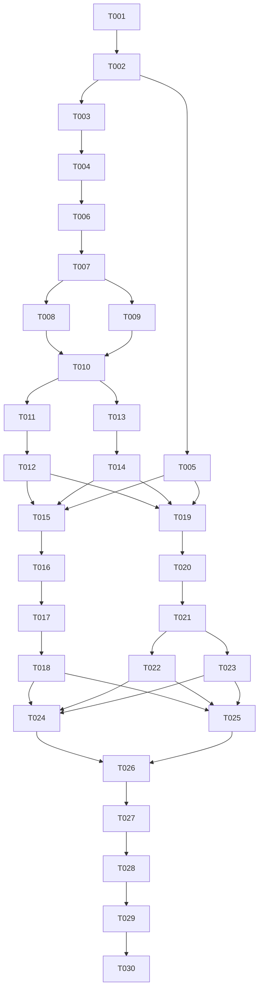

# Multi-Agent Engineering Team - Tasks

## Overview

This derived execution index decomposes the active, implementation-ready source plan into **30 bounded tasks in 20 waves**, covering U1-U12. This is a derived execution index, not a second plan, an approval record or a progress tracker. Task IDs describe scope, not completed implementation. Progress and current grants live in execution evidence outside this pack.

**Validation boundary:** T004 retains the plan-declared `engine/packages/daemon/src/middleware/auth-bearer-token.ts` source path. The validator contract must contain the audited exact-path allowance; broader credential-name denials remain in force. Validate this regenerated pack from the WSL artifact root before execution. Do not remove required source paths or treat a manual exception as a passing receipt.

**High-risk review gate:** after deterministic validation, review this pack against the current source plan and imported owners. Shared authority contracts, worker isolation, native approvals, owner clients and two-repository acceptance need semantic review beyond structural validation. The pack records neither review approval nor permission to execute, provision hosts, spend provider quota or publish changes.

### Repository and file ownership

| Target identity | Scope | Tasks |
| --- | --- | --- |
| `ronronner02/multi-agent` | Engine, control-side harnesses and project documents. The verified WSL checkout at `/home/leo/src/multi-agent` is the sole development authority; `D:/Multi-Agent` is a preserved reference copy. | All except T025-T026 |
| `work-board` | Separately registered local demo root, outside the orchestrator's physical ancestry, with run-local candidate copies. No remote repository. | T025-T026 |

Every card's `files` is relative to its `target_repo`, not the artifact resolution root. The `--repo` used to validate this document selects only the artifact/source root. Resolve physical roots and reject aliases/nesting before writes. The demo seed, feature candidate and control-side acceptance harness have different owners. No worker receives orchestrator source, control state or writable acceptance expectations.

T002 is the only **pinned import operation**, explicitly authorized by U1's source-tree scope when execution is selected. Its exact import/transfer manifest must be audited, frozen and approved before extraction; the listed manifest/build/document paths are the adaptation entrypoints, not an invented full archive inventory. All subsequent edits are restricted to concrete card paths and bounded expected side effects. Native adapter/pickup owners are reconciled with `docs/upstream-baseline.md`; additional mutation paths still require scoped regeneration. Changes to imported files must be recorded in `tools/upstream-import.mjs` `PIN.adapted`, without weakening the provenance verifier. This shared side effect is serialized, including tasks listed in the same wave. New filenames inside plan-declared directories are proposed implementation choices, not claims that files exist.

### Execution-wide gates

- Revalidate source lifecycle, canonical hash, task-pack bytes, repository identity and task scope at intake and continuation. Framework task freshness uses the canonical body hash above; the product's runtime plan approval uses the stricter exact-byte invalidation required by KTD5. Do not substitute one digest policy for the other.
- The owner-confirmed Planning Contract and PC1-PC6 govern milestone changes over historical Product Contract statements. In particular, both authenticated owner clients are supported; the earlier TUI-only wording does not remove browser authority.
- Establish Ubuntu identity/filesystem/process feasibility before substantial adaptation. No weaker identity, broad-access flag, alternative host, raw worker terminal API or shared control socket is a fallback.
- Keep automatic managed dispatch disabled through foundation/integration gates. Only explicitly scoped preflight/native probes are allowed before U8; they are not broad autonomous feature work. Keep `webUiEnabled` false until U9's session/terminal gates pass, and keep the listener loopback-only throughout this milestone.
- Offline tests must not start provider sessions. Setup/privilege changes require their explicit scope; each live compatibility probe, primary run, reverse-contract run and comparison trial needs its own grant and recorded supported spending cap or explicit time-only posture.
- Each granted run has at most three live sessions including the separate lead, one diagnosed recoverable retry, two review/rework cycles and 60 cumulative active minutes. New IDs, restart, retry, concurrent sessions and staged task cards do not reset or multiply that budget. Only a durable pause while all work is stopped pauses accounting.
- T017 owns deadline/no-progress/storage-cap enforcement; T018 owns conservative crash reconciliation. Unknown identity, ambiguous effects, stale plan, rejected grant, failed persistence or exhausted limits stop dependent dispatch. Preserve unrelated files, processes and durable evidence.
- Shared dependency declarations and lockfile changes are owned by T005 before parallel UI work. Missing shared language keys or unexpected imported owners require a serialized scoped pack revision, not an unlisted parallel edit.
- Review each logical change with `gpt-6.1-sol` and `claude-opus-5-5` through locally configured URLs and credentials, without persisting or disclosing keys. Both reviews are report-only and inspect the same frozen candidate; use at most two rounds and leave the gate open when a model is unavailable.
- Stop at T015-T016 and T019-T022 until the owner has reviewed the corresponding design proposal.
- `parallelizable` and waves describe possible implementation scheduling, not worker-dispatch authorization. Independent review intent is not a record that review passed.
- Commit, push, PR creation, merge, release, deployment, remote CI activation and destructive cleanup need their respective current grants; the task pack grants none.

## Source Summary

- **Source:** [the single active plan](../plans/2026-10-13-001-feat-multi-agent-team-plan.md).
- **Branch:** regenerated derived pack with concrete imported owners and serialized import-manifest maintenance; independent semantic review follows deterministic validation.
- **Authority consumed:** Product Contract R1-R22, F1-F4, AE1-AE13 and Success Criteria; Planning Contract PC1-PC6/KTD1-KTD18, interface and persistence invariants, isolation/source transfer, experience matrix, operational caps and demo ownership; all U1-U12; Verification Contract and Definition of Done.
- **Boundary-driven decomposition:** separate preflight from import, persistent authority from enforcement, catalog from context manifests, native launch from safe mailbox consumption and actual-client proof, ownership from review, browser authentication from terminal authority, terminal projection from controls, cancellation from recovery, UI construction from browser proof, demo seed from feature work, and primary/reverse/comparative evidence from final closeout.
- **Implementation-time unknowns retained:** the separate demo root, current client authentication and effective context, owner provisioning/live-run caps and actual browser/client behavior. Native adapter and queue-owner paths are now mapped to the imported source; additional owners remain stop conditions.
- **Excluded/deferred:** distributed nodes, concurrent projects, Pi/DSH support, every optional workflow's live execution, TUI goal authoring/session administration, hostile-admin containment, and Milestone 2 domain/tunnel/passkey/app/push-notification work. Responsive local layouts are included now.
- **Scope preservation:** the selected engine remains selected; the second engine is only a same-frozen-task evaluation. Generated mockups stay historical; `docs/Rendering.png` remains the benchmark. Existing generated runtime directories and personal configuration stay intact.

## Traceability Matrix

The matrix preserves all source units and their source requirement anchors; the canonical JSON narrows each task further. Repeated R/AE references express shared proof obligations, not additional scope.

| Source | Requirements / acceptance | Task(s) | Primary validation |
| --- | --- | --- | --- |
| U1 | R2, R3, R7, R13, R20, R21; AE2, AE6, AE12, AE13; KTD1, KTD2, KTD6, KTD7, KTD10 | T001-T002 | Actual isolation preflight, pinned import/transfer hashes, preserved Windows source and reproducible build |
| U2 | R1, R4, R5, R13, R19, R21, R22; AE1, AE4, AE6, AE11, AE13; KTD4-KTD6 | T003-T004 | Transactional migration/governance and exhaustive managed-entry authority checks |
| U3 | R1-R6, R19, R21, R22; AE1-AE4, AE11, AE13; KTD3-KTD6 | T006-T007 | Pinned catalog equality, bounded invocation, task freshness and effective-context manifests |
| U4 | R6-R9, R12, R15, R16, R19, R21; AE3, AE5, AE6, AE8, AE12, AE13; KTD3, KTD6, KTD7, KTD11 | T008-T010 | Safe mailbox/launch contracts plus actual two-client containment and resume proof |
| U5 | R4-R6, R10, R11, R16-R18, R21, R22; AE2-AE5, AE9-AE11, AE13; KTD4, KTD8, KTD9 | T011-T012 | Dependency/snapshot isolation, exact independent review and persistent bounded rework |
| U6 | R9, R12-R14, R16; AE5-AE7, AE10, AE12; KTD4-KTD6, KTD15, KTD16; PC1-PC4 | T015-T016 | Replay/width/language tests, owner controls and two-size bilingual terminal acceptance |
| U7 | R5, R9-R15, R21, R22; AE4, AE6-AE9, AE13; KTD4-KTD9 | T017-T018 | Owned-process cancel/deadlines, crash fault injection, no duplicate side effects and paired restore |
| U9 | R12-R14, R19, R21, R22; AE6, AE13; KTD6, KTD14, KTD16, KTD18; PC1, PC4, PC5 | T013-T014 | Session/forgery/expiry gates, owner-host identity and audited read-only/take-over boundaries |
| U10 | R12; KTD15; PC2 | T005 | Shared catalog/interpolation parity, fallback and display-width tests |
| U11 | R9, R12-R16, R18; AE5-AE7, AE9, AE10, AE12; KTD2, KTD13-KTD16; PC1-PC4, PC6 | T019-T021 | Component behavior, reference adaptations, six browser width/language combinations and accessibility |
| U12 | R4, R5, R12, R16, R21, R22; AE4, AE13; KTD5, KTD17; PC5 | T022-T023 | Canonical read-only paths/inert Markdown and versioned plan-bound task edits |
| U8 | R1-R22, F1-F4, AE1-AE13; KTD1-KTD18; PC1-PC6; all Success Criteria | T024-T030 | Frozen seed, primary live feature/owner acceptance, reverse contracts, actual candidate comparison and final proof reconciliation |

### Required-proof ownership

| Proof intent | Foundation / focused owner | Final evidence owner |
| --- | --- | --- |
| Scope, framework routing, approval and assignment freshness | T003-T004, T006-T007 | T027, T030 |
| Distinct native clients and direct addressed collaboration | T008-T010 | T027-T028 |
| Rejection, native permission separation, context and control isolation | T001, T004, T007-T010, T013-T014 | T027-T028 |
| Candidate integrity, independent review and integrated acceptance | T011-T012, T024-T026 | T027, T030 |
| Cancellation, restart, ambiguous effects and cumulative limits | T017-T018 | T027-T028 |
| Reproducible source/build and database rollback | T001-T003, T018 | T030 |
| TUI interaction, log visibility, replay timing and durable projection | T015-T016 | T027 |
| Reference Web UI and responsive/accessibility behavior | T019-T021 | T027 |
| Browser pairing/session and owner terminal/take-over safety | T013-T014, T016, T020 | T027 |
| Shared language and runtime switching | T005, T015-T016, T019-T021 | T027 |
| Read-only workspace/knowledge and bounded task editing | T022-T023 | T027 |
| Same-task engine comparison | T024-T025, T029 | T029-T030 |
| Complete required-proof reconciliation and delivery claim ceiling | Each task owns its focused receipts | T030 |

All required intents above need actual final-source evidence. A blocked candidate scenario can be comparative evidence, but is not a passing capability; an unattempted comparison does not satisfy the Success Criteria. KTD18's remote exposure is deferred, while local Host refusal and responsive behavior are required now.

## Task Graph

The canonical dependency arrays below are authoritative. This compact graph highlights shared prerequisites; it is not a substitute for them.



U8 waits for all earlier source-unit outputs through transitive dependencies. The live evidence chain is serial because it shares the approved local runtime/candidate history and must preserve comparable, independently authorized trials. T027 observes the primary T026 run rather than starting a new one. A task-level handoff never resets run limits.

## Execution Waves

Tasks in a wave have disjoint primary file ownership. Tasks carrying the shared import-manifest side effect are marked non-parallel and run serially despite sharing a wave. Other concurrency remains a scheduling option only; execute serially when worker authorization or isolation is absent. Named dependencies, not the passage of a wave, establish eligibility.

| Wave | Tasks | Output / gate |
| --- | --- | --- |
| 1 | T001 | Isolation/client feasibility; no substantial adaptation before passing |
| 2 | T002 | Audited import, exact owner inventory and hash-verified WSL authority |
| 3 | T003, T005 | Shared authority/persistence and shared language/dependency foundations |
| 4 | T004 | New and legacy managed-entry authority enforcement |
| 5 | T006 | Pinned catalog and invocation preservation |
| 6 | T007 | Scope-bound assignments and immutable context manifests |
| 7 | T008, T009 | Native launch/approval boundary and safe durable mailbox |
| 8 | T010 | Actual native containment/provenance/prompt/resume gates |
| 9 | T011, T013 | Candidate/dependency isolation and browser owner sessions |
| 10 | T012, T014 | Independent review and owner terminal/take-over gates |
| 11 | T015, T019 | TUI projections and Web shell/data |
| 12 | T016, T020 | Terminal owner controls and browser task/decision/session views |
| 13 | T017, T021 | Cancellation/resource enforcement and responsive browser proof |
| 14 | T018, T022, T023 | Recovery/rollback, scoped read views and bounded edits |
| 15 | T024, T025 | Control-side harness and separately owned frozen demo seed |
| 16 | T026 | Approved primary demo implementation/review |
| 17 | T027 | Primary live owner-flow and adversarial evidence |
| 18 | T028 | Separately authorized reverse-pairing contracts |
| 19 | T029 | Separately authorized same-frozen-task comparison |
| 20 | T030 | Final source-bound proof reconciliation and local closeout |

## Task Pack Contract

The following JSON is the single machine-readable task source. Human cards below are a compressed mirror. Required review gates express risk intent, not review/approval state.

```json
{
  "schema_version": "task-pack/v1",
  "execution_waves": [
    {
      "wave": 1,
      "tasks": [
        "T001"
      ]
    },
    {
      "wave": 2,
      "tasks": [
        "T002"
      ]
    },
    {
      "wave": 3,
      "tasks": [
        "T003",
        "T005"
      ]
    },
    {
      "wave": 4,
      "tasks": [
        "T004"
      ]
    },
    {
      "wave": 5,
      "tasks": [
        "T006"
      ]
    },
    {
      "wave": 6,
      "tasks": [
        "T007"
      ]
    },
    {
      "wave": 7,
      "tasks": [
        "T008",
        "T009"
      ]
    },
    {
      "wave": 8,
      "tasks": [
        "T010"
      ]
    },
    {
      "wave": 9,
      "tasks": [
        "T011",
        "T013"
      ]
    },
    {
      "wave": 10,
      "tasks": [
        "T012",
        "T014"
      ]
    },
    {
      "wave": 11,
      "tasks": [
        "T015",
        "T019"
      ]
    },
    {
      "wave": 12,
      "tasks": [
        "T016",
        "T020"
      ]
    },
    {
      "wave": 13,
      "tasks": [
        "T017",
        "T021"
      ]
    },
    {
      "wave": 14,
      "tasks": [
        "T018",
        "T022",
        "T023"
      ]
    },
    {
      "wave": 15,
      "tasks": [
        "T024",
        "T025"
      ]
    },
    {
      "wave": 16,
      "tasks": [
        "T026"
      ]
    },
    {
      "wave": 17,
      "tasks": [
        "T027"
      ]
    },
    {
      "wave": 18,
      "tasks": [
        "T028"
      ]
    },
    {
      "wave": 19,
      "tasks": [
        "T029"
      ]
    },
    {
      "wave": 20,
      "tasks": [
        "T030"
      ]
    }
  ],
  "tasks": [
    {
      "task_id": "T001",
      "source_unit": "U1",
      "requirement_refs": [
        "R2",
        "R3",
        "R7",
        "R13",
        "R20",
        "R21",
        "F1",
        "F4",
        "AE2",
        "AE6",
        "AE12",
        "AE13",
        "KTD2",
        "KTD6",
        "KTD7"
      ],
      "goal": "Prove the WSL worker-isolation and native-client prerequisites before adapting the engine.",
      "dependencies": [],
      "target_repo": "ronronner02/multi-agent",
      "files": [
        "engine/config/isolation/worker-policy.json",
        "engine/test/worker-isolation-preflight.test.mjs",
        "docs/operations.md",
        "engine/config/isolation/worker-launch.mjs",
        "engine/config/isolation/provision-host.sh"
      ],
      "context_refs": [
        "docs/plans/2026-10-13-001-feat-multi-agent-team-plan.md#u1-establish-the-pinned-source-and-reproducible-wsl-foundation",
        "docs/plans/2026-10-13-001-feat-multi-agent-team-plan.md#worker-isolation-and-source-transfer",
        "docs/plans/2026-10-13-001-feat-multi-agent-team-plan.md#risks-and-execution-prerequisites"
      ],
      "entry_hint": "Start with the first context anchor and the task's listed source/test owners.",
      "test_focus": "Read-only inventory followed only by authorized minimal probes: worker scratch write succeeds while token/database/WAL/shared-memory/socket/owner-pane access, host-process access and Windows interoperation fail; both native clients retain protections; Windows browser reaches WSL localhost without non-loopback binding.",
      "done_signal": "Redacted receipts record Ubuntu/kernel, identities, isolated mounts/process boundary, launcher ownership/hashes and client versions; each required capability is either demonstrated or blocks T002. Offline checks spend no provider quota.",
      "wave": 1,
      "parallelizable": false,
      "stop_if": "Stop if the source plan is no longer active, its canonical body hash differs, repository identity is unresolved, or implementation needs undeclared mutation paths. OS account/privilege changes, launcher provisioning, a provider call, or another host is needed without its specific grant; any denial boundary fails or a client requires broad-access settings.",
      "review_gate": "required",
      "review_focus": "Check that real worker subprocess probes, rather than launch flags, establish isolation and that the launcher is not a general privileged executor.",
      "notes": "Minimal harness/policy scaffolding only; no source import, business task, client auto-upgrade or model run by inference. Select a new Linux checkout and separate demo allocation; preserve existing Windows and personal files.",
      "risk_note": "Source and client inventory must be reverified before a repeated preflight; a failed capability blocks adaptation rather than weakening containment."
    },
    {
      "task_id": "T002",
      "source_unit": "U1",
      "requirement_refs": [
        "R2",
        "R3",
        "R7",
        "R13",
        "R20",
        "R21",
        "AE2",
        "AE6",
        "AE12",
        "AE13",
        "KTD1",
        "KTD2",
        "KTD7",
        "KTD10"
      ],
      "goal": "Audit the pinned source import, transfer a verified source manifest, and establish the reproducible WSL baseline.",
      "dependencies": [
        "T001"
      ],
      "target_repo": "ronronner02/multi-agent",
      "files": [
        "engine/package.json",
        "engine/package-lock.json",
        "engine/packages/daemon/package.json",
        "engine/packages/tui/package.json",
        "engine/test/project-baseline.test.mjs",
        "docs/upstream-baseline.md",
        "docs/development.md",
        "docs/operations.md",
        "tools/upstream-import.mjs",
        "tools/windows-export.mjs",
        "engine/packages/cli/package.json",
        "engine/packages/ui/package.json"
      ],
      "context_refs": [
        "docs/plans/2026-10-13-001-feat-multi-agent-team-plan.md#u1-establish-the-pinned-source-and-reproducible-wsl-foundation",
        "docs/plans/2026-10-13-001-feat-multi-agent-team-plan.md#worker-isolation-and-source-transfer",
        "docs/plans/2026-10-13-001-feat-multi-agent-team-plan.md#commands-and-evidence-binding"
      ],
      "entry_hint": "Start with the first context anchor and the task's listed source/test owners.",
      "test_focus": "Archive/symlink escape and lifecycle-script audit; additive pinned import with license/notices; manifest transfer and conflicting-export rejection; clean Node 24/npm build, lint, tests, UI tests and SQLite ABI verification.",
      "done_signal": "Preserved Windows file hashes match; approved bootstrap source hashes match the new WSL checkout; cutover authority is recorded; imported script names and exact source owners are inventoried; reproducible baseline results bind source hashes and exact versions.",
      "wave": 2,
      "parallelizable": false,
      "stop_if": "Stop if the source plan is no longer active, its canonical body hash differs, repository identity is unresolved, or implementation needs undeclared mutation paths. Archive entries escape, import would overwrite user files, source/license differs from the pin, a manifest/script or required source owner is missing, or WSL transfer loses identity. Reconcile concrete downstream paths and regenerate the pack before dispatch if the imported layout differs.",
      "review_gate": "required",
      "review_focus": "Check import provenance, lifecycle-script effects, absence of secrets/runtime copies, source-authority cutover and rollback preservation.",
      "notes": "Only this task owns the source import operation under the plan-declared engine/ tree. The listed files are adaptation/check entrypoints, not permission to invent an import set: freeze and approve the exact archive/source manifest before extraction or transfer. Retain upstream source and notices, internal package identifiers and inactive components; adapt application version to 0.1.0. No initial commit, checkout replacement or bidirectional sync.",
      "risk_note": "No local engine source or WSL/client acceptance existed at compilation; failed feasibility blocks adaptation, not a weaker fallback."
    },
    {
      "task_id": "T003",
      "source_unit": "U2",
      "requirement_refs": [
        "R1",
        "R4",
        "R5",
        "R13",
        "R19",
        "R21",
        "R22",
        "F1",
        "F4",
        "AE1",
        "AE4",
        "AE6",
        "AE11",
        "AE13",
        "KTD4",
        "KTD5",
        "KTD6",
        "KTD9"
      ],
      "goal": "Add shared authority contracts and transactional governance persistence.",
      "dependencies": [
        "T002"
      ],
      "target_repo": "ronronner02/multi-agent",
      "files": [
        "engine/packages/daemon/src/contracts/team-control.ts",
        "engine/packages/daemon/src/team-control-surface.ts",
        "engine/packages/daemon/package.json",
        "engine/packages/daemon/src/domain/plan-governance.ts",
        "engine/packages/daemon/src/domain/queue-repository.ts",
        "engine/packages/daemon/src/domain/event-bus.ts",
        "engine/packages/daemon/src/domain/types.ts",
        "engine/packages/daemon/src/db/migrations/104_team_governance.ts",
        "engine/packages/daemon/src/db/all-migrations.ts",
        "engine/packages/daemon/test/team-governance.test.ts",
        "engine/packages/daemon/test/team-migration.test.ts",
        "engine/packages/daemon/test/helpers/test-app.ts",
        "engine/packages/daemon/test/p34-call-site-allowlist.test.ts",
        "engine/test/project-baseline.test.mjs",
        "engine/packages/daemon/src/domain/rig-repository.ts",
        "engine/packages/daemon/src/domain/rig-lifecycle-service.ts",
        "engine/packages/daemon/src/domain/rig-teardown.ts",
        "engine/packages/daemon/src/routes/rigs.ts",
        "engine/packages/daemon/test/rig-repository.test.ts",
        "engine/packages/daemon/test/rig-lifecycle-route.test.ts",
        "engine/packages/daemon/test/rig-teardown.test.ts",
        "engine/packages/daemon/test/rigs-routes.test.ts"
      ],
      "context_refs": [
        "docs/plans/2026-10-13-001-feat-multi-agent-team-plan.md#u2-establish-plan-bound-authority-and-durable-control-contracts",
        "docs/plans/2026-10-13-001-feat-multi-agent-team-plan.md#interface-contracts",
        "docs/plans/2026-10-13-001-feat-multi-agent-team-plan.md#state-persistence-and-approval-invariants"
      ],
      "entry_hint": "Start with the first context anchor and the task's listed source/test owners.",
      "test_focus": "Plan/action/repository/policy binding, entity-version compare-and-set, idempotent decisions, rejection persistence, approval consumption, attempt/budget evidence and post-commit event publication; additive migrations and paired restore fixtures. Register migration and transactional-writer fixtures; verify exact-file provenance and adjacent-file rejection. Cover expired unconsumed renewal through a new pending owner decision, blocked owner escalation without dispatch, observed stopped task outcomes and history-preserving rig deletion conflicts before lifecycle side effects.",
      "done_signal": "Focused tests demonstrate one ordered approve/cancel result, no acknowledgement on persistence failure, stale-plan invalidation and old-message preservation. One exported contract serves later clients; event versions and null-with-reason usage fields are validated.",
      "wave": 3,
      "parallelizable": false,
      "stop_if": "Stop if the source plan is no longer active, its canonical body hash differs, repository identity is unresolved, or implementation needs undeclared mutation paths. Implementation introduces another task scheduler/store, removes still-used schema fields, treats a task pack as approval, or silently reuses a changed migration number.",
      "review_gate": "required",
      "review_focus": "Inspect transaction boundaries, exact approval payload/digest binding, budget durability and compatibility with the retained queue owner. Preserve rejection/consumption fences, counters and immutable bindings across renewal and escalation. Check stopped-attempt evidence before terminal transitions, and retained delete/release/teardown compatibility.",
      "risk_note": "A guarded new endpoint is insufficient while a legacy route, internal wake path or direct worker control-state path remains open.",
      "expected_side_effects": [
        "tools/upstream-import.mjs"
      ],
      "notes": "No dependency additions, upgrades or lockfile changes. The package edit only exports the shared contract. Record changes to imported files in PIN.adapted through the declared, serialized import-manifest side effect. The existing domain/types.ts RigEvent union owns event-bus typing; extend it additively with the shared event contract rather than creating a second event store or bypassing type checks. Approved follow-up is bounded to existing foundation compatibility: renew only expired unconsumed grants through new pending decisions; allow non-dispatching owner escalation records while blocked without applying limits or scope changes; record observed terminal outcomes without reopening dispatch; deny deletion of rigs with governance history before deletion-related lifecycle effects. Imported fixture, lifecycle and route owners are exact PIN.adapted entries. Register the six new authority files individually in LOCAL_ENGINE_PATHS and distinguish exact file entries from slash-terminated directory entries. No cascading removal of governance history or broad legacy authority enforcement is included."
    },
    {
      "task_id": "T004",
      "source_unit": "U2",
      "requirement_refs": [
        "R1",
        "R4",
        "R5",
        "R13",
        "R19",
        "R21",
        "R22",
        "AE1",
        "AE4",
        "AE6",
        "AE11",
        "AE13",
        "KTD4",
        "KTD5",
        "KTD6"
      ],
      "goal": "Enforce owner-only authority across new and legacy managed-work entry paths.",
      "dependencies": [
        "T003"
      ],
      "target_repo": "ronronner02/multi-agent",
      "files": [
        "engine/packages/daemon/src/routes/team-control.ts",
        "engine/packages/daemon/src/index.ts",
        "engine/packages/daemon/src/server.ts",
        "engine/packages/daemon/src/domain/plan-governance.ts",
        "engine/packages/daemon/src/domain/queue-repository.ts",
        "engine/packages/daemon/src/domain/seat-delivery-guard.ts",
        "engine/packages/daemon/src/middleware/auth-bearer-token.ts",
        "engine/packages/daemon/src/middleware/browser-boundary.ts",
        "engine/packages/daemon/test/team-control-auth.test.ts",
        "engine/packages/daemon/test/team-governance.test.ts",
        "engine/packages/daemon/src/domain/queue-recovery.ts",
        "engine/packages/daemon/src/domain/queue-waiting.ts",
        "engine/packages/daemon/src/domain/queue-stuck-sweep.ts",
        "engine/packages/daemon/src/domain/policies/idle-gate-qitem.ts",
        "engine/packages/daemon/src/domain/workflow-runtime.ts"
      ],
      "context_refs": [
        "docs/plans/2026-10-13-001-feat-multi-agent-team-plan.md#u2-establish-plan-bound-authority-and-durable-control-contracts",
        "docs/plans/2026-10-13-001-feat-multi-agent-team-plan.md#interface-contracts",
        "docs/plans/2026-10-13-001-feat-multi-agent-team-plan.md#state-persistence-and-approval-invariants"
      ],
      "entry_hint": "Start with the first context anchor and the task's listed source/test owners.",
      "test_focus": "New/legacy routes and internal start/wake/restore/complete/stop paths share eligibility checks; forged owner identities, worker approval/limit edits, unapproved plans and stale policy fail before effects.",
      "done_signal": "An explicit managed-mutation-path coverage inventory and route tests show no agent token grants authority, rejected grants survive retries, incompatible protocol versions disable controls and verified provider-policy capability is required for eligibility.",
      "wave": 4,
      "parallelizable": false,
      "stop_if": "Stop if the source plan is no longer active, its canonical body hash differs, repository identity is unresolved, or implementation needs undeclared mutation paths. An unguarded legacy/internal path remains, control authority relies on request-body identity, or closing a gap needs source owners outside the verified task file boundary.",
      "review_gate": "required",
      "review_focus": "Look for alternate entry paths, fail-open capability checks, race windows and confused owner/browser/worker credentials.",
      "notes": "Direct worker-process isolation proof remains separately owned by T010; HTTP tests alone do not establish OS containment. Keep managed dispatch off. The imported queue recovery, waiting, sweep, idle-gate and workflow owners are explicit guard-inventory targets; inspect each actual entry before deciding which requires a change. Additional route owners still require scoped regeneration.",
      "risk_note": "A guarded new endpoint is insufficient while a legacy route, internal wake path or direct worker control-state path remains open.",
      "expected_side_effects": [
        "tools/upstream-import.mjs"
      ]
    },
    {
      "task_id": "T005",
      "source_unit": "U10",
      "requirement_refs": [
        "R12",
        "PC2",
        "KTD15"
      ],
      "goal": "Create the shared typed Chinese/English catalog and display-width package.",
      "dependencies": [
        "T002"
      ],
      "target_repo": "ronronner02/multi-agent",
      "files": [
        "engine/packages/i18n/package.json",
        "engine/packages/i18n/src/index.ts",
        "engine/packages/i18n/src/catalogs/zh-CN.json",
        "engine/packages/i18n/src/catalogs/en.json",
        "engine/packages/i18n/src/display-width.ts",
        "engine/packages/i18n/test/catalog-parity.test.ts",
        "engine/packages/i18n/test/display-width.test.ts",
        "engine/package.json",
        "engine/package-lock.json",
        "engine/packages/tui/package.json",
        "engine/packages/ui/package.json"
      ],
      "context_refs": [
        "docs/plans/2026-10-13-001-feat-multi-agent-team-plan.md#u10-share-the-chineseenglish-interface-catalog",
        "docs/plans/2026-10-13-001-feat-multi-agent-team-plan.md#interface-contracts",
        "docs/plans/2026-10-13-001-feat-multi-agent-team-plan.md#web-ui-and-tui-experience"
      ],
      "entry_hint": "Start with the first context anchor and the task's listed source/test owners.",
      "test_focus": "Catalog/interpolation parity, fallback reporting, unknown-code passthrough and widths for Chinese, emoji and combining marks; consumer-ready runtime switch API.",
      "done_signal": "Package tests pass; Chinese is the interface default; state/event codes remain English identifiers; both clients can consume the same catalog and persist language in owner configuration without translating agent text.",
      "wave": 3,
      "parallelizable": false,
      "stop_if": "Stop if the source plan is no longer active, its canonical body hash differs, repository identity is unresolved, or implementation needs undeclared mutation paths. A separate client-owned managed-run string table, another UI framework or unrelated runtime dependency is required.",
      "review_gate": "required",
      "review_focus": "Check that the shared package remains display-only and does not mutate event/state identity.",
      "notes": "Wire both consumer dependency declarations and the shared lockfile in this foundation task so later TUI/Web implementation can proceed without concurrent lockfile writes. Only the planned i18next library family is added; clients keep no duplicate managed-run catalog.",
      "risk_note": "Translation must not change stored identifiers, evidence or agent output.",
      "expected_side_effects": [
        "tools/upstream-import.mjs"
      ]
    },
    {
      "task_id": "T006",
      "source_unit": "U3",
      "requirement_refs": [
        "R1",
        "R2",
        "R3",
        "R6",
        "R19",
        "R21",
        "R22",
        "F1",
        "F2",
        "AE1",
        "AE2",
        "AE3",
        "AE11",
        "AE13",
        "KTD3"
      ],
      "goal": "Compose the pinned framework catalog and bounded invocation adapter.",
      "dependencies": [
        "T004"
      ],
      "target_repo": "ronronner02/multi-agent",
      "files": [
        "engine/packages/daemon/src/integrations/framework/catalog.ts",
        "engine/packages/daemon/src/integrations/framework/invocation.ts",
        "engine/packages/daemon/test/framework-catalog.test.ts",
        "engine/packages/daemon/test/framework-invocation.test.ts"
      ],
      "context_refs": [
        "docs/plans/2026-10-13-001-feat-multi-agent-team-plan.md#u3-connect-the-full-framework-catalog-to-bounded-team-assignments",
        "docs/plans/2026-10-13-001-feat-multi-agent-team-plan.md#framework-and-native-session-integration",
        "docs/plans/2026-10-13-001-feat-multi-agent-team-plan.md#engineering-framework-integration"
      ],
      "entry_hint": "Start with the first context anchor and the task's listed source/test owners.",
      "test_focus": "Pinned 38-entrypoint equality and supported/gated/deferred classification; bounded contracts for both native clients; report-only review, user-invoked capabilities and malformed outcomes.",
      "done_signal": "Catalog tests account for all pinned entries without aliases; invocation tests preserve original readiness/mutation/authorization ownership and return incomplete on malformed output rather than substituting workflow semantics.",
      "wave": 5,
      "parallelizable": false,
      "stop_if": "Stop if the source plan is no longer active, its canonical body hash differs, repository identity is unresolved, or implementation needs undeclared mutation paths. The installed local runtime is substituted for the pin, framework semantics are duplicated, or generated root skill/configuration trees would be edited.",
      "review_gate": "required",
      "review_focus": "Check that availability metadata grants neither workflow execution nor delivery authority and that gated/deferred integrations keep their prerequisites.",
      "risk_note": "Pinned file presence does not prove effective client discovery, and installed runtime mirrors may differ from the planned revision."
    },
    {
      "task_id": "T007",
      "source_unit": "U3",
      "requirement_refs": [
        "R1",
        "R2",
        "R3",
        "R4",
        "R5",
        "R6",
        "R19",
        "R21",
        "R22",
        "AE1",
        "AE2",
        "AE3",
        "AE4",
        "AE11",
        "AE13",
        "KTD3",
        "KTD4",
        "KTD5",
        "KTD6"
      ],
      "goal": "Bind scoped assignments to immutable effective-context manifests.",
      "dependencies": [
        "T006"
      ],
      "target_repo": "ronronner02/multi-agent",
      "files": [
        "engine/packages/daemon/src/integrations/framework/context-manifest.ts",
        "engine/packages/daemon/src/domain/team-assignment.ts",
        "engine/packages/daemon/src/domain/workflow-runtime.ts",
        "engine/config/team/roles.json",
        "engine/packages/daemon/test/framework-context-manifest.test.ts",
        "engine/packages/daemon/test/team-assignment.test.ts"
      ],
      "context_refs": [
        "docs/plans/2026-10-13-001-feat-multi-agent-team-plan.md#u3-connect-the-full-framework-catalog-to-bounded-team-assignments",
        "docs/plans/2026-10-13-001-feat-multi-agent-team-plan.md#framework-and-native-session-integration",
        "docs/plans/2026-10-13-001-feat-multi-agent-team-plan.md#worker-isolation-and-source-transfer"
      ],
      "entry_hint": "Start with the first context anchor and the task's listed source/test owners.",
      "test_focus": "Direct plan and optional upstream-validated task-pack assignment; minimal staffing; repository/path/role/dependency/output/permission validation; immutable projected context and negative ancestor/global contamination cases.",
      "done_signal": "Assignments carry exact plan/repository/policy identity and separate lead/member configuration; stale/invalid packs reject before dispatch; generated/observed context hashes are recorded and unexpected launch/resume sources block work.",
      "wave": 6,
      "parallelizable": false,
      "stop_if": "Stop if the source plan is no longer active, its canonical body hash differs, repository identity is unresolved, or implementation needs undeclared mutation paths. Assignment generation grants new product scope, root runtime mirrors are copied into worker context, an unaccounted instruction source appears, or effective context cannot be established.",
      "review_gate": "required",
      "review_focus": "Check source/runtime separation and scope preservation through projected instructions, role selection and upstream validator results.",
      "notes": "engine/config/team/roles.json is a proposed concrete file within U3's declared application-owned configuration directory, not an existing source claim. Mutable native state stays separate from read-only instructions and their parent directories.",
      "risk_note": "Pinned file presence does not prove effective client discovery, and installed runtime mirrors may differ from the planned revision.",
      "expected_side_effects": [
        "tools/upstream-import.mjs"
      ]
    },
    {
      "task_id": "T008",
      "source_unit": "U4",
      "requirement_refs": [
        "R6",
        "R7",
        "R12",
        "R15",
        "R16",
        "R19",
        "R21",
        "F2",
        "F4",
        "AE3",
        "AE6",
        "AE8",
        "AE12",
        "AE13",
        "KTD3",
        "KTD6",
        "KTD7",
        "KTD9",
        "KTD11"
      ],
      "goal": "Integrate restricted native launch, resume identity and the separate native-approval bridge.",
      "dependencies": [
        "T007"
      ],
      "target_repo": "ronronner02/multi-agent",
      "files": [
        "engine/packages/daemon/src/domain/runtime-adapter.ts",
        "engine/packages/daemon/src/adapters/kernel-authority.ts",
        "engine/packages/daemon/src/adapters/yolo-mode.ts",
        "engine/packages/daemon/src/adapters/tmux-server.ts",
        "engine/packages/daemon/src/adapters/worker-launch.ts",
        "engine/packages/daemon/src/domain/native-approval-bridge.ts",
        "engine/packages/daemon/test/managed-native-policy.test.ts",
        "engine/packages/daemon/test/native-session-contract.test.ts",
        "engine/packages/daemon/src/adapters/claude-code-adapter.ts",
        "engine/packages/daemon/src/adapters/claude-resume.ts",
        "engine/packages/daemon/src/adapters/claude-resume-launch.ts",
        "engine/packages/daemon/src/adapters/codex-runtime-adapter.ts",
        "engine/packages/daemon/src/adapters/codex-resume.ts",
        "engine/packages/daemon/src/adapters/tmux.ts",
        "engine/packages/daemon/src/adapters/tmux-exec.ts",
        "engine/packages/daemon/test/claude-runtime-adapter.test.ts",
        "engine/packages/daemon/test/claude-resume.test.ts",
        "engine/packages/daemon/test/codex-runtime-adapter.test.ts",
        "engine/packages/daemon/test/codex-resume.test.ts",
        "engine/packages/daemon/test/tmux-server.test.ts",
        "engine/packages/daemon/test/tmux-pane-cwd-native.test.ts",
        "engine/packages/daemon/test/terminal-pipe-utf8.test.ts",
        "engine/packages/daemon/test/seat-activity-retirement-hooks.test.ts"
      ],
      "context_refs": [
        "docs/plans/2026-10-13-001-feat-multi-agent-team-plan.md#u4-adapt-native-sessions-and-persistent-peer-communication",
        "docs/plans/2026-10-13-001-feat-multi-agent-team-plan.md#worker-isolation-and-source-transfer",
        "docs/plans/2026-10-13-001-feat-multi-agent-team-plan.md#state-persistence-and-approval-invariants"
      ],
      "entry_hint": "Start with the first context anchor and the task's listed source/test owners.",
      "test_focus": "Fresh/resume worker UID, mounts, closed descriptors, immutable context, isolated provider config and native session/attempt identity; prompt classification; inherited broad-access flags; verified native decision channels. Redact credentials before shared output and bound raw execution logs without losing evidence references.",
      "done_signal": "Adapter tests reject unsupported/unknown readiness and unsafe launch/resume defaults; actual launch metadata is observable; personal configs stay byte-identical; native prompts lacking a verified channel remain pending rather than receiving blind keys. Worker deadlines are enforced outside controller-only timers.",
      "wave": 7,
      "parallelizable": false,
      "stop_if": "Stop if the source plan is no longer active, its canonical body hash differs, repository identity is unresolved, or implementation needs undeclared mutation paths. Either selected client needs weaker permissions or shared control sockets, a model command would run as control identity, or actual Claude/Codex adapter owners differ from the verified file list.",
      "review_gate": "required",
      "review_focus": "Check the launch boundary on fresh sessions and resume, including native subprocesses, separate approvals and non-spoofable attempt identity.",
      "notes": "Concrete native adapters and primary existing tests were reconciled with the pinned import. Diagnose the three recorded native-tmux baseline failures before changing their owners. Additional mutation paths still require regeneration. Focused fixtures do not replace the live gate in T010.",
      "risk_note": "Real native subprocess and resume evidence is required; mocked permissions, terminal text and launch flags have lower proof authority.",
      "expected_side_effects": [
        "tools/upstream-import.mjs"
      ]
    },
    {
      "task_id": "T009",
      "source_unit": "U4",
      "requirement_refs": [
        "R8",
        "R9",
        "R12",
        "R15",
        "R19",
        "R21",
        "F2",
        "F4",
        "AE5",
        "AE8",
        "AE13",
        "KTD4",
        "KTD11"
      ],
      "goal": "Extend the existing durable chat owner with addressed mailbox consumption.",
      "dependencies": [
        "T007"
      ],
      "target_repo": "ronronner02/multi-agent",
      "files": [
        "engine/packages/daemon/src/domain/chat-repository.ts",
        "engine/packages/daemon/src/routes/chat.ts",
        "engine/packages/daemon/src/domain/mailbox-delivery.ts",
        "engine/packages/daemon/test/team-messaging.test.ts"
      ],
      "context_refs": [
        "docs/plans/2026-10-13-001-feat-multi-agent-team-plan.md#u4-adapt-native-sessions-and-persistent-peer-communication",
        "docs/plans/2026-10-13-001-feat-multi-agent-team-plan.md#interface-contracts",
        "docs/plans/2026-10-13-001-feat-multi-agent-team-plan.md#framework-and-native-session-integration"
      ],
      "entry_hint": "Start with the first context anchor and the task's listed source/test owners.",
      "test_focus": "Recipient/task/reply/attachment identity, capability-scoped polling, at-least-once deduplication and idempotent consumption receipts; prompt-active, reconnect and queued-wait cases.",
      "done_signal": "Messages persist once with task/run/sender/recipient/artifact references; duplicate delivery produces one consumption outcome; prompt-answer text, newlines and control characters remain data; safe later polling needs no owner relay.",
      "wave": 7,
      "parallelizable": false,
      "stop_if": "Stop if the source plan is no longer active, its canonical body hash differs, repository identity is unresolved, or implementation needs undeclared mutation paths. Delivery falls back to terminal input/Enter, peer content becomes an approval response, attachments cross task scope, or a second message store is introduced.",
      "review_gate": "required",
      "review_focus": "Inspect prompt-state race handling and authority separation between mailbox consumption, structured wake/resume and native decisions.",
      "risk_note": "Real native subprocess and resume evidence is required; mocked permissions, terminal text and launch flags have lower proof authority.",
      "expected_side_effects": [
        "tools/upstream-import.mjs"
      ]
    },
    {
      "task_id": "T010",
      "source_unit": "U4",
      "requirement_refs": [
        "R6",
        "R7",
        "R8",
        "R9",
        "R12",
        "R15",
        "R16",
        "R19",
        "R21",
        "AE3",
        "AE5",
        "AE6",
        "AE8",
        "AE12",
        "AE13",
        "KTD3",
        "KTD6",
        "KTD7",
        "KTD11"
      ],
      "goal": "Prove both native clients preserve containment, provenance and safe messaging through managed launch and resume.",
      "dependencies": [
        "T008",
        "T009"
      ],
      "target_repo": "ronronner02/multi-agent",
      "files": [
        "engine/packages/daemon/test/worker-control-isolation.test.ts",
        "engine/packages/daemon/test/managed-native-policy.test.ts",
        "engine/packages/daemon/test/team-messaging.test.ts",
        "engine/packages/daemon/test/native-session-contract.test.ts"
      ],
      "context_refs": [
        "docs/plans/2026-10-13-001-feat-multi-agent-team-plan.md#u4-adapt-native-sessions-and-persistent-peer-communication",
        "docs/plans/2026-10-13-001-feat-multi-agent-team-plan.md#worker-isolation-and-source-transfer",
        "docs/plans/2026-10-13-001-feat-multi-agent-team-plan.md#commands-and-evidence-binding"
      ],
      "entry_hint": "Start with the first context anchor and the task's listed source/test owners.",
      "test_focus": "Actual shell/test subprocess attempts against owner tokens, database/WAL/shared memory, supervisor sockets and owner-pane input; allowed scratch edit; expected native prompts and context; prompt-active mailbox text safely consumed later; repeat after resume.",
      "done_signal": "Separately authorized probes for both installed clients produce source/policy/version-bound observed receipts for every required denial plus allowed edit, readiness, prompt race, safe consumption and resume case. Provider usage without reliable metrics is recorded unavailable.",
      "wave": 8,
      "parallelizable": false,
      "stop_if": "Stop if the source plan is no longer active, its canonical body hash differs, repository identity is unresolved, or implementation needs undeclared mutation paths. Authentication, model configuration or a live spending grant is absent; a containment/provenance proof fails or is ambiguous; a probe needs broader access or changes personal configuration.",
      "review_gate": "required",
      "review_focus": "Reject false-green launch flags/mocks and enforce a failed live client contract as a blocker for all dependent managed work.",
      "notes": "At most three live sessions including the lead; probes require their own grant and cumulative cap. This is compatibility verification, not the full feature trial or the reverse-pairing acceptance task.",
      "risk_note": "Real native subprocess and resume evidence is required; mocked permissions, terminal text and launch flags have lower proof authority."
    },
    {
      "task_id": "T011",
      "source_unit": "U5",
      "requirement_refs": [
        "R4",
        "R5",
        "R6",
        "R10",
        "R11",
        "R16",
        "R17",
        "R18",
        "R21",
        "R22",
        "F2",
        "F3",
        "AE2",
        "AE3",
        "AE4",
        "AE5",
        "AE9",
        "AE10",
        "AE11",
        "AE13",
        "KTD4",
        "KTD8",
        "KTD9"
      ],
      "goal": "Enforce dependency eligibility and isolated candidate ownership.",
      "dependencies": [
        "T010"
      ],
      "target_repo": "ronronner02/multi-agent",
      "files": [
        "engine/packages/daemon/src/domain/workflow-runtime.ts",
        "engine/packages/daemon/src/domain/queue-repository.ts",
        "engine/packages/daemon/src/domain/queue-recovery.ts",
        "engine/packages/daemon/src/domain/team-workspace.ts",
        "engine/packages/daemon/test/team-dependencies.test.ts",
        "engine/packages/daemon/test/team-workspace.test.ts"
      ],
      "context_refs": [
        "docs/plans/2026-10-13-001-feat-multi-agent-team-plan.md#u5-enforce-dependencies-isolated-changes-and-independent-review",
        "docs/plans/2026-10-13-001-feat-multi-agent-team-plan.md#state-persistence-and-approval-invariants",
        "docs/plans/2026-10-13-001-feat-multi-agent-team-plan.md#resource-data-and-operational-boundaries"
      ],
      "entry_hint": "Start with the first context anchor and the task's listed source/test owners.",
      "test_focus": "Cycles, 100-task admission limit, overlapping writes and symlinks; validated-success prerequisites versus failed/denied/canceled/handed-off states; commit-backed worktrees and unborn-repository snapshots.",
      "done_signal": "Tests demonstrate that only evidence-backed completion, including a validated handoff successor, unlocks dependents. Candidate manifests include untracked files; original dirty files retain hashes and no commit/merge is created.",
      "wave": 9,
      "parallelizable": false,
      "stop_if": "Stop if the source plan is no longer active, its canonical body hash differs, repository identity is unresolved, or implementation needs undeclared mutation paths. Isolation requires changing unrelated work, manufacturing a base commit, treating a handed-off state as success or adding another scheduler.",
      "review_gate": "required",
      "review_focus": "Inspect ownership and handoff success semantics, including internal pickup/recovery paths and snapshot identity.",
      "notes": "Resolve any additional existing pickup owner from T002 before mutation and regenerate concrete paths if needed. Local integration assembles a candidate, not Git merge.",
      "risk_note": "Untracked files, stale candidate digests and ambiguous handoffs can otherwise produce false independent-review or completion claims.",
      "expected_side_effects": [
        "tools/upstream-import.mjs"
      ]
    },
    {
      "task_id": "T012",
      "source_unit": "U5",
      "requirement_refs": [
        "R4",
        "R5",
        "R6",
        "R10",
        "R11",
        "R16",
        "R17",
        "R18",
        "R21",
        "R22",
        "F3",
        "AE4",
        "AE9",
        "AE10",
        "AE11",
        "AE13",
        "KTD4",
        "KTD8",
        "KTD9"
      ],
      "goal": "Bind independent review and bounded rework to the exact candidate.",
      "dependencies": [
        "T011"
      ],
      "target_repo": "ronronner02/multi-agent",
      "files": [
        "engine/packages/daemon/src/domain/workflow-runtime.ts",
        "engine/packages/daemon/src/domain/review-evidence.ts",
        "engine/packages/daemon/src/domain/team-workspace.ts",
        "engine/packages/daemon/test/team-review-cycle.test.ts"
      ],
      "context_refs": [
        "docs/plans/2026-10-13-001-feat-multi-agent-team-plan.md#u5-enforce-dependencies-isolated-changes-and-independent-review",
        "docs/plans/2026-10-13-001-feat-multi-agent-team-plan.md#state-persistence-and-approval-invariants",
        "docs/plans/2026-10-13-001-feat-multi-agent-team-plan.md#commands-and-evidence-binding"
      ],
      "entry_hint": "Start with the first context anchor and the task's listed source/test owners.",
      "test_focus": "Separate reviewer identity, read-only complete candidate, manifest/diff-bound findings, stale-review invalidation, durable rework/retry counters and integrated-failure rejection.",
      "done_signal": "Tests show the reviewer sees the exact tracked/untracked candidate without write permission, changes invalidate prior review, two review/rework cycles and one diagnosed recoverable retry persist across restart, and process success does not override failed acceptance.",
      "wave": 10,
      "parallelizable": false,
      "stop_if": "Stop if the source plan is no longer active, its canonical body hash differs, repository identity is unresolved, or implementation needs undeclared mutation paths. The implementer can satisfy its own review, findings lack candidate identity, counters reset through retries, or review grants delivery actions.",
      "review_gate": "required",
      "review_focus": "Inspect independent evidence authority, candidate completeness and bounded repair instead of trusting completion text.",
      "risk_note": "Untracked files, stale candidate digests and ambiguous handoffs can otherwise produce false independent-review or completion claims.",
      "expected_side_effects": [
        "tools/upstream-import.mjs"
      ]
    },
    {
      "task_id": "T013",
      "source_unit": "U9",
      "requirement_refs": [
        "R12",
        "R13",
        "R14",
        "R19",
        "R21",
        "R22",
        "F4",
        "AE6",
        "AE13",
        "KTD6",
        "KTD14",
        "KTD18",
        "PC1",
        "PC4",
        "PC5"
      ],
      "goal": "Add paired browser sessions and loopback-only owner authentication.",
      "dependencies": [
        "T010"
      ],
      "target_repo": "ronronner02/multi-agent",
      "files": [
        "engine/packages/daemon/src/routes/owner-session.ts",
        "engine/packages/daemon/src/domain/owner-session.ts",
        "engine/packages/daemon/src/server.ts",
        "engine/packages/daemon/src/middleware/browser-boundary.ts",
        "engine/packages/daemon/src/db/migrations/105_owner_sessions.ts",
        "engine/packages/daemon/src/db/all-migrations.ts",
        "engine/packages/daemon/test/owner-session.test.ts"
      ],
      "context_refs": [
        "docs/plans/2026-10-13-001-feat-multi-agent-team-plan.md#u9-secure-the-browser-and-terminal-owner-surfaces",
        "docs/plans/2026-10-13-001-feat-multi-agent-team-plan.md#interface-contracts",
        "docs/plans/2026-10-13-001-feat-multi-agent-team-plan.md#key-technical-decisions"
      ],
      "entry_hint": "Start with the first context anchor and the task's listed source/test owners.",
      "test_focus": "Single-use 60-second fragment pairing exchange; HttpOnly/SameSite=Strict/host-only cookie; anti-forgery on mutation and WebSocket upgrade; Origin/Host checks, rejected query tokens, idle/absolute expiry and revocation.",
      "done_signal": "Tests verify 30-minute idle and 12-hour absolute expiry, one-request revocation, no worker pairing/session-store access and no credential in query/log/event output. Windows browser pairing works through the verified WSL localhost path without non-local binding.",
      "wave": 9,
      "parallelizable": false,
      "stop_if": "Stop if the source plan is no longer active, its canonical body hash differs, repository identity is unresolved, or implementation needs undeclared mutation paths. Remote Host exceptions, URL bearer tokens, worker pairing, duplicate session authority stores or relaxed Origin/anti-forgery checks are needed.",
      "review_gate": "required",
      "review_focus": "Inspect credential derivation, route ordering and all browser/upgrade paths for forgery and credential leaks.",
      "notes": "webUiEnabled remains false until the complete U9 session/terminal gates pass; fixture success is not owner-host browser acceptance.",
      "risk_note": "Browser script execution can wield its session; terminal/owner identity separation and inert content remain required in addition to anti-forgery.",
      "expected_side_effects": [
        "tools/upstream-import.mjs"
      ]
    },
    {
      "task_id": "T014",
      "source_unit": "U9",
      "requirement_refs": [
        "R12",
        "R13",
        "R14",
        "R19",
        "R21",
        "R22",
        "F4",
        "AE6",
        "AE13",
        "KTD6",
        "KTD14",
        "KTD16",
        "KTD18",
        "PC1",
        "PC4",
        "PC5"
      ],
      "goal": "Implement the isolated owner terminal relay and audited per-session take-over.",
      "dependencies": [
        "T013"
      ],
      "target_repo": "ronronner02/multi-agent",
      "files": [
        "engine/packages/daemon/src/domain/terminal-takeover.ts",
        "engine/packages/daemon/src/terminal/owner-terminal-host.ts",
        "engine/packages/daemon/src/routes/terminal-ws.ts",
        "engine/packages/daemon/src/terminal/TerminalSessionBroker.ts",
        "engine/packages/daemon/test/terminal-takeover.test.ts",
        "engine/packages/daemon/test/owner-terminal-host.test.ts"
      ],
      "context_refs": [
        "docs/plans/2026-10-13-001-feat-multi-agent-team-plan.md#u9-secure-the-browser-and-terminal-owner-surfaces",
        "docs/plans/2026-10-13-001-feat-multi-agent-team-plan.md#interface-contracts",
        "docs/plans/2026-10-13-001-feat-multi-agent-team-plan.md#state-persistence-and-approval-invariants"
      ],
      "entry_hint": "Start with the first context anchor and the task's listed source/test owners.",
      "test_focus": "Read-only agent streams; session-scoped owner take-over; release/disconnect/revocation/15-minute inactivity expiry; owner-host absence; identity/socket separation and non-loopback rejection.",
      "done_signal": "Route and real-process tests prove input without take-over is rejected/audited, only the owner-started owner-account host supplies a shell, absent host reports unavailable, workers cannot reach its socket, and daemon storage contains no owner-terminal keystrokes/output.",
      "wave": 10,
      "parallelizable": false,
      "stop_if": "Stop if the source plan is no longer active, its canonical body hash differs, repository identity is unresolved, or implementation needs undeclared mutation paths. The daemon spawns a fallback shell, owner terminal runs as control/worker, raw worker terminal-control APIs appear, or take-over can address another session or a non-loopback client.",
      "review_gate": "required",
      "review_focus": "Inspect end-to-end shell identity, relay authentication, audit durability and disconnect/revocation races.",
      "notes": "Take-over is owner keyboard input, never a peer-message transport. Record open/close and take-over audit decisions, not terminal content.",
      "risk_note": "Browser script execution can wield its session; terminal/owner identity separation and inert content remain required in addition to anti-forgery.",
      "expected_side_effects": [
        "tools/upstream-import.mjs"
      ]
    },
    {
      "task_id": "T015",
      "source_unit": "U6",
      "requirement_refs": [
        "R9",
        "R12",
        "R13",
        "R14",
        "R16",
        "F4",
        "AE5",
        "AE6",
        "AE7",
        "AE10",
        "AE12",
        "KTD4",
        "KTD5",
        "KTD6",
        "KTD15",
        "KTD16",
        "PC1",
        "PC2",
        "PC3",
        "PC4"
      ],
      "goal": "Project durable team state, inert logs and shared language labels into the TUI.",
      "dependencies": [
        "T012",
        "T014",
        "T005"
      ],
      "target_repo": "ronronner02/multi-agent",
      "files": [
        "engine/packages/tui/src/daemon-client.ts",
        "engine/packages/tui/src/state.ts",
        "engine/packages/tui/src/live-events.ts",
        "engine/packages/tui/src/render.ts",
        "engine/packages/tui/src/attention/attention-model.ts",
        "engine/packages/tui/test/team-projection.test.ts",
        "engine/packages/tui/test/team-language.test.ts"
      ],
      "context_refs": [
        "docs/plans/2026-10-13-001-feat-multi-agent-team-plan.md#u6-add-observable-team-views-and-owner-controls-to-the-tui",
        "docs/plans/2026-10-13-001-feat-multi-agent-team-plan.md#web-ui-and-tui-experience",
        "docs/plans/2026-10-13-001-feat-multi-agent-team-plan.md#resource-data-and-operational-boundaries"
      ],
      "entry_hint": "Start with the first context anchor and the task's listed source/test owners.",
      "test_focus": "All queue states/reference information regions, verified-criteria progress, deduplicated durable replay, task/attempt stderr/exit identity, redaction/truncation/gaps, unknown metrics and inert terminal control characters.",
      "done_signal": "Projection tests recover the exact final state from 1,000 events within two seconds; stale/disconnected states disable misleading controls; language switches preserve codes/text/selection and mixed-width layout stays aligned.",
      "wave": 11,
      "parallelizable": false,
      "stop_if": "Stop if the source plan is no longer active, its canonical body hash differs, repository identity is unresolved, or implementation needs undeclared mutation paths. Agent percentages become progress, logs execute terminal escapes, raw terminal data is stored, or a second locale/state schema is introduced. The owner has not approved the UI/TUI design proposal for this task.",
      "review_gate": "required",
      "review_focus": "Inspect projection authority, false success/zero-cost displays and shared-contract consumption.",
      "notes": "Use the shared catalog; any missing key requires a serialized, scoped catalog update rather than parallel client-local tables.",
      "risk_note": "A terminal projection is not authority; unknown/stale state must remain visible and agent output inert.",
      "expected_side_effects": [
        "tools/upstream-import.mjs"
      ]
    },
    {
      "task_id": "T016",
      "source_unit": "U6",
      "requirement_refs": [
        "R9",
        "R12",
        "R13",
        "R14",
        "R16",
        "F4",
        "AE5",
        "AE6",
        "AE7",
        "AE10",
        "AE12",
        "KTD4",
        "KTD5",
        "KTD6",
        "KTD14",
        "KTD15",
        "KTD16",
        "PC1",
        "PC2",
        "PC3",
        "PC4"
      ],
      "goal": "Connect TUI owner decisions, browser pairing and terminal take-over with real-terminal acceptance.",
      "dependencies": [
        "T015"
      ],
      "target_repo": "ronronner02/multi-agent",
      "files": [
        "engine/packages/tui/src/daemon-client.ts",
        "engine/packages/tui/src/input.ts",
        "engine/packages/tui/src/state.ts",
        "engine/packages/tui/src/render.ts",
        "engine/packages/tui/src/attention/attention-model.ts",
        "engine/packages/tui/src/terminals/terminal-model.ts",
        "engine/packages/tui/test/team-controls.test.ts",
        "engine/packages/tui/test/team-language.test.ts"
      ],
      "context_refs": [
        "docs/plans/2026-10-13-001-feat-multi-agent-team-plan.md#u6-add-observable-team-views-and-owner-controls-to-the-tui",
        "docs/plans/2026-10-13-001-feat-multi-agent-team-plan.md#web-ui-and-tui-experience",
        "docs/plans/2026-10-13-001-feat-multi-agent-team-plan.md#state-persistence-and-approval-invariants"
      ],
      "entry_hint": "Start with the first context anchor and the task's listed source/test owners.",
      "test_focus": "Versioned/idempotent approve/reject/cancel; lost acknowledgement/reconnect; 60-second one-time pairing and revocation; owner-host start; read-only views until audited take-over; unsupported native prompt path.",
      "done_signal": "Input tests and actual terminal runs at two sizes in both languages show correct target/scope confirmations, requested versus observed outcomes, key hints, language switching and take-over audit; worker tmux cannot control the owner TUI.",
      "wave": 12,
      "parallelizable": false,
      "stop_if": "Stop if the source plan is no longer active, its canonical body hash differs, repository identity is unresolved, or implementation needs undeclared mutation paths. An agent holds the owner credential, unsupported native approval is shown as available, or the owner TUI/terminal shares the workers' namespace. The owner has not approved the UI/TUI design proposal for this task.",
      "review_gate": "required",
      "review_focus": "Inspect owner-only credential handling, duplicate input and terminal/session authority rather than screenshots alone.",
      "risk_note": "A terminal projection is not authority; unknown/stale state must remain visible and agent output inert.",
      "expected_side_effects": [
        "tools/upstream-import.mjs"
      ]
    },
    {
      "task_id": "T017",
      "source_unit": "U7",
      "requirement_refs": [
        "R5",
        "R9",
        "R10",
        "R11",
        "R12",
        "R13",
        "R14",
        "R15",
        "R21",
        "R22",
        "F4",
        "AE4",
        "AE6",
        "AE7",
        "AE8",
        "AE9",
        "AE13",
        "KTD4",
        "KTD5",
        "KTD6",
        "KTD7",
        "KTD8",
        "KTD9"
      ],
      "goal": "Persist cancellation and enforce cumulative budgets outside controller-only timers.",
      "dependencies": [
        "T016"
      ],
      "target_repo": "ronronner02/multi-agent",
      "files": [
        "engine/packages/daemon/src/domain/rig-teardown.ts",
        "engine/packages/daemon/src/daemon-shutdown.ts",
        "engine/packages/daemon/src/domain/team-reconciliation.ts",
        "engine/packages/daemon/src/domain/runtime-adapter.ts",
        "engine/packages/daemon/src/adapters/worker-launch.ts",
        "engine/packages/daemon/test/team-cancellation.test.ts"
      ],
      "context_refs": [
        "docs/plans/2026-10-13-001-feat-multi-agent-team-plan.md#u7-make-cancellation-restart-and-data-rollback-reliable",
        "docs/plans/2026-10-13-001-feat-multi-agent-team-plan.md#state-persistence-and-approval-invariants",
        "docs/plans/2026-10-13-001-feat-multi-agent-team-plan.md#resource-data-and-operational-boundaries"
      ],
      "entry_hint": "Start with the first context anchor and the task's listed source/test owners.",
      "test_focus": "Intent-before-effect, dispatch closure, recorded process-group identity, five-second escalation/fifteen-second unresolved outcome; cumulative 60-minute budget, ten-minute no-progress distinction and controller-absent deadline enforcement. Enforce 64 MiB raw logs per run and 256 MiB aggregate artifacts before further dispatch.",
      "done_signal": "Fault/process tests show no dependent dispatch after cancellation, no signal against reused/unowned identities, resistant children remain unresolved, retries/restarts count against the same budget and supervised silent tools retain only their recorded bounded deadline. Capacity pauses preserve durable decisions/evidence and disclose omitted/truncated logs; no history is deleted automatically.",
      "wave": 13,
      "parallelizable": false,
      "stop_if": "Stop if the source plan is no longer active, its canonical body hash differs, repository identity is unresolved, or implementation needs undeclared mutation paths. Cancellation assumes button success, kills unrelated sessions, deletes user work or evidence, or controller absence gives workers unbounded runtime.",
      "review_gate": "required",
      "review_focus": "Inspect independent deadlines, process lineage and conservative unknown intervals; only a durable pause with all work stopped pauses accounting.",
      "notes": "Runtime-adapter and worker-launch are shared U4 identity/deadline owners, deliberately serialized after their earlier tasks. Real-process drills need their applicable run/setup grants.",
      "risk_note": "Unknown process identity or external effects must block replay; restoring SQLite does not undo agent filesystem effects.",
      "expected_side_effects": [
        "tools/upstream-import.mjs"
      ]
    },
    {
      "task_id": "T018",
      "source_unit": "U7",
      "requirement_refs": [
        "R5",
        "R9",
        "R10",
        "R11",
        "R12",
        "R13",
        "R14",
        "R15",
        "R21",
        "R22",
        "F4",
        "AE4",
        "AE6",
        "AE7",
        "AE8",
        "AE9",
        "AE13",
        "KTD4",
        "KTD5",
        "KTD6",
        "KTD7",
        "KTD8",
        "KTD9",
        "KTD10"
      ],
      "goal": "Reconcile restart ambiguity and prove paired binary/database rollback.",
      "dependencies": [
        "T017"
      ],
      "target_repo": "ronronner02/multi-agent",
      "files": [
        "engine/packages/daemon/src/domain/queue-recovery.ts",
        "engine/packages/daemon/src/domain/team-reconciliation.ts",
        "engine/packages/daemon/src/daemon-shutdown.ts",
        "engine/packages/daemon/test/team-recovery.test.ts",
        "docs/operations.md"
      ],
      "context_refs": [
        "docs/plans/2026-10-13-001-feat-multi-agent-team-plan.md#u7-make-cancellation-restart-and-data-rollback-reliable",
        "docs/plans/2026-10-13-001-feat-multi-agent-team-plan.md#state-persistence-and-approval-invariants",
        "docs/plans/2026-10-13-001-feat-multi-agent-team-plan.md#local-rollout-and-rollback"
      ],
      "entry_hint": "Start with the first context anchor and the task's listed source/test owners.",
      "test_focus": "Crash windows around dispatch/ack; active/resumable/unknown identity; PID/pane reuse; rejected/stale grants, mailbox and worker policy after resume; disk-full/corruption and WAL-consistent backup/restore.",
      "done_signal": "Fault-injection and authorized restart/restore receipts prove no ambiguous side-effect replay, no lease-expiry duplicate launch and preserved counters/evidence. A matching binary/database pair restores with external effects reconciled and unrelated process/file inventory unchanged.",
      "wave": 14,
      "parallelizable": false,
      "stop_if": "Stop if the source plan is no longer active, its canonical body hash differs, repository identity is unresolved, or implementation needs undeclared mutation paths. Recovery silently creates another attempt, copies only a live main database file, discards external receipts, or cleanup touches unrelated tmux/Docker/workstation state.",
      "review_gate": "required",
      "review_focus": "Inspect ambiguity blockers, backup consistency and evidence preservation rather than equating database restore with side-effect undo.",
      "risk_note": "Unknown process identity or external effects must block replay; restoring SQLite does not undo agent filesystem effects.",
      "expected_side_effects": [
        "tools/upstream-import.mjs"
      ]
    },
    {
      "task_id": "T019",
      "source_unit": "U11",
      "requirement_refs": [
        "R9",
        "R12",
        "R13",
        "R14",
        "R15",
        "R16",
        "R18",
        "F2",
        "F3",
        "F4",
        "AE5",
        "AE6",
        "AE7",
        "AE9",
        "AE10",
        "AE12",
        "KTD2",
        "KTD13",
        "KTD14",
        "KTD15",
        "KTD16",
        "PC1",
        "PC2",
        "PC3",
        "PC4",
        "PC6"
      ],
      "goal": "Build the reference-derived Web UI shell and durable run projections.",
      "dependencies": [
        "T012",
        "T014",
        "T005"
      ],
      "target_repo": "ronronner02/multi-agent",
      "files": [
        "engine/packages/ui/src/routes.tsx",
        "engine/packages/ui/src/App.tsx",
        "engine/packages/ui/src/globals.css",
        "engine/packages/ui/tailwind.config.ts",
        "engine/packages/ui/src/lib/theme.ts",
        "engine/packages/ui/src/lib/status-colors.ts",
        "engine/packages/ui/src/hooks/useTeamRun.ts",
        "engine/packages/ui/src/hooks/useTeamEvents.ts",
        "engine/packages/ui/src/hooks/useOwnerSession.ts",
        "engine/packages/ui/src/team/shell.tsx",
        "engine/packages/ui/src/team/overview.tsx",
        "engine/packages/ui/src/team/run-stepper.tsx",
        "engine/packages/ui/src/team/task-list.tsx",
        "engine/packages/ui/src/team/agent-status.tsx",
        "engine/packages/ui/src/team/system-status.tsx",
        "engine/packages/ui/src/team/activity.tsx",
        "engine/packages/ui/src/team/__tests__/overview.test.tsx"
      ],
      "context_refs": [
        "docs/plans/2026-10-13-001-feat-multi-agent-team-plan.md#u11-build-the-reference-benchmark-web-ui",
        "docs/plans/2026-10-13-001-feat-multi-agent-team-plan.md#web-ui-and-tui-experience",
        "docs/plans/2026-10-13-001-feat-multi-agent-team-plan.md#interface-contracts"
      ],
      "entry_hint": "Start with the first context anchor and the task's listed source/test owners.",
      "test_focus": "Existing primitives/router/query client with navy reference tokens; managed navigation, current plan, stepper, all-state task filters, task progress and status/activity; durable hydration/replay and language/session state.",
      "done_signal": "Component tests render all overview regions in both languages; 3/4 verified criteria remains 3/4 despite agent claims; earliest unfinished required stage and awaiting-delivery-decision are correct; unknown usage and stale/disconnected state are honest.",
      "wave": 11,
      "parallelizable": false,
      "stop_if": "Stop if the source plan is no longer active, its canonical body hash differs, repository identity is unresolved, or implementation needs undeclared mutation paths. A new UI framework or duplicated schema/catalog is introduced, inactive upstream pages enter managed navigation, or generated mockups replace the owner benchmark. The owner has not approved the UI/TUI design proposal for this task.",
      "review_gate": "required",
      "review_focus": "Inspect evidence-derived projections and safe read-only rendering, including re-pair without losing the current view.",
      "notes": "New team filenames are concrete proposed modules within U11's declared directory. Reuse existing primitives; no Lead chat composer. Final responsive and live-browser proof belongs to T021/T027.",
      "risk_note": "Component fixtures and visual agreement do not establish live owner workflow acceptance or authenticated terminal safety.",
      "expected_side_effects": [
        "tools/upstream-import.mjs"
      ]
    },
    {
      "task_id": "T020",
      "source_unit": "U11",
      "requirement_refs": [
        "R9",
        "R12",
        "R13",
        "R14",
        "R15",
        "R16",
        "R18",
        "F2",
        "F3",
        "F4",
        "AE5",
        "AE6",
        "AE7",
        "AE9",
        "AE10",
        "AE12",
        "KTD13",
        "KTD14",
        "KTD15",
        "KTD16",
        "PC1",
        "PC2",
        "PC3",
        "PC4"
      ],
      "goal": "Add Web task evidence, owner decision dialogs and read-only session/owner terminal views.",
      "dependencies": [
        "T019"
      ],
      "target_repo": "ronronner02/multi-agent",
      "files": [
        "engine/packages/ui/src/team/task-detail.tsx",
        "engine/packages/ui/src/team/decision-card.tsx",
        "engine/packages/ui/src/team/decision-dialog.tsx",
        "engine/packages/ui/src/team/bottom-panel.tsx",
        "engine/packages/ui/src/team/agent-monitor.tsx",
        "engine/packages/ui/src/team/review-decisions.tsx",
        "engine/packages/ui/src/team/logs.tsx",
        "engine/packages/ui/src/team/settings.tsx",
        "engine/packages/ui/src/team/shell.tsx",
        "engine/packages/ui/src/routes.tsx",
        "engine/packages/ui/src/hooks/useOwnerSession.ts",
        "engine/packages/ui/src/team/__tests__/task-detail.test.tsx",
        "engine/packages/ui/src/team/__tests__/decisions.test.tsx"
      ],
      "context_refs": [
        "docs/plans/2026-10-13-001-feat-multi-agent-team-plan.md#u11-build-the-reference-benchmark-web-ui",
        "docs/plans/2026-10-13-001-feat-multi-agent-team-plan.md#web-ui-and-tui-experience",
        "docs/plans/2026-10-13-001-feat-multi-agent-team-plan.md#interface-contracts"
      ],
      "entry_hint": "Start with the first context anchor and the task's listed source/test owners.",
      "test_focus": "Task details/discussion/diff/tests/review; owner dialog requester/action/files/digest/version; idempotency, stale/version conflicts, session expiry; audited take-over and owner-host unavailable state.",
      "done_signal": "Component tests prove a double click sends one action, stale views disable decisions, conflicts refresh and ask again, requested outcomes wait for daemon evidence, unsupported native prompts offer open-session without approve, and agent text remains inert.",
      "wave": 12,
      "parallelizable": false,
      "stop_if": "Stop if the source plan is no longer active, its canonical body hash differs, repository identity is unresolved, or implementation needs undeclared mutation paths. Detailed Lead conversation becomes a new chat box, terminal input lacks take-over, client fields grant authority, or legacy query-token authentication is reintroduced. The owner has not approved the UI/TUI design proposal for this task.",
      "review_gate": "required",
      "review_focus": "Inspect version binding, browser script injection, authenticated terminal component reuse and display of requested versus observed actions.",
      "risk_note": "Component fixtures and visual agreement do not establish live owner workflow acceptance or authenticated terminal safety.",
      "expected_side_effects": [
        "tools/upstream-import.mjs"
      ]
    },
    {
      "task_id": "T021",
      "source_unit": "U11",
      "requirement_refs": [
        "R12",
        "R13",
        "R14",
        "R16",
        "R18",
        "AE6",
        "AE7",
        "AE10",
        "AE12",
        "KTD13",
        "KTD14",
        "KTD15",
        "KTD16",
        "KTD18",
        "PC1",
        "PC2",
        "PC3",
        "PC4",
        "PC6"
      ],
      "goal": "Verify responsive, accessible, bilingual Web UI behavior against the reference.",
      "dependencies": [
        "T020"
      ],
      "target_repo": "ronronner02/multi-agent",
      "files": [
        "engine/packages/ui/src/team/shell.tsx",
        "engine/packages/ui/src/team/overview.tsx",
        "engine/packages/ui/src/team/bottom-panel.tsx",
        "engine/packages/ui/src/team/decision-dialog.tsx",
        "engine/packages/ui/src/globals.css",
        "engine/packages/ui/src/team/__tests__/responsive.test.tsx",
        "engine/packages/ui/src/team/__tests__/decisions.test.tsx"
      ],
      "context_refs": [
        "docs/plans/2026-10-13-001-feat-multi-agent-team-plan.md#u11-build-the-reference-benchmark-web-ui",
        "docs/plans/2026-10-13-001-feat-multi-agent-team-plan.md#web-ui-and-tui-experience",
        "docs/plans/2026-10-13-001-feat-multi-agent-team-plan.md#proof-authority-and-required-coverage"
      ],
      "entry_hint": "Start with the first context anchor and the task's listed source/test owners.",
      "test_focus": "Fixture-driven real-browser checks at 1440/1024/390 px in both languages; side-by-side Rendering.png adaptations; keyboard/focus, dialog error announcements, AA contrast, text/glyph status, reduced motion and 44px touch targets.",
      "done_signal": "Source-bound browser receipts cover all six width/language combinations; the 390px layout hides the owner terminal; reference-region adaptations and accessibility outcomes are recorded with failures retained. Browser capability absence leaves this gate unmet.",
      "wave": 13,
      "parallelizable": false,
      "stop_if": "Stop if the source plan is no longer active, its canonical body hash differs, repository identity is unresolved, or implementation needs undeclared mutation paths. Passing component snapshots are proposed as browser acceptance, remote exposure is required, or visual changes contradict recorded reference adaptations. The owner has not approved the UI/TUI design proposal for this task.",
      "review_gate": "optional",
      "review_focus": "Inspect benchmark fidelity and accessibility without claiming that fixture-run UI checks prove live integration.",
      "notes": "Live-run checks at the same widths/languages remain required in T027; no extra provider trial is implied by a visual test.",
      "risk_note": "Component fixtures and visual agreement do not establish live owner workflow acceptance or authenticated terminal safety.",
      "expected_side_effects": [
        "tools/upstream-import.mjs"
      ]
    },
    {
      "task_id": "T022",
      "source_unit": "U12",
      "requirement_refs": [
        "R4",
        "R5",
        "R12",
        "R16",
        "R21",
        "R22",
        "AE4",
        "AE13",
        "KTD5",
        "KTD17",
        "PC5"
      ],
      "goal": "Add scoped read-only Workspace and Knowledge views.",
      "dependencies": [
        "T021"
      ],
      "target_repo": "ronronner02/multi-agent",
      "files": [
        "engine/packages/daemon/src/routes/files.ts",
        "engine/packages/daemon/src/routes/workspace.ts",
        "engine/packages/daemon/test/workspace-scope.test.ts",
        "engine/packages/ui/src/team/workspace/workspace-view.tsx",
        "engine/packages/ui/src/team/knowledge/knowledge-view.tsx",
        "engine/packages/ui/src/routes.tsx"
      ],
      "context_refs": [
        "docs/plans/2026-10-13-001-feat-multi-agent-team-plan.md#u12-add-workspace-knowledge-and-task-editing-views",
        "docs/plans/2026-10-13-001-feat-multi-agent-team-plan.md#worker-isolation-and-source-transfer",
        "docs/plans/2026-10-13-001-feat-multi-agent-team-plan.md#web-ui-and-tui-experience"
      ],
      "entry_hint": "Start with the first context anchor and the task's listed source/test owners.",
      "test_focus": "Canonical target and candidate diff browsing; traversal/symlink denial; policy credential exclusions; owner-only plan/requirements/solution browsing with inert Markdown.",
      "done_signal": "Route tests and browser receipts show only the registered target/candidates plus the explicitly allowed owner knowledge documents; embedded HTML/scripts remain inert and credential files are excluded.",
      "wave": 14,
      "parallelizable": false,
      "stop_if": "Stop if the source plan is no longer active, its canonical body hash differs, repository identity is unresolved, or implementation needs undeclared mutation paths. A worker can read orchestrator docs/source through the owner view, a browse route writes files, secrets are served, or roots are expanded through aliases. The owner has not approved the UI/TUI design proposal for this task.",
      "review_gate": "required",
      "review_focus": "Inspect distinction between owner knowledge access and forbidden worker context, plus file/Markdown disclosure paths.",
      "risk_note": "Owner browsing and editing must not expose owner/control data to workers or silently alter approved scope.",
      "expected_side_effects": [
        "tools/upstream-import.mjs"
      ]
    },
    {
      "task_id": "T023",
      "source_unit": "U12",
      "requirement_refs": [
        "R4",
        "R5",
        "R12",
        "R16",
        "R21",
        "R22",
        "AE4",
        "AE13",
        "KTD5",
        "KTD17",
        "PC5"
      ],
      "goal": "Classify owner task edits and suspend scope changes for plan re-approval.",
      "dependencies": [
        "T021"
      ],
      "target_repo": "ronronner02/multi-agent",
      "files": [
        "engine/packages/daemon/src/domain/task-edit.ts",
        "engine/packages/daemon/src/routes/team-control.ts",
        "engine/packages/daemon/test/task-edit.test.ts",
        "engine/packages/ui/src/team/task-edit/task-edit-dialog.tsx",
        "engine/packages/ui/src/team/task-detail.tsx",
        "engine/packages/ui/src/team/__tests__/task-edit.test.tsx"
      ],
      "context_refs": [
        "docs/plans/2026-10-13-001-feat-multi-agent-team-plan.md#u12-add-workspace-knowledge-and-task-editing-views",
        "docs/plans/2026-10-13-001-feat-multi-agent-team-plan.md#key-technical-decisions",
        "docs/plans/2026-10-13-001-feat-multi-agent-team-plan.md#state-persistence-and-approval-invariants"
      ],
      "entry_hint": "Start with the first context anchor and the task's listed source/test owners.",
      "test_focus": "Versioned priority/role/order/notes/existing-link edits versus add/remove/scope/path/acceptance/limit plan changes; cycle and unvalidated prerequisite rejection; agent denial and concurrent state changes.",
      "done_signal": "Daemon/component/browser checks show allowed edits apply once, material edits return plan-change-required with transactional suspension of affected work, conflicts ask again and no edit bypasses prerequisite evidence or owner re-approval.",
      "wave": 14,
      "parallelizable": true,
      "stop_if": "Stop if the source plan is no longer active, its canonical body hash differs, repository identity is unresolved, or implementation needs undeclared mutation paths. Edit classification lives only in the browser, assignee/dependency changes expand authorized scope, or task edits update product authority without a new plan binding.",
      "review_gate": "required",
      "review_focus": "Inspect edit-to-plan classification and atomic suspension across dispatch races.",
      "risk_note": "Owner browsing and editing must not expose owner/control data to workers or silently alter approved scope."
    },
    {
      "task_id": "T024",
      "source_unit": "U8",
      "requirement_refs": [
        "R1",
        "R2",
        "R3",
        "R4",
        "R5",
        "R6",
        "R7",
        "R8",
        "R9",
        "R10",
        "R11",
        "R12",
        "R13",
        "R14",
        "R15",
        "R16",
        "R17",
        "R18",
        "R19",
        "R20",
        "R21",
        "R22",
        "F1",
        "F2",
        "F3",
        "F4",
        "AE1",
        "AE2",
        "AE3",
        "AE4",
        "AE5",
        "AE6",
        "AE7",
        "AE8",
        "AE9",
        "AE10",
        "AE11",
        "AE12",
        "AE13",
        "KTD6",
        "KTD8",
        "KTD9",
        "KTD11",
        "KTD12",
        "KTD14",
        "KTD16",
        "KTD17"
      ],
      "goal": "Prepare the control-side acceptance harness and adversarial fixtures without running the demo feature.",
      "dependencies": [
        "T018",
        "T022",
        "T023"
      ],
      "target_repo": "ronronner02/multi-agent",
      "files": [
        "engine/test/team-e2e.test.mjs",
        "engine/test/candidate-comparison.test.mjs",
        "engine/test/fixtures/team-failure-cases/plan-drift.json",
        "engine/test/fixtures/team-failure-cases/prompt-active-message.json",
        "engine/test/fixtures/team-failure-cases/review-defect.patch",
        "engine/test/fixtures/team-failure-cases/restart-cancel.json"
      ],
      "context_refs": [
        "docs/plans/2026-10-13-001-feat-multi-agent-team-plan.md#u8-prove-the-complete-local-workflow-and-document-delivery",
        "docs/plans/2026-10-13-001-feat-multi-agent-team-plan.md#demo-ownership-and-comparative-acceptance",
        "docs/plans/2026-10-13-001-feat-multi-agent-team-plan.md#commands-and-evidence-binding"
      ],
      "entry_hint": "Start with the first context anchor and the task's listed source/test owners.",
      "test_focus": "Explicit registered-root validation and frozen-feature acceptance expectations; offline negative/receipt tests; opt-in native/comparison branches; planted defect, drift, prompt, rejection, cancellation and restart fixtures.",
      "done_signal": "Offline harness tests neither start provider sessions nor spend quota; workers cannot alter acceptance expectations; root alias/nesting checks, source/plan/task/attempt evidence binding and default-off live branches are demonstrated.",
      "wave": 15,
      "parallelizable": true,
      "stop_if": "Stop if the source plan is no longer active, its canonical body hash differs, repository identity is unresolved, or implementation needs undeclared mutation paths. The harness discovers targets through orchestrator ancestry, live mode starts by default, agents can modify control-side checks, or fixture passes are promoted to live acceptance.",
      "review_gate": "required",
      "review_focus": "Inspect independence of acceptance checks and integrity of same-seed/source-bound evidence.",
      "notes": "Concrete fixture names are proposed within the plan's bounded fixture directory. Freeze inputs before evaluation; harness changes after a live attempt invalidate affected acceptance and require a newly authorized rerun. Do not create a second production engine.",
      "risk_note": "Offline fixtures, process exit and source-only comparison cannot substitute for source-bound live, independent-review and owner acceptance evidence."
    },
    {
      "task_id": "T025",
      "source_unit": "U8",
      "requirement_refs": [
        "R1",
        "R2",
        "R3",
        "R4",
        "R10",
        "R16",
        "R18",
        "R21",
        "R22",
        "AE1",
        "AE2",
        "AE10",
        "AE13",
        "KTD7",
        "KTD8",
        "KTD12"
      ],
      "goal": "Create and freeze the separate list-only demo seed.",
      "dependencies": [
        "T018",
        "T022",
        "T023"
      ],
      "target_repo": "work-board",
      "files": [
        "package.json",
        "package-lock.json",
        "tsconfig.json",
        "src/server.ts",
        "src/client.ts",
        "src/schema.ts",
        "test/api.test.ts",
        "test/client.test.ts"
      ],
      "context_refs": [
        "docs/plans/2026-10-13-001-feat-multi-agent-team-plan.md#u8-prove-the-complete-local-workflow-and-document-delivery",
        "docs/plans/2026-10-13-001-feat-multi-agent-team-plan.md#demo-ownership-and-comparative-acceptance",
        "docs/plans/2026-10-13-001-feat-multi-agent-team-plan.md#implementation-scope-boundaries"
      ],
      "entry_hint": "Start with the first context anchor and the task's listed source/test owners.",
      "test_focus": "Separate physical root outside orchestrator ancestry; minimal SQLite fixed rows, list-only API/browser view and baseline tests; explicit source manifest excludes runtime database data.",
      "done_signal": "List-only tests pass and a frozen seed digest is recorded before evaluated agent work; filtering, completion mutation, feature validation and persistence updates are demonstrably absent. No commit or remote repository is created.",
      "wave": 15,
      "parallelizable": true,
      "stop_if": "Stop if the source plan is no longer active, its canonical body hash differs, repository identity is unresolved, or implementation needs undeclared mutation paths. The physical target aliases/nests in the orchestrator, baseline already contains any evaluated feature, a previous run is overwritten, or an unapproved demo scope is introduced.",
      "review_gate": "required",
      "review_focus": "Inspect seed provenance, absence of target feature and source/runtime data separation.",
      "notes": "The physical work-board path is resolved and registered at execution, never inferred from D:/Multi-Agent. package-lock.json, tsconfig.json and src/schema.ts concretize U8's package/build/data-schema setup; reuse the approved minimal structure, not a new demo architecture.",
      "risk_note": "Offline fixtures, process exit and source-only comparison cannot substitute for source-bound live, independent-review and owner acceptance evidence."
    },
    {
      "task_id": "T026",
      "source_unit": "U8",
      "requirement_refs": [
        "R1",
        "R2",
        "R3",
        "R4",
        "R5",
        "R6",
        "R7",
        "R8",
        "R9",
        "R10",
        "R11",
        "R12",
        "R13",
        "R14",
        "R15",
        "R16",
        "R17",
        "R18",
        "R19",
        "R20",
        "R21",
        "R22",
        "F1",
        "F2",
        "F3",
        "F4",
        "AE1",
        "AE2",
        "AE3",
        "AE4",
        "AE5",
        "AE6",
        "AE7",
        "AE8",
        "AE9",
        "AE10",
        "AE11",
        "AE12",
        "AE13",
        "KTD3",
        "KTD5",
        "KTD6",
        "KTD8",
        "KTD9",
        "KTD11",
        "KTD12"
      ],
      "goal": "Run the approved primary implementation and independent review through the product on a fresh frozen seed candidate.",
      "dependencies": [
        "T024",
        "T025"
      ],
      "target_repo": "work-board",
      "files": [
        "src/server.ts",
        "src/client.ts",
        "src/schema.ts",
        "test/api.test.ts",
        "test/client.test.ts"
      ],
      "context_refs": [
        "docs/plans/2026-10-13-001-feat-multi-agent-team-plan.md#u8-prove-the-complete-local-workflow-and-document-delivery",
        "docs/plans/2026-10-13-001-feat-multi-agent-team-plan.md#demo-ownership-and-comparative-acceptance",
        "docs/plans/2026-10-13-001-feat-multi-agent-team-plan.md#framework-and-native-session-integration"
      ],
      "entry_hint": "Start with the first context anchor and the task's listed source/test owners.",
      "test_focus": "Approved demo feature plan before dispatch; primary implementer/reviewer pairing; GET /items status=open|done, PATCH /items/:id status update, 400 invalid input, 404 missing item, browser interactions and restart persistence; planted-defect bounded repair.",
      "done_signal": "A separately authorized primary run produces an isolated candidate, independent read-only review of its exact digest and passing demo API/client checks with receipts. The seed and control harness remain unchanged; owner-visible acceptance is still required in T027.",
      "wave": 16,
      "parallelizable": false,
      "stop_if": "Stop if the source plan is no longer active, its canonical body hash differs, repository identity is unresolved, or implementation needs undeclared mutation paths. Feature work precedes plan approval, provider budget/auth is missing, workers see orchestrator/control source, comparison seed is altered, or required review/rework/budget gates fail.",
      "review_gate": "required",
      "review_focus": "Inspect that the feature was agent-produced through the application rather than hand-preimplemented by the harness or seed owner.",
      "notes": "Claude Code implements, Codex reviews and the configured lead remains separate. This card bounds demo writes only; T024 owns immutable acceptance checks and T027 owns control-side receipts. No business feature implementation occurs during task compilation.",
      "risk_note": "Offline fixtures, process exit and source-only comparison cannot substitute for source-bound live, independent-review and owner acceptance evidence."
    },
    {
      "task_id": "T027",
      "source_unit": "U8",
      "requirement_refs": [
        "R1",
        "R2",
        "R3",
        "R4",
        "R5",
        "R6",
        "R7",
        "R8",
        "R9",
        "R10",
        "R11",
        "R12",
        "R13",
        "R14",
        "R15",
        "R16",
        "R17",
        "R18",
        "R19",
        "R20",
        "R21",
        "R22",
        "F1",
        "F2",
        "F3",
        "F4",
        "AE1",
        "AE2",
        "AE3",
        "AE4",
        "AE5",
        "AE6",
        "AE7",
        "AE8",
        "AE9",
        "AE10",
        "AE11",
        "AE12",
        "AE13",
        "KTD1",
        "KTD2",
        "KTD3",
        "KTD4",
        "KTD5",
        "KTD6",
        "KTD7",
        "KTD8",
        "KTD9",
        "KTD10",
        "KTD11",
        "KTD12",
        "KTD13",
        "KTD14",
        "KTD15",
        "KTD16",
        "KTD17",
        "KTD18",
        "PC1",
        "PC2",
        "PC3",
        "PC4",
        "PC5",
        "PC6"
      ],
      "goal": "Verify and record the primary live run, owner clients and adversarial outcomes.",
      "dependencies": [
        "T026"
      ],
      "target_repo": "ronronner02/multi-agent",
      "files": [
        "docs/validation/first-team.md"
      ],
      "context_refs": [
        "docs/plans/2026-10-13-001-feat-multi-agent-team-plan.md#u8-prove-the-complete-local-workflow-and-document-delivery",
        "docs/plans/2026-10-13-001-feat-multi-agent-team-plan.md#proof-authority-and-required-coverage",
        "docs/plans/2026-10-13-001-feat-multi-agent-team-plan.md#web-ui-and-tui-experience",
        "docs/plans/2026-10-13-001-feat-multi-agent-team-plan.md#definition-of-done"
      ],
      "entry_hint": "Start with the first context anchor and the task's listed source/test owners.",
      "test_focus": "Primary candidate API/UI filtering, completion and restart; real drift/control-access/prompt/rejection/cancellation/restart cases; Web at 1440/1024/390 in both languages and TUI at two sizes in both languages; pairing, decision, Lead take-over, workspace diff and re-approval edit.",
      "done_signal": "The report links exact source/seed/candidate/plan/run/task/attempt/version receipts, independent review, user-flow outcomes and before/after preservation evidence. Required missing/skipped/failed outcomes remain incomplete; integrated failure overrides agent/process completion.",
      "wave": 17,
      "parallelizable": false,
      "stop_if": "Stop if the source plan is no longer active, its canonical body hash differs, repository identity is unresolved, or implementation needs undeclared mutation paths. Evidence is not from the final candidate, a fresh run is needed without a new grant, owner interaction is missing, or drills would exceed the primary run's cumulative remaining budget.",
      "review_gate": "required",
      "review_focus": "Inspect proof coverage and the distinction among implemented, reviewed, integration-verified and owner-accepted results.",
      "notes": "Observe T026 and collect its receipts within the same approved run; this documentation task does not reset its clock or authorize another run. UI fixture evidence from T021 supplements, never substitutes for, live acceptance.",
      "risk_note": "Offline fixtures, process exit and source-only comparison cannot substitute for source-bound live, independent-review and owner acceptance evidence."
    },
    {
      "task_id": "T028",
      "source_unit": "U8",
      "requirement_refs": [
        "R4",
        "R5",
        "R6",
        "R7",
        "R8",
        "R9",
        "R13",
        "R15",
        "R16",
        "R17",
        "R19",
        "R21",
        "R22",
        "AE3",
        "AE4",
        "AE5",
        "AE6",
        "AE8",
        "AE9",
        "AE12",
        "AE13",
        "KTD3",
        "KTD6",
        "KTD8",
        "KTD9",
        "KTD11",
        "KTD12"
      ],
      "goal": "Run and record the explicitly scoped reverse-pairing native contracts.",
      "dependencies": [
        "T027"
      ],
      "target_repo": "ronronner02/multi-agent",
      "files": [
        "engine/test/team-e2e.test.mjs",
        "docs/validation/first-team.md"
      ],
      "context_refs": [
        "docs/plans/2026-10-13-001-feat-multi-agent-team-plan.md#u8-prove-the-complete-local-workflow-and-document-delivery",
        "docs/plans/2026-10-13-001-feat-multi-agent-team-plan.md#framework-and-native-session-integration",
        "docs/plans/2026-10-13-001-feat-multi-agent-team-plan.md#commands-and-evidence-binding"
      ],
      "entry_hint": "Start with the first context anchor and the task's listed source/test owners.",
      "test_focus": "Codex implementation-role and Claude review-role permitted/denied actions, read-only reviewer scope, prompt-active mailbox delivery, instruction provenance and resume.",
      "done_signal": "A separately authorized bounded reverse-contract run yields observed receipts for each named contract and preserves lead independence, configured limits and source identity. It is not reported as a second complete feature task.",
      "wave": 18,
      "parallelizable": false,
      "stop_if": "Stop if the source plan is no longer active, its canonical body hash differs, repository identity is unresolved, or implementation needs undeclared mutation paths. Reverse checks need an unapproved extra feature trial, fail isolation/provenance, or merely reuse the primary pairing's receipts.",
      "review_gate": "required",
      "review_focus": "Inspect that pairing reversal is actually exercised under the same restrictions and does not expand required feature scope.",
      "notes": "Use the T024-defined harness modes; any harness correction requires affected proof reruns, not editing expected outcomes to fit observed results.",
      "risk_note": "Offline fixtures, process exit and source-only comparison cannot substitute for source-bound live, independent-review and owner acceptance evidence."
    },
    {
      "task_id": "T029",
      "source_unit": "U8",
      "requirement_refs": [
        "R7",
        "R13",
        "R16",
        "R18",
        "R19",
        "R20",
        "R21",
        "R22",
        "AE6",
        "AE10",
        "AE11",
        "AE12",
        "AE13",
        "KTD1",
        "KTD2",
        "KTD6",
        "KTD9",
        "KTD12"
      ],
      "goal": "Execute and report the same-frozen-task pinned candidate comparison.",
      "dependencies": [
        "T028"
      ],
      "target_repo": "ronronner02/multi-agent",
      "files": [
        "engine/test/candidate-comparison.test.mjs",
        "docs/validation/candidate-comparison.md"
      ],
      "context_refs": [
        "docs/plans/2026-10-13-001-feat-multi-agent-team-plan.md#u8-prove-the-complete-local-workflow-and-document-delivery",
        "docs/plans/2026-10-13-001-feat-multi-agent-team-plan.md#demo-ownership-and-comparative-acceptance",
        "docs/plans/2026-10-13-001-feat-multi-agent-team-plan.md#success-criteria"
      ],
      "entry_hint": "Start with the first context anchor and the task's listed source/test owners.",
      "test_focus": "Selected engine and pinned ReevesAgents 39ce3ace2dd2f2df451e943c432d505fb61d5946 attempt the identical frozen seed/task with matching protections, available models/roles, acceptance checks and separately granted caps.",
      "done_signal": "A comparative report contains observed attempts or evidenced blocked scenarios per candidate, configuration differences, adaptation/glue effort, interventions, failures, recovery and reliable elapsed/usage metrics. Unknown cost is unknown; an unattempted comparison or manual baseline does not satisfy this gate.",
      "wave": 19,
      "parallelizable": false,
      "stop_if": "Stop if the source plan is no longer active, its canonical body hash differs, repository identity is unresolved, or implementation needs undeclared mutation paths. The comparison changes the selected production engine, weakens isolation, reuses a mutated seed, lacks another required run grant or substitutes source inspection for an attempted scenario.",
      "review_gate": "required",
      "review_focus": "Inspect comparability and blocked-result honesty; do not infer a productivity advantage without a measured baseline.",
      "notes": "Comparison runtime copies stay in separately registered run-local sandboxes of the approved demo target; no new product repository or remote write is authorized. Selected-engine primary evidence may be reused only when frozen task/configuration/protection equivalence is recorded; otherwise request a separate trial grant.",
      "risk_note": "Offline fixtures, process exit and source-only comparison cannot substitute for source-bound live, independent-review and owner acceptance evidence."
    },
    {
      "task_id": "T030",
      "source_unit": "U8",
      "requirement_refs": [
        "R1",
        "R2",
        "R3",
        "R4",
        "R5",
        "R6",
        "R7",
        "R8",
        "R9",
        "R10",
        "R11",
        "R12",
        "R13",
        "R14",
        "R15",
        "R16",
        "R17",
        "R18",
        "R19",
        "R20",
        "R21",
        "R22",
        "F1",
        "F2",
        "F3",
        "F4",
        "AE1",
        "AE2",
        "AE3",
        "AE4",
        "AE5",
        "AE6",
        "AE7",
        "AE8",
        "AE9",
        "AE10",
        "AE11",
        "AE12",
        "AE13",
        "KTD1",
        "KTD2",
        "KTD3",
        "KTD4",
        "KTD5",
        "KTD6",
        "KTD7",
        "KTD8",
        "KTD9",
        "KTD10",
        "KTD11",
        "KTD12",
        "KTD13",
        "KTD14",
        "KTD15",
        "KTD16",
        "KTD17",
        "KTD18",
        "PC1",
        "PC2",
        "PC3",
        "PC4",
        "PC5",
        "PC6"
      ],
      "goal": "Reconcile all required proof and produce the local delivery and operations documentation.",
      "dependencies": [
        "T029"
      ],
      "target_repo": "ronronner02/multi-agent",
      "files": [
        "docs/validation/first-team.md",
        "docs/validation/candidate-comparison.md",
        "docs/development.md",
        "docs/operations.md"
      ],
      "context_refs": [
        "docs/plans/2026-10-13-001-feat-multi-agent-team-plan.md#proof-authority-and-required-coverage",
        "docs/plans/2026-10-13-001-feat-multi-agent-team-plan.md#commands-and-evidence-binding",
        "docs/plans/2026-10-13-001-feat-multi-agent-team-plan.md#local-rollout-and-rollback",
        "docs/plans/2026-10-13-001-feat-multi-agent-team-plan.md#definition-of-done"
      ],
      "entry_hint": "Start with the first context anchor and the task's listed source/test owners.",
      "test_focus": "Final adapted build/lint/unit/UI regressions on the authoritative WSL revision; proof-intent reconciliation; paired rollback, source transfer/export, provenance/licenses, unavailable metrics and delivery permission boundaries.",
      "done_signal": "Every required proof intent links a current actual outcome and owner; final source matches accepted/reviewed candidates, no unresolved delivery-blocking P0/P1 defects remain, preservation checks pass and the owner receives local results with limitations and the next delivery decision. Missing evidence prevents verified completion.",
      "wave": 20,
      "parallelizable": false,
      "stop_if": "Stop if the source plan is no longer active, its canonical body hash differs, repository identity is unresolved, or implementation needs undeclared mutation paths. A required proof is stale/missing/ambiguous, tests lack an actual manifest script, final edits invalidate acceptance, source authority diverges or a publication action lacks its separate grant.",
      "review_gate": "required",
      "review_focus": "Inspect claim ceilings, source freshness and retained requirements rather than accepting a green aggregate with missing native/browser/owner evidence.",
      "notes": "No commit, push, PR, merge, release, deployment, remote CI activation or cleanup of unrelated files is included. Optional manual baseline and deferred Milestone 2 work remain outside required current tasks.",
      "risk_note": "Offline fixtures, process exit and source-only comparison cannot substitute for source-bound live, independent-review and owner acceptance evidence."
    }
  ]
}
```

## Task Cards

The JSON contains the complete reading pointers, risk notes and review focus. Each card repeats the deterministic execution fields; read its JSON context anchors before starting. All stop conditions also inherit the execution-wide gates above.

### T001. Prove the WSL worker-isolation and native-client prerequisites before adapting the engine.

- **Source / requirements:** `U1`; `R2`, `R3`, `R7`, `R13`, `R20`, `R21`, `F1`, `F4`, `AE2`, `AE6`, `AE12`, `AE13`, `KTD2`, `KTD6`, `KTD7`.
- **Target / wave / dependencies:** `ronronner02/multi-agent`; wave 1; none.
- **Files:** `engine/config/isolation/worker-policy.json`; `engine/test/worker-isolation-preflight.test.mjs`; `docs/operations.md`; `engine/config/isolation/worker-launch.mjs`; `engine/config/isolation/provision-host.sh`.
- **Test focus:** Read-only inventory followed only by authorized minimal probes: worker scratch write succeeds while token/database/WAL/shared-memory/socket/owner-pane access, host-process access and Windows interoperation fail; both native clients retain protections; Windows browser reaches WSL localhost without non-loopback binding.
- **Done signal:** Redacted receipts record Ubuntu/kernel, identities, isolated mounts/process boundary, launcher ownership/hashes and client versions; each required capability is either demonstrated or blocks T002. Offline checks spend no provider quota.
- **Stop if:** Stop if the source plan is no longer active, its canonical body hash differs, repository identity is unresolved, or implementation needs undeclared mutation paths. OS account/privilege changes, launcher provisioning, a provider call, or another host is needed without its specific grant; any denial boundary fails or a client requires broad-access settings.
- **Review intent:** required; Check that real worker subprocess probes, rather than launch flags, establish isolation and that the launcher is not a general privileged executor.

### T002. Audit the pinned source import, transfer a verified source manifest, and establish the reproducible WSL baseline.

- **Source / requirements:** `U1`; `R2`, `R3`, `R7`, `R13`, `R20`, `R21`, `AE2`, `AE6`, `AE12`, `AE13`, `KTD1`, `KTD2`, `KTD7`, `KTD10`.
- **Target / wave / dependencies:** `ronronner02/multi-agent`; wave 2; T001.
- **Files:** `engine/package.json`; `engine/package-lock.json`; `engine/packages/daemon/package.json`; `engine/packages/tui/package.json`; `engine/test/project-baseline.test.mjs`; `docs/upstream-baseline.md`; `docs/development.md`; `docs/operations.md`; `tools/upstream-import.mjs`; `tools/windows-export.mjs`; `engine/packages/cli/package.json`; `engine/packages/ui/package.json`.
- **Test focus:** Archive/symlink escape and lifecycle-script audit; additive pinned import with license/notices; manifest transfer and conflicting-export rejection; clean Node 24/npm build, lint, tests, UI tests and SQLite ABI verification.
- **Done signal:** Preserved Windows file hashes match; approved bootstrap source hashes match the new WSL checkout; cutover authority is recorded; imported script names and exact source owners are inventoried; reproducible baseline results bind source hashes and exact versions.
- **Stop if:** Stop if the source plan is no longer active, its canonical body hash differs, repository identity is unresolved, or implementation needs undeclared mutation paths. Archive entries escape, import would overwrite user files, source/license differs from the pin, a manifest/script or required source owner is missing, or WSL transfer loses identity. Reconcile concrete downstream paths and regenerate the pack before dispatch if the imported layout differs.
- **Review intent:** required; Check import provenance, lifecycle-script effects, absence of secrets/runtime copies, source-authority cutover and rollback preservation.

### T003. Add shared authority contracts and transactional governance persistence.

- **Source / requirements:** `U2`; `R1`, `R4`, `R5`, `R13`, `R19`, `R21`, `R22`, `F1`, `F4`, `AE1`, `AE4`, `AE6`, `AE11`, `AE13`, `KTD4`, `KTD5`, `KTD6`, `KTD9`.
- **Target / wave / dependencies:** `ronronner02/multi-agent`; wave 3; T002.
- **Files:** `engine/packages/daemon/src/contracts/team-control.ts`; `engine/packages/daemon/src/team-control-surface.ts`; `engine/packages/daemon/package.json`; `engine/packages/daemon/src/domain/plan-governance.ts`; `engine/packages/daemon/src/domain/queue-repository.ts`; `engine/packages/daemon/src/domain/event-bus.ts`; `engine/packages/daemon/src/domain/types.ts`; `engine/packages/daemon/src/db/migrations/104_team_governance.ts`; `engine/packages/daemon/src/db/all-migrations.ts`; `engine/packages/daemon/test/team-governance.test.ts`; `engine/packages/daemon/test/team-migration.test.ts`; `engine/packages/daemon/test/helpers/test-app.ts`; `engine/packages/daemon/test/p34-call-site-allowlist.test.ts`; `engine/test/project-baseline.test.mjs`; `engine/packages/daemon/src/domain/rig-repository.ts`; `engine/packages/daemon/src/domain/rig-lifecycle-service.ts`; `engine/packages/daemon/src/domain/rig-teardown.ts`; `engine/packages/daemon/src/routes/rigs.ts`; `engine/packages/daemon/test/rig-repository.test.ts`; `engine/packages/daemon/test/rig-lifecycle-route.test.ts`; `engine/packages/daemon/test/rig-teardown.test.ts`; `engine/packages/daemon/test/rigs-routes.test.ts`.
- **Expected side effects:** `tools/upstream-import.mjs`, limited to exact task-owned `PIN.adapted` and local-file registrations, plus file-versus-directory matching; serialize this shared owner.
- **Test focus:** Plan/action/repository/policy binding, entity-version compare-and-set, idempotent decisions, rejection persistence, approval consumption, attempt/budget evidence and post-commit event publication; additive migrations and paired restore fixtures. Register migration and transactional-writer fixtures; verify exact-file provenance and adjacent-file rejection. Cover expired unconsumed renewal through a new pending owner decision, blocked owner escalation without dispatch, observed stopped task outcomes and history-preserving rig deletion conflicts before lifecycle side effects.
- **Done signal:** Focused tests demonstrate one ordered approve/cancel result, no acknowledgement on persistence failure, stale-plan invalidation and old-message preservation. One exported contract serves later clients; event versions and null-with-reason usage fields are validated.
- **Stop if:** Stop if the source plan is no longer active, its canonical body hash differs, repository identity is unresolved, or implementation needs undeclared mutation paths. Implementation introduces another task scheduler/store, removes still-used schema fields, treats a task pack as approval, or silently reuses a changed migration number.
- **Review intent:** required; Inspect transaction boundaries, exact approval payload/digest binding, budget durability and compatibility with the retained queue owner. Preserve rejection/consumption fences, counters and immutable bindings across renewal and escalation. Check stopped-attempt evidence before terminal transitions, and retained delete/release/teardown compatibility.

- **Compatibility boundary:** existing foundation compatibility: renew only expired unconsumed grants through new pending decisions; allow non-dispatching owner escalation records while blocked without applying limits or scope changes; record observed terminal outcomes without reopening dispatch; deny deletion of rigs with governance history before deletion-related lifecycle effects. Imported fixture, lifecycle and route owners are exact PIN.adapted entries. Register the six new authority files individually in LOCAL_ENGINE_PATHS and distinguish exact file entries from slash-terminated directory entries. No cascading removal of governance history or broad legacy authority enforcement is included.

### T004. Enforce owner-only authority across new and legacy managed-work entry paths.

- **Source / requirements:** `U2`; `R1`, `R4`, `R5`, `R13`, `R19`, `R21`, `R22`, `AE1`, `AE4`, `AE6`, `AE11`, `AE13`, `KTD4`, `KTD5`, `KTD6`.
- **Target / wave / dependencies:** `ronronner02/multi-agent`; wave 4; T003.
- **Files:** `engine/packages/daemon/src/routes/team-control.ts`; `engine/packages/daemon/src/index.ts`; `engine/packages/daemon/src/server.ts`; `engine/packages/daemon/src/domain/plan-governance.ts`; `engine/packages/daemon/src/domain/queue-repository.ts`; `engine/packages/daemon/src/domain/seat-delivery-guard.ts`; `engine/packages/daemon/src/middleware/auth-bearer-token.ts`; `engine/packages/daemon/src/middleware/browser-boundary.ts`; `engine/packages/daemon/test/team-control-auth.test.ts`; `engine/packages/daemon/test/team-governance.test.ts`; `engine/packages/daemon/src/domain/queue-recovery.ts`; `engine/packages/daemon/src/domain/queue-waiting.ts`; `engine/packages/daemon/src/domain/queue-stuck-sweep.ts`; `engine/packages/daemon/src/domain/policies/idle-gate-qitem.ts`; `engine/packages/daemon/src/domain/workflow-runtime.ts`.
- **Expected side effects:** `tools/upstream-import.mjs`, limited to the task-owned `PIN.adapted` entries; serialize this shared owner.
- **Test focus:** New/legacy routes and internal start/wake/restore/complete/stop paths share eligibility checks; forged owner identities, worker approval/limit edits, unapproved plans and stale policy fail before effects.
- **Done signal:** An explicit managed-mutation-path coverage inventory and route tests show no agent token grants authority, rejected grants survive retries, incompatible protocol versions disable controls and verified provider-policy capability is required for eligibility.
- **Stop if:** Stop if the source plan is no longer active, its canonical body hash differs, repository identity is unresolved, or implementation needs undeclared mutation paths. An unguarded legacy/internal path remains, control authority relies on request-body identity, or closing a gap needs source owners outside the verified task file boundary.
- **Review intent:** required; Look for alternate entry paths, fail-open capability checks, race windows and confused owner/browser/worker credentials.

### T005. Create the shared typed Chinese/English catalog and display-width package.

- **Source / requirements:** `U10`; `R12`, `PC2`, `KTD15`.
- **Target / wave / dependencies:** `ronronner02/multi-agent`; wave 3; T002.
- **Files:** `engine/packages/i18n/package.json`; `engine/packages/i18n/src/index.ts`; `engine/packages/i18n/src/catalogs/zh-CN.json`; `engine/packages/i18n/src/catalogs/en.json`; `engine/packages/i18n/src/display-width.ts`; `engine/packages/i18n/test/catalog-parity.test.ts`; `engine/packages/i18n/test/display-width.test.ts`; `engine/package.json`; `engine/package-lock.json`; `engine/packages/tui/package.json`; `engine/packages/ui/package.json`.
- **Expected side effects:** `tools/upstream-import.mjs`, limited to the task-owned `PIN.adapted` entries; serialize this shared owner.
- **Test focus:** Catalog/interpolation parity, fallback reporting, unknown-code passthrough and widths for Chinese, emoji and combining marks; consumer-ready runtime switch API.
- **Done signal:** Package tests pass; Chinese is the interface default; state/event codes remain English identifiers; both clients can consume the same catalog and persist language in owner configuration without translating agent text.
- **Stop if:** Stop if the source plan is no longer active, its canonical body hash differs, repository identity is unresolved, or implementation needs undeclared mutation paths. A separate client-owned managed-run string table, another UI framework or unrelated runtime dependency is required.
- **Review intent:** required; Check that the shared package remains display-only and does not mutate event/state identity.

### T006. Compose the pinned framework catalog and bounded invocation adapter.

- **Source / requirements:** `U3`; `R1`, `R2`, `R3`, `R6`, `R19`, `R21`, `R22`, `F1`, `F2`, `AE1`, `AE2`, `AE3`, `AE11`, `AE13`, `KTD3`.
- **Target / wave / dependencies:** `ronronner02/multi-agent`; wave 5; T004.
- **Files:** `engine/packages/daemon/src/integrations/framework/catalog.ts`; `engine/packages/daemon/src/integrations/framework/invocation.ts`; `engine/packages/daemon/test/framework-catalog.test.ts`; `engine/packages/daemon/test/framework-invocation.test.ts`.
- **Test focus:** Pinned 38-entrypoint equality and supported/gated/deferred classification; bounded contracts for both native clients; report-only review, user-invoked capabilities and malformed outcomes.
- **Done signal:** Catalog tests account for all pinned entries without aliases; invocation tests preserve original readiness/mutation/authorization ownership and return incomplete on malformed output rather than substituting workflow semantics.
- **Stop if:** Stop if the source plan is no longer active, its canonical body hash differs, repository identity is unresolved, or implementation needs undeclared mutation paths. The installed local runtime is substituted for the pin, framework semantics are duplicated, or generated root skill/configuration trees would be edited.
- **Review intent:** required; Check that availability metadata grants neither workflow execution nor delivery authority and that gated/deferred integrations keep their prerequisites.

### T007. Bind scoped assignments to immutable effective-context manifests.

- **Source / requirements:** `U3`; `R1`, `R2`, `R3`, `R4`, `R5`, `R6`, `R19`, `R21`, `R22`, `AE1`, `AE2`, `AE3`, `AE4`, `AE11`, `AE13`, `KTD3`, `KTD4`, `KTD5`, `KTD6`.
- **Target / wave / dependencies:** `ronronner02/multi-agent`; wave 6; T006.
- **Files:** `engine/packages/daemon/src/integrations/framework/context-manifest.ts`; `engine/packages/daemon/src/domain/team-assignment.ts`; `engine/packages/daemon/src/domain/workflow-runtime.ts`; `engine/config/team/roles.json`; `engine/packages/daemon/test/framework-context-manifest.test.ts`; `engine/packages/daemon/test/team-assignment.test.ts`.
- **Expected side effects:** `tools/upstream-import.mjs`, limited to the task-owned `PIN.adapted` entries; serialize this shared owner.
- **Test focus:** Direct plan and optional upstream-validated task-pack assignment; minimal staffing; repository/path/role/dependency/output/permission validation; immutable projected context and negative ancestor/global contamination cases.
- **Done signal:** Assignments carry exact plan/repository/policy identity and separate lead/member configuration; stale/invalid packs reject before dispatch; generated/observed context hashes are recorded and unexpected launch/resume sources block work.
- **Stop if:** Stop if the source plan is no longer active, its canonical body hash differs, repository identity is unresolved, or implementation needs undeclared mutation paths. Assignment generation grants new product scope, root runtime mirrors are copied into worker context, an unaccounted instruction source appears, or effective context cannot be established.
- **Review intent:** required; Check source/runtime separation and scope preservation through projected instructions, role selection and upstream validator results.

### T008. Integrate restricted native launch, resume identity and the separate native-approval bridge.

- **Source / requirements:** `U4`; `R6`, `R7`, `R12`, `R15`, `R16`, `R19`, `R21`, `F2`, `F4`, `AE3`, `AE6`, `AE8`, `AE12`, `AE13`, `KTD3`, `KTD6`, `KTD7`, `KTD9`, `KTD11`.
- **Target / wave / dependencies:** `ronronner02/multi-agent`; wave 7; T007.
- **Files:** `engine/packages/daemon/src/domain/runtime-adapter.ts`; `engine/packages/daemon/src/adapters/kernel-authority.ts`; `engine/packages/daemon/src/adapters/yolo-mode.ts`; `engine/packages/daemon/src/adapters/tmux-server.ts`; `engine/packages/daemon/src/adapters/worker-launch.ts`; `engine/packages/daemon/src/domain/native-approval-bridge.ts`; `engine/packages/daemon/test/managed-native-policy.test.ts`; `engine/packages/daemon/test/native-session-contract.test.ts`; `engine/packages/daemon/src/adapters/claude-code-adapter.ts`; `engine/packages/daemon/src/adapters/claude-resume.ts`; `engine/packages/daemon/src/adapters/claude-resume-launch.ts`; `engine/packages/daemon/src/adapters/codex-runtime-adapter.ts`; `engine/packages/daemon/src/adapters/codex-resume.ts`; `engine/packages/daemon/src/adapters/tmux.ts`; `engine/packages/daemon/src/adapters/tmux-exec.ts`; `engine/packages/daemon/test/claude-runtime-adapter.test.ts`; `engine/packages/daemon/test/claude-resume.test.ts`; `engine/packages/daemon/test/codex-runtime-adapter.test.ts`; `engine/packages/daemon/test/codex-resume.test.ts`; `engine/packages/daemon/test/tmux-server.test.ts`; `engine/packages/daemon/test/tmux-pane-cwd-native.test.ts`; `engine/packages/daemon/test/terminal-pipe-utf8.test.ts`; `engine/packages/daemon/test/seat-activity-retirement-hooks.test.ts`.
- **Expected side effects:** `tools/upstream-import.mjs`, limited to the task-owned `PIN.adapted` entries; serialize this shared owner.
- **Test focus:** Fresh/resume worker UID, mounts, closed descriptors, immutable context, isolated provider config and native session/attempt identity; prompt classification; inherited broad-access flags; verified native decision channels. Redact credentials before shared output and bound raw execution logs without losing evidence references.
- **Done signal:** Adapter tests reject unsupported/unknown readiness and unsafe launch/resume defaults; actual launch metadata is observable; personal configs stay byte-identical; native prompts lacking a verified channel remain pending rather than receiving blind keys. Worker deadlines are enforced outside controller-only timers.
- **Stop if:** Stop if the source plan is no longer active, its canonical body hash differs, repository identity is unresolved, or implementation needs undeclared mutation paths. Either selected client needs weaker permissions or shared control sockets, a model command would run as control identity, or actual Claude/Codex adapter owners differ from the verified file list.
- **Review intent:** required; Check the launch boundary on fresh sessions and resume, including native subprocesses, separate approvals and non-spoofable attempt identity.

### T009. Extend the existing durable chat owner with addressed mailbox consumption.

- **Source / requirements:** `U4`; `R8`, `R9`, `R12`, `R15`, `R19`, `R21`, `F2`, `F4`, `AE5`, `AE8`, `AE13`, `KTD4`, `KTD11`.
- **Target / wave / dependencies:** `ronronner02/multi-agent`; wave 7; T007.
- **Files:** `engine/packages/daemon/src/domain/chat-repository.ts`; `engine/packages/daemon/src/routes/chat.ts`; `engine/packages/daemon/src/domain/mailbox-delivery.ts`; `engine/packages/daemon/test/team-messaging.test.ts`.
- **Expected side effects:** `tools/upstream-import.mjs`, limited to the task-owned `PIN.adapted` entries; serialize this shared owner.
- **Test focus:** Recipient/task/reply/attachment identity, capability-scoped polling, at-least-once deduplication and idempotent consumption receipts; prompt-active, reconnect and queued-wait cases.
- **Done signal:** Messages persist once with task/run/sender/recipient/artifact references; duplicate delivery produces one consumption outcome; prompt-answer text, newlines and control characters remain data; safe later polling needs no owner relay.
- **Stop if:** Stop if the source plan is no longer active, its canonical body hash differs, repository identity is unresolved, or implementation needs undeclared mutation paths. Delivery falls back to terminal input/Enter, peer content becomes an approval response, attachments cross task scope, or a second message store is introduced.
- **Review intent:** required; Inspect prompt-state race handling and authority separation between mailbox consumption, structured wake/resume and native decisions.

### T010. Prove both native clients preserve containment, provenance and safe messaging through managed launch and resume.

- **Source / requirements:** `U4`; `R6`, `R7`, `R8`, `R9`, `R12`, `R15`, `R16`, `R19`, `R21`, `AE3`, `AE5`, `AE6`, `AE8`, `AE12`, `AE13`, `KTD3`, `KTD6`, `KTD7`, `KTD11`.
- **Target / wave / dependencies:** `ronronner02/multi-agent`; wave 8; T008, T009.
- **Files:** `engine/packages/daemon/test/worker-control-isolation.test.ts`; `engine/packages/daemon/test/managed-native-policy.test.ts`; `engine/packages/daemon/test/team-messaging.test.ts`; `engine/packages/daemon/test/native-session-contract.test.ts`.
- **Test focus:** Actual shell/test subprocess attempts against owner tokens, database/WAL/shared memory, supervisor sockets and owner-pane input; allowed scratch edit; expected native prompts and context; prompt-active mailbox text safely consumed later; repeat after resume.
- **Done signal:** Separately authorized probes for both installed clients produce source/policy/version-bound observed receipts for every required denial plus allowed edit, readiness, prompt race, safe consumption and resume case. Provider usage without reliable metrics is recorded unavailable.
- **Stop if:** Stop if the source plan is no longer active, its canonical body hash differs, repository identity is unresolved, or implementation needs undeclared mutation paths. Authentication, model configuration or a live spending grant is absent; a containment/provenance proof fails or is ambiguous; a probe needs broader access or changes personal configuration.
- **Review intent:** required; Reject false-green launch flags/mocks and enforce a failed live client contract as a blocker for all dependent managed work.

### T011. Enforce dependency eligibility and isolated candidate ownership.

- **Source / requirements:** `U5`; `R4`, `R5`, `R6`, `R10`, `R11`, `R16`, `R17`, `R18`, `R21`, `R22`, `F2`, `F3`, `AE2`, `AE3`, `AE4`, `AE5`, `AE9`, `AE10`, `AE11`, `AE13`, `KTD4`, `KTD8`, `KTD9`.
- **Target / wave / dependencies:** `ronronner02/multi-agent`; wave 9; T010.
- **Files:** `engine/packages/daemon/src/domain/workflow-runtime.ts`; `engine/packages/daemon/src/domain/queue-repository.ts`; `engine/packages/daemon/src/domain/queue-recovery.ts`; `engine/packages/daemon/src/domain/team-workspace.ts`; `engine/packages/daemon/test/team-dependencies.test.ts`; `engine/packages/daemon/test/team-workspace.test.ts`.
- **Expected side effects:** `tools/upstream-import.mjs`, limited to the task-owned `PIN.adapted` entries; serialize this shared owner.
- **Test focus:** Cycles, 100-task admission limit, overlapping writes and symlinks; validated-success prerequisites versus failed/denied/canceled/handed-off states; commit-backed worktrees and unborn-repository snapshots.
- **Done signal:** Tests demonstrate that only evidence-backed completion, including a validated handoff successor, unlocks dependents. Candidate manifests include untracked files; original dirty files retain hashes and no commit/merge is created.
- **Stop if:** Stop if the source plan is no longer active, its canonical body hash differs, repository identity is unresolved, or implementation needs undeclared mutation paths. Isolation requires changing unrelated work, manufacturing a base commit, treating a handed-off state as success or adding another scheduler.
- **Review intent:** required; Inspect ownership and handoff success semantics, including internal pickup/recovery paths and snapshot identity.

### T012. Bind independent review and bounded rework to the exact candidate.

- **Source / requirements:** `U5`; `R4`, `R5`, `R6`, `R10`, `R11`, `R16`, `R17`, `R18`, `R21`, `R22`, `F3`, `AE4`, `AE9`, `AE10`, `AE11`, `AE13`, `KTD4`, `KTD8`, `KTD9`.
- **Target / wave / dependencies:** `ronronner02/multi-agent`; wave 10; T011.
- **Files:** `engine/packages/daemon/src/domain/workflow-runtime.ts`; `engine/packages/daemon/src/domain/review-evidence.ts`; `engine/packages/daemon/src/domain/team-workspace.ts`; `engine/packages/daemon/test/team-review-cycle.test.ts`.
- **Expected side effects:** `tools/upstream-import.mjs`, limited to the task-owned `PIN.adapted` entries; serialize this shared owner.
- **Test focus:** Separate reviewer identity, read-only complete candidate, manifest/diff-bound findings, stale-review invalidation, durable rework/retry counters and integrated-failure rejection.
- **Done signal:** Tests show the reviewer sees the exact tracked/untracked candidate without write permission, changes invalidate prior review, two review/rework cycles and one diagnosed recoverable retry persist across restart, and process success does not override failed acceptance.
- **Stop if:** Stop if the source plan is no longer active, its canonical body hash differs, repository identity is unresolved, or implementation needs undeclared mutation paths. The implementer can satisfy its own review, findings lack candidate identity, counters reset through retries, or review grants delivery actions.
- **Review intent:** required; Inspect independent evidence authority, candidate completeness and bounded repair instead of trusting completion text.

### T013. Add paired browser sessions and loopback-only owner authentication.

- **Source / requirements:** `U9`; `R12`, `R13`, `R14`, `R19`, `R21`, `R22`, `F4`, `AE6`, `AE13`, `KTD6`, `KTD14`, `KTD18`, `PC1`, `PC4`, `PC5`.
- **Target / wave / dependencies:** `ronronner02/multi-agent`; wave 9; T010.
- **Files:** `engine/packages/daemon/src/routes/owner-session.ts`; `engine/packages/daemon/src/domain/owner-session.ts`; `engine/packages/daemon/src/server.ts`; `engine/packages/daemon/src/middleware/browser-boundary.ts`; `engine/packages/daemon/src/db/migrations/105_owner_sessions.ts`; `engine/packages/daemon/src/db/all-migrations.ts`; `engine/packages/daemon/test/owner-session.test.ts`.
- **Expected side effects:** `tools/upstream-import.mjs`, limited to the task-owned `PIN.adapted` entries; serialize this shared owner.
- **Test focus:** Single-use 60-second fragment pairing exchange; HttpOnly/SameSite=Strict/host-only cookie; anti-forgery on mutation and WebSocket upgrade; Origin/Host checks, rejected query tokens, idle/absolute expiry and revocation.
- **Done signal:** Tests verify 30-minute idle and 12-hour absolute expiry, one-request revocation, no worker pairing/session-store access and no credential in query/log/event output. Windows browser pairing works through the verified WSL localhost path without non-local binding.
- **Stop if:** Stop if the source plan is no longer active, its canonical body hash differs, repository identity is unresolved, or implementation needs undeclared mutation paths. Remote Host exceptions, URL bearer tokens, worker pairing, duplicate session authority stores or relaxed Origin/anti-forgery checks are needed.
- **Review intent:** required; Inspect credential derivation, route ordering and all browser/upgrade paths for forgery and credential leaks.

### T014. Implement the isolated owner terminal relay and audited per-session take-over.

- **Source / requirements:** `U9`; `R12`, `R13`, `R14`, `R19`, `R21`, `R22`, `F4`, `AE6`, `AE13`, `KTD6`, `KTD14`, `KTD16`, `KTD18`, `PC1`, `PC4`, `PC5`.
- **Target / wave / dependencies:** `ronronner02/multi-agent`; wave 10; T013.
- **Files:** `engine/packages/daemon/src/domain/terminal-takeover.ts`; `engine/packages/daemon/src/terminal/owner-terminal-host.ts`; `engine/packages/daemon/src/routes/terminal-ws.ts`; `engine/packages/daemon/src/terminal/TerminalSessionBroker.ts`; `engine/packages/daemon/test/terminal-takeover.test.ts`; `engine/packages/daemon/test/owner-terminal-host.test.ts`.
- **Expected side effects:** `tools/upstream-import.mjs`, limited to the task-owned `PIN.adapted` entries; serialize this shared owner.
- **Test focus:** Read-only agent streams; session-scoped owner take-over; release/disconnect/revocation/15-minute inactivity expiry; owner-host absence; identity/socket separation and non-loopback rejection.
- **Done signal:** Route and real-process tests prove input without take-over is rejected/audited, only the owner-started owner-account host supplies a shell, absent host reports unavailable, workers cannot reach its socket, and daemon storage contains no owner-terminal keystrokes/output.
- **Stop if:** Stop if the source plan is no longer active, its canonical body hash differs, repository identity is unresolved, or implementation needs undeclared mutation paths. The daemon spawns a fallback shell, owner terminal runs as control/worker, raw worker terminal-control APIs appear, or take-over can address another session or a non-loopback client.
- **Review intent:** required; Inspect end-to-end shell identity, relay authentication, audit durability and disconnect/revocation races.

### T015. Project durable team state, inert logs and shared language labels into the TUI.

- **Source / requirements:** `U6`; `R9`, `R12`, `R13`, `R14`, `R16`, `F4`, `AE5`, `AE6`, `AE7`, `AE10`, `AE12`, `KTD4`, `KTD5`, `KTD6`, `KTD15`, `KTD16`, `PC1`, `PC2`, `PC3`, `PC4`.
- **Target / wave / dependencies:** `ronronner02/multi-agent`; wave 11; T012, T014, T005.
- **Files:** `engine/packages/tui/src/daemon-client.ts`; `engine/packages/tui/src/state.ts`; `engine/packages/tui/src/live-events.ts`; `engine/packages/tui/src/render.ts`; `engine/packages/tui/src/attention/attention-model.ts`; `engine/packages/tui/test/team-projection.test.ts`; `engine/packages/tui/test/team-language.test.ts`.
- **Expected side effects:** `tools/upstream-import.mjs`, limited to the task-owned `PIN.adapted` entries; serialize this shared owner.
- **Test focus:** All queue states/reference information regions, verified-criteria progress, deduplicated durable replay, task/attempt stderr/exit identity, redaction/truncation/gaps, unknown metrics and inert terminal control characters.
- **Done signal:** Projection tests recover the exact final state from 1,000 events within two seconds; stale/disconnected states disable misleading controls; language switches preserve codes/text/selection and mixed-width layout stays aligned.
- **Stop if:** Stop if the source plan is no longer active, its canonical body hash differs, repository identity is unresolved, or implementation needs undeclared mutation paths. Agent percentages become progress, logs execute terminal escapes, raw terminal data is stored, or a second locale/state schema is introduced. The owner has not approved the UI/TUI design proposal for this task.
- **Review intent:** required; Inspect projection authority, false success/zero-cost displays and shared-contract consumption.

### T016. Connect TUI owner decisions, browser pairing and terminal take-over with real-terminal acceptance.

- **Source / requirements:** `U6`; `R9`, `R12`, `R13`, `R14`, `R16`, `F4`, `AE5`, `AE6`, `AE7`, `AE10`, `AE12`, `KTD4`, `KTD5`, `KTD6`, `KTD14`, `KTD15`, `KTD16`, `PC1`, `PC2`, `PC3`, `PC4`.
- **Target / wave / dependencies:** `ronronner02/multi-agent`; wave 12; T015.
- **Files:** `engine/packages/tui/src/daemon-client.ts`; `engine/packages/tui/src/input.ts`; `engine/packages/tui/src/state.ts`; `engine/packages/tui/src/render.ts`; `engine/packages/tui/src/attention/attention-model.ts`; `engine/packages/tui/src/terminals/terminal-model.ts`; `engine/packages/tui/test/team-controls.test.ts`; `engine/packages/tui/test/team-language.test.ts`.
- **Expected side effects:** `tools/upstream-import.mjs`, limited to the task-owned `PIN.adapted` entries; serialize this shared owner.
- **Test focus:** Versioned/idempotent approve/reject/cancel; lost acknowledgement/reconnect; 60-second one-time pairing and revocation; owner-host start; read-only views until audited take-over; unsupported native prompt path.
- **Done signal:** Input tests and actual terminal runs at two sizes in both languages show correct target/scope confirmations, requested versus observed outcomes, key hints, language switching and take-over audit; worker tmux cannot control the owner TUI.
- **Stop if:** Stop if the source plan is no longer active, its canonical body hash differs, repository identity is unresolved, or implementation needs undeclared mutation paths. An agent holds the owner credential, unsupported native approval is shown as available, or the owner TUI/terminal shares the workers' namespace. The owner has not approved the UI/TUI design proposal for this task.
- **Review intent:** required; Inspect owner-only credential handling, duplicate input and terminal/session authority rather than screenshots alone.

### T017. Persist cancellation and enforce cumulative budgets outside controller-only timers.

- **Source / requirements:** `U7`; `R5`, `R9`, `R10`, `R11`, `R12`, `R13`, `R14`, `R15`, `R21`, `R22`, `F4`, `AE4`, `AE6`, `AE7`, `AE8`, `AE9`, `AE13`, `KTD4`, `KTD5`, `KTD6`, `KTD7`, `KTD8`, `KTD9`.
- **Target / wave / dependencies:** `ronronner02/multi-agent`; wave 13; T016.
- **Files:** `engine/packages/daemon/src/domain/rig-teardown.ts`; `engine/packages/daemon/src/daemon-shutdown.ts`; `engine/packages/daemon/src/domain/team-reconciliation.ts`; `engine/packages/daemon/src/domain/runtime-adapter.ts`; `engine/packages/daemon/src/adapters/worker-launch.ts`; `engine/packages/daemon/test/team-cancellation.test.ts`.
- **Expected side effects:** `tools/upstream-import.mjs`, limited to the task-owned `PIN.adapted` entries; serialize this shared owner.
- **Test focus:** Intent-before-effect, dispatch closure, recorded process-group identity, five-second escalation/fifteen-second unresolved outcome; cumulative 60-minute budget, ten-minute no-progress distinction and controller-absent deadline enforcement. Enforce 64 MiB raw logs per run and 256 MiB aggregate artifacts before further dispatch.
- **Done signal:** Fault/process tests show no dependent dispatch after cancellation, no signal against reused/unowned identities, resistant children remain unresolved, retries/restarts count against the same budget and supervised silent tools retain only their recorded bounded deadline. Capacity pauses preserve durable decisions/evidence and disclose omitted/truncated logs; no history is deleted automatically.
- **Stop if:** Stop if the source plan is no longer active, its canonical body hash differs, repository identity is unresolved, or implementation needs undeclared mutation paths. Cancellation assumes button success, kills unrelated sessions, deletes user work or evidence, or controller absence gives workers unbounded runtime.
- **Review intent:** required; Inspect independent deadlines, process lineage and conservative unknown intervals; only a durable pause with all work stopped pauses accounting.

### T018. Reconcile restart ambiguity and prove paired binary/database rollback.

- **Source / requirements:** `U7`; `R5`, `R9`, `R10`, `R11`, `R12`, `R13`, `R14`, `R15`, `R21`, `R22`, `F4`, `AE4`, `AE6`, `AE7`, `AE8`, `AE9`, `AE13`, `KTD4`, `KTD5`, `KTD6`, `KTD7`, `KTD8`, `KTD9`, `KTD10`.
- **Target / wave / dependencies:** `ronronner02/multi-agent`; wave 14; T017.
- **Files:** `engine/packages/daemon/src/domain/queue-recovery.ts`; `engine/packages/daemon/src/domain/team-reconciliation.ts`; `engine/packages/daemon/src/daemon-shutdown.ts`; `engine/packages/daemon/test/team-recovery.test.ts`; `docs/operations.md`.
- **Expected side effects:** `tools/upstream-import.mjs`, limited to the task-owned `PIN.adapted` entries; serialize this shared owner.
- **Test focus:** Crash windows around dispatch/ack; active/resumable/unknown identity; PID/pane reuse; rejected/stale grants, mailbox and worker policy after resume; disk-full/corruption and WAL-consistent backup/restore.
- **Done signal:** Fault-injection and authorized restart/restore receipts prove no ambiguous side-effect replay, no lease-expiry duplicate launch and preserved counters/evidence. A matching binary/database pair restores with external effects reconciled and unrelated process/file inventory unchanged.
- **Stop if:** Stop if the source plan is no longer active, its canonical body hash differs, repository identity is unresolved, or implementation needs undeclared mutation paths. Recovery silently creates another attempt, copies only a live main database file, discards external receipts, or cleanup touches unrelated tmux/Docker/workstation state.
- **Review intent:** required; Inspect ambiguity blockers, backup consistency and evidence preservation rather than equating database restore with side-effect undo.

### T019. Build the reference-derived Web UI shell and durable run projections.

- **Source / requirements:** `U11`; `R9`, `R12`, `R13`, `R14`, `R15`, `R16`, `R18`, `F2`, `F3`, `F4`, `AE5`, `AE6`, `AE7`, `AE9`, `AE10`, `AE12`, `KTD2`, `KTD13`, `KTD14`, `KTD15`, `KTD16`, `PC1`, `PC2`, `PC3`, `PC4`, `PC6`.
- **Target / wave / dependencies:** `ronronner02/multi-agent`; wave 11; T012, T014, T005.
- **Files:** `engine/packages/ui/src/routes.tsx`; `engine/packages/ui/src/App.tsx`; `engine/packages/ui/src/globals.css`; `engine/packages/ui/tailwind.config.ts`; `engine/packages/ui/src/lib/theme.ts`; `engine/packages/ui/src/lib/status-colors.ts`; `engine/packages/ui/src/hooks/useTeamRun.ts`; `engine/packages/ui/src/hooks/useTeamEvents.ts`; `engine/packages/ui/src/hooks/useOwnerSession.ts`; `engine/packages/ui/src/team/shell.tsx`; `engine/packages/ui/src/team/overview.tsx`; `engine/packages/ui/src/team/run-stepper.tsx`; `engine/packages/ui/src/team/task-list.tsx`; `engine/packages/ui/src/team/agent-status.tsx`; `engine/packages/ui/src/team/system-status.tsx`; `engine/packages/ui/src/team/activity.tsx`; `engine/packages/ui/src/team/__tests__/overview.test.tsx`.
- **Expected side effects:** `tools/upstream-import.mjs`, limited to the task-owned `PIN.adapted` entries; serialize this shared owner.
- **Test focus:** Existing primitives/router/query client with navy reference tokens; managed navigation, current plan, stepper, all-state task filters, task progress and status/activity; durable hydration/replay and language/session state.
- **Done signal:** Component tests render all overview regions in both languages; 3/4 verified criteria remains 3/4 despite agent claims; earliest unfinished required stage and awaiting-delivery-decision are correct; unknown usage and stale/disconnected state are honest.
- **Stop if:** Stop if the source plan is no longer active, its canonical body hash differs, repository identity is unresolved, or implementation needs undeclared mutation paths. A new UI framework or duplicated schema/catalog is introduced, inactive upstream pages enter managed navigation, or generated mockups replace the owner benchmark. The owner has not approved the UI/TUI design proposal for this task.
- **Review intent:** required; Inspect evidence-derived projections and safe read-only rendering, including re-pair without losing the current view.

### T020. Add Web task evidence, owner decision dialogs and read-only session/owner terminal views.

- **Source / requirements:** `U11`; `R9`, `R12`, `R13`, `R14`, `R15`, `R16`, `R18`, `F2`, `F3`, `F4`, `AE5`, `AE6`, `AE7`, `AE9`, `AE10`, `AE12`, `KTD13`, `KTD14`, `KTD15`, `KTD16`, `PC1`, `PC2`, `PC3`, `PC4`.
- **Target / wave / dependencies:** `ronronner02/multi-agent`; wave 12; T019.
- **Files:** `engine/packages/ui/src/team/task-detail.tsx`; `engine/packages/ui/src/team/decision-card.tsx`; `engine/packages/ui/src/team/decision-dialog.tsx`; `engine/packages/ui/src/team/bottom-panel.tsx`; `engine/packages/ui/src/team/agent-monitor.tsx`; `engine/packages/ui/src/team/review-decisions.tsx`; `engine/packages/ui/src/team/logs.tsx`; `engine/packages/ui/src/team/settings.tsx`; `engine/packages/ui/src/team/shell.tsx`; `engine/packages/ui/src/routes.tsx`; `engine/packages/ui/src/hooks/useOwnerSession.ts`; `engine/packages/ui/src/team/__tests__/task-detail.test.tsx`; `engine/packages/ui/src/team/__tests__/decisions.test.tsx`.
- **Expected side effects:** `tools/upstream-import.mjs`, limited to the task-owned `PIN.adapted` entries; serialize this shared owner.
- **Test focus:** Task details/discussion/diff/tests/review; owner dialog requester/action/files/digest/version; idempotency, stale/version conflicts, session expiry; audited take-over and owner-host unavailable state.
- **Done signal:** Component tests prove a double click sends one action, stale views disable decisions, conflicts refresh and ask again, requested outcomes wait for daemon evidence, unsupported native prompts offer open-session without approve, and agent text remains inert.
- **Stop if:** Stop if the source plan is no longer active, its canonical body hash differs, repository identity is unresolved, or implementation needs undeclared mutation paths. Detailed Lead conversation becomes a new chat box, terminal input lacks take-over, client fields grant authority, or legacy query-token authentication is reintroduced. The owner has not approved the UI/TUI design proposal for this task.
- **Review intent:** required; Inspect version binding, browser script injection, authenticated terminal component reuse and display of requested versus observed actions.

### T021. Verify responsive, accessible, bilingual Web UI behavior against the reference.

- **Source / requirements:** `U11`; `R12`, `R13`, `R14`, `R16`, `R18`, `AE6`, `AE7`, `AE10`, `AE12`, `KTD13`, `KTD14`, `KTD15`, `KTD16`, `KTD18`, `PC1`, `PC2`, `PC3`, `PC4`, `PC6`.
- **Target / wave / dependencies:** `ronronner02/multi-agent`; wave 13; T020.
- **Files:** `engine/packages/ui/src/team/shell.tsx`; `engine/packages/ui/src/team/overview.tsx`; `engine/packages/ui/src/team/bottom-panel.tsx`; `engine/packages/ui/src/team/decision-dialog.tsx`; `engine/packages/ui/src/globals.css`; `engine/packages/ui/src/team/__tests__/responsive.test.tsx`; `engine/packages/ui/src/team/__tests__/decisions.test.tsx`.
- **Expected side effects:** `tools/upstream-import.mjs`, limited to the task-owned `PIN.adapted` entries; serialize this shared owner.
- **Test focus:** Fixture-driven real-browser checks at 1440/1024/390 px in both languages; side-by-side Rendering.png adaptations; keyboard/focus, dialog error announcements, AA contrast, text/glyph status, reduced motion and 44px touch targets.
- **Done signal:** Source-bound browser receipts cover all six width/language combinations; the 390px layout hides the owner terminal; reference-region adaptations and accessibility outcomes are recorded with failures retained. Browser capability absence leaves this gate unmet.
- **Stop if:** Stop if the source plan is no longer active, its canonical body hash differs, repository identity is unresolved, or implementation needs undeclared mutation paths. Passing component snapshots are proposed as browser acceptance, remote exposure is required, or visual changes contradict recorded reference adaptations. The owner has not approved the UI/TUI design proposal for this task.
- **Review intent:** optional; Inspect benchmark fidelity and accessibility without claiming that fixture-run UI checks prove live integration.

### T022. Add scoped read-only Workspace and Knowledge views.

- **Source / requirements:** `U12`; `R4`, `R5`, `R12`, `R16`, `R21`, `R22`, `AE4`, `AE13`, `KTD5`, `KTD17`, `PC5`.
- **Target / wave / dependencies:** `ronronner02/multi-agent`; wave 14; T021.
- **Files:** `engine/packages/daemon/src/routes/files.ts`; `engine/packages/daemon/src/routes/workspace.ts`; `engine/packages/daemon/test/workspace-scope.test.ts`; `engine/packages/ui/src/team/workspace/workspace-view.tsx`; `engine/packages/ui/src/team/knowledge/knowledge-view.tsx`; `engine/packages/ui/src/routes.tsx`.
- **Expected side effects:** `tools/upstream-import.mjs`, limited to the task-owned `PIN.adapted` entries; serialize this shared owner.
- **Test focus:** Canonical target and candidate diff browsing; traversal/symlink denial; policy credential exclusions; owner-only plan/requirements/solution browsing with inert Markdown.
- **Done signal:** Route tests and browser receipts show only the registered target/candidates plus the explicitly allowed owner knowledge documents; embedded HTML/scripts remain inert and credential files are excluded.
- **Stop if:** Stop if the source plan is no longer active, its canonical body hash differs, repository identity is unresolved, or implementation needs undeclared mutation paths. A worker can read orchestrator docs/source through the owner view, a browse route writes files, secrets are served, or roots are expanded through aliases. The owner has not approved the UI/TUI design proposal for this task.
- **Review intent:** required; Inspect distinction between owner knowledge access and forbidden worker context, plus file/Markdown disclosure paths.

### T023. Classify owner task edits and suspend scope changes for plan re-approval.

- **Source / requirements:** `U12`; `R4`, `R5`, `R12`, `R16`, `R21`, `R22`, `AE4`, `AE13`, `KTD5`, `KTD17`, `PC5`.
- **Target / wave / dependencies:** `ronronner02/multi-agent`; wave 14; T021.
- **Files:** `engine/packages/daemon/src/domain/task-edit.ts`; `engine/packages/daemon/src/routes/team-control.ts`; `engine/packages/daemon/test/task-edit.test.ts`; `engine/packages/ui/src/team/task-edit/task-edit-dialog.tsx`; `engine/packages/ui/src/team/task-detail.tsx`; `engine/packages/ui/src/team/__tests__/task-edit.test.tsx`.
- **Test focus:** Versioned priority/role/order/notes/existing-link edits versus add/remove/scope/path/acceptance/limit plan changes; cycle and unvalidated prerequisite rejection; agent denial and concurrent state changes.
- **Done signal:** Daemon/component/browser checks show allowed edits apply once, material edits return plan-change-required with transactional suspension of affected work, conflicts ask again and no edit bypasses prerequisite evidence or owner re-approval.
- **Stop if:** Stop if the source plan is no longer active, its canonical body hash differs, repository identity is unresolved, or implementation needs undeclared mutation paths. Edit classification lives only in the browser, assignee/dependency changes expand authorized scope, or task edits update product authority without a new plan binding.
- **Review intent:** required; Inspect edit-to-plan classification and atomic suspension across dispatch races.

### T024. Prepare the control-side acceptance harness and adversarial fixtures without running the demo feature.

- **Source / requirements:** `U8`; `R1`, `R2`, `R3`, `R4`, `R5`, `R6`, `R7`, `R8`, `R9`, `R10`, `R11`, `R12`, `R13`, `R14`, `R15`, `R16`, `R17`, `R18`, `R19`, `R20`, `R21`, `R22`, `F1`, `F2`, `F3`, `F4`, `AE1`, `AE2`, `AE3`, `AE4`, `AE5`, `AE6`, `AE7`, `AE8`, `AE9`, `AE10`, `AE11`, `AE12`, `AE13`, `KTD6`, `KTD8`, `KTD9`, `KTD11`, `KTD12`, `KTD14`, `KTD16`, `KTD17`.
- **Target / wave / dependencies:** `ronronner02/multi-agent`; wave 15; T018, T022, T023.
- **Files:** `engine/test/team-e2e.test.mjs`; `engine/test/candidate-comparison.test.mjs`; `engine/test/fixtures/team-failure-cases/plan-drift.json`; `engine/test/fixtures/team-failure-cases/prompt-active-message.json`; `engine/test/fixtures/team-failure-cases/review-defect.patch`; `engine/test/fixtures/team-failure-cases/restart-cancel.json`.
- **Test focus:** Explicit registered-root validation and frozen-feature acceptance expectations; offline negative/receipt tests; opt-in native/comparison branches; planted defect, drift, prompt, rejection, cancellation and restart fixtures.
- **Done signal:** Offline harness tests neither start provider sessions nor spend quota; workers cannot alter acceptance expectations; root alias/nesting checks, source/plan/task/attempt evidence binding and default-off live branches are demonstrated.
- **Stop if:** Stop if the source plan is no longer active, its canonical body hash differs, repository identity is unresolved, or implementation needs undeclared mutation paths. The harness discovers targets through orchestrator ancestry, live mode starts by default, agents can modify control-side checks, or fixture passes are promoted to live acceptance.
- **Review intent:** required; Inspect independence of acceptance checks and integrity of same-seed/source-bound evidence.

### T025. Create and freeze the separate list-only demo seed.

- **Source / requirements:** `U8`; `R1`, `R2`, `R3`, `R4`, `R10`, `R16`, `R18`, `R21`, `R22`, `AE1`, `AE2`, `AE10`, `AE13`, `KTD7`, `KTD8`, `KTD12`.
- **Target / wave / dependencies:** `work-board`; wave 15; T018, T022, T023.
- **Files:** `package.json`; `package-lock.json`; `tsconfig.json`; `src/server.ts`; `src/client.ts`; `src/schema.ts`; `test/api.test.ts`; `test/client.test.ts`.
- **Test focus:** Separate physical root outside orchestrator ancestry; minimal SQLite fixed rows, list-only API/browser view and baseline tests; explicit source manifest excludes runtime database data.
- **Done signal:** List-only tests pass and a frozen seed digest is recorded before evaluated agent work; filtering, completion mutation, feature validation and persistence updates are demonstrably absent. No commit or remote repository is created.
- **Stop if:** Stop if the source plan is no longer active, its canonical body hash differs, repository identity is unresolved, or implementation needs undeclared mutation paths. The physical target aliases/nests in the orchestrator, baseline already contains any evaluated feature, a previous run is overwritten, or an unapproved demo scope is introduced.
- **Review intent:** required; Inspect seed provenance, absence of target feature and source/runtime data separation.

### T026. Run the approved primary implementation and independent review through the product on a fresh frozen seed candidate.

- **Source / requirements:** `U8`; `R1`, `R2`, `R3`, `R4`, `R5`, `R6`, `R7`, `R8`, `R9`, `R10`, `R11`, `R12`, `R13`, `R14`, `R15`, `R16`, `R17`, `R18`, `R19`, `R20`, `R21`, `R22`, `F1`, `F2`, `F3`, `F4`, `AE1`, `AE2`, `AE3`, `AE4`, `AE5`, `AE6`, `AE7`, `AE8`, `AE9`, `AE10`, `AE11`, `AE12`, `AE13`, `KTD3`, `KTD5`, `KTD6`, `KTD8`, `KTD9`, `KTD11`, `KTD12`.
- **Target / wave / dependencies:** `work-board`; wave 16; T024, T025.
- **Files:** `src/server.ts`; `src/client.ts`; `src/schema.ts`; `test/api.test.ts`; `test/client.test.ts`.
- **Test focus:** Approved demo feature plan before dispatch; primary implementer/reviewer pairing; GET /items status=open|done, PATCH /items/:id status update, 400 invalid input, 404 missing item, browser interactions and restart persistence; planted-defect bounded repair.
- **Done signal:** A separately authorized primary run produces an isolated candidate, independent read-only review of its exact digest and passing demo API/client checks with receipts. The seed and control harness remain unchanged; owner-visible acceptance is still required in T027.
- **Stop if:** Stop if the source plan is no longer active, its canonical body hash differs, repository identity is unresolved, or implementation needs undeclared mutation paths. Feature work precedes plan approval, provider budget/auth is missing, workers see orchestrator/control source, comparison seed is altered, or required review/rework/budget gates fail.
- **Review intent:** required; Inspect that the feature was agent-produced through the application rather than hand-preimplemented by the harness or seed owner.

### T027. Verify and record the primary live run, owner clients and adversarial outcomes.

- **Source / requirements:** `U8`; `R1`, `R2`, `R3`, `R4`, `R5`, `R6`, `R7`, `R8`, `R9`, `R10`, `R11`, `R12`, `R13`, `R14`, `R15`, `R16`, `R17`, `R18`, `R19`, `R20`, `R21`, `R22`, `F1`, `F2`, `F3`, `F4`, `AE1`, `AE2`, `AE3`, `AE4`, `AE5`, `AE6`, `AE7`, `AE8`, `AE9`, `AE10`, `AE11`, `AE12`, `AE13`, `KTD1`, `KTD2`, `KTD3`, `KTD4`, `KTD5`, `KTD6`, `KTD7`, `KTD8`, `KTD9`, `KTD10`, `KTD11`, `KTD12`, `KTD13`, `KTD14`, `KTD15`, `KTD16`, `KTD17`, `KTD18`, `PC1`, `PC2`, `PC3`, `PC4`, `PC5`, `PC6`.
- **Target / wave / dependencies:** `ronronner02/multi-agent`; wave 17; T026.
- **Files:** `docs/validation/first-team.md`.
- **Test focus:** Primary candidate API/UI filtering, completion and restart; real drift/control-access/prompt/rejection/cancellation/restart cases; Web at 1440/1024/390 in both languages and TUI at two sizes in both languages; pairing, decision, Lead take-over, workspace diff and re-approval edit.
- **Done signal:** The report links exact source/seed/candidate/plan/run/task/attempt/version receipts, independent review, user-flow outcomes and before/after preservation evidence. Required missing/skipped/failed outcomes remain incomplete; integrated failure overrides agent/process completion.
- **Stop if:** Stop if the source plan is no longer active, its canonical body hash differs, repository identity is unresolved, or implementation needs undeclared mutation paths. Evidence is not from the final candidate, a fresh run is needed without a new grant, owner interaction is missing, or drills would exceed the primary run's cumulative remaining budget.
- **Review intent:** required; Inspect proof coverage and the distinction among implemented, reviewed, integration-verified and owner-accepted results.

### T028. Run and record the explicitly scoped reverse-pairing native contracts.

- **Source / requirements:** `U8`; `R4`, `R5`, `R6`, `R7`, `R8`, `R9`, `R13`, `R15`, `R16`, `R17`, `R19`, `R21`, `R22`, `AE3`, `AE4`, `AE5`, `AE6`, `AE8`, `AE9`, `AE12`, `AE13`, `KTD3`, `KTD6`, `KTD8`, `KTD9`, `KTD11`, `KTD12`.
- **Target / wave / dependencies:** `ronronner02/multi-agent`; wave 18; T027.
- **Files:** `engine/test/team-e2e.test.mjs`; `docs/validation/first-team.md`.
- **Test focus:** Codex implementation-role and Claude review-role permitted/denied actions, read-only reviewer scope, prompt-active mailbox delivery, instruction provenance and resume.
- **Done signal:** A separately authorized bounded reverse-contract run yields observed receipts for each named contract and preserves lead independence, configured limits and source identity. It is not reported as a second complete feature task.
- **Stop if:** Stop if the source plan is no longer active, its canonical body hash differs, repository identity is unresolved, or implementation needs undeclared mutation paths. Reverse checks need an unapproved extra feature trial, fail isolation/provenance, or merely reuse the primary pairing's receipts.
- **Review intent:** required; Inspect that pairing reversal is actually exercised under the same restrictions and does not expand required feature scope.

### T029. Execute and report the same-frozen-task pinned candidate comparison.

- **Source / requirements:** `U8`; `R7`, `R13`, `R16`, `R18`, `R19`, `R20`, `R21`, `R22`, `AE6`, `AE10`, `AE11`, `AE12`, `AE13`, `KTD1`, `KTD2`, `KTD6`, `KTD9`, `KTD12`.
- **Target / wave / dependencies:** `ronronner02/multi-agent`; wave 19; T028.
- **Files:** `engine/test/candidate-comparison.test.mjs`; `docs/validation/candidate-comparison.md`.
- **Test focus:** Selected engine and pinned ReevesAgents 39ce3ace2dd2f2df451e943c432d505fb61d5946 attempt the identical frozen seed/task with matching protections, available models/roles, acceptance checks and separately granted caps.
- **Done signal:** A comparative report contains observed attempts or evidenced blocked scenarios per candidate, configuration differences, adaptation/glue effort, interventions, failures, recovery and reliable elapsed/usage metrics. Unknown cost is unknown; an unattempted comparison or manual baseline does not satisfy this gate.
- **Stop if:** Stop if the source plan is no longer active, its canonical body hash differs, repository identity is unresolved, or implementation needs undeclared mutation paths. The comparison changes the selected production engine, weakens isolation, reuses a mutated seed, lacks another required run grant or substitutes source inspection for an attempted scenario.
- **Review intent:** required; Inspect comparability and blocked-result honesty; do not infer a productivity advantage without a measured baseline.

### T030. Reconcile all required proof and produce the local delivery and operations documentation.

- **Source / requirements:** `U8`; `R1`, `R2`, `R3`, `R4`, `R5`, `R6`, `R7`, `R8`, `R9`, `R10`, `R11`, `R12`, `R13`, `R14`, `R15`, `R16`, `R17`, `R18`, `R19`, `R20`, `R21`, `R22`, `F1`, `F2`, `F3`, `F4`, `AE1`, `AE2`, `AE3`, `AE4`, `AE5`, `AE6`, `AE7`, `AE8`, `AE9`, `AE10`, `AE11`, `AE12`, `AE13`, `KTD1`, `KTD2`, `KTD3`, `KTD4`, `KTD5`, `KTD6`, `KTD7`, `KTD8`, `KTD9`, `KTD10`, `KTD11`, `KTD12`, `KTD13`, `KTD14`, `KTD15`, `KTD16`, `KTD17`, `KTD18`, `PC1`, `PC2`, `PC3`, `PC4`, `PC5`, `PC6`.
- **Target / wave / dependencies:** `ronronner02/multi-agent`; wave 20; T029.
- **Files:** `docs/validation/first-team.md`; `docs/validation/candidate-comparison.md`; `docs/development.md`; `docs/operations.md`.
- **Test focus:** Final adapted build/lint/unit/UI regressions on the authoritative WSL revision; proof-intent reconciliation; paired rollback, source transfer/export, provenance/licenses, unavailable metrics and delivery permission boundaries.
- **Done signal:** Every required proof intent links a current actual outcome and owner; final source matches accepted/reviewed candidates, no unresolved delivery-blocking P0/P1 defects remain, preservation checks pass and the owner receives local results with limitations and the next delivery decision. Missing evidence prevents verified completion.
- **Stop if:** Stop if the source plan is no longer active, its canonical body hash differs, repository identity is unresolved, or implementation needs undeclared mutation paths. A required proof is stale/missing/ambiguous, tests lack an actual manifest script, final edits invalidate acceptance, source authority diverges or a publication action lacks its separate grant.
- **Review intent:** required; Inspect claim ceilings, source freshness and retained requirements rather than accepting a green aggregate with missing native/browser/owner evidence.

## Orientation Evidence

- **Provider / posture:** direct bounded reads of the source plan, the imported owners, the root instructions and current Git state.
- **Artifact / mutation root:** `/home/leo/src/multi-agent`. The preserved Windows workspace is not an execution source.
- **Observed source:** the baseline commit is `85ac0b2f6181ea4a992800cd5c6c381e9ff884a8`; the worktree was clean at intake. `engine/` exists with the pinned import. `docs/upstream-baseline.md` maps shorthand owners; the latest imported migration is `103_session_stop_intent.ts`, leaving `104` for T003.
- **Reconciled scope:** T001/T002 scaffolding and package owners; T004 internal queue guards; T008 native launch/resume/tmux source and existing tests; serialized provenance-manifest side effects. These are existing-plan owners, not new product scope.
- **Limitations:** historical preflight and baseline results in `docs/development.md` and `docs/operations.md` are not rerun evidence. The six documented upstream test failures remain explicit limitations. No T003+ behavior, live client acceptance or UI design approval follows from this regeneration.

## Validation Notes

- **Source identity:** `docs/plans/2026-10-13-001-feat-multi-agent-team-plan.md`, still active and implementation-ready; canonical body hash `sha256:d1a52af83f2c2f576fc8b250c9bfa9878fffe561e87e358b16342f6634d822e8`. Regeneration does not edit the source plan.
- **Exact filename exception:** the maintained validator contract allows only the audited middleware source path. Adjacent credential-like files, backups, prefixed copies and actual credentials retain their denials. Use the tested CLI, not a patched receipt or omitted source path.
- **Commands:** run `spec-first tasks hash docs/plans/2026-10-13-001-feat-multi-agent-team-plan.md --repo /home/leo/src/multi-agent --json` and `spec-first tasks validate docs/tasks/2026-10-13-001-feat-multi-agent-team-tasks.md --repo /home/leo/src/multi-agent --json` from WSL; a Windows host may address the same root through its UNC path. Pin the current receipt and pack digest in run-local evidence.
- **Validation scope:** identity, freshness and structure only. A deterministic pass is not semantic approval, implementation completion, runtime acceptance or spending/delivery authority.
- **Optional trace:** neither source nor pack carries `spec_id`; preserve `task-pack-spec-id-trace-missing` rather than inventing one.
- **Semantic handoff:** both requested reviewers must assess the regenerated pack without editing it. Resolve blocking findings, revalidate after any pack change, and then pin the reviewed bytes before executing T003. At most two review rounds apply.
- **Current bounded continuation:** only T003 follows pack repair and the scheduled quota wait. T005/dependency work, subsequent tasks, UI design implementation and delivery actions are not implied.
- **Evidence discipline:** current source-bound checks, real-client outcomes and the full milestone verification remain separate proof levels. Record failed/not-run checks honestly; preserve all later verification obligations.

## Regeneration Rules

1. Reject execution when the source is non-active, source identity is unresolved, the canonical body hash differs, or a present-on-both-sides compatibility trace mismatches.
2. Rebuild this pack when source scope, units, file owners, contracts, verification or task semantics change. Do not refresh only the hash while preserving stale tasks.
3. Confirm T002's import inventory before affected tasks. Additional native adapter, pickup, lockfile or client source owners require concrete file-list reconciliation and renewed validation; a directory pointer is not mutation authority.
4. Keep canonical JSON and human task mirrors synchronized. Recheck all dependencies, inherited source-unit gates, cross-repository ownership and same-wave/shared-side-effect overlap after splitting or merging.
5. Preserve the single source plan and PC/KTD authority. Return unresolved product/architecture/repository changes to planning; regenerate decomposition-only changes without inventing requirements.
6. After the WSL cutover, regenerate and validate from the authoritative WSL artifact root. Preserve portable source paths; do not treat the old Windows artifact root as current mutation authority. Requested exports compare the previous destination manifest and stop on external changes.
7. Preserve user-owned files, generated runtime mirrors, unrelated work and evidence. Do not manufacture an initial commit, reset a worktree, overwrite an existing checkout or remove history to obtain a passing check.
8. Before any downstream dispatch, pin the current deterministic receipt, task-pack file digest and source-plan hash, replay readiness and scope, and require the relevant execution/setup/live-run grants. A review recommendation or validated task pack grants none of those actions.

