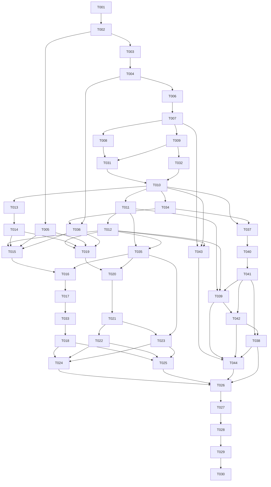

# Multi-Agent Engineering Team - Tasks

## Overview

This derived execution index decomposes the active, implementation-ready source plan into **44 bounded tasks in 23 waves**, covering U1-U14. The 2026-10-22 KTD28 revision adds U14 as T043 (the offline slice: pinned core and role charters, and the reviewer report format enforced at recording; wave 14) and T044 (facts-only briefs, retained review packets and the observed-discovery check; wave 18, after T039, T042 and T038). T026 now also depends on T044, and T026-T030 move to waves 19-23. The 2026-10-19 revision splits T010: T010 closes at its reviewed source and host-provisioning share, and the new T037 owns the full launch lifecycle, production startup composition and installed-client acceptance; T026 now also depends on T037. The 2026-10-20 revision moves T037's installed-client acceptance into the new T038, which depends on T037 and now gates T026 instead. A later 2026-10-20 revision moves T011's production launch wiring into the new T039, which depends on T011, T012 and T037; T038 now also depends on T039 and moves to wave 13. The 2026-10-21 revision closes T037 at the hardened process reader and moves its lifecycle into the new T040 and its production composition into the new T041; T039 now depends on T041 and moves to wave 15, and T038 depends on T039 and T041 and moves to wave 16. A later 2026-10-21 revision adds the managed-attempt producer to T039, after T041's review found that no production path builds the context projection, the per-attempt mailbox endpoint or the seat's managed attempt. The 2026-10-22 revision splits that producer out of T039 into the new T042, because the producer's prerequisites have no production owner and the combined work would exceed the task-level budget; T042 depends on T039 and T041, and T038 now depends on T042 and moves to wave 17. The 2026-10-18 revision applies PC8 and KTD25-KTD27: it adds T034 (client lock), T035 (scope extensions) and T036 (health checks), and amends T012, T015, T016, T019, T020, T023 and T026. The 2026-10-15 regeneration keeps T001-T030 and adds T031 (KTD19 channel spike), T032 (KTD21 Lead wake guards) and T033 (KTD20 failure classification and attempt phases); T004 now carries the KTD22 fixed-startup-mode and admission-invariant boundaries, T007-T010 and T016 carry the KTD21 and PC7 changes, and T018 routes recovery through the KTD20 classifier. This is a derived execution index, not a second plan, an approval record or a progress tracker. Task IDs describe scope, not completed implementation. Progress and current grants live in execution evidence outside this pack.

**Validation boundary:** T004 retains the plan-declared `engine/packages/daemon/src/middleware/auth-bearer-token.ts` source path. The validator contract must contain the audited exact-path allowance; broader credential-name denials remain in force. Validate this regenerated pack from the WSL artifact root before execution. Do not remove required source paths or treat a manual exception as a passing receipt.

**High-risk review gate:** after deterministic validation, review this pack against the current source plan and imported owners. Shared authority contracts, worker isolation, the PC7 unattended launch mode, owner clients and two-repository acceptance need semantic review beyond structural validation. The pack records neither review approval nor permission to execute, provision hosts, spend provider quota or publish changes.

### Repository and file ownership

| Target identity | Scope | Tasks |
| --- | --- | --- |
| `ronronner02/multi-agent` | Engine, control-side harnesses and project documents. The verified WSL checkout at `/home/leo/src/multi-agent` is the sole development authority; `D:/Multi-Agent` is a preserved reference copy. | All except T025-T026 |
| `work-board` | Separately registered local demo root, outside the orchestrator's physical ancestry, with run-local candidate copies. No remote repository. | T025-T026 |

Every card's `files` is relative to its `target_repo`, not the artifact resolution root. The `--repo` used to validate this document selects only the artifact/source root. Resolve physical roots and reject aliases/nesting before writes. The demo seed, feature candidate and control-side acceptance harness have different owners. No worker receives orchestrator source, control state or writable acceptance expectations.

T002 is the only **pinned import operation**, explicitly authorized by U1's source-tree scope when execution is selected. Its exact import/transfer manifest must be audited, frozen and approved before extraction; the listed manifest/build/document paths are the adaptation entrypoints, not an invented full archive inventory. All subsequent edits are restricted to concrete card paths and bounded expected side effects. Native adapter/pickup owners are reconciled with `docs/upstream-baseline.md`; additional mutation paths still require scoped regeneration. Changes to imported files must be recorded in `tools/upstream-import.mjs` `PIN.adapted`, without weakening the provenance verifier. This shared side effect is serialized, including tasks listed in the same wave. New filenames inside plan-declared directories are proposed implementation choices, not claims that files exist.

### Execution-wide gates

- Revalidate source lifecycle, canonical hash, task-pack bytes, repository identity and task scope at intake and continuation. Framework task freshness uses the canonical body hash above; the product's runtime plan approval uses the stricter exact-byte invalidation required by KTD5. Do not substitute one digest policy for the other.
- The owner-confirmed Planning Contract and PC1-PC7 govern milestone changes over historical Product Contract statements. In particular, both authenticated owner clients are supported; the earlier TUI-only wording does not remove browser authority.
- Establish Ubuntu identity/filesystem/process feasibility before substantial adaptation. No weaker identity, launch outside the worker boundary, alternative host, raw worker terminal API or shared control socket is a fallback. PC7's native no-prompt flags apply only inside that boundary and only through the launcher.
- Keep automatic managed dispatch disabled through foundation/integration gates. Only explicitly scoped preflight/native probes are allowed before U8; they are not broad autonomous feature work. Keep `webUiEnabled` false until U9's session/terminal gates pass, and keep the listener loopback-only throughout this milestone.
- Offline tests must not start provider sessions. Setup/privilege changes require their explicit scope; each live compatibility probe, primary run, reverse-contract run and comparison trial needs its own grant and recorded supported spending cap or explicit time-only posture.
- Each granted run has at most three live sessions including the separate lead, one diagnosed recoverable retry, two review/rework cycles (up to four for open P0/P1 under the progress gate) and 60 cumulative active minutes. New IDs, restart, retry, concurrent sessions and staged task cards do not reset or multiply that budget. Only a durable pause while all work is stopped pauses accounting.
- No managed launch may run under `sandbox.network: host-shared` (KTD23); the narrowed-network policy revision and its preflight receipt must exist first, and a preflight receipt is void once host networking or `policy_revision` changes.
- T017 owns independent worker-deadline (launcher-enforced, on the privileged isolation owner)/no-progress/storage-cap enforcement; T033 owns failure classification, retry eligibility and attempt phases; T018 owns conservative crash reconciliation. Unknown identity, ambiguous effects, stale plan, rejected grant, failed persistence or exhausted limits stop dependent dispatch. Preserve unrelated files, processes and durable evidence.
- Shared dependency declarations and lockfile changes are owned by T005 before parallel UI work. Missing shared language keys or unexpected imported owners require a serialized scoped pack revision, not an unlisted parallel edit.
- Review each logical change with `gpt-6.1-sol` and `ds/gpt-6-astra` (the owner's DeepSeek-backed mapping; see the `AGENTS.md` reviewer roster) through locally configured URLs and credentials, without persisting or disclosing keys. Both reviews are report-only and inspect the same frozen candidate; use two rounds, plus rounds 3 and 4 only for open P0/P1 under the progress gate, and leave the gate open when a model is unavailable.
- Stop at T015-T016 and T019-T022 until the owner has reviewed the corresponding design proposal.
- `parallelizable` and waves describe possible implementation scheduling, not worker-dispatch authorization. Independent review intent is not a record that review passed.
- Commit, push, PR creation, merge, release, deployment, remote CI activation and destructive cleanup need their respective current grants; the task pack grants none.

## Source Summary

- **Source:** [the single active plan](../plans/2026-10-13-001-feat-multi-agent-team-plan.md).
- **Branch:** regenerated derived pack with concrete imported owners and serialized import-manifest maintenance; independent semantic review follows deterministic validation.
- **Authority consumed:** Product Contract R1-R22, F1-F4, AE1-AE13 and Success Criteria; Planning Contract PC1-PC8/KTD1-KTD28, interface and persistence invariants, isolation/source transfer, experience matrix, operational caps and demo ownership; all U1-U14; Verification Contract and Definition of Done.
- **Boundary-driven decomposition:** separate preflight from import, persistent authority from enforcement, catalog from context manifests, native launch from safe mailbox consumption and actual-client proof, ownership from review, browser authentication from terminal authority, terminal projection from controls, cancellation from recovery, UI construction from browser proof, demo seed from feature work, and primary/reverse/comparative evidence from final closeout.
- **Implementation-time unknowns retained:** the separate demo root, current client authentication and effective context, owner provisioning/live-run caps and actual browser/client behavior. Native adapter and queue-owner paths are now mapped to the imported source; additional owners remain stop conditions.
- **Excluded/deferred:** distributed nodes, concurrent projects, Pi/DSH support, every optional workflow's live execution, TUI goal authoring/session administration, hostile-admin containment, and Milestone 2 domain/tunnel/passkey/app/push-notification work. Responsive local layouts are included now.
- **Scope preservation:** the selected engine remains selected; the second engine is only a same-frozen-task evaluation. Generated mockups stay historical; `docs/Rendering.png` remains the benchmark. Existing generated runtime directories and personal configuration stay intact.

## Traceability Matrix

The matrix preserves all source units and their source requirement anchors; the canonical JSON narrows each task further. Repeated R/AE references express shared proof obligations, not additional scope.

| Source | Requirements / acceptance | Task(s) | Primary validation |
| --- | --- | --- | --- |
| U1 | R2, R3, R7, R13, R20, R21; AE2, AE6, AE12, AE13; KTD1, KTD2, KTD6, KTD7, KTD10, KTD23 | T001-T002 | Actual isolation preflight, pinned import/transfer hashes, preserved Windows source and reproducible build |
| U2 | R1, R4, R5, R13, R19, R21, R22; AE1, AE4, AE6, AE11, AE13; KTD4-KTD6, KTD22 | T003-T004 | Transactional migration/governance, fixed daemon mode, admission invariants and owner-level managed-entry authority checks |
| U3 | R1-R6, R11, R18, R19, R21, R22; AE1-AE4, AE11, AE13; KTD3-KTD6, KTD21 | T006-T007 | Pinned catalog equality, bounded invocation, task freshness, effective-context manifests and the Lead operating protocol |
| U4 | R6-R9, R11-R13, R15, R16, R19, R21; AE3, AE5, AE6, AE8, AE12, AE13; KTD3, KTD6, KTD7, KTD11, KTD16, KTD19, KTD21, KTD23, KTD24, KTD27; PC7 | T008-T010, T031-T032, T034, T037-T042, T040-T041 | Safe mailbox and PC7 launch contracts, the KTD19 spike record, Lead wake guards, plus actual two-client containment and resume proof |
| U5 | R4-R6, R10, R11, R16-R18, R21, R22; AE2-AE5, AE9-AE11, AE13; KTD4, KTD8, KTD9, KTD24, KTD25 | T011-T012, T035, T039, T042 | Dependency/snapshot isolation, exact independent review, progress-gated bounded rework, the managed-attempt producer and KTD25 scope extensions |
| U6 | R9, R12-R14, R16; AE5-AE7, AE10, AE12; KTD4-KTD6, KTD15, KTD16; PC1-PC4 | T015-T016 | Replay/width/language tests, owner controls and two-size bilingual terminal acceptance |
| U7 | R5, R9-R15, R18, R21, R22; AE4, AE6-AE9, AE13; KTD4-KTD9, KTD20 | T017-T018, T033 | Owned-process cancel/deadlines, failure classification and retry eligibility, crash fault injection, no duplicate side effects and paired restore |
| U9 | R12-R14, R19, R21, R22; AE6, AE13; KTD6, KTD14, KTD16, KTD18; PC1, PC4, PC5 | T013-T014 | Session/forgery/expiry gates, owner-host identity and audited read-only/take-over boundaries |
| U10 | R12; KTD15; PC2 | T005 | Shared catalog/interpolation parity, fallback and display-width tests |
| U11 | R9, R12-R16, R18; AE5-AE7, AE9, AE10, AE12; KTD2, KTD13-KTD16; PC1-PC4, PC6 | T019-T021 | Component behavior, reference adaptations, six browser width/language combinations and accessibility |
| U12 | R4, R5, R12, R16, R21, R22; AE4, AE13; KTD5, KTD17; PC5 | T022-T023 | Canonical read-only paths/inert Markdown and versioned plan-bound task edits |
| U13 | R12, R16; AE12; KTD20, KTD23, KTD26, KTD27; PC8 | T036 | Fault-fixture health lights, `unknown` on timeout, no-mutation check and agent denial |
| U14 | R6, R11, R17, R21, R22; KTD3, KTD9, KTD21, KTD24, KTD27, KTD28 | T043-T044 | Pinned, versioned role instructions in every manifest, the reviewer report format refused or residualized at recording, facts-only briefs and observed discovery |
| U8 | R1-R22, F1-F4, AE1-AE13; KTD1-KTD28; PC1-PC8; all Success Criteria | T024-T030 | Frozen seed, primary live feature/owner acceptance, reverse contracts, actual candidate comparison and final proof reconciliation |

### Required-proof ownership

| Proof intent | Foundation / focused owner | Final evidence owner |
| --- | --- | --- |
| Scope, framework routing, approval and assignment freshness | T003-T004, T006-T007 | T027, T030 |
| Distinct native clients and direct addressed collaboration | T008-T010, T037-T042, T040-T041 | T027-T028 |
| Structured native channels and Lead wake bounds | T007, T031-T032 | T038, T030 |
| Rejection, PC7 launch mode, context and control isolation | T001-T002, T004, T007-T010, T013-T014, T037-T042, T040-T041 | T027-T028 |
| Candidate integrity, independent review and integrated acceptance | T011-T012, T039, T042, T024-T026 | T027, T030 |
| Cancellation, restart, ambiguous effects and cumulative limits | T017-T018, T033 | T027-T028 |
| Reproducible source/build and database rollback | T001-T003, T018 | T030 |
| TUI interaction, log visibility, replay timing and durable projection | T015-T016 | T027 |
| Reference Web UI and responsive/accessibility behavior | T019-T021 | T027 |
| Browser pairing/session and owner terminal/take-over safety | T013-T014, T016, T020 | T027 |
| Shared language and runtime switching | T005, T015-T016, T019-T021 | T027 |
| Read-only workspace/knowledge and bounded task editing | T022-T023 | T027 |
| Same-task engine comparison | T024-T025, T029 | T029-T030 |
| Scope extensions and progress-gated review | T012, T035 | T027, T030 |
| System health status | T036, T015, T019 | T027 |
| Client version lock | T034 | T027, T030 |
| Role charters and review output format | T043-T044 | T027, T030 |
| Complete required-proof reconciliation and delivery claim ceiling | Each task owns its focused receipts | T030 |

All required intents above need actual final-source evidence. A blocked candidate scenario can be comparative evidence, but is not a passing capability; an unattempted comparison does not satisfy the Success Criteria. KTD18's remote exposure is deferred, while local Host refusal and responsive behavior are required now.

## Task Graph

The canonical dependency arrays below are authoritative. This compact graph highlights shared prerequisites; it is not a substitute for them.



U8 waits for all earlier source-unit outputs through transitive dependencies. The live evidence chain is serial because it shares the approved local runtime/candidate history and must preserve comparable, independently authorized trials. T027 observes the primary T026 run rather than starting a new one. A task-level handoff never resets run limits.

## Execution Waves

Tasks in a wave have disjoint primary file ownership. Tasks carrying the shared import-manifest side effect are marked non-parallel and run serially despite sharing a wave. Other concurrency remains a scheduling option only; execute serially when worker authorization or isolation is absent. Named dependencies, not the passage of a wave, establish eligibility.

| Wave | Tasks | Output / gate |
| --- | --- | --- |
| 1 | T001 | Isolation/client feasibility; no substantial adaptation before passing |
| 2 | T002 | Audited import, exact owner inventory and hash-verified WSL authority |
| 3 | T003, T005 | Shared authority/persistence and shared language/dependency foundations |
| 4 | T004 | New and legacy managed-entry authority enforcement |
| 5 | T006 | Pinned catalog and invocation preservation |
| 6 | T007 | Scope-bound assignments, immutable context manifests and the Lead operating protocol |
| 7 | T008, T009 | PC7 native launch boundary and safe durable mailbox |
| 8 | T031, T032 | KTD19 channel spike and Lead wake guards |
| 9 | T010 | Managed-launch source contracts, the KTD24 projection and the Rev-5 host preflight |
| 10 | T011, T013, T034 | Candidate/dependency isolation, browser owner sessions and the client version lock |
| 11 | T012, T014, T036, T037 | Independent review, owner terminal/take-over gates and read-only health checks, and production launch composition |
| 12 | T015, T019, T035, T040 | TUI projections, Web shell/data and KTD25 scope extensions, and the managed launch lifecycle |
| 13 | T016, T020, T041 | Terminal owner controls and browser task/decision/session views, and production launch composition |
| 14 | T017, T021, T043 | Cancellation/resource enforcement, responsive browser proof and pinned role charters |
| 15 | T022, T023, T033, T039 | Scoped read views, bounded edits and failure classification, and production candidate isolation |
| 16 | T018, T042 | Recovery/rollback through the shared classifier, and the managed-attempt producer |
| 17 | T024, T025, T038 | Installed-client two-client acceptance, control-side harness and separately owned frozen demo seed |
| 18 | T044 | Facts-only role briefs, retained review packets and observed charter discovery |
| 19 | T026 | Approved primary demo implementation/review |
| 20 | T027 | Primary live owner-flow and adversarial evidence |
| 21 | T028 | Separately authorized reverse-pairing contracts |
| 22 | T029 | Separately authorized same-frozen-task comparison |
| 23 | T030 | Final source-bound proof reconciliation and local closeout |

## Task Pack Contract

The following JSON is the single machine-readable task source. Human cards below are a compressed mirror. Required review gates express risk intent, not review/approval state.

```json
{
  "schema_version": "task-pack/v1",
  "execution_waves": [
    {
      "wave": 1,
      "tasks": [
        "T001"
      ]
    },
    {
      "wave": 2,
      "tasks": [
        "T002"
      ]
    },
    {
      "wave": 3,
      "tasks": [
        "T003",
        "T005"
      ]
    },
    {
      "wave": 4,
      "tasks": [
        "T004"
      ]
    },
    {
      "wave": 5,
      "tasks": [
        "T006"
      ]
    },
    {
      "wave": 6,
      "tasks": [
        "T007"
      ]
    },
    {
      "wave": 7,
      "tasks": [
        "T008",
        "T009"
      ]
    },
    {
      "wave": 8,
      "tasks": [
        "T031",
        "T032"
      ]
    },
    {
      "wave": 9,
      "tasks": [
        "T010"
      ]
    },
    {
      "wave": 10,
      "tasks": [
        "T011",
        "T013",
        "T034"
      ]
    },
    {
      "wave": 11,
      "tasks": [
        "T012",
        "T014",
        "T036",
        "T037"
      ]
    },
    {
      "wave": 12,
      "tasks": [
        "T015",
        "T019",
        "T035",
        "T040"
      ]
    },
    {
      "wave": 13,
      "tasks": [
        "T016",
        "T020",
        "T041"
      ]
    },
    {
      "wave": 14,
      "tasks": [
        "T017",
        "T021",
        "T043"
      ]
    },
    {
      "wave": 15,
      "tasks": [
        "T022",
        "T023",
        "T033",
        "T039"
      ]
    },
    {
      "wave": 16,
      "tasks": [
        "T018",
        "T042"
      ]
    },
    {
      "wave": 17,
      "tasks": [
        "T038",
        "T024",
        "T025"
      ]
    },
    {
      "wave": 18,
      "tasks": [
        "T044"
      ]
    },
    {
      "wave": 19,
      "tasks": [
        "T026"
      ]
    },
    {
      "wave": 20,
      "tasks": [
        "T027"
      ]
    },
    {
      "wave": 21,
      "tasks": [
        "T028"
      ]
    },
    {
      "wave": 22,
      "tasks": [
        "T029"
      ]
    },
    {
      "wave": 23,
      "tasks": [
        "T030"
      ]
    }
  ],
  "tasks": [
    {
      "task_id": "T001",
      "source_unit": "U1",
      "requirement_refs": [
        "R2",
        "R3",
        "R7",
        "R13",
        "R20",
        "R21",
        "F1",
        "F4",
        "AE2",
        "AE6",
        "AE12",
        "AE13",
        "KTD2",
        "KTD6",
        "KTD7",
        "KTD23"
      ],
      "goal": "Prove the WSL worker-isolation and native-client prerequisites before adapting the engine.",
      "dependencies": [],
      "target_repo": "ronronner02/multi-agent",
      "files": [
        "engine/config/isolation/worker-policy.json",
        "engine/test/worker-isolation-preflight.test.mjs",
        "docs/operations.md",
        "engine/config/isolation/worker-launch.mjs",
        "engine/config/isolation/provision-host.sh"
      ],
      "context_refs": [
        "docs/plans/2026-10-13-001-feat-multi-agent-team-plan.md#u1-establish-the-pinned-source-and-reproducible-wsl-foundation",
        "docs/plans/2026-10-13-001-feat-multi-agent-team-plan.md#worker-isolation-and-source-transfer",
        "docs/plans/2026-10-13-001-feat-multi-agent-team-plan.md#risks-and-execution-prerequisites"
      ],
      "entry_hint": "Start with the first context anchor and the task's listed source/test owners.",
      "test_focus": "Read-only inventory followed only by authorized minimal probes: worker scratch write succeeds while token/database/WAL/shared-memory/socket/owner-pane access, host-process access and Windows interoperation fail; both native clients retain protections; Windows browser reaches WSL localhost without non-loopback binding. The preflight also enumerates the sandbox reachable set: provider and dependency endpoints succeed while Windows host loopback services, overlay-network peers and their MagicDNS names, the local LAN and host abstract sockets all fail (KTD23). That enumeration is a re-run gate, not a one-time result: a receipt is valid only for the host networking and policy_revision it was taken under, so changing either invalidates it and requires the preflight to run again before the next managed launch.",
      "done_signal": "Redacted receipts record Ubuntu/kernel, identities, isolated mounts/process boundary, launcher ownership/hashes and client versions; each required capability is either demonstrated or blocks T002. Offline checks spend no provider quota.",
      "wave": 1,
      "parallelizable": false,
      "stop_if": "Stop if the source plan is no longer active, its canonical body hash differs, repository identity is unresolved, or implementation needs undeclared mutation paths. OS account/privilege changes, launcher provisioning, a provider call, or another host is needed without its specific grant; any denial boundary fails or a client requires broad-access settings.",
      "review_gate": "required",
      "review_focus": "Check that real worker subprocess probes, rather than launch flags, establish isolation and that the launcher is not a general privileged executor.",
      "notes": "Minimal harness/policy scaffolding only; no source import, business task, client auto-upgrade or model run by inference. Select a new Linux checkout and separate demo allocation; preserve existing Windows and personal files. Provisioning also creates the pinned framework tree at the policy's framework_dir, which the U4 sandbox mounts read-only, and installs the narrowed worker network path KTD23 requires; a missing framework tree blocks live managed acceptance but not adapter implementation, while a host network posture that cannot be narrowed blocks managed launch entirely.",
      "risk_note": "Source and client inventory must be reverified before a repeated preflight; a failed capability blocks adaptation rather than weakening containment."
    },
    {
      "task_id": "T002",
      "source_unit": "U1",
      "requirement_refs": [
        "R2",
        "R3",
        "R7",
        "R13",
        "R20",
        "R21",
        "AE2",
        "AE6",
        "AE12",
        "AE13",
        "KTD1",
        "KTD2",
        "KTD7",
        "KTD10"
      ],
      "goal": "Audit the pinned source import, transfer a verified source manifest, and establish the reproducible WSL baseline.",
      "dependencies": [
        "T001"
      ],
      "target_repo": "ronronner02/multi-agent",
      "files": [
        "engine/package.json",
        "engine/package-lock.json",
        "engine/packages/daemon/package.json",
        "engine/packages/tui/package.json",
        "engine/test/project-baseline.test.mjs",
        "docs/upstream-baseline.md",
        "docs/development.md",
        "docs/operations.md",
        "tools/upstream-import.mjs",
        "tools/windows-export.mjs",
        "engine/packages/cli/package.json",
        "engine/packages/ui/package.json"
      ],
      "context_refs": [
        "docs/plans/2026-10-13-001-feat-multi-agent-team-plan.md#u1-establish-the-pinned-source-and-reproducible-wsl-foundation",
        "docs/plans/2026-10-13-001-feat-multi-agent-team-plan.md#worker-isolation-and-source-transfer",
        "docs/plans/2026-10-13-001-feat-multi-agent-team-plan.md#commands-and-evidence-binding"
      ],
      "entry_hint": "Start with the first context anchor and the task's listed source/test owners.",
      "test_focus": "Archive/symlink escape and lifecycle-script audit; additive pinned import with license/notices; manifest transfer and conflicting-export rejection; clean Node 24/npm build, lint, tests, UI tests and SQLite ABI verification.",
      "done_signal": "Preserved Windows file hashes match; approved bootstrap source hashes match the new WSL checkout; cutover authority is recorded; imported script names and exact source owners are inventoried; reproducible baseline results bind source hashes and exact versions.",
      "wave": 2,
      "parallelizable": false,
      "stop_if": "Stop if the source plan is no longer active, its canonical body hash differs, repository identity is unresolved, or implementation needs undeclared mutation paths. Archive entries escape, import would overwrite user files, source/license differs from the pin, a manifest/script or required source owner is missing, or WSL transfer loses identity. Reconcile concrete downstream paths and regenerate the pack before dispatch if the imported layout differs.",
      "review_gate": "required",
      "review_focus": "Check import provenance, lifecycle-script effects, absence of secrets/runtime copies, source-authority cutover and rollback preservation.",
      "notes": "Only this task owns the source import operation under the plan-declared engine/ tree. The listed files are adaptation/check entrypoints, not permission to invent an import set: freeze and approve the exact archive/source manifest before extraction or transfer. Retain upstream source and notices, internal package identifiers and inactive components; adapt application version to 0.1.0. No initial commit, checkout replacement or bidirectional sync.",
      "risk_note": "No local engine source or WSL/client acceptance existed at compilation; failed feasibility blocks adaptation, not a weaker fallback."
    },
    {
      "task_id": "T003",
      "source_unit": "U2",
      "requirement_refs": [
        "R1",
        "R4",
        "R5",
        "R13",
        "R19",
        "R21",
        "R22",
        "F1",
        "F4",
        "AE1",
        "AE4",
        "AE6",
        "AE11",
        "AE13",
        "KTD4",
        "KTD5",
        "KTD6",
        "KTD9"
      ],
      "goal": "Add shared authority contracts and transactional governance persistence.",
      "dependencies": [
        "T002"
      ],
      "target_repo": "ronronner02/multi-agent",
      "files": [
        "engine/packages/daemon/src/contracts/team-control.ts",
        "engine/packages/daemon/src/team-control-surface.ts",
        "engine/packages/daemon/package.json",
        "engine/packages/daemon/src/domain/plan-governance.ts",
        "engine/packages/daemon/src/domain/queue-repository.ts",
        "engine/packages/daemon/src/domain/event-bus.ts",
        "engine/packages/daemon/src/domain/types.ts",
        "engine/packages/daemon/src/db/migrations/104_team_governance.ts",
        "engine/packages/daemon/src/db/all-migrations.ts",
        "engine/packages/daemon/test/team-governance.test.ts",
        "engine/packages/daemon/test/team-migration.test.ts",
        "engine/packages/daemon/test/helpers/test-app.ts",
        "engine/packages/daemon/test/p34-call-site-allowlist.test.ts",
        "engine/test/project-baseline.test.mjs",
        "engine/packages/daemon/src/domain/rig-repository.ts",
        "engine/packages/daemon/src/domain/rig-lifecycle-service.ts",
        "engine/packages/daemon/src/domain/rig-teardown.ts",
        "engine/packages/daemon/src/routes/rigs.ts",
        "engine/packages/daemon/test/rig-repository.test.ts",
        "engine/packages/daemon/test/rig-lifecycle-route.test.ts",
        "engine/packages/daemon/test/rig-teardown.test.ts",
        "engine/packages/daemon/test/rigs-routes.test.ts"
      ],
      "context_refs": [
        "docs/plans/2026-10-13-001-feat-multi-agent-team-plan.md#u2-establish-plan-bound-authority-and-durable-control-contracts",
        "docs/plans/2026-10-13-001-feat-multi-agent-team-plan.md#interface-contracts",
        "docs/plans/2026-10-13-001-feat-multi-agent-team-plan.md#state-persistence-and-approval-invariants"
      ],
      "entry_hint": "Start with the first context anchor and the task's listed source/test owners.",
      "test_focus": "Plan/action/repository/policy binding, entity-version compare-and-set, idempotent decisions, rejection persistence, approval consumption, attempt/budget evidence and post-commit event publication; additive migrations and paired restore fixtures. Register migration and transactional-writer fixtures; verify exact-file provenance and adjacent-file rejection. Cover expired unconsumed renewal through a new pending owner decision, blocked owner escalation without dispatch, observed stopped task outcomes and history-preserving rig deletion conflicts before lifecycle side effects.",
      "done_signal": "Focused tests demonstrate one ordered approve/cancel result, no acknowledgement on persistence failure, stale-plan invalidation and old-message preservation. One exported contract serves later clients; event versions and null-with-reason usage fields are validated.",
      "wave": 3,
      "parallelizable": false,
      "stop_if": "Stop if the source plan is no longer active, its canonical body hash differs, repository identity is unresolved, or implementation needs undeclared mutation paths. Implementation introduces another task scheduler/store, removes still-used schema fields, treats a task pack as approval, or silently reuses a changed migration number.",
      "review_gate": "required",
      "review_focus": "Inspect transaction boundaries, exact approval payload/digest binding, budget durability and compatibility with the retained queue owner. Preserve rejection/consumption fences, counters and immutable bindings across renewal and escalation. Check stopped-attempt evidence before terminal transitions, and retained delete/release/teardown compatibility.",
      "risk_note": "A guarded new endpoint is insufficient while a legacy route, internal wake path or direct worker control-state path remains open.",
      "expected_side_effects": [
        "tools/upstream-import.mjs"
      ],
      "notes": "No dependency additions, upgrades or lockfile changes. The package edit only exports the shared contract. Record changes to imported files in PIN.adapted through the declared, serialized import-manifest side effect. The existing domain/types.ts RigEvent union owns event-bus typing; extend it additively with the shared event contract rather than creating a second event store or bypassing type checks. Approved follow-up is bounded to existing foundation compatibility: renew only expired unconsumed grants through new pending decisions; allow non-dispatching owner escalation records while blocked without applying limits or scope changes; record observed terminal outcomes without reopening dispatch; deny deletion of rigs with governance history before deletion-related lifecycle effects. Imported fixture, lifecycle and route owners are exact PIN.adapted entries. Register the six new authority files individually in LOCAL_ENGINE_PATHS and distinguish exact file entries from slash-terminated directory entries. No cascading removal of governance history or broad legacy authority enforcement is included."
    },
    {
      "task_id": "T004",
      "source_unit": "U2",
      "requirement_refs": [
        "R1",
        "R4",
        "R5",
        "R13",
        "R19",
        "R21",
        "R22",
        "F1",
        "F4",
        "AE1",
        "AE4",
        "AE6",
        "AE11",
        "AE13",
        "KTD4",
        "KTD5",
        "KTD6",
        "KTD22"
      ],
      "goal": "Fix daemon mode at startup and enforce managed-control grants at the owner-level legacy boundaries.",
      "dependencies": [
        "T003"
      ],
      "target_repo": "ronronner02/multi-agent",
      "files": [
        "engine/packages/daemon/src/routes/team-control.ts",
        "engine/packages/daemon/src/index.ts",
        "engine/packages/daemon/src/server.ts",
        "engine/packages/daemon/src/startup.ts",
        "engine/packages/daemon/src/domain/plan-governance.ts",
        "engine/packages/daemon/src/domain/queue-repository.ts",
        "engine/packages/daemon/src/adapters/tmux.ts",
        "engine/packages/daemon/src/middleware/auth-bearer-token.ts",
        "engine/packages/daemon/src/middleware/browser-boundary.ts",
        "docs/operations.md",
        "engine/packages/daemon/test/team-control-auth.test.ts",
        "engine/packages/daemon/test/team-governance.test.ts",
        "engine/packages/daemon/test/daemon-mode.test.ts",
        "engine/packages/daemon/test/startup-wiring-pins.test.ts"
      ],
      "context_refs": [
        "docs/plans/2026-10-13-001-feat-multi-agent-team-plan.md#u2-establish-plan-bound-authority-and-durable-control-contracts",
        "docs/plans/2026-10-13-001-feat-multi-agent-team-plan.md#state-persistence-and-approval-invariants",
        "engine/packages/daemon/src/domain/plan-governance.ts",
        "engine/packages/daemon/src/index.ts",
        "engine/packages/daemon/test/daemon-mode.test.ts"
      ],
      "entry_hint": "Start with U2's KTD22 approach and the daemon-mode test's startup inventory.",
      "test_focus": "Managed-mode createDaemon and startServer start none of the KTD22 legacy services; every legacy /api/* path returns managed_control_required and legacy pages return 404; legacy mode refuses managed-authority registration while preserving upstream behavior; persisted managed authority selects managed mode at startup; ungranted queue mutators and tmux session create/input/kill are refused at the owner while calls inside a managed-control grant succeed; effects admitted before revocation still record outcomes.",
      "done_signal": "Daemon-mode tests cover both boot paths and the startup inventory; route and auth tests cover the managed allowlist and legacy refusal; owner-level queue/tmux tests prove grant-aware refusal and success; admission tests prove post-revocation outcome recording; operations documentation states the fixed startup mode and managed-mode responses.",
      "wave": 4,
      "parallelizable": false,
      "stop_if": "Stop if the source plan is no longer active, its canonical body hash differs, repository identity is unresolved, or implementation needs undeclared mutation paths. Restoring per-call-site guards, adding another scheduler/store, changing the managed route architecture, or editing owners outside the revised U2 file list requires plan reconciliation.",
      "review_gate": "required",
      "review_focus": "Check KTD22 startup composition in createDaemon and startServer, the single managed-route allowlist, grant-aware owner checks, admission outcome recording, and legacy compatibility.",
      "notes": "Continue the existing uncommitted T004 work. Keep the governance contracts and fixed mode; remove only unreachable per-call-site guards. The managed-control grant must remain the authorization boundary for shared queue and tmux owners, and outcome/receipt writes remain admissible after revocation.",
      "risk_note": "A route-only green result can miss a startServer boot path or an owner-level bypass; direct queue and tmux calls must exercise both ungranted and granted cases.",
      "expected_side_effects": [
        "tools/upstream-import.mjs"
      ]
    },
    {
      "task_id": "T005",
      "source_unit": "U10",
      "requirement_refs": [
        "R12",
        "PC2",
        "KTD15"
      ],
      "goal": "Create the shared typed Chinese/English catalog and display-width package.",
      "dependencies": [
        "T002"
      ],
      "target_repo": "ronronner02/multi-agent",
      "files": [
        "engine/packages/i18n/package.json",
        "engine/packages/i18n/src/index.ts",
        "engine/packages/i18n/src/catalogs/zh-CN.json",
        "engine/packages/i18n/src/catalogs/en.json",
        "engine/packages/i18n/src/display-width.ts",
        "engine/packages/i18n/test/catalog-parity.test.ts",
        "engine/packages/i18n/test/display-width.test.ts",
        "engine/package.json",
        "engine/package-lock.json",
        "engine/packages/tui/package.json",
        "engine/packages/ui/package.json"
      ],
      "context_refs": [
        "docs/plans/2026-10-13-001-feat-multi-agent-team-plan.md#u10-share-the-chineseenglish-interface-catalog",
        "docs/plans/2026-10-13-001-feat-multi-agent-team-plan.md#interface-contracts",
        "docs/plans/2026-10-13-001-feat-multi-agent-team-plan.md#web-ui-and-tui-experience"
      ],
      "entry_hint": "Start with the first context anchor and the task's listed source/test owners.",
      "test_focus": "Catalog/interpolation parity, fallback reporting, unknown-code passthrough and widths for Chinese, emoji and combining marks; consumer-ready runtime switch API.",
      "done_signal": "Package tests pass; Chinese is the interface default; state/event codes remain English identifiers; both clients can consume the same catalog and persist language in owner configuration without translating agent text.",
      "wave": 3,
      "parallelizable": false,
      "stop_if": "Stop if the source plan is no longer active, its canonical body hash differs, repository identity is unresolved, or implementation needs undeclared mutation paths. A separate client-owned managed-run string table, another UI framework or unrelated runtime dependency is required.",
      "review_gate": "required",
      "review_focus": "Check that the shared package remains display-only and does not mutate event/state identity.",
      "notes": "Wire both consumer dependency declarations and the shared lockfile in this foundation task so later TUI/Web implementation can proceed without concurrent lockfile writes. Only the planned i18next library family is added; clients keep no duplicate managed-run catalog.",
      "risk_note": "Translation must not change stored identifiers, evidence or agent output.",
      "expected_side_effects": [
        "tools/upstream-import.mjs"
      ]
    },
    {
      "task_id": "T006",
      "source_unit": "U3",
      "requirement_refs": [
        "R1",
        "R2",
        "R3",
        "R6",
        "R19",
        "R21",
        "R22",
        "F1",
        "F2",
        "AE1",
        "AE2",
        "AE3",
        "AE11",
        "AE13",
        "KTD3"
      ],
      "goal": "Compose the pinned framework catalog and bounded invocation adapter.",
      "dependencies": [
        "T004"
      ],
      "target_repo": "ronronner02/multi-agent",
      "files": [
        "engine/packages/daemon/src/integrations/framework/catalog.ts",
        "engine/packages/daemon/src/integrations/framework/invocation.ts",
        "engine/packages/daemon/test/framework-catalog.test.ts",
        "engine/packages/daemon/test/framework-invocation.test.ts"
      ],
      "context_refs": [
        "docs/plans/2026-10-13-001-feat-multi-agent-team-plan.md#u3-connect-the-full-framework-catalog-to-bounded-team-assignments",
        "docs/plans/2026-10-13-001-feat-multi-agent-team-plan.md#framework-and-native-session-integration",
        "docs/plans/2026-10-13-001-feat-multi-agent-team-plan.md#engineering-framework-integration"
      ],
      "entry_hint": "Start with the first context anchor and the task's listed source/test owners.",
      "test_focus": "Pinned 38-entrypoint equality and supported/gated/deferred classification; bounded contracts for both native clients; report-only review, user-invoked capabilities and malformed outcomes.",
      "done_signal": "Catalog tests account for all pinned entries without aliases; invocation tests preserve original readiness/mutation/authorization ownership and return incomplete on malformed output rather than substituting workflow semantics.",
      "wave": 5,
      "parallelizable": false,
      "stop_if": "Stop if the source plan is no longer active, its canonical body hash differs, repository identity is unresolved, or implementation needs undeclared mutation paths. The installed local runtime is substituted for the pin, framework semantics are duplicated, or generated root skill/configuration trees would be edited.",
      "review_gate": "required",
      "review_focus": "Check that availability metadata grants neither workflow execution nor delivery authority and that gated/deferred integrations keep their prerequisites.",
      "risk_note": "Pinned file presence does not prove effective client discovery, and installed runtime mirrors may differ from the planned revision."
    },
    {
      "task_id": "T007",
      "source_unit": "U3",
      "requirement_refs": [
        "R1",
        "R2",
        "R3",
        "R4",
        "R5",
        "R6",
        "R19",
        "R21",
        "R22",
        "AE1",
        "AE2",
        "AE3",
        "AE4",
        "AE11",
        "AE13",
        "KTD3",
        "KTD4",
        "KTD5",
        "KTD6",
        "R11",
        "R18",
        "KTD21"
      ],
      "goal": "Bind scoped assignments to immutable effective-context manifests.",
      "dependencies": [
        "T006"
      ],
      "target_repo": "ronronner02/multi-agent",
      "files": [
        "engine/packages/daemon/src/integrations/framework/context-manifest.ts",
        "engine/packages/daemon/src/domain/team-assignment.ts",
        "engine/packages/daemon/src/domain/workflow-runtime.ts",
        "engine/config/team/roles.json",
        "engine/packages/daemon/test/framework-context-manifest.test.ts",
        "engine/packages/daemon/test/team-assignment.test.ts",
        "engine/config/team/lead-protocol.md",
        "engine/packages/daemon/test/lead-protocol.test.ts"
      ],
      "context_refs": [
        "docs/plans/2026-10-13-001-feat-multi-agent-team-plan.md#u3-connect-the-full-framework-catalog-to-bounded-team-assignments",
        "docs/plans/2026-10-13-001-feat-multi-agent-team-plan.md#framework-and-native-session-integration",
        "docs/plans/2026-10-13-001-feat-multi-agent-team-plan.md#worker-isolation-and-source-transfer"
      ],
      "entry_hint": "Start with the first context anchor and the task's listed source/test owners.",
      "test_focus": "Direct plan and optional upstream-validated task-pack assignment; minimal staffing; repository/path/role/dependency/output/permission validation; immutable projected context and negative ancestor/global contamination cases. KTD21 Lead protocol, roster and run instructions delivered read-only on every Lead activation; Lead requests to write an assigned tree, submit review outcomes or record acceptance are rejected; activations without a recorded evaluation stay visibly incomplete.",
      "done_signal": "Assignments carry exact plan/repository/policy identity and separate lead/member configuration; stale/invalid packs reject before dispatch; generated/observed context hashes are recorded and unexpected launch/resume sources block work. Every Lead activation manifest carries the current protocol version, roster and run instructions as read-only entries.",
      "wave": 6,
      "parallelizable": false,
      "stop_if": "Stop if the source plan is no longer active, its canonical body hash differs, repository identity is unresolved, or implementation needs undeclared mutation paths. Assignment generation grants new product scope, root runtime mirrors are copied into worker context, an unaccounted instruction source appears, or effective context cannot be established.",
      "review_gate": "required",
      "review_focus": "Check source/runtime separation and scope preservation through projected instructions, role selection and upstream validator results.",
      "notes": "engine/config/team/roles.json is a proposed concrete file within U3's declared application-owned configuration directory, not an existing source claim. Mutable native state stays separate from read-only instructions and their parent directories.",
      "risk_note": "Pinned file presence does not prove effective client discovery, and installed runtime mirrors may differ from the planned revision.",
      "expected_side_effects": [
        "tools/upstream-import.mjs"
      ]
    },
    {
      "task_id": "T008",
      "source_unit": "U4",
      "requirement_refs": [
        "R6",
        "R7",
        "R12",
        "R15",
        "R16",
        "R19",
        "R21",
        "F2",
        "F4",
        "AE3",
        "AE6",
        "AE8",
        "AE12",
        "AE13",
        "KTD3",
        "KTD6",
        "KTD7",
        "KTD9",
        "KTD11",
        "KTD23",
        "PC7"
      ],
      "goal": "Integrate restricted native launch with the PC7 unattended launch mode and resume identity.",
      "dependencies": [
        "T007"
      ],
      "target_repo": "ronronner02/multi-agent",
      "files": [
        "engine/packages/daemon/src/domain/runtime-adapter.ts",
        "engine/packages/daemon/src/adapters/kernel-authority.ts",
        "engine/packages/daemon/src/adapters/yolo-mode.ts",
        "engine/packages/daemon/src/adapters/tmux-server.ts",
        "engine/packages/daemon/src/adapters/worker-launch.ts",
        "engine/packages/daemon/test/managed-native-policy.test.ts",
        "engine/packages/daemon/test/native-session-contract.test.ts",
        "engine/packages/daemon/src/adapters/claude-code-adapter.ts",
        "engine/packages/daemon/src/adapters/claude-resume.ts",
        "engine/packages/daemon/src/adapters/claude-resume-launch.ts",
        "engine/packages/daemon/src/adapters/codex-runtime-adapter.ts",
        "engine/packages/daemon/src/adapters/codex-resume.ts",
        "engine/packages/daemon/src/adapters/tmux.ts",
        "engine/packages/daemon/src/adapters/tmux-exec.ts",
        "engine/packages/daemon/test/claude-runtime-adapter.test.ts",
        "engine/packages/daemon/test/claude-resume.test.ts",
        "engine/packages/daemon/test/codex-runtime-adapter.test.ts",
        "engine/packages/daemon/test/codex-resume.test.ts",
        "engine/packages/daemon/test/tmux-server.test.ts",
        "engine/packages/daemon/test/tmux-pane-cwd-native.test.ts",
        "engine/packages/daemon/test/terminal-pipe-utf8.test.ts",
        "engine/packages/daemon/test/seat-activity-retirement-hooks.test.ts"
      ],
      "context_refs": [
        "docs/plans/2026-10-13-001-feat-multi-agent-team-plan.md#u4-adapt-native-sessions-and-persistent-peer-communication",
        "docs/plans/2026-10-13-001-feat-multi-agent-team-plan.md#worker-isolation-and-source-transfer",
        "docs/plans/2026-10-13-001-feat-multi-agent-team-plan.md#state-persistence-and-approval-invariants"
      ],
      "entry_hint": "Start with the first context anchor and the task's listed source/test owners.",
      "test_focus": "Fresh/resume worker UID, mounts, closed descriptors, immutable context, isolated provider config and native session/attempt identity; prompt classification; launcher-only PC7 flags (Claude Code `bypassPermissions`; Codex `approval_policy = \"never\"` with `danger-full-access`), refusing sessions that still prompt, keep a native sandbox on, or start outside the worker boundary; provider sign-in from each worker home; the launch and resume paths preserve the KTD23 boundary so a managed session reaches only its provider and dependency endpoints; U4 scenario 19: a verification failure after start, or readiness drift, quiesces the attempt through the authenticated control-side `WorkerLaunchControl.quiesce` bound to its recorded identity and process group, with targeted cases for initial boundary failure, post-ready drift, observation failure, evidence-write failure and quiesce failure. Redact credentials before shared output and bound raw execution logs without losing evidence references.",
      "done_signal": "Adapter tests reject unsupported/unknown readiness and unsafe launch/resume defaults; actual launch metadata is observable; personal configs stay byte-identical; a session that still raises a native prompt is blocked as a configuration fault and nothing is typed into it; a signed-out worker home is a launch blocker; a blocked transition after start completes only with a `terminated` or `quarantined` receipt, and an unconfirmed quiesce remains an unresolved blocker. The U4 scenario 20 context-mount projection is T010's, not this card's. Independent worker-deadline enforcement is T017's obligation under U7, not part of this card: this task records and forwards each attempt deadline and is not gated on the privileged launcher or its policy.",
      "wave": 7,
      "parallelizable": false,
      "stop_if": "Stop if the source plan is no longer active, its canonical body hash differs, repository identity is unresolved, or implementation needs undeclared mutation paths. Either selected client needs a weaker worker boundary or shared control sockets, a model command would run as control identity, or actual Claude/Codex adapter owners differ from the verified file list.",
      "review_gate": "required",
      "review_focus": "Check the launch boundary on fresh sessions and resume, including native subprocesses, PC7 launch-mode enforcement and non-spoofable attempt identity.",
      "notes": "Concrete native adapters and primary existing tests were reconciled with the pinned import. Diagnose the three recorded native-tmux baseline failures before changing their owners. Additional mutation paths still require regeneration. Focused fixtures do not replace the live gate in T010. U7 owns independent worker-deadline enforcement, including any engine/config/isolation/worker-launch.mjs change and the U1 host preflight it requires; this card is not blocked on them. The KTD23 boundary is implemented here; the separately authorized live reachable-set denial is T010's, not this card's.",
      "risk_note": "Real native subprocess and resume evidence is required; mocked permissions, terminal text and launch flags have lower proof authority.",
      "expected_side_effects": [
        "tools/upstream-import.mjs"
      ]
    },
    {
      "task_id": "T009",
      "source_unit": "U4",
      "requirement_refs": [
        "R8",
        "R9",
        "R12",
        "R15",
        "R19",
        "R21",
        "F2",
        "F4",
        "AE5",
        "AE8",
        "AE13",
        "KTD4",
        "KTD11"
      ],
      "goal": "Extend the existing durable chat owner with addressed mailbox consumption.",
      "dependencies": [
        "T007"
      ],
      "target_repo": "ronronner02/multi-agent",
      "files": [
        "engine/packages/daemon/src/domain/chat-repository.ts",
        "engine/packages/daemon/src/routes/chat.ts",
        "engine/packages/daemon/src/domain/mailbox-delivery.ts",
        "engine/packages/daemon/test/team-messaging.test.ts"
      ],
      "context_refs": [
        "docs/plans/2026-10-13-001-feat-multi-agent-team-plan.md#u4-adapt-native-sessions-and-persistent-peer-communication",
        "docs/plans/2026-10-13-001-feat-multi-agent-team-plan.md#interface-contracts",
        "docs/plans/2026-10-13-001-feat-multi-agent-team-plan.md#framework-and-native-session-integration"
      ],
      "entry_hint": "Start with the first context anchor and the task's listed source/test owners.",
      "test_focus": "Recipient/task/reply/attachment identity, capability-scoped polling, at-least-once deduplication and idempotent consumption receipts; prompt-active, reconnect and queued-wait cases. U4 scenario 22: chat history, latest, search and watch exclude mailbox rows and every read omits the capability, which only the send response returns. U4 scenario 23: attachments are null or an array of exact `{ taskId, runId, artifactId, hash }` references scoped to the message's task and run; arrays of other shapes, extra or nested keys and foreign scope are rejected before storage. U4 scenario 24: consumption admission comes from the daemon's observed prompt state for the recipient seat, never from the request's state field or a mailbox-held state cache; a consume with no prior poll, a caller-claimed `ready` against an observed prompt or missing evidence, a racing reconnect/ready poll and a post-restart consume all stay pending with no receipt; only fresh evidence observed after daemon start reads clear; poll returns status and pending count only, never bodies, unless the reading is `clear`; a managed worker whose client yields no seat or hook evidence stays pending and is recorded as a T010 blocker.",
      "done_signal": "Messages persist once with task/run/sender/recipient/artifact references; duplicate delivery produces one consumption outcome; prompt-answer text, newlines and control characters remain data; safe later polling needs no owner relay; no generic chat projection exposes a mailbox row or capability; a malformed or foreign-scope attachment stores nothing. Managed-mode route admission for the worker mailbox is T010's (U4 scenario 21), not this card's.",
      "wave": 7,
      "parallelizable": false,
      "stop_if": "Stop if the source plan is no longer active, its canonical body hash differs, repository identity is unresolved, or implementation needs undeclared mutation paths. Delivery falls back to terminal input/Enter, peer content becomes an approval response, attachments cross task scope, or a second message store is introduced.",
      "review_gate": "required",
      "review_focus": "Inspect prompt-state race handling and authority separation between mailbox consumption, structured wake/resume and owner decisions. Confirm consume admission is daemon-observed and fails closed, and judge post-admission prompt races under the KTD22 admission rule.",
      "risk_note": "Real native subprocess and resume evidence is required; mocked permissions, terminal text and launch flags have lower proof authority.",
      "expected_side_effects": [
        "tools/upstream-import.mjs",
        "engine/packages/daemon/src/server.ts"
      ]
    },
    {
      "task_id": "T010",
      "source_unit": "U4",
      "requirement_refs": [
        "R6",
        "R7",
        "R8",
        "R9",
        "R12",
        "R15",
        "R16",
        "R19",
        "R21",
        "AE3",
        "AE5",
        "AE6",
        "AE8",
        "AE12",
        "AE13",
        "KTD3",
        "KTD6",
        "KTD7",
        "KTD11",
        "KTD19",
        "KTD21",
        "KTD23",
        "KTD24",
        "PC7"
      ],
      "goal": "Land the reviewed source and host-provisioning share of managed native launch, mailbox transport and governed start.",
      "dependencies": [
        "T008",
        "T009",
        "T031",
        "T032"
      ],
      "target_repo": "ronronner02/multi-agent",
      "files": [
        "engine/packages/daemon/test/team-messaging.test.ts",
        "engine/packages/daemon/test/native-session-contract.test.ts",
        "engine/packages/daemon/test/native-channel-contract.test.ts",
        "engine/packages/daemon/src/adapters/worker-launch.ts",
        "engine/packages/daemon/src/integrations/framework/context-manifest.ts",
        "engine/packages/daemon/test/framework-context-manifest.test.ts",
        "engine/config/isolation/worker-launch.mjs",
        "engine/config/isolation/worker-policy.json",
        "engine/config/isolation/provision-host.sh",
        "engine/test/worker-isolation-preflight.test.mjs",
        "engine/packages/daemon/src/server.ts",
        "engine/packages/daemon/src/adapters/worker-launch-control.ts",
        "engine/packages/daemon/src/adapters/worker-mailbox-bridge.ts",
        "engine/packages/daemon/assets/managed-native-channel-relay.cjs",
        "engine/packages/daemon/src/domain/mailbox-delivery.ts",
        "engine/packages/daemon/src/middleware/auth-bearer-token.ts",
        "engine/packages/daemon/test/managed-native-startup.test.ts",
        "engine/packages/daemon/test/worker-mailbox-bridge.test.ts",
        "tools/upstream-import.mjs",
        "engine/packages/daemon/src/domain/plan-governance.ts",
        "engine/packages/daemon/src/adapters/tmux.ts",
        "engine/config/isolation/egress.mjs"
      ],
      "context_refs": [
        "docs/plans/2026-10-13-001-feat-multi-agent-team-plan.md#u4-adapt-native-sessions-and-persistent-peer-communication",
        "docs/plans/2026-10-13-001-feat-multi-agent-team-plan.md#worker-isolation-and-source-transfer",
        "docs/plans/2026-10-13-001-feat-multi-agent-team-plan.md#commands-and-evidence-binding",
        "docs/plans/2026-10-13-001-feat-multi-agent-team-plan.md#t010-production-composition-and-bounded-sequence",
        "engine/packages/daemon/test/auth-bearer-token.test.ts"
      ],
      "entry_hint": "Start with the first context anchor and the task's listed source/test owners.",
      "test_focus": "KTD24 and U4 scenario 20 at manifest build and launch validation: the per-attempt read-only projection under `/var/lib/multi-agent/context/<worker>/<runId>/<attemptId>/`, mandatory `/framework` and `/context` mounts through verified descriptors, the two-prefix host-to-worker mapping, refusal of out-of-mount context, and no cross-worker projection read. U4 scenario 21 route admission in `server.ts`. Shared credential resolution with HTTP loopback admission intact; the authenticated Unix mailbox transport with peer send/reply, own scope, malformed/oversized frames and revocation; the context-only channel relay with prompt race, interrupted output and safe acknowledgments; the immutable effective-configuration digest with fixed native-policy aliases; fixed policy mounts and the mailbox-only surface in the launcher and preflight tests; the five exact import entries and rejection of an unlisted sibling. Governed pre-start admission and reconciliation at `plan-governance.ts`: no effect before admission, idempotent replay and conflicts, session and Lead limits, unresolved-intent accounting, same-attempt identity and confirmed no-start without fabricated identity. Governed start: the exact command is committed before the transport callback, and authority, credential, deadline or admitted-command drift during terminal metadata lookup blocks the write through the `tmux.ts` `beforeWrite` callback and leaves the intent unresolved. Seat resolution from the persisted tree and pane, rejecting missing, stopped, superseded, foreign, aliased and duplicate seats. Privileged process snapshot: supervisor and child-process facts, descriptor cleanup and replacement, root-escape and foreign-process rejection.",
      "done_signal": "Focused tests for every listed slice pass, the daemon typecheck passes, and one final daemon package run has no task-caused failure. Rev-5 is installed with hashes matching the landed source, and its full host preflight passes against the installed launcher hash. Required review closes on the final candidate. T010 makes no live-client, daemon-mediated, channel or restart claim; those belong to T037 and T038.",
      "wave": 9,
      "parallelizable": false,
      "stop_if": "Stop if the source plan is no longer active, its canonical body hash differs, repository identity is unresolved, or implementation needs undeclared mutation paths. Stop if the installed launcher no longer matches the landed source, a required review leaves an open P0/P1, or closing a gate needs production startup composition or a live call. Keep Product Contract bytes and other task contracts unchanged.",
      "review_gate": "required",
      "review_focus": "Confirm that every slice in the closeout candidate is bound by hash to a closed review. The process-reader delta moved to T037 after two P1 findings. Reject any claim of live, daemon-mediated or restart acceptance.",
      "notes": "The KTD24 context-mount change was deferred here from T008 by owner decision on 2026-10-16. context-manifest.ts is shared with T007, and the launcher/policy/provisioning owners are shared with T001 (KTD23) and T017 (deadline). The KTD24 policy change bumps policy_revision, is re-provisioned by the owner and re-runs the full U1 host preflight; serialize it with any other policy_revision change. Owner-approved 2026-10-19: apply the bounded production-wiring amendment, include authenticated peer send/reply and the mailbox-only socket exception, and expose existing credential resolution through the two named authentication files. Follow the dependency-ordered slices in U4; no provider credential, dependency, Windows, host-policy installation or service change is implied. Count tokens only, not spending. The Product Contract, other task identities/dependencies/waves and independent deadline enforcement are unchanged. The existing authentication test file is read-only verification context because the task validator classifies its filename as secret-denied; add resolver-parity regression cases in worker-mailbox-bridge.test.ts and run the existing HTTP tests unchanged. No validator exemption or path disguise is used. Owner-approved 2026-10-19: tools/upstream-import.mjs may change only to add the five exact LOCAL_ENGINE_PATHS entries named in U4; serialize this shared-owner edit before creating those files. Owner-approved 2026-10-19: add plan-governance.ts only for the governed pre-start admission and observed reconciliation described in U4. Reuse existing command/event transactions and admission guards; tests stay in managed-native-startup.test.ts. No schema, dependency, Product Contract, deadline-enforcement, host or service change. Owner split 2026-10-19: T010 closes at its reviewed source and host-provisioning share; T037 takes the full launch lifecycle and production startup composition, and T038 takes installed-client acceptance with the unused live allowance. Owner-approved 2026-10-19: `engine/packages/daemon/src/adapters/tmux.ts` only for the synchronous `beforeWrite` callback. `engine/config/isolation/egress.mjs` carries the R2-1 egress prerequisite approved with T010's declared scope and landed in 6b5668a. The closeout review of the process-reader slice returned two P1s, so that slice moved to T037 as a saved patch.",
      "risk_note": "Unit and fixture evidence proves source contracts only; it never substitutes for control-owned observation of a real managed session, which T038 owns."
    },
    {
      "task_id": "T011",
      "source_unit": "U5",
      "requirement_refs": [
        "R4",
        "R5",
        "R6",
        "R10",
        "R11",
        "R16",
        "R17",
        "R18",
        "R21",
        "R22",
        "F2",
        "F3",
        "AE2",
        "AE3",
        "AE4",
        "AE5",
        "AE9",
        "AE10",
        "AE11",
        "AE13",
        "KTD4",
        "KTD8",
        "KTD9"
      ],
      "goal": "Enforce dependency eligibility and isolated candidate ownership.",
      "dependencies": [
        "T010"
      ],
      "target_repo": "ronronner02/multi-agent",
      "files": [
        "engine/packages/daemon/src/domain/workflow-runtime.ts",
        "engine/packages/daemon/src/domain/queue-repository.ts",
        "engine/packages/daemon/src/domain/queue-recovery.ts",
        "engine/packages/daemon/src/domain/team-workspace.ts",
        "engine/packages/daemon/test/team-dependencies.test.ts",
        "engine/packages/daemon/test/team-workspace.test.ts"
      ],
      "context_refs": [
        "docs/plans/2026-10-13-001-feat-multi-agent-team-plan.md#u5-enforce-dependencies-isolated-changes-and-independent-review",
        "docs/plans/2026-10-13-001-feat-multi-agent-team-plan.md#state-persistence-and-approval-invariants",
        "docs/plans/2026-10-13-001-feat-multi-agent-team-plan.md#resource-data-and-operational-boundaries"
      ],
      "entry_hint": "Start with the first context anchor and the task's listed source/test owners.",
      "test_focus": "Cycles, 100-task admission limit, overlapping writes and symlinks; validated-success prerequisites versus failed/denied/canceled/handed-off states; commit-backed worktrees and unborn-repository snapshots.",
      "done_signal": "Tests demonstrate that only evidence-backed completion, including a validated handoff successor, unlocks dependents. Candidate manifests include untracked files; original dirty files retain hashes and no commit/merge is created.",
      "wave": 10,
      "parallelizable": false,
      "stop_if": "Stop if the source plan is no longer active, its canonical body hash differs, repository identity is unresolved, or implementation needs undeclared mutation paths. Isolation requires changing unrelated work, manufacturing a base commit, treating a handed-off state as success or adding another scheduler.",
      "review_gate": "required",
      "review_focus": "Inspect ownership and handoff success semantics, including internal pickup/recovery paths and snapshot identity.",
      "notes": "Resolve any additional existing pickup owner from T002 before mutation and regenerate concrete paths if needed. Local integration assembles a candidate, not Git merge. Production launch wiring (lead activation and both launcher paths constructing a `CandidateWorkspace` through runtime eligibility) moved to T039 by owner decision on 2026-10-20; T011's done signal is proven at the module boundary.",
      "risk_note": "Untracked files, stale candidate digests and ambiguous handoffs can otherwise produce false independent-review or completion claims.",
      "expected_side_effects": [
        "tools/upstream-import.mjs"
      ]
    },
    {
      "task_id": "T012",
      "source_unit": "U5",
      "requirement_refs": [
        "R4",
        "R5",
        "R6",
        "R10",
        "R11",
        "R16",
        "R17",
        "R18",
        "R21",
        "R22",
        "F3",
        "AE4",
        "AE9",
        "AE10",
        "AE11",
        "AE13",
        "KTD4",
        "KTD8",
        "KTD9"
      ],
      "goal": "Bind independent review and bounded rework to the exact candidate.",
      "dependencies": [
        "T011"
      ],
      "target_repo": "ronronner02/multi-agent",
      "files": [
        "engine/packages/daemon/src/domain/workflow-runtime.ts",
        "engine/packages/daemon/src/domain/review-evidence.ts",
        "engine/packages/daemon/src/domain/team-workspace.ts",
        "engine/packages/daemon/test/team-review-cycle.test.ts"
      ],
      "context_refs": [
        "docs/plans/2026-10-13-001-feat-multi-agent-team-plan.md#u5-enforce-dependencies-isolated-changes-and-independent-review",
        "docs/plans/2026-10-13-001-feat-multi-agent-team-plan.md#state-persistence-and-approval-invariants",
        "docs/plans/2026-10-13-001-feat-multi-agent-team-plan.md#commands-and-evidence-binding"
      ],
      "entry_hint": "Start with the first context anchor and the task's listed source/test owners.",
      "test_focus": "Separate reviewer identity, read-only complete candidate, manifest/diff-bound findings, stale-review invalidation, durable rework/retry counters and integrated-failure rejection; after round 2, rounds 3 and 4 start only while the open P0/P1 count strictly falls, no closed P0/P1 reappears and the remaining run time covers another round; P2/P3-only findings never extend review and no fifth round starts.",
      "done_signal": "Tests show the reviewer sees the exact tracked/untracked candidate without write permission, changes invalidate prior review, two review/rework cycles (up to four for open P0/P1 under the progress gate) and one diagnosed recoverable retry persist across restart, and process success does not override failed acceptance.",
      "wave": 11,
      "parallelizable": false,
      "stop_if": "Stop if the source plan is no longer active, its canonical body hash differs, repository identity is unresolved, or implementation needs undeclared mutation paths. The implementer can satisfy its own review, findings lack candidate identity, counters reset through retries, or review grants delivery actions.",
      "review_gate": "required",
      "review_focus": "Inspect independent evidence authority, candidate completeness and bounded repair instead of trusting completion text.",
      "risk_note": "Untracked files, stale candidate digests and ambiguous handoffs can otherwise produce false independent-review or completion claims.",
      "expected_side_effects": [
        "tools/upstream-import.mjs"
      ],
      "notes": "Reviewer findings record severity, cited KTD or invariant, file and category so the daemon evaluates the progress gate."
    },
    {
      "task_id": "T013",
      "source_unit": "U9",
      "requirement_refs": [
        "R12",
        "R13",
        "R14",
        "R19",
        "R21",
        "R22",
        "F4",
        "AE6",
        "AE13",
        "KTD6",
        "KTD14",
        "KTD18",
        "PC1",
        "PC4",
        "PC5"
      ],
      "goal": "Add paired browser sessions and loopback-only owner authentication.",
      "dependencies": [
        "T010"
      ],
      "target_repo": "ronronner02/multi-agent",
      "files": [
        "engine/packages/daemon/src/routes/owner-session.ts",
        "engine/packages/daemon/src/domain/owner-session.ts",
        "engine/packages/daemon/src/server.ts",
        "engine/packages/daemon/src/middleware/browser-boundary.ts",
        "engine/packages/daemon/src/db/migrations/105_owner_sessions.ts",
        "engine/packages/daemon/src/db/all-migrations.ts",
        "engine/packages/daemon/test/owner-session.test.ts"
      ],
      "context_refs": [
        "docs/plans/2026-10-13-001-feat-multi-agent-team-plan.md#u9-secure-the-browser-and-terminal-owner-surfaces",
        "docs/plans/2026-10-13-001-feat-multi-agent-team-plan.md#interface-contracts",
        "docs/plans/2026-10-13-001-feat-multi-agent-team-plan.md#key-technical-decisions"
      ],
      "entry_hint": "Start with the first context anchor and the task's listed source/test owners.",
      "test_focus": "Single-use 60-second fragment pairing exchange; HttpOnly/SameSite=Strict/host-only cookie; anti-forgery on mutation and WebSocket upgrade; Origin/Host checks, rejected query tokens, idle/absolute expiry and revocation.",
      "done_signal": "Tests verify 30-minute idle and 12-hour absolute expiry, one-request revocation, no worker pairing/session-store access and no credential in query/log/event output. Windows browser pairing works through the verified WSL localhost path without non-local binding.",
      "wave": 10,
      "parallelizable": false,
      "stop_if": "Stop if the source plan is no longer active, its canonical body hash differs, repository identity is unresolved, or implementation needs undeclared mutation paths. Remote Host exceptions, URL bearer tokens, worker pairing, duplicate session authority stores or relaxed Origin/anti-forgery checks are needed.",
      "review_gate": "required",
      "review_focus": "Inspect credential derivation, route ordering and all browser/upgrade paths for forgery and credential leaks.",
      "notes": "webUiEnabled remains false until the complete U9 session/terminal gates pass; fixture success is not owner-host browser acceptance.",
      "risk_note": "Browser script execution can wield its session; terminal/owner identity separation and inert content remain required in addition to anti-forgery.",
      "expected_side_effects": [
        "tools/upstream-import.mjs"
      ]
    },
    {
      "task_id": "T014",
      "source_unit": "U9",
      "requirement_refs": [
        "R12",
        "R13",
        "R14",
        "R19",
        "R21",
        "R22",
        "F4",
        "AE6",
        "AE13",
        "KTD6",
        "KTD14",
        "KTD16",
        "KTD18",
        "PC1",
        "PC4",
        "PC5"
      ],
      "goal": "Implement the isolated owner terminal relay and audited per-session take-over.",
      "dependencies": [
        "T013"
      ],
      "target_repo": "ronronner02/multi-agent",
      "files": [
        "engine/packages/daemon/src/domain/terminal-takeover.ts",
        "engine/packages/daemon/src/terminal/owner-terminal-host.ts",
        "engine/packages/daemon/src/routes/terminal-ws.ts",
        "engine/packages/daemon/src/terminal/TerminalSessionBroker.ts",
        "engine/packages/daemon/test/terminal-takeover.test.ts",
        "engine/packages/daemon/test/owner-terminal-host.test.ts"
      ],
      "context_refs": [
        "docs/plans/2026-10-13-001-feat-multi-agent-team-plan.md#u9-secure-the-browser-and-terminal-owner-surfaces",
        "docs/plans/2026-10-13-001-feat-multi-agent-team-plan.md#interface-contracts",
        "docs/plans/2026-10-13-001-feat-multi-agent-team-plan.md#state-persistence-and-approval-invariants"
      ],
      "entry_hint": "Start with the first context anchor and the task's listed source/test owners.",
      "test_focus": "Read-only agent streams; session-scoped owner take-over; release/disconnect/revocation/15-minute inactivity expiry; owner-host absence; identity/socket separation and non-loopback rejection.",
      "done_signal": "Route and real-process tests prove input without take-over is rejected/audited, only the owner-started owner-account host supplies a shell, absent host reports unavailable, workers cannot reach its socket, and daemon storage contains no owner-terminal keystrokes/output.",
      "wave": 11,
      "parallelizable": false,
      "stop_if": "Stop if the source plan is no longer active, its canonical body hash differs, repository identity is unresolved, or implementation needs undeclared mutation paths. The daemon spawns a fallback shell, owner terminal runs as control/worker, raw worker terminal-control APIs appear, or take-over can address another session or a non-loopback client.",
      "review_gate": "required",
      "review_focus": "Inspect end-to-end shell identity, relay authentication, audit durability and disconnect/revocation races.",
      "notes": "Take-over is owner keyboard input, never a peer-message transport. Record open/close and take-over audit decisions, not terminal content.",
      "risk_note": "Browser script execution can wield its session; terminal/owner identity separation and inert content remain required in addition to anti-forgery.",
      "expected_side_effects": [
        "tools/upstream-import.mjs"
      ]
    },
    {
      "task_id": "T015",
      "source_unit": "U6",
      "requirement_refs": [
        "R9",
        "R12",
        "R13",
        "R14",
        "R16",
        "F4",
        "AE5",
        "AE6",
        "AE7",
        "AE10",
        "AE12",
        "KTD4",
        "KTD5",
        "KTD6",
        "KTD15",
        "KTD16",
        "PC1",
        "PC2",
        "PC3",
        "PC4"
      ],
      "goal": "Project durable team state, inert logs and shared language labels into the TUI.",
      "dependencies": [
        "T012",
        "T014",
        "T005",
        "T036"
      ],
      "target_repo": "ronronner02/multi-agent",
      "files": [
        "engine/packages/tui/src/daemon-client.ts",
        "engine/packages/tui/src/state.ts",
        "engine/packages/tui/src/live-events.ts",
        "engine/packages/tui/src/render.ts",
        "engine/packages/tui/src/attention/attention-model.ts",
        "engine/packages/tui/test/team-projection.test.ts",
        "engine/packages/tui/test/team-language.test.ts"
      ],
      "context_refs": [
        "docs/plans/2026-10-13-001-feat-multi-agent-team-plan.md#u6-add-observable-team-views-and-owner-controls-to-the-tui",
        "docs/plans/2026-10-13-001-feat-multi-agent-team-plan.md#web-ui-and-tui-experience",
        "docs/plans/2026-10-13-001-feat-multi-agent-team-plan.md#resource-data-and-operational-boundaries"
      ],
      "entry_hint": "Start with the first context anchor and the task's listed source/test owners.",
      "test_focus": "All queue states/reference information regions, verified-criteria progress, deduplicated durable replay, task/attempt stderr/exit identity, redaction/truncation/gaps, unknown metrics and inert terminal control characters; the system status card renders the KTD26 lights from the U13 query, and `unknown` never renders as `ok`.",
      "done_signal": "Projection tests recover the exact final state from 1,000 events within two seconds; stale/disconnected states disable misleading controls; language switches preserve codes/text/selection and mixed-width layout stays aligned.",
      "wave": 12,
      "parallelizable": false,
      "stop_if": "Stop if the source plan is no longer active, its canonical body hash differs, repository identity is unresolved, or implementation needs undeclared mutation paths. Agent percentages become progress, logs execute terminal escapes, raw terminal data is stored, or a second locale/state schema is introduced. The owner has not approved the UI/TUI design proposal for this task.",
      "review_gate": "required",
      "review_focus": "Inspect projection authority, false success/zero-cost displays and shared-contract consumption.",
      "notes": "Use the shared catalog; any missing key requires a serialized, scoped catalog update rather than parallel client-local tables.",
      "risk_note": "A terminal projection is not authority; unknown/stale state must remain visible and agent output inert.",
      "expected_side_effects": [
        "tools/upstream-import.mjs"
      ]
    },
    {
      "task_id": "T016",
      "source_unit": "U6",
      "requirement_refs": [
        "R9",
        "R12",
        "R13",
        "R14",
        "R16",
        "F4",
        "AE5",
        "AE6",
        "AE7",
        "AE10",
        "AE12",
        "KTD4",
        "KTD5",
        "KTD6",
        "KTD14",
        "KTD15",
        "KTD16",
        "PC1",
        "PC2",
        "PC3",
        "PC4"
      ],
      "goal": "Connect TUI owner decisions, browser pairing and terminal take-over with real-terminal acceptance.",
      "dependencies": [
        "T015",
        "T035"
      ],
      "target_repo": "ronronner02/multi-agent",
      "files": [
        "engine/packages/tui/src/daemon-client.ts",
        "engine/packages/tui/src/input.ts",
        "engine/packages/tui/src/state.ts",
        "engine/packages/tui/src/render.ts",
        "engine/packages/tui/src/attention/attention-model.ts",
        "engine/packages/tui/src/terminals/terminal-model.ts",
        "engine/packages/tui/test/team-controls.test.ts",
        "engine/packages/tui/test/team-language.test.ts"
      ],
      "context_refs": [
        "docs/plans/2026-10-13-001-feat-multi-agent-team-plan.md#u6-add-observable-team-views-and-owner-controls-to-the-tui",
        "docs/plans/2026-10-13-001-feat-multi-agent-team-plan.md#web-ui-and-tui-experience",
        "docs/plans/2026-10-13-001-feat-multi-agent-team-plan.md#state-persistence-and-approval-invariants"
      ],
      "entry_hint": "Start with the first context anchor and the task's listed source/test owners.",
      "test_focus": "Versioned/idempotent approve/reject/cancel; lost acknowledgement/reconnect; 60-second one-time pairing and revocation; owner-host start; read-only views until audited take-over; native-prompt configuration-fault blocker under PC7; a KTD25 scope-extension decision shows the task, each path with create or modify, the reason, the classification and, for a dependency change, each package, exact version and matched list entry.",
      "done_signal": "Input tests and actual terminal runs at two sizes in both languages show correct target/scope confirmations, requested versus observed outcomes, key hints, language switching and take-over audit; worker tmux cannot control the owner TUI.",
      "wave": 13,
      "parallelizable": false,
      "stop_if": "Stop if the source plan is no longer active, its canonical body hash differs, repository identity is unresolved, or implementation needs undeclared mutation paths. An agent holds the owner credential, unsupported native approval is shown as available, or the owner TUI/terminal shares the workers' namespace. The owner has not approved the UI/TUI design proposal for this task.",
      "review_gate": "required",
      "review_focus": "Inspect owner-only credential handling, duplicate input and terminal/session authority rather than screenshots alone.",
      "risk_note": "A terminal projection is not authority; unknown/stale state must remain visible and agent output inert.",
      "expected_side_effects": [
        "tools/upstream-import.mjs"
      ]
    },
    {
      "task_id": "T017",
      "source_unit": "U7",
      "requirement_refs": [
        "R5",
        "R9",
        "R10",
        "R11",
        "R12",
        "R13",
        "R14",
        "R15",
        "R21",
        "R22",
        "F4",
        "AE4",
        "AE6",
        "AE7",
        "AE8",
        "AE9",
        "AE13",
        "KTD4",
        "KTD5",
        "KTD6",
        "KTD7",
        "KTD8",
        "KTD9"
      ],
      "goal": "Persist cancellation and enforce cumulative budgets outside controller-only timers.",
      "dependencies": [
        "T016"
      ],
      "target_repo": "ronronner02/multi-agent",
      "files": [
        "engine/packages/daemon/src/domain/rig-teardown.ts",
        "engine/packages/daemon/src/daemon-shutdown.ts",
        "engine/packages/daemon/src/domain/team-reconciliation.ts",
        "engine/packages/daemon/src/domain/runtime-adapter.ts",
        "engine/packages/daemon/src/adapters/worker-launch.ts",
        "engine/config/isolation/worker-launch.mjs",
        "engine/config/isolation/worker-policy.json",
        "engine/test/worker-isolation-preflight.test.mjs",
        "engine/packages/daemon/test/team-cancellation.test.ts"
      ],
      "context_refs": [
        "docs/plans/2026-10-13-001-feat-multi-agent-team-plan.md#u7-make-cancellation-restart-and-data-rollback-reliable",
        "docs/plans/2026-10-13-001-feat-multi-agent-team-plan.md#state-persistence-and-approval-invariants",
        "docs/plans/2026-10-13-001-feat-multi-agent-team-plan.md#resource-data-and-operational-boundaries"
      ],
      "entry_hint": "Start with the first context anchor and the task's listed source/test owners.",
      "test_focus": "Intent-before-effect, dispatch closure, recorded process-group identity, five-second escalation/fifteen-second unresolved outcome; cumulative 60-minute budget, ten-minute no-progress distinction and controller-absent deadline enforcement. Enforce 64 MiB raw logs per run and 256 MiB aggregate artifacts before further dispatch.",
      "done_signal": "Fault/process tests show no dependent dispatch after cancellation, no signal against reused/unowned identities, resistant children remain unresolved, retries/restarts count against the same budget and supervised silent tools retain only their recorded bounded deadline. Capacity pauses preserve durable decisions/evidence and disclose omitted/truncated logs; no history is deleted automatically.",
      "wave": 14,
      "parallelizable": false,
      "stop_if": "Stop if the source plan is no longer active, its canonical body hash differs, repository identity is unresolved, or implementation needs undeclared mutation paths. Cancellation assumes button success, kills unrelated sessions, deletes user work or evidence, or controller absence gives workers unbounded runtime.",
      "review_gate": "required",
      "review_focus": "Inspect independent deadlines, process lineage and conservative unknown intervals; only a durable pause with all work stopped pauses accounting.",
      "notes": "Runtime-adapter and worker-launch are shared identity owners, deliberately serialized after their earlier tasks. This card owns independent worker-deadline enforcement: the deadline must survive daemon absence, enforced at the privileged launcher against the recorded process group. A new launcher option or policy key bumps policy_revision, is re-provisioned, and re-runs the full U1 host preflight before managed launch. Real-process drills need their applicable run/setup grants.",
      "risk_note": "Unknown process identity or external effects must block replay; restoring SQLite does not undo agent filesystem effects.",
      "expected_side_effects": [
        "tools/upstream-import.mjs"
      ]
    },
    {
      "task_id": "T018",
      "source_unit": "U7",
      "requirement_refs": [
        "R5",
        "R9",
        "R10",
        "R11",
        "R12",
        "R13",
        "R14",
        "R15",
        "R21",
        "R22",
        "F4",
        "AE4",
        "AE6",
        "AE7",
        "AE8",
        "AE9",
        "AE13",
        "KTD4",
        "KTD5",
        "KTD6",
        "KTD7",
        "KTD8",
        "KTD9",
        "KTD10",
        "KTD20"
      ],
      "goal": "Reconcile restart ambiguity and prove paired binary/database rollback.",
      "dependencies": [
        "T033"
      ],
      "target_repo": "ronronner02/multi-agent",
      "files": [
        "engine/packages/daemon/src/domain/queue-recovery.ts",
        "engine/packages/daemon/src/domain/team-reconciliation.ts",
        "engine/packages/daemon/src/daemon-shutdown.ts",
        "engine/packages/daemon/test/team-recovery.test.ts",
        "docs/operations.md"
      ],
      "context_refs": [
        "docs/plans/2026-10-13-001-feat-multi-agent-team-plan.md#u7-make-cancellation-restart-and-data-rollback-reliable",
        "docs/plans/2026-10-13-001-feat-multi-agent-team-plan.md#state-persistence-and-approval-invariants",
        "docs/plans/2026-10-13-001-feat-multi-agent-team-plan.md#local-rollout-and-rollback"
      ],
      "entry_hint": "Start with the first context anchor and the task's listed source/test owners.",
      "test_focus": "Crash windows around dispatch/ack; active/resumable/unknown identity; PID/pane reuse; rejected/stale grants, mailbox and worker policy after resume; disk-full/corruption and WAL-consistent backup/restore. A stopped session with `resume_safe: false` is never resumed. Recovery takes retry and resume decisions only from the T033 classifier.",
      "done_signal": "Fault-injection and authorized restart/restore receipts prove no ambiguous side-effect replay, no lease-expiry duplicate launch and preserved counters/evidence. A matching binary/database pair restores with external effects reconciled and unrelated process/file inventory unchanged.",
      "wave": 16,
      "parallelizable": false,
      "stop_if": "Stop if the source plan is no longer active, its canonical body hash differs, repository identity is unresolved, or implementation needs undeclared mutation paths. Recovery silently creates another attempt, copies only a live main database file, discards external receipts, or cleanup touches unrelated tmux/Docker/workstation state.",
      "review_gate": "required",
      "review_focus": "Inspect ambiguity blockers, backup consistency and evidence preservation rather than equating database restore with side-effect undo.",
      "risk_note": "Unknown process identity or external effects must block replay; restoring SQLite does not undo agent filesystem effects.",
      "expected_side_effects": [
        "tools/upstream-import.mjs"
      ]
    },
    {
      "task_id": "T019",
      "source_unit": "U11",
      "requirement_refs": [
        "R9",
        "R12",
        "R13",
        "R14",
        "R15",
        "R16",
        "R18",
        "F2",
        "F3",
        "F4",
        "AE5",
        "AE6",
        "AE7",
        "AE9",
        "AE10",
        "AE12",
        "KTD2",
        "KTD13",
        "KTD14",
        "KTD15",
        "KTD16",
        "PC1",
        "PC2",
        "PC3",
        "PC4",
        "PC6"
      ],
      "goal": "Build the reference-derived Web UI shell and durable run projections.",
      "dependencies": [
        "T012",
        "T014",
        "T005",
        "T036"
      ],
      "target_repo": "ronronner02/multi-agent",
      "files": [
        "engine/packages/ui/src/routes.tsx",
        "engine/packages/ui/src/App.tsx",
        "engine/packages/ui/src/globals.css",
        "engine/packages/ui/tailwind.config.ts",
        "engine/packages/ui/src/lib/theme.ts",
        "engine/packages/ui/src/lib/status-colors.ts",
        "engine/packages/ui/src/hooks/useTeamRun.ts",
        "engine/packages/ui/src/hooks/useTeamEvents.ts",
        "engine/packages/ui/src/hooks/useOwnerSession.ts",
        "engine/packages/ui/src/team/shell.tsx",
        "engine/packages/ui/src/team/overview.tsx",
        "engine/packages/ui/src/team/run-stepper.tsx",
        "engine/packages/ui/src/team/task-list.tsx",
        "engine/packages/ui/src/team/agent-status.tsx",
        "engine/packages/ui/src/team/system-status.tsx",
        "engine/packages/ui/src/team/activity.tsx",
        "engine/packages/ui/src/team/__tests__/overview.test.tsx",
        "engine/packages/ui/src/skins/shuimo-danqing/skin.css",
        "engine/packages/ui/src/skins/shuimo-danqing/ATTRIBUTION.md",
        "engine/packages/ui/public/skins/shuimo-danqing/shuimo-danqing-loop.mp4",
        "engine/packages/ui/public/skins/shuimo-danqing/sm-paper-grain.webp",
        "engine/packages/ui/public/skins/shuimo-danqing/sm-paper-grain-strong.webp",
        "engine/packages/ui/src/team/__tests__/skins.test.tsx"
      ],
      "context_refs": [
        "docs/plans/2026-10-13-001-feat-multi-agent-team-plan.md#u11-build-the-reference-benchmark-web-ui",
        "docs/plans/2026-10-13-001-feat-multi-agent-team-plan.md#web-ui-and-tui-experience",
        "docs/plans/2026-10-13-001-feat-multi-agent-team-plan.md#interface-contracts"
      ],
      "entry_hint": "Start with the first context anchor and the task's listed source/test owners.",
      "test_focus": "Existing primitives/router/query client with navy reference tokens; managed navigation, current plan, stepper, all-state task filters, task progress and status/activity; durable hydration/replay and language/session state; the optional skin layer and the shuimo-danqing skin (U11 scenarios 13-15); the system status card renders the KTD26 lights from the U13 query, and `unknown` never renders as `ok`.",
      "done_signal": "Component tests render all overview regions in both languages; 3/4 verified criteria remains 3/4 despite agent claims; earliest unfinished required stage and awaiting-delivery-decision are correct; unknown usage and stale/disconnected state are honest; switching skins changes no layout or data and persists only the selection, and reduced motion pauses the skin video and its animations.",
      "wave": 12,
      "parallelizable": false,
      "stop_if": "Stop if the source plan is no longer active, its canonical body hash differs, repository identity is unresolved, or implementation needs undeclared mutation paths. A new UI framework or duplicated schema/catalog is introduced, inactive upstream pages enter managed navigation, or generated mockups replace the owner benchmark. The owner has not approved the UI/TUI design proposal for this task.",
      "review_gate": "required",
      "review_focus": "Inspect evidence-derived projections and safe read-only rendering, including re-pair without losing the current view.",
      "notes": "New team filenames are concrete proposed modules within U11's declared directory. Reuse existing primitives; no Lead chat composer. Final responsive and live-browser proof belongs to T021/T027. The skin media are the creator's files, copied from the DSH skin and adapted; the two-phase contrast check (U11 scenario 15) is part of T021's real-browser proof.",
      "risk_note": "Component fixtures and visual agreement do not establish live owner workflow acceptance or authenticated terminal safety.",
      "expected_side_effects": [
        "tools/upstream-import.mjs"
      ]
    },
    {
      "task_id": "T020",
      "source_unit": "U11",
      "requirement_refs": [
        "R9",
        "R12",
        "R13",
        "R14",
        "R15",
        "R16",
        "R18",
        "F2",
        "F3",
        "F4",
        "AE5",
        "AE6",
        "AE7",
        "AE9",
        "AE10",
        "AE12",
        "KTD13",
        "KTD14",
        "KTD15",
        "KTD16",
        "PC1",
        "PC2",
        "PC3",
        "PC4"
      ],
      "goal": "Add Web task evidence, owner decision dialogs and read-only session/owner terminal views.",
      "dependencies": [
        "T019",
        "T035"
      ],
      "target_repo": "ronronner02/multi-agent",
      "files": [
        "engine/packages/ui/src/team/task-detail.tsx",
        "engine/packages/ui/src/team/decision-card.tsx",
        "engine/packages/ui/src/team/decision-dialog.tsx",
        "engine/packages/ui/src/team/bottom-panel.tsx",
        "engine/packages/ui/src/team/agent-monitor.tsx",
        "engine/packages/ui/src/team/review-decisions.tsx",
        "engine/packages/ui/src/team/logs.tsx",
        "engine/packages/ui/src/team/settings.tsx",
        "engine/packages/ui/src/team/shell.tsx",
        "engine/packages/ui/src/routes.tsx",
        "engine/packages/ui/src/hooks/useOwnerSession.ts",
        "engine/packages/ui/src/team/__tests__/task-detail.test.tsx",
        "engine/packages/ui/src/team/__tests__/decisions.test.tsx"
      ],
      "context_refs": [
        "docs/plans/2026-10-13-001-feat-multi-agent-team-plan.md#u11-build-the-reference-benchmark-web-ui",
        "docs/plans/2026-10-13-001-feat-multi-agent-team-plan.md#web-ui-and-tui-experience",
        "docs/plans/2026-10-13-001-feat-multi-agent-team-plan.md#interface-contracts"
      ],
      "entry_hint": "Start with the first context anchor and the task's listed source/test owners.",
      "test_focus": "Task details/discussion/diff/tests/review; owner dialog requester/action/files/digest/version; idempotency, stale/version conflicts, session expiry; audited take-over and owner-host unavailable state; a KTD25 scope-extension decision shows the task, each path with create or modify, the reason, the classification and, for a dependency change, each package, exact version and matched list entry.",
      "done_signal": "Component tests prove a double click sends one action, stale views disable decisions, conflicts refresh and ask again, requested outcomes wait for daemon evidence, unsupported native prompts offer open-session without approve, and agent text remains inert.",
      "wave": 13,
      "parallelizable": false,
      "stop_if": "Stop if the source plan is no longer active, its canonical body hash differs, repository identity is unresolved, or implementation needs undeclared mutation paths. Detailed Lead conversation becomes a new chat box, terminal input lacks take-over, client fields grant authority, or legacy query-token authentication is reintroduced. The owner has not approved the UI/TUI design proposal for this task.",
      "review_gate": "required",
      "review_focus": "Inspect version binding, browser script injection, authenticated terminal component reuse and display of requested versus observed actions.",
      "risk_note": "Component fixtures and visual agreement do not establish live owner workflow acceptance or authenticated terminal safety.",
      "expected_side_effects": [
        "tools/upstream-import.mjs"
      ]
    },
    {
      "task_id": "T021",
      "source_unit": "U11",
      "requirement_refs": [
        "R12",
        "R13",
        "R14",
        "R16",
        "R18",
        "AE6",
        "AE7",
        "AE10",
        "AE12",
        "KTD13",
        "KTD14",
        "KTD15",
        "KTD16",
        "KTD18",
        "PC1",
        "PC2",
        "PC3",
        "PC4",
        "PC6"
      ],
      "goal": "Verify responsive, accessible, bilingual Web UI behavior against the reference.",
      "dependencies": [
        "T020"
      ],
      "target_repo": "ronronner02/multi-agent",
      "files": [
        "engine/packages/ui/src/team/shell.tsx",
        "engine/packages/ui/src/team/overview.tsx",
        "engine/packages/ui/src/team/bottom-panel.tsx",
        "engine/packages/ui/src/team/decision-dialog.tsx",
        "engine/packages/ui/src/globals.css",
        "engine/packages/ui/src/team/__tests__/responsive.test.tsx",
        "engine/packages/ui/src/team/__tests__/decisions.test.tsx"
      ],
      "context_refs": [
        "docs/plans/2026-10-13-001-feat-multi-agent-team-plan.md#u11-build-the-reference-benchmark-web-ui",
        "docs/plans/2026-10-13-001-feat-multi-agent-team-plan.md#web-ui-and-tui-experience",
        "docs/plans/2026-10-13-001-feat-multi-agent-team-plan.md#proof-authority-and-required-coverage"
      ],
      "entry_hint": "Start with the first context anchor and the task's listed source/test owners.",
      "test_focus": "Fixture-driven real-browser checks at 1440/1024/390 px in both languages; side-by-side Rendering.png adaptations; keyboard/focus, dialog error announcements, AA contrast, text/glyph status, reduced motion and 44px touch targets.",
      "done_signal": "Source-bound browser receipts cover all six width/language combinations; the 390px layout hides the owner terminal; reference-region adaptations and accessibility outcomes are recorded with failures retained. Browser capability absence leaves this gate unmet.",
      "wave": 14,
      "parallelizable": false,
      "stop_if": "Stop if the source plan is no longer active, its canonical body hash differs, repository identity is unresolved, or implementation needs undeclared mutation paths. Passing component snapshots are proposed as browser acceptance, remote exposure is required, or visual changes contradict recorded reference adaptations. The owner has not approved the UI/TUI design proposal for this task.",
      "review_gate": "optional",
      "review_focus": "Inspect benchmark fidelity and accessibility without claiming that fixture-run UI checks prove live integration.",
      "notes": "Live-run checks at the same widths/languages remain required in T027; no extra provider trial is implied by a visual test.",
      "risk_note": "Component fixtures and visual agreement do not establish live owner workflow acceptance or authenticated terminal safety.",
      "expected_side_effects": [
        "tools/upstream-import.mjs"
      ]
    },
    {
      "task_id": "T022",
      "source_unit": "U12",
      "requirement_refs": [
        "R4",
        "R5",
        "R12",
        "R16",
        "R21",
        "R22",
        "AE4",
        "AE13",
        "KTD5",
        "KTD17",
        "PC5"
      ],
      "goal": "Add scoped read-only Workspace and Knowledge views.",
      "dependencies": [
        "T021"
      ],
      "target_repo": "ronronner02/multi-agent",
      "files": [
        "engine/packages/daemon/src/routes/files.ts",
        "engine/packages/daemon/src/routes/workspace.ts",
        "engine/packages/daemon/test/workspace-scope.test.ts",
        "engine/packages/ui/src/team/workspace/workspace-view.tsx",
        "engine/packages/ui/src/team/knowledge/knowledge-view.tsx",
        "engine/packages/ui/src/routes.tsx"
      ],
      "context_refs": [
        "docs/plans/2026-10-13-001-feat-multi-agent-team-plan.md#u12-add-workspace-knowledge-and-task-editing-views",
        "docs/plans/2026-10-13-001-feat-multi-agent-team-plan.md#worker-isolation-and-source-transfer",
        "docs/plans/2026-10-13-001-feat-multi-agent-team-plan.md#web-ui-and-tui-experience"
      ],
      "entry_hint": "Start with the first context anchor and the task's listed source/test owners.",
      "test_focus": "Canonical target and candidate diff browsing; traversal/symlink denial; policy credential exclusions; owner-only plan/requirements/solution browsing with inert Markdown.",
      "done_signal": "Route tests and browser receipts show only the registered target/candidates plus the explicitly allowed owner knowledge documents; embedded HTML/scripts remain inert and credential files are excluded.",
      "wave": 15,
      "parallelizable": false,
      "stop_if": "Stop if the source plan is no longer active, its canonical body hash differs, repository identity is unresolved, or implementation needs undeclared mutation paths. A worker can read orchestrator docs/source through the owner view, a browse route writes files, secrets are served, or roots are expanded through aliases. The owner has not approved the UI/TUI design proposal for this task.",
      "review_gate": "required",
      "review_focus": "Inspect distinction between owner knowledge access and forbidden worker context, plus file/Markdown disclosure paths.",
      "risk_note": "Owner browsing and editing must not expose owner/control data to workers or silently alter approved scope.",
      "expected_side_effects": [
        "tools/upstream-import.mjs"
      ]
    },
    {
      "task_id": "T023",
      "source_unit": "U12",
      "requirement_refs": [
        "R4",
        "R5",
        "R12",
        "R16",
        "R21",
        "R22",
        "AE4",
        "AE13",
        "KTD5",
        "KTD17",
        "PC5"
      ],
      "goal": "Classify owner task edits and suspend scope changes for plan re-approval.",
      "dependencies": [
        "T021",
        "T035"
      ],
      "target_repo": "ronronner02/multi-agent",
      "files": [
        "engine/packages/daemon/src/domain/task-edit.ts",
        "engine/packages/daemon/src/routes/team-control.ts",
        "engine/packages/daemon/test/task-edit.test.ts",
        "engine/packages/ui/src/team/task-edit/task-edit-dialog.tsx",
        "engine/packages/ui/src/team/task-detail.tsx",
        "engine/packages/ui/src/team/__tests__/task-edit.test.tsx"
      ],
      "context_refs": [
        "docs/plans/2026-10-13-001-feat-multi-agent-team-plan.md#u12-add-workspace-knowledge-and-task-editing-views",
        "docs/plans/2026-10-13-001-feat-multi-agent-team-plan.md#key-technical-decisions",
        "docs/plans/2026-10-13-001-feat-multi-agent-team-plan.md#state-persistence-and-approval-invariants"
      ],
      "entry_hint": "Start with the first context anchor and the task's listed source/test owners.",
      "test_focus": "Versioned priority/role/order/notes/existing-link edits versus add/remove/scope/path/acceptance/limit plan changes; cycle and unvalidated prerequisite rejection; agent denial and concurrent state changes; the task view lists each task's KTD25 extensions with their decision or auto-pass state.",
      "done_signal": "Daemon/component/browser checks show allowed edits apply once, material edits return plan-change-required with transactional suspension of affected work, conflicts ask again and no edit bypasses prerequisite evidence or owner re-approval.",
      "wave": 15,
      "parallelizable": true,
      "stop_if": "Stop if the source plan is no longer active, its canonical body hash differs, repository identity is unresolved, or implementation needs undeclared mutation paths. Edit classification lives only in the browser, assignee/dependency changes expand authorized scope, or task edits update product authority without a new plan binding.",
      "review_gate": "required",
      "review_focus": "Inspect edit-to-plan classification and atomic suspension across dispatch races.",
      "risk_note": "Owner browsing and editing must not expose owner/control data to workers or silently alter approved scope."
    },
    {
      "task_id": "T024",
      "source_unit": "U8",
      "requirement_refs": [
        "R1",
        "R2",
        "R3",
        "R4",
        "R5",
        "R6",
        "R7",
        "R8",
        "R9",
        "R10",
        "R11",
        "R12",
        "R13",
        "R14",
        "R15",
        "R16",
        "R17",
        "R18",
        "R19",
        "R20",
        "R21",
        "R22",
        "F1",
        "F2",
        "F3",
        "F4",
        "AE1",
        "AE2",
        "AE3",
        "AE4",
        "AE5",
        "AE6",
        "AE7",
        "AE8",
        "AE9",
        "AE10",
        "AE11",
        "AE12",
        "AE13",
        "KTD6",
        "KTD8",
        "KTD9",
        "KTD11",
        "KTD12",
        "KTD14",
        "KTD16",
        "KTD17"
      ],
      "goal": "Prepare the control-side acceptance harness and adversarial fixtures without running the demo feature.",
      "dependencies": [
        "T018",
        "T022",
        "T023"
      ],
      "target_repo": "ronronner02/multi-agent",
      "files": [
        "engine/test/team-e2e.test.mjs",
        "engine/test/candidate-comparison.test.mjs",
        "engine/test/fixtures/team-failure-cases/plan-drift.json",
        "engine/test/fixtures/team-failure-cases/prompt-active-message.json",
        "engine/test/fixtures/team-failure-cases/review-defect.patch",
        "engine/test/fixtures/team-failure-cases/restart-cancel.json"
      ],
      "context_refs": [
        "docs/plans/2026-10-13-001-feat-multi-agent-team-plan.md#u8-prove-the-complete-local-workflow-and-document-delivery",
        "docs/plans/2026-10-13-001-feat-multi-agent-team-plan.md#demo-ownership-and-comparative-acceptance",
        "docs/plans/2026-10-13-001-feat-multi-agent-team-plan.md#commands-and-evidence-binding"
      ],
      "entry_hint": "Start with the first context anchor and the task's listed source/test owners.",
      "test_focus": "Explicit registered-root validation and frozen-feature acceptance expectations; offline negative/receipt tests; opt-in native/comparison branches; planted defect, drift, prompt, rejection, cancellation and restart fixtures.",
      "done_signal": "Offline harness tests neither start provider sessions nor spend quota; workers cannot alter acceptance expectations; root alias/nesting checks, source/plan/task/attempt evidence binding and default-off live branches are demonstrated.",
      "wave": 17,
      "parallelizable": true,
      "stop_if": "Stop if the source plan is no longer active, its canonical body hash differs, repository identity is unresolved, or implementation needs undeclared mutation paths. The harness discovers targets through orchestrator ancestry, live mode starts by default, agents can modify control-side checks, or fixture passes are promoted to live acceptance.",
      "review_gate": "required",
      "review_focus": "Inspect independence of acceptance checks and integrity of same-seed/source-bound evidence.",
      "notes": "Concrete fixture names are proposed within the plan's bounded fixture directory. Freeze inputs before evaluation; harness changes after a live attempt invalidate affected acceptance and require a newly authorized rerun. Do not create a second production engine.",
      "risk_note": "Offline fixtures, process exit and source-only comparison cannot substitute for source-bound live, independent-review and owner acceptance evidence."
    },
    {
      "task_id": "T025",
      "source_unit": "U8",
      "requirement_refs": [
        "R1",
        "R2",
        "R3",
        "R4",
        "R10",
        "R16",
        "R18",
        "R21",
        "R22",
        "AE1",
        "AE2",
        "AE10",
        "AE13",
        "KTD7",
        "KTD8",
        "KTD12"
      ],
      "goal": "Create and freeze the separate list-only demo seed.",
      "dependencies": [
        "T018",
        "T022",
        "T023"
      ],
      "target_repo": "work-board",
      "files": [
        "package.json",
        "package-lock.json",
        "tsconfig.json",
        "src/server.ts",
        "src/client.ts",
        "src/schema.ts",
        "test/api.test.ts",
        "test/client.test.ts"
      ],
      "context_refs": [
        "docs/plans/2026-10-13-001-feat-multi-agent-team-plan.md#u8-prove-the-complete-local-workflow-and-document-delivery",
        "docs/plans/2026-10-13-001-feat-multi-agent-team-plan.md#demo-ownership-and-comparative-acceptance",
        "docs/plans/2026-10-13-001-feat-multi-agent-team-plan.md#implementation-scope-boundaries"
      ],
      "entry_hint": "Start with the first context anchor and the task's listed source/test owners.",
      "test_focus": "Separate physical root outside orchestrator ancestry; minimal SQLite fixed rows, list-only API/browser view and baseline tests; explicit source manifest excludes runtime database data.",
      "done_signal": "List-only tests pass and a frozen seed digest is recorded before evaluated agent work; filtering, completion mutation, feature validation and persistence updates are demonstrably absent. No commit or remote repository is created.",
      "wave": 17,
      "parallelizable": true,
      "stop_if": "Stop if the source plan is no longer active, its canonical body hash differs, repository identity is unresolved, or implementation needs undeclared mutation paths. The physical target aliases/nests in the orchestrator, baseline already contains any evaluated feature, a previous run is overwritten, or an unapproved demo scope is introduced.",
      "review_gate": "required",
      "review_focus": "Inspect seed provenance, absence of target feature and source/runtime data separation.",
      "notes": "The physical work-board path is resolved and registered at execution, never inferred from D:/Multi-Agent. package-lock.json, tsconfig.json and src/schema.ts concretize U8's package/build/data-schema setup; reuse the approved minimal structure, not a new demo architecture.",
      "risk_note": "Offline fixtures, process exit and source-only comparison cannot substitute for source-bound live, independent-review and owner acceptance evidence."
    },
    {
      "task_id": "T026",
      "source_unit": "U8",
      "requirement_refs": [
        "R1",
        "R2",
        "R3",
        "R4",
        "R5",
        "R6",
        "R7",
        "R8",
        "R9",
        "R10",
        "R11",
        "R12",
        "R13",
        "R14",
        "R15",
        "R16",
        "R17",
        "R18",
        "R19",
        "R20",
        "R21",
        "R22",
        "F1",
        "F2",
        "F3",
        "F4",
        "AE1",
        "AE2",
        "AE3",
        "AE4",
        "AE5",
        "AE6",
        "AE7",
        "AE8",
        "AE9",
        "AE10",
        "AE11",
        "AE12",
        "AE13",
        "KTD3",
        "KTD5",
        "KTD6",
        "KTD8",
        "KTD9",
        "KTD11",
        "KTD12"
      ],
      "goal": "Run the approved primary implementation and independent review through the product on a fresh frozen seed candidate.",
      "dependencies": [
        "T024",
        "T025",
        "T038",
        "T044"
      ],
      "target_repo": "work-board",
      "files": [
        "src/contract.ts",
        "src/server.ts",
        "src/client.ts",
        "src/schema.ts",
        "test/api.test.ts",
        "test/client.test.ts"
      ],
      "context_refs": [
        "docs/plans/2026-10-13-001-feat-multi-agent-team-plan.md#u8-prove-the-complete-local-workflow-and-document-delivery",
        "docs/plans/2026-10-13-001-feat-multi-agent-team-plan.md#demo-ownership-and-comparative-acceptance",
        "docs/plans/2026-10-13-001-feat-multi-agent-team-plan.md#framework-and-native-session-integration"
      ],
      "entry_hint": "Start with the first context anchor and the task's listed source/test owners.",
      "test_focus": "Approved demo feature plan before dispatch; primary implementer/reviewer pairing; GET /items status=open|done, PATCH /items/:id status update, 400 invalid input, 404 missing item, browser interactions and restart persistence; planted-defect bounded repair; server and client import the typed schema in `src/contract.ts`, and integration verification passes only with executed HTTP and browser evidence bound to the integrated candidate digest.",
      "done_signal": "A separately authorized primary run produces an isolated candidate, independent read-only review of its exact digest and passing demo API/client checks with receipts. The seed and control harness remain unchanged; owner-visible acceptance is still required in T027.",
      "wave": 19,
      "parallelizable": false,
      "stop_if": "Stop if the source plan is no longer active, its canonical body hash differs, repository identity is unresolved, or implementation needs undeclared mutation paths. Feature work precedes plan approval, provider budget/auth is missing, workers see orchestrator/control source, comparison seed is altered, or required review/rework/budget gates fail.",
      "review_gate": "required",
      "review_focus": "Inspect that the feature was agent-produced through the application rather than hand-preimplemented by the harness or seed owner.",
      "notes": "Claude Code implements, Codex reviews and the configured lead remains separate. This card bounds demo writes only; T024 owns immutable acceptance checks and T027 owns control-side receipts. No business feature implementation occurs during task compilation.",
      "risk_note": "Offline fixtures, process exit and source-only comparison cannot substitute for source-bound live, independent-review and owner acceptance evidence."
    },
    {
      "task_id": "T027",
      "source_unit": "U8",
      "requirement_refs": [
        "R1",
        "R2",
        "R3",
        "R4",
        "R5",
        "R6",
        "R7",
        "R8",
        "R9",
        "R10",
        "R11",
        "R12",
        "R13",
        "R14",
        "R15",
        "R16",
        "R17",
        "R18",
        "R19",
        "R20",
        "R21",
        "R22",
        "F1",
        "F2",
        "F3",
        "F4",
        "AE1",
        "AE2",
        "AE3",
        "AE4",
        "AE5",
        "AE6",
        "AE7",
        "AE8",
        "AE9",
        "AE10",
        "AE11",
        "AE12",
        "AE13",
        "KTD1",
        "KTD2",
        "KTD3",
        "KTD4",
        "KTD5",
        "KTD6",
        "KTD7",
        "KTD8",
        "KTD9",
        "KTD10",
        "KTD11",
        "KTD12",
        "KTD13",
        "KTD14",
        "KTD15",
        "KTD16",
        "KTD17",
        "KTD18",
        "PC1",
        "PC2",
        "PC3",
        "PC4",
        "PC5",
        "PC6"
      ],
      "goal": "Verify and record the primary live run, owner clients and adversarial outcomes.",
      "dependencies": [
        "T026"
      ],
      "target_repo": "ronronner02/multi-agent",
      "files": [
        "docs/validation/first-team.md"
      ],
      "context_refs": [
        "docs/plans/2026-10-13-001-feat-multi-agent-team-plan.md#u8-prove-the-complete-local-workflow-and-document-delivery",
        "docs/plans/2026-10-13-001-feat-multi-agent-team-plan.md#proof-authority-and-required-coverage",
        "docs/plans/2026-10-13-001-feat-multi-agent-team-plan.md#web-ui-and-tui-experience",
        "docs/plans/2026-10-13-001-feat-multi-agent-team-plan.md#definition-of-done"
      ],
      "entry_hint": "Start with the first context anchor and the task's listed source/test owners.",
      "test_focus": "Primary candidate API/UI filtering, completion and restart; real drift/control-access/prompt/rejection/cancellation/restart cases; Web at 1440/1024/390 in both languages and TUI at two sizes in both languages; pairing, decision, Lead take-over, workspace diff and re-approval edit.",
      "done_signal": "The report links exact source/seed/candidate/plan/run/task/attempt/version receipts, independent review, user-flow outcomes and before/after preservation evidence. Required missing/skipped/failed outcomes remain incomplete; integrated failure overrides agent/process completion.",
      "wave": 20,
      "parallelizable": false,
      "stop_if": "Stop if the source plan is no longer active, its canonical body hash differs, repository identity is unresolved, or implementation needs undeclared mutation paths. Evidence is not from the final candidate, a fresh run is needed without a new grant, owner interaction is missing, or drills would exceed the primary run's cumulative remaining budget.",
      "review_gate": "required",
      "review_focus": "Inspect proof coverage and the distinction among implemented, reviewed, integration-verified and owner-accepted results.",
      "notes": "Observe T026 and collect its receipts within the same approved run; this documentation task does not reset its clock or authorize another run. UI fixture evidence from T021 supplements, never substitutes for, live acceptance.",
      "risk_note": "Offline fixtures, process exit and source-only comparison cannot substitute for source-bound live, independent-review and owner acceptance evidence."
    },
    {
      "task_id": "T028",
      "source_unit": "U8",
      "requirement_refs": [
        "R4",
        "R5",
        "R6",
        "R7",
        "R8",
        "R9",
        "R13",
        "R15",
        "R16",
        "R17",
        "R19",
        "R21",
        "R22",
        "AE3",
        "AE4",
        "AE5",
        "AE6",
        "AE8",
        "AE9",
        "AE12",
        "AE13",
        "KTD3",
        "KTD6",
        "KTD8",
        "KTD9",
        "KTD11",
        "KTD12"
      ],
      "goal": "Run and record the explicitly scoped reverse-pairing native contracts.",
      "dependencies": [
        "T027"
      ],
      "target_repo": "ronronner02/multi-agent",
      "files": [
        "engine/test/team-e2e.test.mjs",
        "docs/validation/first-team.md"
      ],
      "context_refs": [
        "docs/plans/2026-10-13-001-feat-multi-agent-team-plan.md#u8-prove-the-complete-local-workflow-and-document-delivery",
        "docs/plans/2026-10-13-001-feat-multi-agent-team-plan.md#framework-and-native-session-integration",
        "docs/plans/2026-10-13-001-feat-multi-agent-team-plan.md#commands-and-evidence-binding"
      ],
      "entry_hint": "Start with the first context anchor and the task's listed source/test owners.",
      "test_focus": "Codex implementation-role and Claude review-role permitted/denied actions, read-only reviewer scope, prompt-active mailbox delivery, instruction provenance and resume.",
      "done_signal": "A separately authorized bounded reverse-contract run yields observed receipts for each named contract and preserves lead independence, configured limits and source identity. It is not reported as a second complete feature task.",
      "wave": 21,
      "parallelizable": false,
      "stop_if": "Stop if the source plan is no longer active, its canonical body hash differs, repository identity is unresolved, or implementation needs undeclared mutation paths. Reverse checks need an unapproved extra feature trial, fail isolation/provenance, or merely reuse the primary pairing's receipts.",
      "review_gate": "required",
      "review_focus": "Inspect that pairing reversal is actually exercised under the same restrictions and does not expand required feature scope.",
      "notes": "Use the T024-defined harness modes; any harness correction requires affected proof reruns, not editing expected outcomes to fit observed results.",
      "risk_note": "Offline fixtures, process exit and source-only comparison cannot substitute for source-bound live, independent-review and owner acceptance evidence."
    },
    {
      "task_id": "T029",
      "source_unit": "U8",
      "requirement_refs": [
        "R7",
        "R13",
        "R16",
        "R18",
        "R19",
        "R20",
        "R21",
        "R22",
        "AE6",
        "AE10",
        "AE11",
        "AE12",
        "AE13",
        "KTD1",
        "KTD2",
        "KTD6",
        "KTD9",
        "KTD12"
      ],
      "goal": "Execute and report the same-frozen-task pinned candidate comparison.",
      "dependencies": [
        "T028"
      ],
      "target_repo": "ronronner02/multi-agent",
      "files": [
        "engine/test/candidate-comparison.test.mjs",
        "docs/validation/candidate-comparison.md"
      ],
      "context_refs": [
        "docs/plans/2026-10-13-001-feat-multi-agent-team-plan.md#u8-prove-the-complete-local-workflow-and-document-delivery",
        "docs/plans/2026-10-13-001-feat-multi-agent-team-plan.md#demo-ownership-and-comparative-acceptance",
        "docs/plans/2026-10-13-001-feat-multi-agent-team-plan.md#success-criteria"
      ],
      "entry_hint": "Start with the first context anchor and the task's listed source/test owners.",
      "test_focus": "Selected engine and pinned ReevesAgents 39ce3ace2dd2f2df451e943c432d505fb61d5946 attempt the identical frozen seed/task with matching protections, available models/roles, acceptance checks and separately granted caps.",
      "done_signal": "A comparative report contains observed attempts or evidenced blocked scenarios per candidate, configuration differences, adaptation/glue effort, interventions, failures, recovery and reliable elapsed/usage metrics. Unknown cost is unknown; an unattempted comparison or manual baseline does not satisfy this gate.",
      "wave": 22,
      "parallelizable": false,
      "stop_if": "Stop if the source plan is no longer active, its canonical body hash differs, repository identity is unresolved, or implementation needs undeclared mutation paths. The comparison changes the selected production engine, weakens isolation, reuses a mutated seed, lacks another required run grant or substitutes source inspection for an attempted scenario.",
      "review_gate": "required",
      "review_focus": "Inspect comparability and blocked-result honesty; do not infer a productivity advantage without a measured baseline.",
      "notes": "Comparison runtime copies stay in separately registered run-local sandboxes of the approved demo target; no new product repository or remote write is authorized. Selected-engine primary evidence may be reused only when frozen task/configuration/protection equivalence is recorded; otherwise request a separate trial grant.",
      "risk_note": "Offline fixtures, process exit and source-only comparison cannot substitute for source-bound live, independent-review and owner acceptance evidence."
    },
    {
      "task_id": "T030",
      "source_unit": "U8",
      "requirement_refs": [
        "R1",
        "R2",
        "R3",
        "R4",
        "R5",
        "R6",
        "R7",
        "R8",
        "R9",
        "R10",
        "R11",
        "R12",
        "R13",
        "R14",
        "R15",
        "R16",
        "R17",
        "R18",
        "R19",
        "R20",
        "R21",
        "R22",
        "F1",
        "F2",
        "F3",
        "F4",
        "AE1",
        "AE2",
        "AE3",
        "AE4",
        "AE5",
        "AE6",
        "AE7",
        "AE8",
        "AE9",
        "AE10",
        "AE11",
        "AE12",
        "AE13",
        "KTD1",
        "KTD2",
        "KTD3",
        "KTD4",
        "KTD5",
        "KTD6",
        "KTD7",
        "KTD8",
        "KTD9",
        "KTD10",
        "KTD11",
        "KTD12",
        "KTD13",
        "KTD14",
        "KTD15",
        "KTD16",
        "KTD17",
        "KTD18",
        "PC1",
        "PC2",
        "PC3",
        "PC4",
        "PC5",
        "PC6"
      ],
      "goal": "Reconcile all required proof and produce the local delivery and operations documentation.",
      "dependencies": [
        "T029"
      ],
      "target_repo": "ronronner02/multi-agent",
      "files": [
        "docs/validation/first-team.md",
        "docs/validation/candidate-comparison.md",
        "docs/development.md",
        "docs/operations.md"
      ],
      "context_refs": [
        "docs/plans/2026-10-13-001-feat-multi-agent-team-plan.md#proof-authority-and-required-coverage",
        "docs/plans/2026-10-13-001-feat-multi-agent-team-plan.md#commands-and-evidence-binding",
        "docs/plans/2026-10-13-001-feat-multi-agent-team-plan.md#local-rollout-and-rollback",
        "docs/plans/2026-10-13-001-feat-multi-agent-team-plan.md#definition-of-done"
      ],
      "entry_hint": "Start with the first context anchor and the task's listed source/test owners.",
      "test_focus": "Final adapted build/lint/unit/UI regressions on the authoritative WSL revision; proof-intent reconciliation; paired rollback, source transfer/export, provenance/licenses, unavailable metrics and delivery permission boundaries.",
      "done_signal": "Every required proof intent links a current actual outcome and owner; final source matches accepted/reviewed candidates, no unresolved delivery-blocking P0/P1 defects remain, preservation checks pass and the owner receives local results with limitations and the next delivery decision. Missing evidence prevents verified completion.",
      "wave": 23,
      "parallelizable": false,
      "stop_if": "Stop if the source plan is no longer active, its canonical body hash differs, repository identity is unresolved, or implementation needs undeclared mutation paths. A required proof is stale/missing/ambiguous, tests lack an actual manifest script, final edits invalidate acceptance, source authority diverges or a publication action lacks its separate grant.",
      "review_gate": "required",
      "review_focus": "Inspect claim ceilings, source freshness and retained requirements rather than accepting a green aggregate with missing native/browser/owner evidence.",
      "notes": "No commit, push, PR, merge, release, deployment, remote CI activation or cleanup of unrelated files is included. Optional manual baseline and deferred Milestone 2 work remain outside required current tasks.",
      "risk_note": "Offline fixtures, process exit and source-only comparison cannot substitute for source-bound live, independent-review and owner acceptance evidence."
    },
    {
      "task_id": "T031",
      "source_unit": "U4",
      "requirement_refs": [
        "R7",
        "R8",
        "R12",
        "R13",
        "R19",
        "R21",
        "AE5",
        "AE12",
        "KTD11",
        "KTD16",
        "KTD19",
        "PC7"
      ],
      "goal": "Run the KTD19 structured-channel spike per client and adopt only passing channels for mailbox delivery and steering.",
      "dependencies": [
        "T008",
        "T009"
      ],
      "target_repo": "ronronner02/multi-agent",
      "files": [
        "engine/packages/daemon/src/domain/mailbox-delivery.ts",
        "engine/packages/daemon/src/adapters/claude-code-adapter.ts",
        "engine/packages/daemon/src/adapters/codex-runtime-adapter.ts",
        "engine/packages/daemon/test/native-channel-contract.test.ts",
        "docs/validation/native-channel-spike.md"
      ],
      "context_refs": [
        "docs/plans/2026-10-13-001-feat-multi-agent-team-plan.md#u4-adapt-native-sessions-and-persistent-peer-communication",
        "docs/plans/2026-10-13-001-feat-multi-agent-team-plan.md#key-technical-decisions",
        "docs/plans/2026-10-13-001-feat-multi-agent-team-plan.md#evidence--limitations"
      ],
      "entry_hint": "Start with KTD19, then the U4 spike approach and the pinned client versions in docs/operations.md.",
      "test_focus": "Per client and pinned version: the channel exists; the KTD16 read-only session view and audited take-over survive (mandatory for the Lead); the session runs with the PC7 launch flags; absent or altered channel configuration fails closed to pending; delivery is at least once with one consumption receipt; message text arrives as context, never as a user turn or approval.",
      "done_signal": "`docs/validation/native-channel-spike.md` records pinned client versions and pass or fail per client against every KTD19 condition. Passing channels deliver through the existing mailbox owner with receipts; a failing client stays on KTD11 polling with that fallback evidenced.",
      "wave": 8,
      "parallelizable": false,
      "stop_if": "Stop if the source plan is no longer active, its canonical body hash differs, repository identity is unresolved, or implementation needs undeclared mutation paths. A channel needs terminal input, a second message store, a weaker worker boundary, or loss of the Lead's session view or take-over; a channel carries a native approval; the spike needs more than its single recorded budget grant; or `engine/config/isolation/worker-policy.json` must change, which needs owner-approved re-provisioning, a full U1 host preflight rerun and pack regeneration first.",
      "review_gate": "required",
      "review_focus": "Check that adoption follows the recorded spike result, message text never becomes a user turn or approval, and the KTD11 fallback is real for failing clients.",
      "notes": "Timebox to one recorded budget grant. A failing result is a valid outcome, not a reason to relax KTD16 or the worker boundary.",
      "risk_note": "Documentation and headless reference drivers do not prove the channels work with the pinned clients in interactive tmux panes.",
      "expected_side_effects": [
        "tools/upstream-import.mjs"
      ]
    },
    {
      "task_id": "T032",
      "source_unit": "U4",
      "requirement_refs": [
        "R8",
        "R11",
        "R12",
        "R15",
        "R22",
        "KTD9",
        "KTD11",
        "KTD21"
      ],
      "goal": "Enforce the KTD21 Lead wake guards on every wake path.",
      "dependencies": [
        "T009"
      ],
      "target_repo": "ronronner02/multi-agent",
      "files": [
        "engine/packages/daemon/src/domain/lead-wake-policy.ts",
        "engine/packages/daemon/src/domain/queue-wake-ladder.ts",
        "engine/packages/daemon/src/domain/wake-resolver.ts",
        "engine/packages/daemon/src/domain/wake-resolve-service.ts",
        "engine/packages/daemon/src/domain/queue-wake-repository.ts",
        "engine/packages/daemon/src/routes/wake-resolve.ts",
        "engine/packages/daemon/src/domain/queue-repository.ts",
        "engine/packages/daemon/src/domain/plan-governance.ts",
        "engine/packages/daemon/test/lead-wake-policy.test.ts"
      ],
      "context_refs": [
        "docs/plans/2026-10-13-001-feat-multi-agent-team-plan.md#key-technical-decisions",
        "docs/plans/2026-10-13-001-feat-multi-agent-team-plan.md#u4-adapt-native-sessions-and-persistent-peer-communication",
        "docs/plans/2026-10-13-001-feat-multi-agent-team-plan.md#interface-contracts"
      ],
      "entry_hint": "Start with KTD21 and the existing queue wake ladder.",
      "test_focus": "The Lead's own message never wakes it; duplicate triggers coalesce to one pending wake; an addressed peer-to-peer message wakes only its recipient; a third agent-only wake cycle on one task without an owner action or new validated evidence pauses the run with an owner decision; the thirteenth activation within an hour is refused while its trigger stays pending behind an owner-visible blocker; counters survive restart. Cover direct queue nudges, recovered durable intents, and governed Lead-attempt admission; caller-supplied owner/evidence claims cannot reset guards.",
      "done_signal": "Wake-policy tests pass for every guard on new and legacy wake paths; refused wakes are never dropped; raising either limit requires an owner grant.",
      "wave": 8,
      "parallelizable": false,
      "stop_if": "Stop if the source plan is no longer active, its canonical body hash differs, repository identity is unresolved, or implementation needs undeclared mutation paths. A wake path outside the listed owners must change, a guard would drop a trigger, or the Lead could raise its own limits.",
      "review_gate": "required",
      "review_focus": "Inspect every wake entry path, including legacy routes guarded in T004, for bypasses and lost triggers.",
      "notes": "Owner-approved scope repair (2026-10-17): guard the shared queue wake-send core and governed Lead-attempt admission; persist pending trigger pointers and counter snapshots in the existing event log, expose blockers through team_runs, and preserve unbound legacy behavior. Immediate sends and recovered durable intents must not bypass the policy. No schema, launch-mode, resource-limit or T031 change.",
      "risk_note": "An unlisted legacy wake path would silently bypass the guards.",
      "expected_side_effects": [
        "tools/upstream-import.mjs"
      ]
    },
    {
      "task_id": "T033",
      "source_unit": "U7",
      "requirement_refs": [
        "R11",
        "R15",
        "R18",
        "R22",
        "AE8",
        "KTD9",
        "KTD20"
      ],
      "goal": "Classify failed attempts once and route retry, resume and attempt phases through that classifier.",
      "dependencies": [
        "T017"
      ],
      "target_repo": "ronronner02/multi-agent",
      "files": [
        "engine/packages/daemon/src/domain/attempt-failure.ts",
        "engine/packages/daemon/src/domain/runtime-adapter.ts",
        "engine/packages/daemon/src/domain/rig-teardown.ts",
        "engine/packages/daemon/src/domain/review-evidence.ts",
        "engine/packages/daemon/test/attempt-failure.test.ts",
        "engine/packages/daemon/test/fixtures/attempt-failure/client-errors.json",
        "docs/operations.md"
      ],
      "context_refs": [
        "docs/plans/2026-10-13-001-feat-multi-agent-team-plan.md#key-technical-decisions",
        "docs/plans/2026-10-13-001-feat-multi-agent-team-plan.md#u7-make-cancellation-restart-and-data-rollback-reliable",
        "docs/plans/2026-10-13-001-feat-multi-agent-team-plan.md#state-persistence-and-approval-invariants"
      ],
      "entry_hint": "Start with KTD20 and the captured error fixtures.",
      "test_focus": "Captured client-error fixtures map to their KTD20 codes and retry eligibility; `provider_network` retries once and a second failure becomes a blocker; auth, quota, configuration, missing-executable and `unknown` never retry and name the owner action; after `context_overflow` or `provider_invalid_request` the continuation starts a fresh session on the same tree; a long completed answer quoting a failure marker is not a failure; `starting` fails as `start_timeout` after 5 minutes and `waiting_workspace_lock` waits for the lock; a successful exit without validated evidence leaves the task unaccepted.",
      "done_signal": "Only KTD20-eligible codes retry, once, within KTD9's cap; poisoned sessions are never resumed; recovery, cancellation and the U5 rework counter consume the classifier result; `docs/operations.md` lists every reason code with its owner action.",
      "wave": 15,
      "parallelizable": false,
      "stop_if": "Stop if the source plan is no longer active, its canonical body hash differs, repository identity is unresolved, or implementation needs undeclared mutation paths. Classification would add attempts or budget, an unknown code would retry, a consumer re-derives eligibility outside the classifier, or a poisoned session would be resumed.",
      "review_gate": "required",
      "review_focus": "Check conservative classification (uncertain means not retried), single classifier ownership and no budget reset.",
      "notes": "`runtime-adapter.ts` is a shared U4/U7 owner, serialized after T017.",
      "risk_note": "Text-fingerprint classification can misfire; structured exit and provider evidence must come first.",
      "expected_side_effects": [
        "tools/upstream-import.mjs"
      ]
    },
    {
      "task_id": "T034",
      "source_unit": "U4",
      "requirement_refs": [
        "R13",
        "R21",
        "KTD20",
        "KTD27"
      ],
      "goal": "Lock each native client build and refuse a mismatched version or executable hash on launch and resume.",
      "dependencies": [
        "T010"
      ],
      "target_repo": "ronronner02/multi-agent",
      "files": [
        "engine/config/isolation/client-lock.json",
        "engine/packages/daemon/src/adapters/worker-launch.ts",
        "engine/config/isolation/worker-launch.mjs",
        "engine/config/isolation/provision-host.sh",
        "engine/packages/daemon/test/client-lock.test.ts",
        "docs/operations.md"
      ],
      "context_refs": [
        "docs/plans/2026-10-13-001-feat-multi-agent-team-plan.md#key-technical-decisions",
        "docs/plans/2026-10-13-001-feat-multi-agent-team-plan.md#u4-adapt-native-sessions-and-persistent-peer-communication"
      ],
      "entry_hint": "Start with KTD27 and the executable check in worker-launch.ts.",
      "test_focus": "A version or executable-hash mismatch refuses fresh launch and resume with `agent_error.unsupported_version` and no retry, including a matching version string with a different hash; a lock entry without a fixture set for its version fails the contract suite; client self-update is off in every launched worker; a lock change leaves `policy_revision` unchanged and the launch receipt records the lock digest.",
      "done_signal": "Managed launch runs only locked client builds, every mismatch is an owner-visible non-retryable blocker, and `docs/operations.md` documents the lock-change steps.",
      "wave": 10,
      "parallelizable": false,
      "stop_if": "Stop if the source plan is no longer active, its canonical body hash differs, repository identity is unresolved, or implementation needs undeclared mutation paths. The lock check would need a weaker isolation boundary, a compatibility fallback, or a `policy_revision` bump.",
      "review_gate": "required",
      "review_focus": "Check that no launch or resume path bypasses the lock and that a mismatch never falls back.",
      "risk_note": "A provider can still retire a locked version server-side; the lock detects that, it does not prevent it.",
      "expected_side_effects": [
        "tools/upstream-import.mjs"
      ]
    },
    {
      "task_id": "T036",
      "source_unit": "U13",
      "requirement_refs": [
        "R12",
        "R16",
        "AE12",
        "KTD20",
        "KTD26",
        "KTD27"
      ],
      "goal": "Expose read-only KTD26 health checks as owner status lights.",
      "dependencies": [
        "T004",
        "T034"
      ],
      "target_repo": "ronronner02/multi-agent",
      "files": [
        "engine/packages/daemon/src/domain/system-health.ts",
        "engine/packages/daemon/src/contracts/team-control.ts",
        "engine/packages/daemon/src/routes/team-control.ts",
        "engine/packages/daemon/test/system-health.test.ts",
        "docs/operations.md"
      ],
      "context_refs": [
        "docs/plans/2026-10-13-001-feat-multi-agent-team-plan.md#key-technical-decisions",
        "docs/plans/2026-10-13-001-feat-multi-agent-team-plan.md#u13-add-read-only-system-health-checks",
        "docs/plans/2026-10-13-001-feat-multi-agent-team-plan.md#interface-contracts"
      ],
      "entry_hint": "Start with KTD26 and the imported `domain/health-*.ts` modules.",
      "test_focus": "Fixture faults turn exactly the matching light `failed` (database lock held, tmux socket missing, worker signed out, client version differing from the lock, policy fingerprint mismatch); a hung probe returns `unknown` within its timeout and `unknown` never renders as `ok`; a full check changes no database rows, files, sessions or host state and starts no provider session; an agent credential is refused; every `failed` state has a runbook entry.",
      "done_signal": "One owner-authenticated query returns every KTD26 light from the existing owners, and the before/after state comparison shows no mutation.",
      "wave": 11,
      "parallelizable": false,
      "stop_if": "Stop if the source plan is no longer active, its canonical body hash differs, repository identity is unresolved, or implementation needs undeclared mutation paths. A check would repair, restart, upgrade or spend quota, or would need a probe that duplicates an existing owner.",
      "review_gate": "required",
      "review_focus": "Check for hidden writes, unbounded probes and any path where a hung component reads as `ok`.",
      "notes": "Extend the imported health modules where they fit instead of building parallel probes.",
      "risk_note": "A false `ok` during a hang is worse than no light.",
      "expected_side_effects": [
        "tools/upstream-import.mjs"
      ]
    },
    {
      "task_id": "T037",
      "source_unit": "U4",
      "requirement_refs": [
        "R6",
        "R7",
        "R8",
        "R9",
        "R12",
        "R15",
        "R16",
        "R19",
        "R21",
        "AE3",
        "AE5",
        "AE6",
        "AE8",
        "AE12",
        "AE13",
        "KTD3",
        "KTD6",
        "KTD7",
        "KTD11",
        "KTD19",
        "KTD21",
        "KTD23",
        "KTD24",
        "PC7",
        "KTD27"
      ],
      "goal": "Harden the command-bound process reader so the native process, its image and its session come only from privileged kernel evidence.",
      "dependencies": [
        "T010",
        "T034"
      ],
      "target_repo": "ronronner02/multi-agent",
      "files": [
        "engine/packages/daemon/src/adapters/worker-launch-control.ts",
        "engine/config/isolation/worker-launch.mjs",
        "engine/packages/daemon/test/managed-native-startup.test.ts",
        "engine/test/worker-isolation-preflight.test.mjs"
      ],
      "context_refs": [
        "docs/plans/2026-10-13-001-feat-multi-agent-team-plan.md#u4-adapt-native-sessions-and-persistent-peer-communication",
        "docs/plans/2026-10-13-001-feat-multi-agent-team-plan.md#worker-isolation-and-source-transfer",
        "docs/plans/2026-10-13-001-feat-multi-agent-team-plan.md#commands-and-evidence-binding",
        "docs/plans/2026-10-13-001-feat-multi-agent-team-plan.md#t010-production-composition-and-bounded-sequence"
      ],
      "entry_hint": "Start with the saved process-reader patch and its review findings in `t037-handoff/` of the `20261019T154948Z-t010-closeout` run, then `acceptance-readiness.json` in the `20261019T140631Z-t010-rev5-host-acceptance` run.",
      "test_focus": "Close the P1s from T010's closeout review of the saved process-reader patch (S1, S2 and G1-G3) and its recorded P2s. The privileged helper selects the native process from kernel structure below the pinned sandbox init and authenticates each image against the installed client lock. The supervisor is bound to the live pane process, which is rechecked after the snapshot. A Codex session ID comes only from a rollout the native holds open for writing under its own UUID; it must be fresh and unused on first launch, and later observations bind to the same session and rollout file. Projected file hashes, namespaces, stdio and argv are compared. Everything runs offline; no provider session starts.",
      "done_signal": "Focused tests for the helper's structural selection and the control-side reader pass, including a negative case for each closed finding; the daemon typecheck passes; one final daemon package run has no task-caused failure. Required review closes on the final candidate with the `AGENTS.md` reviewer roster. T037 composes no lifecycle or production startup (T040 and T041) and claims no installed-client outcome (T038).",
      "wave": 11,
      "parallelizable": false,
      "stop_if": "Stop if the source plan is no longer active, its canonical body hash differs, repository identity is unresolved, or implementation needs undeclared mutation paths. Stop if a done-signal component has no owner among the listed files, and return it as a plan question rather than a scope amendment. Stop if a check needs a provider session or a live client. Stop if the task-level budget in `AGENTS.md` is reached. Keep Product Contract bytes and other task contracts unchanged.",
      "review_gate": "required",
      "review_focus": "Review the reader against the saved S1, S2 and G1-G3 findings and their P2s. Reject any path where a worker-settable name, argv, process row or file content selects the native process or its session.",
      "notes": "Split from T010 on 2026-10-19; its live gate moved to T038 on 2026-10-20, and its lifecycle and production composition moved to T040 and T041 on 2026-10-21. A `worker-launch.mjs` change needs re-installation, a fresh full host preflight and its separate grant before T038; the launcher and policy owners are shared with T017, T034 and T040, so serialize those changes.",
      "risk_note": "Offline fixtures prove the reader's selection and binding rules; installed-client behavior is T038's proof."
    },
    {
      "task_id": "T038",
      "source_unit": "U4",
      "requirement_refs": [
        "R6",
        "R7",
        "R8",
        "R9",
        "R12",
        "R15",
        "R16",
        "R19",
        "R21",
        "AE3",
        "AE5",
        "AE6",
        "AE8",
        "AE12",
        "AE13",
        "KTD3",
        "KTD6",
        "KTD7",
        "KTD11",
        "KTD19",
        "KTD21",
        "KTD23",
        "KTD24",
        "PC7",
        "KTD27"
      ],
      "goal": "Prove both installed clients preserve containment, provenance and safe messaging through daemon-mediated fresh launch, exact resume and daemon restart.",
      "dependencies": [
        "T042",
        "T041"
      ],
      "target_repo": "ronronner02/multi-agent",
      "files": [
        "engine/packages/daemon/test/worker-control-isolation.test.ts",
        "engine/packages/daemon/test/managed-native-policy.test.ts"
      ],
      "context_refs": [
        "docs/plans/2026-10-13-001-feat-multi-agent-team-plan.md#u4-adapt-native-sessions-and-persistent-peer-communication",
        "docs/plans/2026-10-13-001-feat-multi-agent-team-plan.md#worker-isolation-and-source-transfer",
        "docs/plans/2026-10-13-001-feat-multi-agent-team-plan.md#commands-and-evidence-binding",
        "docs/plans/2026-10-13-001-feat-multi-agent-team-plan.md#t010-production-composition-and-bounded-sequence"
      ],
      "entry_hint": "Start with `acceptance-readiness.json` in the `20261019T140631Z-t010-rev5-host-acceptance` run and T037's closeout report.",
      "test_focus": "Actual shell/test subprocess attempts against owner tokens, database/WAL/shared memory, supervisor sockets and owner-pane input; allowed scratch edit; PC7 sessions run a shell command, a file edit and a network package install with no prompt while every denial holds; worker-home provider sign-in; expected context; prompt-active mailbox text safely consumed later; repeat after resume. The KTD23 reachable set measured from inside a real managed session: provider and dependency endpoints succeed while Windows host loopback services, overlay-network peers and their MagicDNS names, the LAN and host abstract sockets are unreachable, on fresh launch and again after resume. Passing-channel delivery receipts and failing-client fallback match the KTD19 spike record; Lead wake guards hold across a real restart. Observe effective instruction and hook loading from the client or the OS, not from launch flags; observed in-worker discovery matches the KTD24 worker paths on fresh launch and resume. Use an actual daemon process restart with live sessions. Launch and resume refuse a client that differs from the T034 lock.",
      "done_signal": "Daemon-mediated probes for both installed clients, within the inherited allowance, produce source/policy/version-bound observed receipts for every required denial plus allowed edit, readiness, prompt race, safe consumption and resume case. Provider usage without reliable metrics is recorded unavailable. PC7 launch-mode receipts, the KTD23 reachable-set receipts and the spike record are bound to the same source, policy and client versions. A fresh full U1 host preflight passes on the installed policy before any live probe. Every U4 scenario 1-24 has its daemon-mediated or live evidence, including channel and prompt/readiness evidence, authenticated send/reply, endpoint revocation and real full resume and daemon restart. The source/policy/executable candidate is the same for final acceptance and independent review. Focused tests and daemon typecheck pass; one final daemon package run has no task-caused failure. Selector/parser checks alone do not close effective hook execution.",
      "wave": 17,
      "parallelizable": false,
      "stop_if": "Stop if the source plan is no longer active, its canonical body hash differs, repository identity is unresolved, or implementation needs undeclared mutation paths. Stop if a done-signal component has no owner among the listed files, and return it as a plan question rather than a scope amendment. Stop if authentication, model configuration or the inherited live allowance is absent or exhausted; a containment/provenance proof fails or is ambiguous; a probe needs broader worker-boundary access or changes personal configuration; another `policy_revision` change is in flight; or a policy, provisioning or service change lacks its separate grant. Stop if the effective native policy source is shadowed or unobserved, or the mailbox exception exposes general control or network access. Keep Product Contract bytes and other task contracts unchanged. Stop if a live failure needs a source change; return it to the plan owner rather than editing T037's owners.",
      "review_gate": "required",
      "review_focus": "Reject false-green launch flags/mocks and enforce a failed live client contract as a blocker for all dependent managed work. Review the real production chain, shared authentication, socket lifecycle/cross-scope denials, control-owned prompt evidence, fixed immutable configuration aliases and complete effective source/digest binding.",
      "notes": "Split from T037 by owner decision on 2026-10-20. At most three live sessions including the lead. This is compatibility verification, not the full feature trial or the reverse-pairing acceptance task. The inherited allowance is four native invocations, 150,000 reported tokens and 1,200 seconds; count tokens only, not spending, and never reset it. No source change belongs to this task. On 2026-10-22 the owner moved its launch dependency from T039 to the new T042, so live acceptance observes the produced attempt as well as the composed chain. The task-level budget in `AGENTS.md` applies from the first run.",
      "risk_note": "Real native subprocess and resume evidence is required; mocked permissions, terminal text and launch flags have lower proof authority. A ready-looking screen, worker hook payload, expected fixture metadata or writable-file digest never substitutes for control-owned observation and effective native source selection."
    },
    {
      "task_id": "T039",
      "source_unit": "U5",
      "requirement_refs": [
        "R4",
        "R5",
        "R10",
        "R11",
        "R16",
        "R18",
        "R21",
        "AE2",
        "AE3",
        "AE4",
        "AE9",
        "AE13",
        "KTD4",
        "KTD8",
        "KTD9"
      ],
      "goal": "Route every production launch through runtime eligibility and an isolated candidate workspace.",
      "dependencies": [
        "T011",
        "T012",
        "T041"
      ],
      "target_repo": "ronronner02/multi-agent",
      "files": [
        "engine/packages/daemon/src/domain/workflow-runtime.ts",
        "engine/packages/daemon/src/adapters/worker-launch.ts",
        "engine/packages/daemon/src/startup.ts",
        "engine/packages/daemon/test/team-candidate-launch.test.ts"
      ],
      "context_refs": [
        "docs/plans/2026-10-13-001-feat-multi-agent-team-plan.md#u5-enforce-dependencies-isolated-changes-and-independent-review",
        "docs/plans/2026-10-13-001-feat-multi-agent-team-plan.md#worker-isolation-and-source-transfer",
        "docs/plans/2026-10-13-001-feat-multi-agent-team-plan.md#state-persistence-and-approval-invariants"
      ],
      "entry_hint": "Start with `plan-questions.md` and `review/round-01-findings.md` in the `20261020T013801Z-t011-dependency-eligibility` run, then the direct `prepareTeamAssignment` call sites in `workflow-runtime.ts` and `worker-launch.ts`.",
      "test_focus": "Exercise the production entry points, not a directly constructed workspace. Lead activation and both the fresh and resume `RestrictedWorkerLauncher` paths reach `prepareTeamAssignment` only through `WorkflowRuntime`, so a prerequisite without validated evidence, a cyclic or over-limit graph and overlapping write claims each refuse the launch. An implementation assignment runs inside one `CandidateWorkspace` (a worktree when an approved base exists, a snapshot otherwise) whose manifest, including untracked files, is bound to the T012 review packet. The source checkout keeps its dirty-file hashes and no commit or merge is created. A failed `verifySourceUnchanged` blocks delivery. A resumed attempt reuses its recorded candidate instead of creating a second one. Everything runs offline; no provider session starts.",
      "done_signal": "Focused tests for those cases pass through the production launch and activation paths; the daemon typecheck passes; one final daemon package run has no task-caused failure. No production path calls `prepareTeamAssignment` outside `WorkflowRuntime`, and every implementation launch constructs or resumes exactly one candidate workspace. Required review closes on the final candidate with the `AGENTS.md` reviewer roster. T039 claims no installed-client outcome; T038 observes the composed path live.",
      "wave": 15,
      "parallelizable": false,
      "stop_if": "Stop if the source plan is no longer active, its canonical body hash differs, repository identity is unresolved, or implementation needs undeclared mutation paths. Stop if a done-signal component has no owner among the listed files, and return it as a plan question rather than a scope amendment. Stop if isolation needs a `worker-launch.mjs` or policy change, a provider session or a live client. Stop if the task-level budget in `AGENTS.md` is reached. Keep Product Contract bytes and other task contracts unchanged.",
      "review_gate": "required",
      "review_focus": "Check that no launch path bypasses runtime eligibility or the candidate workspace, that the review packet binds the exact manifest, and that the source checkout is never written. Reject tests that construct a workspace directly in place of the production path.",
      "notes": "Split from T011 by owner decision on 2026-10-20: T011's round-1 review returned a P0 (no production caller of `createCandidateWorkspace`) after its single scope amendment was spent. T039 also owns T011's plan question that the launcher bypasses runtime eligibility and graph admission. `worker-launch.ts` is shared with T017 and T037; serialize those changes. The task-level budget in `AGENTS.md` applies from the first run. On 2026-10-21 it moved behind T041, which composes the launch path it wires. On 2026-10-21 the owner added the managed-attempt producer found missing by T041's review, within this budget; on 2026-10-22 the owner split it out to the new T042 after source review showed the producer's prerequisites have no production owner and the combined work would exceed the task-level budget. On 2026-10-22 the owner moved `startup.ts` from T042 to T039 after intake review showed T039's production-path components — the launcher reaching `prepareTeamAssignment` only through `WorkflowRuntime`, and `resolveAssignedTree` choosing an isolated candidate tree — both live in that file; the producer keeps the bridge, the orchestrator attachment and its own test. `startup.ts` is shared with T041 and `workflow-runtime.ts` with T042; both are in different waves, so serialize them.",
      "risk_note": "Module-level tests prove isolation only where a workspace is constructed. Without production composition a worker edits the source checkout and review never sees an exact candidate.",
      "expected_side_effects": [
        "tools/upstream-import.mjs"
      ]
    },
    {
      "task_id": "T042",
      "source_unit": "U5",
      "requirement_refs": [
        "R4",
        "R5",
        "R10",
        "R16",
        "R21",
        "R22",
        "AE2",
        "AE3",
        "AE4",
        "AE9",
        "AE13",
        "KTD4",
        "KTD8",
        "KTD9",
        "KTD24"
      ],
      "goal": "Produce the managed attempt for an admitted assignment: KTD24 context projection, per-attempt mailbox endpoint and bootstrap, endpoint registration, and attachment to the seat's binding.",
      "dependencies": [
        "T039",
        "T041"
      ],
      "target_repo": "ronronner02/multi-agent",
      "files": [
        "engine/packages/daemon/src/domain/workflow-runtime.ts",
        "engine/packages/daemon/src/adapters/worker-mailbox-bridge.ts",
        "engine/packages/daemon/src/domain/startup-orchestrator.ts",
        "engine/packages/daemon/test/managed-attempt-producer.test.ts"
      ],
      "context_refs": [
        "docs/plans/2026-10-13-001-feat-multi-agent-team-plan.md#u5-enforce-dependencies-isolated-changes-and-independent-review",
        "docs/plans/2026-10-13-001-feat-multi-agent-team-plan.md#worker-isolation-and-source-transfer",
        "docs/plans/2026-10-13-001-feat-multi-agent-team-plan.md#state-persistence-and-approval-invariants"
      ],
      "entry_hint": "Start with the 20261021T024815Z-t041-launch-composition report, then `composeManagedLaunch` in `startup.ts` and `inspectManagedWorker` in `worker-launch-control.ts`.",
      "test_focus": "Exercise the production producer through `WorkflowRuntime`, not a directly constructed workspace. For an admitted assignment `WorkflowRuntime` projects the KTD24 context once under `<paths.context_root>/<worker>/<runId>/<attemptId>/`, creates and starts listening on the attempt's `WorkerMailboxBridge` in the control-private mailbox root, writes the bootstrap the launcher binds, registers the endpoint in `deps.managedLaunch.endpoints` and attaches the resulting `ManagedAttempt` to the seat's binding for the startup orchestrator's launch. A refused assignment creates no projection, endpoint or attempt. A resume reuses its recorded attempt's projection and endpoint shape and binds the exact previous receipt. Retirement, quiescence and daemon restart close the endpoint. Everything runs offline; no provider session starts, with the privileged launcher faked only at `/usr/bin/sudo`.",
      "done_signal": "Focused tests for those cases pass through the production launch and activation paths; the daemon typecheck passes; one final daemon package run has no task-caused failure. An admitted managed assignment reaches the composed launch chain with a registered endpoint and an attached attempt, offline, with the privileged launcher faked only at `/usr/bin/sudo`. Required review closes on the final candidate with the `AGENTS.md` reviewer roster. T042 claims no installed-client outcome; T038 observes the composed path live.",
      "wave": 16,
      "parallelizable": false,
      "stop_if": "Stop if the source plan is no longer active, its canonical body hash differs, repository identity is unresolved, or implementation needs undeclared mutation paths. Stop if a done-signal component has no owner among the listed files, and return it as a plan question rather than a scope amendment. Stop if isolation needs a `worker-launch.mjs` or policy change, a provider session or a live client. Stop if the task-level budget in `AGENTS.md` is reached. Keep Product Contract bytes and other task contracts unchanged.",
      "review_gate": "required",
      "review_focus": "Check that the producer never creates an endpoint, projection or attempt for an assignment that admission refused, that the projected context is the exact one the launcher verifies, and that endpoint lifetime closes on retirement, quiescence and restart. Reject tests that construct a bridge or attempt directly in place of the production path.",
      "notes": "Split out of T039 by owner decision on 2026-10-22. T039's card requires stopping and proposing a split when the candidate-workspace work and the producer together would exceed the task-level budget, and source review at e98fc56 confirmed it: `projectContext`, `createContextManifest` and the `WorkerMailboxBridge` constructor had no production callers, so the producer is new composition rather than wiring. T038 now depends on this task instead of T039, so live acceptance still observes the final launch shape. `workflow-runtime.ts` is shared with T011, T012, T039 and T033, and `startup.ts` with T041; serialize those changes. The task-level budget in `AGENTS.md` applies from the first run. On 2026-10-22 the owner moved `startup.ts` to T039, which owns the launch wiring that file carries; this task keeps its producer registration through `deps.managedLaunch.endpoints` and the orchestrator attachment.",
      "risk_note": "A producer that builds an attempt the composed chain cannot verify yields a refused launch, not a running one; and an endpoint registered for an attempt that admission refused would hand a worker a channel its assignment never authorized.",
      "expected_side_effects": []
    },
    {
      "task_id": "T040",
      "source_unit": "U4",
      "requirement_refs": [
        "R6",
        "R7",
        "R8",
        "R9",
        "R12",
        "R15",
        "R16",
        "R19",
        "R21",
        "AE3",
        "AE5",
        "AE6",
        "AE8",
        "AE12",
        "AE13",
        "KTD3",
        "KTD6",
        "KTD7",
        "KTD11",
        "KTD19",
        "KTD21",
        "KTD23",
        "KTD24",
        "PC7",
        "KTD27"
      ],
      "goal": "Complete the control-owned WorkerLaunchControl lifecycle on the hardened process reader.",
      "dependencies": [
        "T037"
      ],
      "target_repo": "ronronner02/multi-agent",
      "files": [
        "engine/packages/daemon/src/adapters/worker-launch-control.ts",
        "engine/packages/daemon/src/adapters/worker-launch.ts",
        "engine/config/isolation/worker-launch.mjs",
        "engine/packages/daemon/test/managed-native-startup.test.ts",
        "engine/packages/daemon/test/native-session-contract.test.ts",
        "engine/test/worker-isolation-preflight.test.mjs"
      ],
      "context_refs": [
        "docs/plans/2026-10-13-001-feat-multi-agent-team-plan.md#u4-adapt-native-sessions-and-persistent-peer-communication",
        "docs/plans/2026-10-13-001-feat-multi-agent-team-plan.md#worker-isolation-and-source-transfer",
        "docs/plans/2026-10-13-001-feat-multi-agent-team-plan.md#commands-and-evidence-binding",
        "docs/plans/2026-10-13-001-feat-multi-agent-team-plan.md#t010-production-composition-and-bounded-sequence"
      ],
      "entry_hint": "Start with T037's closeout report and the `WorkerLaunchControl` contract in `worker-launch.ts`, then `acceptance-readiness.json` in the `20261019T140631Z-t010-rev5-host-acceptance` run.",
      "test_focus": "Implement the remaining `WorkerLaunchControl` operations over T037's reader. Preflight comes from the root inspection, the installed lock and policy, provider sign-in evidence observed in the worker home without reading credential bytes, and the exact previous receipt. Start goes through the governed pane start and adopts the native session at the attempt's first observation, before any task input reaches the session. Observation maps the snapshot into `WorkerObservation`, including mounts, descriptors, context and native-policy evidence, effective mode and readiness from control-owned observation, and every later observation detects drift. Quiescence is confirmed through the launcher, locating an ambiguous start by its command, and evidence is recorded through the existing governance reconciliation. A launcher refusal for a client outside the T034 lock maps to `agent_error.unsupported_version` with no retry (A-R3). Everything runs offline; no provider session starts.",
      "done_signal": "Focused tests for preflight, start, first-observation adoption, drift, quiescence, ambiguous start and evidence recording pass; the daemon typecheck passes; one final daemon package run has no task-caused failure. A failed observation, evidence write or quiescence leaves an unresolved blocker, never a running unverified attempt. Required review closes on the final candidate with the `AGENTS.md` reviewer roster. T040 composes no production startup (T041) and claims no installed-client outcome (T038).",
      "wave": 12,
      "parallelizable": false,
      "stop_if": "Stop if the source plan is no longer active, its canonical body hash differs, repository identity is unresolved, or implementation needs undeclared mutation paths. Stop if a done-signal component has no owner among the listed files, and return it as a plan question rather than a scope amendment. Stop if a check needs a provider session or a live client. Stop if the task-level budget in `AGENTS.md` is reached. Keep Product Contract bytes and other task contracts unchanged. Stop if provider sign-in evidence would require reading credential bytes.",
      "review_gate": "required",
      "review_focus": "Review every fail-closed path of the lifecycle: no worker-asserted readiness, no fabricated stopped receipt, quiescence bound to the recorded identity or immutable command, and session adoption before task input.",
      "notes": "Split from T037 by owner decision on 2026-10-21, when T037's process reader used about 510 of its 1,200 lines. Carries T034's residual A-R3. The launcher and policy owners are shared with T017, T034 and T037; serialize those changes. The task-level budget in `AGENTS.md` applies from the first run.",
      "risk_note": "Offline fixture evidence proves the lifecycle's decisions; installed-client behavior is T038's proof."
    },
    {
      "task_id": "T041",
      "source_unit": "U4",
      "requirement_refs": [
        "R6",
        "R7",
        "R8",
        "R9",
        "R12",
        "R15",
        "R16",
        "R19",
        "R21",
        "AE3",
        "AE5",
        "AE6",
        "AE8",
        "AE12",
        "AE13",
        "KTD3",
        "KTD6",
        "KTD7",
        "KTD11",
        "KTD19",
        "KTD21",
        "KTD23",
        "KTD24",
        "PC7",
        "KTD27"
      ],
      "goal": "Compose the managed launch chain into production daemon startup and prove it with an offline fixture-daemon restart.",
      "dependencies": [
        "T040"
      ],
      "target_repo": "ronronner02/multi-agent",
      "files": [
        "engine/packages/daemon/src/startup.ts",
        "engine/packages/daemon/src/server.ts",
        "engine/packages/daemon/src/domain/mailbox-delivery.ts",
        "engine/packages/daemon/test/managed-native-startup.test.ts",
        "engine/packages/daemon/test/native-channel-contract.test.ts",
        "engine/packages/daemon/test/lead-wake-policy.test.ts",
        "engine/packages/daemon/test/team-messaging.test.ts"
      ],
      "context_refs": [
        "docs/plans/2026-10-13-001-feat-multi-agent-team-plan.md#u4-adapt-native-sessions-and-persistent-peer-communication",
        "docs/plans/2026-10-13-001-feat-multi-agent-team-plan.md#worker-isolation-and-source-transfer",
        "docs/plans/2026-10-13-001-feat-multi-agent-team-plan.md#commands-and-evidence-binding",
        "docs/plans/2026-10-13-001-feat-multi-agent-team-plan.md#t010-production-composition-and-bounded-sequence"
      ],
      "entry_hint": "Start with T040's closeout report, then the managed boundary in `startup.ts` and the mailbox owner in `server.ts`.",
      "test_focus": "Inject T040's `WorkerLaunchControl` through `startup.ts` into both fresh and both resume adapters, and compose the production native-channel reader with the single mailbox owner in `server.ts`. Use an actual offline fixture-daemon process restart: durable messages and wake limits survive, while stale admission and handouts are invalidated. Launch and resume refuse a client that differs from the T034 lock. If composition needs T034's residual R2-1 (generic commands), return it as a plan question. Everything runs offline; no provider session starts.",
      "done_signal": "Focused tests for the startup composition and the offline fixture-daemon restart pass; the daemon typecheck passes; one final daemon package run has no task-caused failure. Both fresh and both resume adapters receive the real launch control in production startup, and the production native-channel reader is composed with the single mailbox owner. Required review closes on the final candidate with the `AGENTS.md` reviewer roster. T041 makes no provider call and claims no installed-client outcome; those belong to T038.",
      "wave": 13,
      "parallelizable": false,
      "stop_if": "Stop if the source plan is no longer active, its canonical body hash differs, repository identity is unresolved, or implementation needs undeclared mutation paths. Stop if a done-signal component has no owner among the listed files, and return it as a plan question rather than a scope amendment. Stop if a check needs a provider session or a live client. Stop if the task-level budget in `AGENTS.md` is reached. Keep Product Contract bytes and other task contracts unchanged.",
      "review_gate": "required",
      "review_focus": "Review the production injection and the restart proof. Reject mocks that stand in for the composed chain where a real fixture process is feasible.",
      "notes": "Split from T037 by owner decision on 2026-10-21. The task-level budget in `AGENTS.md` applies from the first run.",
      "risk_note": "Offline fixture evidence proves composition only; installed-client behavior is T038's proof. A fixture that substitutes the launcher or prompt reader does not prove production composition."
    },
    {
      "task_id": "T035",
      "source_unit": "U5",
      "requirement_refs": [
        "R4",
        "R5",
        "R10",
        "R21",
        "KTD5",
        "KTD17",
        "KTD25"
      ],
      "goal": "Record KTD25 scope extensions beside the binding and gate candidate staging on effective scope.",
      "dependencies": [
        "T011",
        "T012"
      ],
      "target_repo": "ronronner02/multi-agent",
      "files": [
        "engine/packages/daemon/src/domain/scope-extension.ts",
        "engine/config/governance/low-risk-dev-dependencies.json",
        "engine/packages/daemon/src/contracts/team-control.ts",
        "engine/packages/daemon/src/routes/team-control.ts",
        "engine/packages/daemon/src/db/migrations/105_scope_extensions.ts",
        "engine/packages/daemon/src/db/all-migrations.ts",
        "engine/packages/daemon/src/domain/team-workspace.ts",
        "engine/packages/daemon/test/scope-extension.test.ts"
      ],
      "context_refs": [
        "docs/plans/2026-10-13-001-feat-multi-agent-team-plan.md#key-technical-decisions",
        "docs/plans/2026-10-13-001-feat-multi-agent-team-plan.md#u5-enforce-dependencies-isolated-changes-and-independent-review",
        "docs/plans/2026-10-13-001-feat-multi-agent-team-plan.md#state-persistence-and-approval-invariants"
      ],
      "entry_hint": "Start with KTD25 and the candidate staging check in team-workspace.ts.",
      "test_focus": "An approved extension stages the candidate while the plan digest, binding digest, implementation approval and other tasks are unchanged; another task's path, a protected path, a path outside `writePaths`, a cap overrun or a `..`/symlink escape returns `plan-change-required` with the failing rule; no agent credential approves and a stale chain head conflicts; a rejection survives restart; a plan-byte change invalidates pending extensions; a new `types.ts` beside an owned file auto-passes while a modified neighbour, a file in an unowned directory or a protected new file does not; an exact-version `@types/node` devDependency with only `\"dev\": true` lockfile entries is eligible, while `dependencies`, an unlisted name, a range or tag, `hasInstallScript`, a missing `integrity`, an unlisted registry, a non-dev entry change, a scripts or `overrides` change and a non-npm lockfile are not.",
      "done_signal": "Only the requesting task waits on an extension decision, every extension appears in the review packet and delivery report, and any dependency change outside the low-risk path needs a plan change.",
      "wave": 12,
      "parallelizable": false,
      "stop_if": "Stop if the source plan is no longer active, its canonical body hash differs, repository identity is unresolved, or implementation needs undeclared mutation paths. An extension would change the plan or binding digest, a worker could write the low-risk list, or an agent could file or approve an extension.",
      "review_gate": "required",
      "review_focus": "Check protected-list completeness, canonicalization and the conservatism of the lockfile check.",
      "risk_note": "Unscoped `eslint-plugin-*` can match a lookalike package; exact pins, the install-script check and the owner decision bound it.",
      "expected_side_effects": [
        "tools/upstream-import.mjs"
      ]
    },
    {
      "task_id": "T043",
      "source_unit": "U14",
      "requirement_refs": [
        "R6",
        "R11",
        "R17",
        "R21",
        "R22",
        "KTD3",
        "KTD9",
        "KTD21",
        "KTD24",
        "KTD27",
        "KTD28"
      ],
      "goal": "Pin the shared core and the implementer and reviewer charters into every attempt's context manifest, and enforce the reviewer charter's report format when a review is recorded (KTD28 offline slice).",
      "dependencies": [
        "T007",
        "T010",
        "T012"
      ],
      "target_repo": "ronronner02/multi-agent",
      "files": [
        "engine/config/team/core.md",
        "engine/config/team/roles/implementer.md",
        "engine/config/team/roles/reviewer.md",
        "engine/packages/daemon/src/integrations/framework/context-manifest.ts",
        "engine/packages/daemon/src/domain/review-evidence.ts",
        "engine/packages/daemon/test/framework-context-manifest.test.ts",
        "engine/packages/daemon/test/native-session-contract.test.ts",
        "engine/packages/daemon/test/managed-native-startup.test.ts",
        "engine/packages/daemon/test/team-review-cycle.test.ts",
        "engine/packages/daemon/test/role-charter.test.ts",
        "engine/packages/daemon/test/fixtures/role-charters/reviewer-shared-tree-release.json",
        "engine/packages/daemon/test/fixtures/role-charters/implementer-planted-instruction.json",
        "engine/packages/daemon/test/fixtures/role-charters/lead-self-review-request.json",
        "tools/upstream-import.mjs",
        "AGENTS.md",
        "docs/operations.md"
      ],
      "context_refs": [
        "docs/plans/2026-10-13-001-feat-multi-agent-team-plan.md#u14-pin-role-charters-and-enforce-the-reviewers-output-format",
        "docs/plans/2026-10-13-001-feat-multi-agent-team-plan.md#key-technical-decisions"
      ],
      "entry_hint": "Start with `leadProtocol` and the `protocol` checks in `createContextManifest`, then `parseFindings`, `recordReview` and `openClasses` in `review-evidence.ts`.",
      "test_focus": "Each role's manifest carries the core and its own charter with recorded versions, never another role's charter; a missing, duplicate, changed or foreign instruction file refuses the manifest, and a changed recorded version refuses launch and resume. A P0/P1 without a failing scenario is refused; from round 2 a missing verdict on an earlier open P0/P1 or a missing delta tag is refused without spending a round; the daemon decides delta membership from a daemon-owned changed-file seam that defaults to a full review; an out-of-delta P1 is a residual while a reproduced out-of-delta P0 counts; a kept-open finding the reviewer did not re-raise is carried forward. The reviewer charter's JSON example records through the ledger, and every role has a well-formed planted-defect fixture citing real plan decisions. All offline.",
      "done_signal": "Focused tests pass; the daemon typecheck passes; `upstream-import.mjs verify` reports no `extra` entry; one final daemon package run has no task-caused failure. Required review closes on the final candidate with the `AGENTS.md` reviewer roster. T043 builds no brief, retains no packet and claims no observed client discovery; T044 owns those.",
      "wave": 14,
      "parallelizable": false,
      "stop_if": "Stop if the source plan is no longer active, its canonical body hash differs, repository identity is unresolved, or implementation needs undeclared mutation paths. Stop if the task-level budget in `AGENTS.md` is reached. Keep Product Contract bytes and other task contracts unchanged. Stop if enforcing the format needs a route, schema or migration change, or the brief generator or packet retention, which belong to T044.",
      "review_gate": "required",
      "review_focus": "Check that no instruction file can reach a manifest unpinned or under another role, that a refused submission records nothing, that delta membership is never taken from the request, and that an earlier open P0/P1 cannot close by omission.",
      "notes": "Split from U14 by owner decision on 2026-10-22: the offline slice runs now, while T044 waits for T039, T042 and T038. Carries the shared import-manifest side effect, so it does not run in parallel."
    },
    {
      "task_id": "T044",
      "source_unit": "U14",
      "requirement_refs": [
        "R6",
        "R11",
        "R17",
        "R21",
        "R22",
        "KTD3",
        "KTD9",
        "KTD21",
        "KTD24",
        "KTD27",
        "KTD28"
      ],
      "goal": "Generate facts-only role briefs, retain each reviewed round's packet as the delta base, and prove the projected core and charter appear in each client's observed instruction discovery (KTD28 remainder).",
      "dependencies": [
        "T039",
        "T042",
        "T038",
        "T043"
      ],
      "target_repo": "ronronner02/multi-agent",
      "files": [
        "engine/packages/daemon/src/domain/team-assignment.ts",
        "engine/packages/daemon/src/domain/workflow-runtime.ts",
        "engine/packages/daemon/src/domain/review-evidence.ts",
        "engine/packages/daemon/test/role-brief.test.ts",
        "engine/packages/daemon/test/team-review-cycle.test.ts",
        "engine/packages/daemon/test/managed-attempt-producer.test.ts",
        "tools/upstream-import.mjs"
      ],
      "context_refs": [
        "docs/plans/2026-10-13-001-feat-multi-agent-team-plan.md#u14-pin-role-charters-and-enforce-the-reviewers-output-format",
        "docs/plans/2026-10-13-001-feat-multi-agent-team-plan.md#key-technical-decisions"
      ],
      "entry_hint": "Start with T042's managed-attempt producer and T039's `reviewPacketFor`, then the `deltaFiles` seam on `ReviewEvidenceLedger`.",
      "test_focus": "The generated brief equals its template rendered from structured records and contains no role prose; a Lead note is bounded, quoted data and refused with control characters or over its size bound. After an in-place rework, round 2's changed-file set comes from the retained round-1 packet; a missing packet yields a full-review brief with a recorded reason. The production producer projects `roleInstructionEntries` for the attempt's role, and observed discovery missing the core or charter refuses the session.",
      "done_signal": "Focused tests pass through the production producer and ledger; the daemon typecheck passes; one final daemon package run has no task-caused failure. Required review closes on the final candidate with the `AGENTS.md` reviewer roster. The live planted-defect run is separate owner-granted evidence.",
      "wave": 18,
      "parallelizable": false,
      "stop_if": "Stop if the source plan is no longer active, its canonical body hash differs, repository identity is unresolved, or implementation needs undeclared mutation paths. Stop if the task-level budget in `AGENTS.md` is reached. Keep Product Contract bytes and other task contracts unchanged. Stop if observed-discovery proof needs a live client beyond T038's recorded evidence, a policy change or a provider session.",
      "review_gate": "required",
      "review_focus": "Check that no persona text reaches a brief, that the delta base is the exact bytes reviewed, and that a client whose discovery lacks its charter cannot start.",
      "notes": "Split from U14 by owner decision on 2026-10-22. T026 depends on it so the primary live run uses charters."
    }
  ]
}
```

## Task Cards

The JSON contains the complete reading pointers, risk notes and review focus. Each card repeats the deterministic execution fields; read its JSON context anchors before starting. All stop conditions also inherit the execution-wide gates above.

### T001. Prove the WSL worker-isolation and native-client prerequisites before adapting the engine.

- **Source / requirements:** `U1`; `R2`, `R3`, `R7`, `R13`, `R20`, `R21`, `F1`, `F4`, `AE2`, `AE6`, `AE12`, `AE13`, `KTD2`, `KTD6`, `KTD7`, `KTD23`.
- **Target / wave / dependencies:** `ronronner02/multi-agent`; wave 1; none.
- **Files:** `engine/config/isolation/worker-policy.json`; `engine/test/worker-isolation-preflight.test.mjs`; `docs/operations.md`; `engine/config/isolation/worker-launch.mjs`; `engine/config/isolation/provision-host.sh`.
- **Test focus:** Read-only inventory followed only by authorized minimal probes: worker scratch write succeeds while token/database/WAL/shared-memory/socket/owner-pane access, host-process access and Windows interoperation fail; both native clients retain protections; Windows browser reaches WSL localhost without non-loopback binding.
- **Done signal:** Redacted receipts record Ubuntu/kernel, identities, isolated mounts/process boundary, launcher ownership/hashes and client versions; each required capability is either demonstrated or blocks T002. Offline checks spend no provider quota. Provisioning also creates the pinned framework tree at the policy's `framework_dir`, which the U4 sandbox mounts read-only; a missing framework tree blocks live managed acceptance but not adapter implementation.
- **Stop if:** Stop if the source plan is no longer active, its canonical body hash differs, repository identity is unresolved, or implementation needs undeclared mutation paths. OS account/privilege changes, launcher provisioning, a provider call, or another host is needed without its specific grant; any denial boundary fails or a client requires broad-access settings.
- **Review intent:** required; Check that real worker subprocess probes, rather than launch flags, establish isolation and that the launcher is not a general privileged executor.

### T002. Audit the pinned source import, transfer a verified source manifest, and establish the reproducible WSL baseline.

- **Source / requirements:** `U1`; `R2`, `R3`, `R7`, `R13`, `R20`, `R21`, `AE2`, `AE6`, `AE12`, `AE13`, `KTD1`, `KTD2`, `KTD7`, `KTD10`.
- **Target / wave / dependencies:** `ronronner02/multi-agent`; wave 2; T001.
- **Files:** `engine/package.json`; `engine/package-lock.json`; `engine/packages/daemon/package.json`; `engine/packages/tui/package.json`; `engine/test/project-baseline.test.mjs`; `docs/upstream-baseline.md`; `docs/development.md`; `docs/operations.md`; `tools/upstream-import.mjs`; `tools/windows-export.mjs`; `engine/packages/cli/package.json`; `engine/packages/ui/package.json`.
- **Test focus:** Archive/symlink escape and lifecycle-script audit; additive pinned import with license/notices; manifest transfer and conflicting-export rejection; clean Node 24/npm build, lint, tests, UI tests and SQLite ABI verification.
- **Done signal:** Preserved Windows file hashes match; approved bootstrap source hashes match the new WSL checkout; cutover authority is recorded; imported script names and exact source owners are inventoried; reproducible baseline results bind source hashes and exact versions.
- **Stop if:** Stop if the source plan is no longer active, its canonical body hash differs, repository identity is unresolved, or implementation needs undeclared mutation paths. Archive entries escape, import would overwrite user files, source/license differs from the pin, a manifest/script or required source owner is missing, or WSL transfer loses identity. Reconcile concrete downstream paths and regenerate the pack before dispatch if the imported layout differs.
- **Review intent:** required; Check import provenance, lifecycle-script effects, absence of secrets/runtime copies, source-authority cutover and rollback preservation.

### T003. Add shared authority contracts and transactional governance persistence.

- **Source / requirements:** `U2`; `R1`, `R4`, `R5`, `R13`, `R19`, `R21`, `R22`, `F1`, `F4`, `AE1`, `AE4`, `AE6`, `AE11`, `AE13`, `KTD4`, `KTD5`, `KTD6`, `KTD9`.
- **Target / wave / dependencies:** `ronronner02/multi-agent`; wave 3; T002.
- **Files:** `engine/packages/daemon/src/contracts/team-control.ts`; `engine/packages/daemon/src/team-control-surface.ts`; `engine/packages/daemon/package.json`; `engine/packages/daemon/src/domain/plan-governance.ts`; `engine/packages/daemon/src/domain/queue-repository.ts`; `engine/packages/daemon/src/domain/event-bus.ts`; `engine/packages/daemon/src/domain/types.ts`; `engine/packages/daemon/src/db/migrations/104_team_governance.ts`; `engine/packages/daemon/src/db/all-migrations.ts`; `engine/packages/daemon/test/team-governance.test.ts`; `engine/packages/daemon/test/team-migration.test.ts`; `engine/packages/daemon/test/helpers/test-app.ts`; `engine/packages/daemon/test/p34-call-site-allowlist.test.ts`; `engine/test/project-baseline.test.mjs`; `engine/packages/daemon/src/domain/rig-repository.ts`; `engine/packages/daemon/src/domain/rig-lifecycle-service.ts`; `engine/packages/daemon/src/domain/rig-teardown.ts`; `engine/packages/daemon/src/routes/rigs.ts`; `engine/packages/daemon/test/rig-repository.test.ts`; `engine/packages/daemon/test/rig-lifecycle-route.test.ts`; `engine/packages/daemon/test/rig-teardown.test.ts`; `engine/packages/daemon/test/rigs-routes.test.ts`.
- **Expected side effects:** `tools/upstream-import.mjs`, limited to exact task-owned `PIN.adapted` and local-file registrations, plus file-versus-directory matching; serialize this shared owner.
- **Test focus:** Plan/action/repository/policy binding, entity-version compare-and-set, idempotent decisions, rejection persistence, approval consumption, attempt/budget evidence and post-commit event publication; additive migrations and paired restore fixtures. Register migration and transactional-writer fixtures; verify exact-file provenance and adjacent-file rejection. Cover expired unconsumed renewal through a new pending owner decision, blocked owner escalation without dispatch, observed stopped task outcomes and history-preserving rig deletion conflicts before lifecycle side effects.
- **Done signal:** Focused tests demonstrate one ordered approve/cancel result, no acknowledgement on persistence failure, stale-plan invalidation and old-message preservation. One exported contract serves later clients; event versions and null-with-reason usage fields are validated.
- **Stop if:** Stop if the source plan is no longer active, its canonical body hash differs, repository identity is unresolved, or implementation needs undeclared mutation paths. Implementation introduces another task scheduler/store, removes still-used schema fields, treats a task pack as approval, or silently reuses a changed migration number.
- **Review intent:** required; Inspect transaction boundaries, exact approval payload/digest binding, budget durability and compatibility with the retained queue owner. Preserve rejection/consumption fences, counters and immutable bindings across renewal and escalation. Check stopped-attempt evidence before terminal transitions, and retained delete/release/teardown compatibility.

- **Compatibility boundary:** existing foundation compatibility: renew only expired unconsumed grants through new pending decisions; allow non-dispatching owner escalation records while blocked without applying limits or scope changes; record observed terminal outcomes without reopening dispatch; deny deletion of rigs with governance history before deletion-related lifecycle effects. Imported fixture, lifecycle and route owners are exact PIN.adapted entries. Register the six new authority files individually in LOCAL_ENGINE_PATHS and distinguish exact file entries from slash-terminated directory entries. No cascading removal of governance history or broad legacy authority enforcement is included.

### T004. Fix daemon mode at startup and enforce owner-level managed-work authority.

- **Source / requirements:** U2; R1, R4, R5, R13, R19, R21, R22, F1, F4, AE1, AE4, AE6, AE11, AE13, KTD4, KTD5, KTD6, KTD22.
- **Target / wave / dependencies:** ronronner02/multi-agent; wave 4; T003.
- **Files:** engine/packages/daemon/src/routes/team-control.ts; engine/packages/daemon/src/index.ts; engine/packages/daemon/src/server.ts; engine/packages/daemon/src/startup.ts; engine/packages/daemon/src/domain/plan-governance.ts; engine/packages/daemon/src/domain/queue-repository.ts; engine/packages/daemon/src/adapters/tmux.ts; engine/packages/daemon/src/middleware/auth-bearer-token.ts; engine/packages/daemon/src/middleware/browser-boundary.ts; docs/operations.md; engine/packages/daemon/test/team-control-auth.test.ts; engine/packages/daemon/test/team-governance.test.ts; engine/packages/daemon/test/daemon-mode.test.ts; engine/packages/daemon/test/startup-wiring-pins.test.ts.
- **Expected side effects:** tools/upstream-import.mjs, limited to the task-owned PIN.adapted entries; serialize this shared owner.
- **Test focus:** Managed-mode createDaemon and startServer start none of the KTD22 legacy services; every legacy /api/* path returns managed_control_required and legacy pages return 404; legacy mode refuses managed-authority registration while preserving upstream behavior; persisted managed authority selects managed mode at startup; ungranted queue mutators and tmux session create/input/kill are refused at the owner while calls inside a managed-control grant succeed; effects admitted before revocation still record outcomes.
- **Done signal:** Daemon-mode tests cover both boot paths and the startup inventory; route and auth tests cover the managed allowlist and legacy refusal; owner-level queue/tmux tests prove grant-aware refusal and success; admission tests prove post-revocation outcome recording; operations documentation states the fixed startup mode and managed-mode responses.
- **Stop if:** Stop if the source plan is no longer active, its canonical body hash differs, repository identity is unresolved, or implementation needs undeclared mutation paths. Restoring per-call-site guards, adding another scheduler/store, changing the managed route architecture, or editing owners outside the revised U2 file list requires plan reconciliation.
- **Review intent:** required; Check KTD22 startup composition in createDaemon and startServer, the single managed-route allowlist, grant-aware owner checks, admission outcome recording, and legacy compatibility.
- **Notes:** Continue the existing uncommitted T004 work. Keep the governance contracts and fixed mode; remove only unreachable per-call-site guards. The managed-control grant must remain the authorization boundary for shared queue and tmux owners, and outcome/receipt writes remain admissible after revocation.
- **Risk note:** A route-only green result can miss a startServer boot path or an owner-level bypass; direct queue and tmux calls must exercise both ungranted and granted cases.

### T005. Create the shared typed Chinese/English catalog and display-width package.

- **Source / requirements:** `U10`; `R12`, `PC2`, `KTD15`.
- **Target / wave / dependencies:** `ronronner02/multi-agent`; wave 3; T002.
- **Files:** `engine/packages/i18n/package.json`; `engine/packages/i18n/src/index.ts`; `engine/packages/i18n/src/catalogs/zh-CN.json`; `engine/packages/i18n/src/catalogs/en.json`; `engine/packages/i18n/src/display-width.ts`; `engine/packages/i18n/test/catalog-parity.test.ts`; `engine/packages/i18n/test/display-width.test.ts`; `engine/package.json`; `engine/package-lock.json`; `engine/packages/tui/package.json`; `engine/packages/ui/package.json`.
- **Expected side effects:** `tools/upstream-import.mjs`, limited to the task-owned `PIN.adapted` entries; serialize this shared owner.
- **Test focus:** Catalog/interpolation parity, fallback reporting, unknown-code passthrough and widths for Chinese, emoji and combining marks; consumer-ready runtime switch API.
- **Done signal:** Package tests pass; Chinese is the interface default; state/event codes remain English identifiers; both clients can consume the same catalog and persist language in owner configuration without translating agent text.
- **Stop if:** Stop if the source plan is no longer active, its canonical body hash differs, repository identity is unresolved, or implementation needs undeclared mutation paths. A separate client-owned managed-run string table, another UI framework or unrelated runtime dependency is required.
- **Review intent:** required; Check that the shared package remains display-only and does not mutate event/state identity.

### T006. Compose the pinned framework catalog and bounded invocation adapter.

- **Source / requirements:** `U3`; `R1`, `R2`, `R3`, `R6`, `R19`, `R21`, `R22`, `F1`, `F2`, `AE1`, `AE2`, `AE3`, `AE11`, `AE13`, `KTD3`.
- **Target / wave / dependencies:** `ronronner02/multi-agent`; wave 5; T004.
- **Files:** `engine/packages/daemon/src/integrations/framework/catalog.ts`; `engine/packages/daemon/src/integrations/framework/invocation.ts`; `engine/packages/daemon/test/framework-catalog.test.ts`; `engine/packages/daemon/test/framework-invocation.test.ts`.
- **Test focus:** Pinned 38-entrypoint equality and supported/gated/deferred classification; bounded contracts for both native clients; report-only review, user-invoked capabilities and malformed outcomes.
- **Done signal:** Catalog tests account for all pinned entries without aliases; invocation tests preserve original readiness/mutation/authorization ownership and return incomplete on malformed output rather than substituting workflow semantics.
- **Stop if:** Stop if the source plan is no longer active, its canonical body hash differs, repository identity is unresolved, or implementation needs undeclared mutation paths. The installed local runtime is substituted for the pin, framework semantics are duplicated, or generated root skill/configuration trees would be edited.
- **Review intent:** required; Check that availability metadata grants neither workflow execution nor delivery authority and that gated/deferred integrations keep their prerequisites.

### T007. Bind scoped assignments to immutable effective-context manifests.

- **Source / requirements:** `U3`; `R1`, `R2`, `R3`, `R4`, `R5`, `R6`, `R19`, `R21`, `R22`, `AE1`, `AE2`, `AE3`, `AE4`, `AE11`, `AE13`, `KTD3`, `KTD4`, `KTD5`, `KTD6`, `R11`, `R18`, `KTD21`.
- **Target / wave / dependencies:** `ronronner02/multi-agent`; wave 6; T006.
- **Files:** `engine/packages/daemon/src/integrations/framework/context-manifest.ts`; `engine/packages/daemon/src/domain/team-assignment.ts`; `engine/packages/daemon/src/domain/workflow-runtime.ts`; `engine/config/team/roles.json`; `engine/packages/daemon/test/framework-context-manifest.test.ts`; `engine/packages/daemon/test/team-assignment.test.ts`; `engine/config/team/lead-protocol.md`; `engine/packages/daemon/test/lead-protocol.test.ts`.
- **Expected side effects:** `tools/upstream-import.mjs`, limited to the task-owned `PIN.adapted` entries; serialize this shared owner.
- **Test focus:** Direct plan and optional upstream-validated task-pack assignment; minimal staffing; repository/path/role/dependency/output/permission validation; immutable projected context and negative ancestor/global contamination cases. KTD21 Lead protocol, roster and run instructions delivered read-only on every Lead activation; Lead requests to write an assigned tree, submit review outcomes or record acceptance are rejected; activations without a recorded evaluation stay visibly incomplete.
- **Done signal:** Assignments carry exact plan/repository/policy identity and separate lead/member configuration; stale/invalid packs reject before dispatch; generated/observed context hashes are recorded and unexpected launch/resume sources block work. Every Lead activation manifest carries the current protocol version, roster and run instructions as read-only entries.
- **Stop if:** Stop if the source plan is no longer active, its canonical body hash differs, repository identity is unresolved, or implementation needs undeclared mutation paths. Assignment generation grants new product scope, root runtime mirrors are copied into worker context, an unaccounted instruction source appears, or effective context cannot be established.
- **Review intent:** required; Check source/runtime separation and scope preservation through projected instructions, role selection and upstream validator results.

### T008. Integrate restricted native launch with the PC7 unattended launch mode and resume identity.

- **Source / requirements:** `U4`; `R6`, `R7`, `R12`, `R15`, `R16`, `R19`, `R21`, `F2`, `F4`, `AE3`, `AE6`, `AE8`, `AE12`, `AE13`, `KTD3`, `KTD6`, `KTD7`, `KTD9`, `KTD11`, `KTD23`, `PC7`.
- **Target / wave / dependencies:** `ronronner02/multi-agent`; wave 7; T007.
- **Files:** `engine/packages/daemon/src/domain/runtime-adapter.ts`; `engine/packages/daemon/src/adapters/kernel-authority.ts`; `engine/packages/daemon/src/adapters/yolo-mode.ts`; `engine/packages/daemon/src/adapters/tmux-server.ts`; `engine/packages/daemon/src/adapters/worker-launch.ts`; `engine/packages/daemon/test/managed-native-policy.test.ts`; `engine/packages/daemon/test/native-session-contract.test.ts`; `engine/packages/daemon/src/adapters/claude-code-adapter.ts`; `engine/packages/daemon/src/adapters/claude-resume.ts`; `engine/packages/daemon/src/adapters/claude-resume-launch.ts`; `engine/packages/daemon/src/adapters/codex-runtime-adapter.ts`; `engine/packages/daemon/src/adapters/codex-resume.ts`; `engine/packages/daemon/src/adapters/tmux.ts`; `engine/packages/daemon/src/adapters/tmux-exec.ts`; `engine/packages/daemon/test/claude-runtime-adapter.test.ts`; `engine/packages/daemon/test/claude-resume.test.ts`; `engine/packages/daemon/test/codex-runtime-adapter.test.ts`; `engine/packages/daemon/test/codex-resume.test.ts`; `engine/packages/daemon/test/tmux-server.test.ts`; `engine/packages/daemon/test/tmux-pane-cwd-native.test.ts`; `engine/packages/daemon/test/terminal-pipe-utf8.test.ts`; `engine/packages/daemon/test/seat-activity-retirement-hooks.test.ts`.
- **Expected side effects:** `tools/upstream-import.mjs`, limited to the task-owned `PIN.adapted` entries; serialize this shared owner.
- **Test focus:** Fresh/resume worker UID, mounts, closed descriptors, immutable context, isolated provider config and native session/attempt identity; prompt classification; launcher-only PC7 flags (Claude Code `bypassPermissions`; Codex `approval_policy = "never"` with `danger-full-access`), refusing sessions that still prompt, keep a native sandbox on, or start outside the worker boundary; provider sign-in from each worker home; U4 scenario 19: a verification failure after start, or readiness drift, quiesces the attempt through the authenticated control-side `WorkerLaunchControl.quiesce` bound to its recorded identity and process group, with targeted cases for initial boundary failure, post-ready drift, observation failure, evidence-write failure and quiesce failure. Redact credentials before shared output and bound raw execution logs without losing evidence references.
- **Done signal:** Adapter tests reject unsupported/unknown readiness and unsafe launch/resume defaults; actual launch metadata is observable; personal configs stay byte-identical; a session that still raises a native prompt is blocked as a configuration fault and nothing is typed into it; a signed-out worker home is a launch blocker; a blocked transition after start completes only with a `terminated` or `quarantined` receipt, and an unconfirmed quiesce remains an unresolved blocker. The U4 scenario 20 context-mount projection is T010's, not this card's. Independent worker-deadline enforcement is T017's obligation under U7, not part of this card: this task records and forwards each attempt deadline and is not gated on the privileged launcher or its policy.
- **Stop if:** Stop if the source plan is no longer active, its canonical body hash differs, repository identity is unresolved, or implementation needs undeclared mutation paths. Either selected client needs a weaker worker boundary or shared control sockets, a model command would run as control identity, or actual Claude/Codex adapter owners differ from the verified file list.
- **Review intent:** required; Check the launch boundary on fresh sessions and resume, including native subprocesses, PC7 launch-mode enforcement and non-spoofable attempt identity.

### T009. Extend the existing durable chat owner with addressed mailbox consumption.

- **Source / requirements:** `U4`; `R8`, `R9`, `R12`, `R15`, `R19`, `R21`, `F2`, `F4`, `AE5`, `AE8`, `AE13`, `KTD4`, `KTD11`.
- **Target / wave / dependencies:** `ronronner02/multi-agent`; wave 7; T007.
- **Files:** `engine/packages/daemon/src/domain/chat-repository.ts`; `engine/packages/daemon/src/routes/chat.ts`; `engine/packages/daemon/src/domain/mailbox-delivery.ts`; `engine/packages/daemon/test/team-messaging.test.ts`.
- **Expected side effects:** `tools/upstream-import.mjs`, limited to the task-owned `PIN.adapted` entries; serialize this shared owner. `engine/packages/daemon/src/server.ts`, limited to injecting the shared `mailboxDelivery` with the daemon's prompt-state reader; T010 owns its managed allowlist change.
- **Test focus:** Recipient/task/reply/attachment identity, capability-scoped polling, at-least-once deduplication and idempotent consumption receipts; prompt-active, reconnect and queued-wait cases. U4 scenario 22: chat history, latest, search and watch exclude mailbox rows and every read omits the capability, which only the send response returns. U4 scenario 23: attachments are null or an array of exact `{ taskId, runId, artifactId, hash }` references scoped to the message's task and run; arrays of other shapes, extra or nested keys and foreign scope are rejected before storage. U4 scenario 24: consumption admission comes from the daemon's observed prompt state for the recipient seat, never from the request's state field or a mailbox-held state cache; a consume with no prior poll, a caller-claimed `ready` against an observed prompt or missing evidence, a racing reconnect/ready poll and a post-restart consume all stay pending with no receipt; only fresh evidence observed after daemon start reads clear; poll returns status and pending count only, never bodies, unless the reading is `clear`; a managed worker whose client yields no seat or hook evidence stays pending and is recorded as a T010 blocker.
- **Done signal:** Messages persist once with task/run/sender/recipient/artifact references; duplicate delivery produces one consumption outcome; prompt-answer text, newlines and control characters remain data; safe later polling needs no owner relay; no generic chat projection exposes a mailbox row or capability; a malformed or foreign-scope attachment stores nothing. Managed-mode route admission for the worker mailbox is T010's (U4 scenario 21), not this card's.
- **Stop if:** Stop if the source plan is no longer active, its canonical body hash differs, repository identity is unresolved, or implementation needs undeclared mutation paths. Delivery falls back to terminal input/Enter, peer content becomes an approval response, attachments cross task scope, or a second message store is introduced.
- **Review intent:** required; Inspect prompt-state race handling and authority separation between mailbox consumption, structured wake/resume and owner decisions. Confirm consume admission is daemon-observed and fails closed, and judge post-admission prompt races under the KTD22 admission rule.

### T010. Land the reviewed source and host-provisioning share of managed native launch, mailbox transport and governed start.

- **Source / requirements:** `U4`; `R6`, `R7`, `R8`, `R9`, `R12`, `R15`, `R16`, `R19`, `R21`, `AE3`, `AE5`, `AE6`, `AE8`, `AE12`, `AE13`, `KTD3`, `KTD6`, `KTD7`, `KTD11`, `KTD19`, `KTD21`, `KTD23`, `KTD24`, `PC7`.
- **Target / wave / dependencies:** `ronronner02/multi-agent`; wave 9; T008, T009, T031, T032.
- **Files:** `engine/packages/daemon/test/team-messaging.test.ts`; `engine/packages/daemon/test/native-session-contract.test.ts`; `engine/packages/daemon/test/native-channel-contract.test.ts`; `engine/packages/daemon/src/adapters/worker-launch.ts`; `engine/packages/daemon/src/integrations/framework/context-manifest.ts`; `engine/packages/daemon/test/framework-context-manifest.test.ts`; `engine/config/isolation/worker-launch.mjs`; `engine/config/isolation/worker-policy.json`; `engine/config/isolation/provision-host.sh`; `engine/test/worker-isolation-preflight.test.mjs`; `engine/packages/daemon/src/server.ts`; `engine/packages/daemon/src/adapters/worker-launch-control.ts`; `engine/packages/daemon/src/adapters/worker-mailbox-bridge.ts`; `engine/packages/daemon/assets/managed-native-channel-relay.cjs`; `engine/packages/daemon/src/domain/mailbox-delivery.ts`; `engine/packages/daemon/src/middleware/auth-bearer-token.ts`; `engine/packages/daemon/test/managed-native-startup.test.ts`; `engine/packages/daemon/test/worker-mailbox-bridge.test.ts`; `tools/upstream-import.mjs`; `engine/packages/daemon/src/domain/plan-governance.ts`; `engine/packages/daemon/src/adapters/tmux.ts`; `engine/config/isolation/egress.mjs`.
- **Context:** `docs/plans/2026-10-13-001-feat-multi-agent-team-plan.md#u4-adapt-native-sessions-and-persistent-peer-communication`; `docs/plans/2026-10-13-001-feat-multi-agent-team-plan.md#worker-isolation-and-source-transfer`; `docs/plans/2026-10-13-001-feat-multi-agent-team-plan.md#commands-and-evidence-binding`; `docs/plans/2026-10-13-001-feat-multi-agent-team-plan.md#t010-production-composition-and-bounded-sequence`; `engine/packages/daemon/test/auth-bearer-token.test.ts`.
- **Test focus:** KTD24 and U4 scenario 20 at manifest build and launch validation: the per-attempt read-only projection under `/var/lib/multi-agent/context/<worker>/<runId>/<attemptId>/`, mandatory `/framework` and `/context` mounts through verified descriptors, the two-prefix host-to-worker mapping, refusal of out-of-mount context, and no cross-worker projection read. U4 scenario 21 route admission in `server.ts`. Shared credential resolution with HTTP loopback admission intact; the authenticated Unix mailbox transport with peer send/reply, own scope, malformed/oversized frames and revocation; the context-only channel relay with prompt race, interrupted output and safe acknowledgments; the immutable effective-configuration digest with fixed native-policy aliases; fixed policy mounts and the mailbox-only surface in the launcher and preflight tests; the five exact import entries and rejection of an unlisted sibling. Governed pre-start admission and reconciliation at `plan-governance.ts`: no effect before admission, idempotent replay and conflicts, session and Lead limits, unresolved-intent accounting, same-attempt identity and confirmed no-start without fabricated identity. Governed start: the exact command is committed before the transport callback, and authority, credential, deadline or admitted-command drift during terminal metadata lookup blocks the write through the `tmux.ts` `beforeWrite` callback and leaves the intent unresolved. Seat resolution from the persisted tree and pane, rejecting missing, stopped, superseded, foreign, aliased and duplicate seats. Privileged process snapshot: supervisor and child-process facts, descriptor cleanup and replacement, root-escape and foreign-process rejection.
- **Done signal:** Focused tests for every listed slice pass, the daemon typecheck passes, and one final daemon package run has no task-caused failure. Rev-5 is installed with hashes matching the landed source, and its full host preflight passes against the installed launcher hash. Required review closes on the final candidate. T010 makes no live-client, daemon-mediated, channel or restart claim; those belong to T037 and T038.
- **Stop if:** Stop if the source plan is no longer active, its canonical body hash differs, repository identity is unresolved, or implementation needs undeclared mutation paths. Stop if the installed launcher no longer matches the landed source, a required review leaves an open P0/P1, or closing a gate needs production startup composition or a live call. Keep Product Contract bytes and other task contracts unchanged.
- **Notes:** The KTD24 context-mount change was deferred here from T008 by owner decision on 2026-10-16. context-manifest.ts is shared with T007, and the launcher/policy/provisioning owners are shared with T001 (KTD23) and T017 (deadline). The KTD24 policy change bumps policy_revision, is re-provisioned by the owner and re-runs the full U1 host preflight; serialize it with any other policy_revision change. Owner-approved 2026-10-19: apply the bounded production-wiring amendment, include authenticated peer send/reply and the mailbox-only socket exception, and expose existing credential resolution through the two named authentication files. Follow the dependency-ordered slices in U4; no provider credential, dependency, Windows, host-policy installation or service change is implied. Count tokens only, not spending. The Product Contract, other task identities/dependencies/waves and independent deadline enforcement are unchanged. The existing authentication test file is read-only verification context because the task validator classifies its filename as secret-denied; add resolver-parity regression cases in worker-mailbox-bridge.test.ts and run the existing HTTP tests unchanged. No validator exemption or path disguise is used. Owner-approved 2026-10-19: tools/upstream-import.mjs may change only to add the five exact LOCAL_ENGINE_PATHS entries named in U4; serialize this shared-owner edit before creating those files. Owner-approved 2026-10-19: add plan-governance.ts only for the governed pre-start admission and observed reconciliation described in U4. Reuse existing command/event transactions and admission guards; tests stay in managed-native-startup.test.ts. No schema, dependency, Product Contract, deadline-enforcement, host or service change. Owner split 2026-10-19: T010 closes at its reviewed source and host-provisioning share; T037 takes the full launch lifecycle and production startup composition, and T038 takes installed-client acceptance with the unused live allowance. Owner-approved 2026-10-19: `engine/packages/daemon/src/adapters/tmux.ts` only for the synchronous `beforeWrite` callback. `engine/config/isolation/egress.mjs` carries the R2-1 egress prerequisite approved with T010's declared scope and landed in 6b5668a. The closeout review of the process-reader slice returned two P1s, so that slice moved to T037 as a saved patch.
- **Review intent:** required; Confirm that every slice in the closeout candidate is bound by hash to a closed review. The process-reader delta moved to T037 after two P1 findings. Reject any claim of live, daemon-mediated or restart acceptance.

### T011. Enforce dependency eligibility and isolated candidate ownership.

- **Source / requirements:** `U5`; `R4`, `R5`, `R6`, `R10`, `R11`, `R16`, `R17`, `R18`, `R21`, `R22`, `F2`, `F3`, `AE2`, `AE3`, `AE4`, `AE5`, `AE9`, `AE10`, `AE11`, `AE13`, `KTD4`, `KTD8`, `KTD9`.
- **Target / wave / dependencies:** `ronronner02/multi-agent`; wave 10; T010.
- **Files:** `engine/packages/daemon/src/domain/workflow-runtime.ts`; `engine/packages/daemon/src/domain/queue-repository.ts`; `engine/packages/daemon/src/domain/queue-recovery.ts`; `engine/packages/daemon/src/domain/team-workspace.ts`; `engine/packages/daemon/test/team-dependencies.test.ts`; `engine/packages/daemon/test/team-workspace.test.ts`.
- **Expected side effects:** `tools/upstream-import.mjs`, limited to the task-owned `PIN.adapted` entries; serialize this shared owner.
- **Test focus:** Cycles, 100-task admission limit, overlapping writes and symlinks; validated-success prerequisites versus failed/denied/canceled/handed-off states; commit-backed worktrees and unborn-repository snapshots.
- **Done signal:** Tests demonstrate that only evidence-backed completion, including a validated handoff successor, unlocks dependents. Candidate manifests include untracked files; original dirty files retain hashes and no commit/merge is created.
- **Stop if:** Stop if the source plan is no longer active, its canonical body hash differs, repository identity is unresolved, or implementation needs undeclared mutation paths. Isolation requires changing unrelated work, manufacturing a base commit, treating a handed-off state as success or adding another scheduler.
- **Review intent:** required; Inspect ownership and handoff success semantics, including internal pickup/recovery paths and snapshot identity.
- **Notes:** Production launch wiring (lead activation and both launcher paths constructing a `CandidateWorkspace` through runtime eligibility) moved to T039 by owner decision on 2026-10-20; T011's done signal is proven at the module boundary.

### T012. Bind independent review and bounded rework to the exact candidate.

- **Source / requirements:** `U5`; `R4`, `R5`, `R6`, `R10`, `R11`, `R16`, `R17`, `R18`, `R21`, `R22`, `F3`, `AE4`, `AE9`, `AE10`, `AE11`, `AE13`, `KTD4`, `KTD8`, `KTD9`.
- **Target / wave / dependencies:** `ronronner02/multi-agent`; wave 11; T011.
- **Files:** `engine/packages/daemon/src/domain/workflow-runtime.ts`; `engine/packages/daemon/src/domain/review-evidence.ts`; `engine/packages/daemon/src/domain/team-workspace.ts`; `engine/packages/daemon/test/team-review-cycle.test.ts`.
- **Expected side effects:** `tools/upstream-import.mjs`, limited to the task-owned `PIN.adapted` entries; serialize this shared owner.
- **Test focus:** Separate reviewer identity, read-only complete candidate, manifest/diff-bound findings, stale-review invalidation, durable rework/retry counters and integrated-failure rejection; after round 2, rounds 3 and 4 start only while the open P0/P1 count strictly falls, no closed P0/P1 reappears and the remaining run time covers another round; P2/P3-only findings never extend review and no fifth round starts.
- **Done signal:** Tests show the reviewer sees the exact tracked/untracked candidate without write permission, changes invalidate prior review, two review/rework cycles (up to four for open P0/P1 under the progress gate) and one diagnosed recoverable retry persist across restart, and process success does not override failed acceptance.
- **Stop if:** Stop if the source plan is no longer active, its canonical body hash differs, repository identity is unresolved, or implementation needs undeclared mutation paths. The implementer can satisfy its own review, findings lack candidate identity, counters reset through retries, or review grants delivery actions.
- **Review intent:** required; Inspect independent evidence authority, candidate completeness and bounded repair instead of trusting completion text.
- **Notes:** Reviewer findings record severity, cited KTD or invariant, file and category so the daemon evaluates the progress gate.

### T013. Add paired browser sessions and loopback-only owner authentication.

- **Source / requirements:** `U9`; `R12`, `R13`, `R14`, `R19`, `R21`, `R22`, `F4`, `AE6`, `AE13`, `KTD6`, `KTD14`, `KTD18`, `PC1`, `PC4`, `PC5`.
- **Target / wave / dependencies:** `ronronner02/multi-agent`; wave 10; T010.
- **Files:** `engine/packages/daemon/src/routes/owner-session.ts`; `engine/packages/daemon/src/domain/owner-session.ts`; `engine/packages/daemon/src/server.ts`; `engine/packages/daemon/src/middleware/browser-boundary.ts`; `engine/packages/daemon/src/db/migrations/105_owner_sessions.ts`; `engine/packages/daemon/src/db/all-migrations.ts`; `engine/packages/daemon/test/owner-session.test.ts`.
- **Expected side effects:** `tools/upstream-import.mjs`, limited to the task-owned `PIN.adapted` entries; serialize this shared owner.
- **Test focus:** Single-use 60-second fragment pairing exchange; HttpOnly/SameSite=Strict/host-only cookie; anti-forgery on mutation and WebSocket upgrade; Origin/Host checks, rejected query tokens, idle/absolute expiry and revocation.
- **Done signal:** Tests verify 30-minute idle and 12-hour absolute expiry, one-request revocation, no worker pairing/session-store access and no credential in query/log/event output. Windows browser pairing works through the verified WSL localhost path without non-local binding.
- **Stop if:** Stop if the source plan is no longer active, its canonical body hash differs, repository identity is unresolved, or implementation needs undeclared mutation paths. Remote Host exceptions, URL bearer tokens, worker pairing, duplicate session authority stores or relaxed Origin/anti-forgery checks are needed.
- **Review intent:** required; Inspect credential derivation, route ordering and all browser/upgrade paths for forgery and credential leaks.

### T014. Implement the isolated owner terminal relay and audited per-session take-over.

- **Source / requirements:** `U9`; `R12`, `R13`, `R14`, `R19`, `R21`, `R22`, `F4`, `AE6`, `AE13`, `KTD6`, `KTD14`, `KTD16`, `KTD18`, `PC1`, `PC4`, `PC5`.
- **Target / wave / dependencies:** `ronronner02/multi-agent`; wave 11; T013.
- **Files:** `engine/packages/daemon/src/domain/terminal-takeover.ts`; `engine/packages/daemon/src/terminal/owner-terminal-host.ts`; `engine/packages/daemon/src/routes/terminal-ws.ts`; `engine/packages/daemon/src/terminal/TerminalSessionBroker.ts`; `engine/packages/daemon/test/terminal-takeover.test.ts`; `engine/packages/daemon/test/owner-terminal-host.test.ts`.
- **Expected side effects:** `tools/upstream-import.mjs`, limited to the task-owned `PIN.adapted` entries; serialize this shared owner.
- **Test focus:** Read-only agent streams; session-scoped owner take-over; release/disconnect/revocation/15-minute inactivity expiry; owner-host absence; identity/socket separation and non-loopback rejection.
- **Done signal:** Route and real-process tests prove input without take-over is rejected/audited, only the owner-started owner-account host supplies a shell, absent host reports unavailable, workers cannot reach its socket, and daemon storage contains no owner-terminal keystrokes/output.
- **Stop if:** Stop if the source plan is no longer active, its canonical body hash differs, repository identity is unresolved, or implementation needs undeclared mutation paths. The daemon spawns a fallback shell, owner terminal runs as control/worker, raw worker terminal-control APIs appear, or take-over can address another session or a non-loopback client.
- **Review intent:** required; Inspect end-to-end shell identity, relay authentication, audit durability and disconnect/revocation races.

### T015. Project durable team state, inert logs and shared language labels into the TUI.

- **Source / requirements:** `U6`; `R9`, `R12`, `R13`, `R14`, `R16`, `F4`, `AE5`, `AE6`, `AE7`, `AE10`, `AE12`, `KTD4`, `KTD5`, `KTD6`, `KTD15`, `KTD16`, `PC1`, `PC2`, `PC3`, `PC4`.
- **Target / wave / dependencies:** `ronronner02/multi-agent`; wave 12; T012, T014, T005, T036.
- **Files:** `engine/packages/tui/src/daemon-client.ts`; `engine/packages/tui/src/state.ts`; `engine/packages/tui/src/live-events.ts`; `engine/packages/tui/src/render.ts`; `engine/packages/tui/src/attention/attention-model.ts`; `engine/packages/tui/test/team-projection.test.ts`; `engine/packages/tui/test/team-language.test.ts`.
- **Expected side effects:** `tools/upstream-import.mjs`, limited to the task-owned `PIN.adapted` entries; serialize this shared owner.
- **Test focus:** All queue states/reference information regions, verified-criteria progress, deduplicated durable replay, task/attempt stderr/exit identity, redaction/truncation/gaps, unknown metrics and inert terminal control characters; the system status card renders the KTD26 lights from the U13 query, and `unknown` never renders as `ok`.
- **Done signal:** Projection tests recover the exact final state from 1,000 events within two seconds; stale/disconnected states disable misleading controls; language switches preserve codes/text/selection and mixed-width layout stays aligned.
- **Stop if:** Stop if the source plan is no longer active, its canonical body hash differs, repository identity is unresolved, or implementation needs undeclared mutation paths. Agent percentages become progress, logs execute terminal escapes, raw terminal data is stored, or a second locale/state schema is introduced. The owner has not approved the UI/TUI design proposal for this task.
- **Review intent:** required; Inspect projection authority, false success/zero-cost displays and shared-contract consumption.

### T016. Connect TUI owner decisions, browser pairing and terminal take-over with real-terminal acceptance.

- **Source / requirements:** `U6`; `R9`, `R12`, `R13`, `R14`, `R16`, `F4`, `AE5`, `AE6`, `AE7`, `AE10`, `AE12`, `KTD4`, `KTD5`, `KTD6`, `KTD14`, `KTD15`, `KTD16`, `PC1`, `PC2`, `PC3`, `PC4`.
- **Target / wave / dependencies:** `ronronner02/multi-agent`; wave 13; T015, T035.
- **Files:** `engine/packages/tui/src/daemon-client.ts`; `engine/packages/tui/src/input.ts`; `engine/packages/tui/src/state.ts`; `engine/packages/tui/src/render.ts`; `engine/packages/tui/src/attention/attention-model.ts`; `engine/packages/tui/src/terminals/terminal-model.ts`; `engine/packages/tui/test/team-controls.test.ts`; `engine/packages/tui/test/team-language.test.ts`.
- **Expected side effects:** `tools/upstream-import.mjs`, limited to the task-owned `PIN.adapted` entries; serialize this shared owner.
- **Test focus:** Versioned/idempotent approve/reject/cancel; lost acknowledgement/reconnect; 60-second one-time pairing and revocation; owner-host start; read-only views until audited take-over; native-prompt configuration-fault blocker under PC7; a KTD25 scope-extension decision shows the task, each path with create or modify, the reason, the classification and, for a dependency change, each package, exact version and matched list entry.
- **Done signal:** Input tests and actual terminal runs at two sizes in both languages show correct target/scope confirmations, requested versus observed outcomes, key hints, language switching and take-over audit; worker tmux cannot control the owner TUI.
- **Stop if:** Stop if the source plan is no longer active, its canonical body hash differs, repository identity is unresolved, or implementation needs undeclared mutation paths. An agent holds the owner credential, unsupported native approval is shown as available, or the owner TUI/terminal shares the workers' namespace. The owner has not approved the UI/TUI design proposal for this task.
- **Review intent:** required; Inspect owner-only credential handling, duplicate input and terminal/session authority rather than screenshots alone.

### T017. Persist cancellation and enforce cumulative budgets outside controller-only timers.

- **Source / requirements:** `U7`; `R5`, `R9`, `R10`, `R11`, `R12`, `R13`, `R14`, `R15`, `R21`, `R22`, `F4`, `AE4`, `AE6`, `AE7`, `AE8`, `AE9`, `AE13`, `KTD4`, `KTD5`, `KTD6`, `KTD7`, `KTD8`, `KTD9`.
- **Target / wave / dependencies:** `ronronner02/multi-agent`; wave 14; T016.
- **Files:** `engine/packages/daemon/src/domain/rig-teardown.ts`; `engine/packages/daemon/src/daemon-shutdown.ts`; `engine/packages/daemon/src/domain/team-reconciliation.ts`; `engine/packages/daemon/src/domain/runtime-adapter.ts`; `engine/packages/daemon/src/adapters/worker-launch.ts`; `engine/config/isolation/worker-launch.mjs` and `engine/config/isolation/worker-policy.json` only when an independent deadline needs a new launcher option or policy key (bump `policy_revision`, re-provision, re-run the U1 host preflight); `engine/test/worker-isolation-preflight.test.mjs`; `engine/packages/daemon/test/team-cancellation.test.ts`.
- **Expected side effects:** `tools/upstream-import.mjs`, limited to the task-owned `PIN.adapted` entries; serialize this shared owner.
- **Test focus:** Intent-before-effect, dispatch closure, recorded process-group identity, five-second escalation/fifteen-second unresolved outcome; cumulative 60-minute budget, ten-minute no-progress distinction and controller-absent deadline enforcement. Enforce 64 MiB raw logs per run and 256 MiB aggregate artifacts before further dispatch.
- **Done signal:** Fault/process tests show no dependent dispatch after cancellation, no signal against reused/unowned identities, resistant children remain unresolved, retries/restarts count against the same budget and supervised silent tools retain only their recorded bounded deadline. Capacity pauses preserve durable decisions/evidence and disclose omitted/truncated logs; no history is deleted automatically.
- **Stop if:** Stop if the source plan is no longer active, its canonical body hash differs, repository identity is unresolved, or implementation needs undeclared mutation paths. Cancellation assumes button success, kills unrelated sessions, deletes user work or evidence, or controller absence gives workers unbounded runtime.
- **Review intent:** required; Inspect independent deadlines, process lineage and conservative unknown intervals; only a durable pause with all work stopped pauses accounting.

### T018. Reconcile restart ambiguity and prove paired binary/database rollback.

- **Source / requirements:** `U7`; `R5`, `R9`, `R10`, `R11`, `R12`, `R13`, `R14`, `R15`, `R21`, `R22`, `F4`, `AE4`, `AE6`, `AE7`, `AE8`, `AE9`, `AE13`, `KTD4`, `KTD5`, `KTD6`, `KTD7`, `KTD8`, `KTD9`, `KTD10`, `KTD20`.
- **Target / wave / dependencies:** `ronronner02/multi-agent`; wave 16; T033.
- **Files:** `engine/packages/daemon/src/domain/queue-recovery.ts`; `engine/packages/daemon/src/domain/team-reconciliation.ts`; `engine/packages/daemon/src/daemon-shutdown.ts`; `engine/packages/daemon/test/team-recovery.test.ts`; `docs/operations.md`.
- **Expected side effects:** `tools/upstream-import.mjs`, limited to the task-owned `PIN.adapted` entries; serialize this shared owner.
- **Test focus:** Crash windows around dispatch/ack; active/resumable/unknown identity; PID/pane reuse; rejected/stale grants, mailbox and worker policy after resume; disk-full/corruption and WAL-consistent backup/restore. A stopped session with `resume_safe: false` is never resumed. Recovery takes retry and resume decisions only from the T033 classifier.
- **Done signal:** Fault-injection and authorized restart/restore receipts prove no ambiguous side-effect replay, no lease-expiry duplicate launch and preserved counters/evidence. A matching binary/database pair restores with external effects reconciled and unrelated process/file inventory unchanged.
- **Stop if:** Stop if the source plan is no longer active, its canonical body hash differs, repository identity is unresolved, or implementation needs undeclared mutation paths. Recovery silently creates another attempt, copies only a live main database file, discards external receipts, or cleanup touches unrelated tmux/Docker/workstation state.
- **Review intent:** required; Inspect ambiguity blockers, backup consistency and evidence preservation rather than equating database restore with side-effect undo.

### T019. Build the reference-derived Web UI shell and durable run projections.

- **Source / requirements:** `U11`; `R9`, `R12`, `R13`, `R14`, `R15`, `R16`, `R18`, `F2`, `F3`, `F4`, `AE5`, `AE6`, `AE7`, `AE9`, `AE10`, `AE12`, `KTD2`, `KTD13`, `KTD14`, `KTD15`, `KTD16`, `PC1`, `PC2`, `PC3`, `PC4`, `PC6`.
- **Target / wave / dependencies:** `ronronner02/multi-agent`; wave 12; T012, T014, T005, T036.
- **Files:** `engine/packages/ui/src/routes.tsx`; `engine/packages/ui/src/App.tsx`; `engine/packages/ui/src/globals.css`; `engine/packages/ui/tailwind.config.ts`; `engine/packages/ui/src/lib/theme.ts`; `engine/packages/ui/src/lib/status-colors.ts`; `engine/packages/ui/src/hooks/useTeamRun.ts`; `engine/packages/ui/src/hooks/useTeamEvents.ts`; `engine/packages/ui/src/hooks/useOwnerSession.ts`; `engine/packages/ui/src/team/shell.tsx`; `engine/packages/ui/src/team/overview.tsx`; `engine/packages/ui/src/team/run-stepper.tsx`; `engine/packages/ui/src/team/task-list.tsx`; `engine/packages/ui/src/team/agent-status.tsx`; `engine/packages/ui/src/team/system-status.tsx`; `engine/packages/ui/src/team/activity.tsx`; `engine/packages/ui/src/team/__tests__/overview.test.tsx`; `engine/packages/ui/src/skins/shuimo-danqing/skin.css`; `engine/packages/ui/src/skins/shuimo-danqing/ATTRIBUTION.md`; `engine/packages/ui/public/skins/shuimo-danqing/shuimo-danqing-loop.mp4`; `engine/packages/ui/public/skins/shuimo-danqing/sm-paper-grain.webp`; `engine/packages/ui/public/skins/shuimo-danqing/sm-paper-grain-strong.webp`; `engine/packages/ui/src/team/__tests__/skins.test.tsx`.
- **Expected side effects:** `tools/upstream-import.mjs`, limited to the task-owned `PIN.adapted` entries; serialize this shared owner.
- **Test focus:** Existing primitives/router/query client with navy reference tokens; managed navigation, current plan, stepper, all-state task filters, task progress and status/activity; durable hydration/replay and language/session state; the optional skin layer and the shuimo-danqing skin (U11 scenarios 13-15); the system status card renders the KTD26 lights from the U13 query, and `unknown` never renders as `ok`.
- **Done signal:** Component tests render all overview regions in both languages; 3/4 verified criteria remains 3/4 despite agent claims; earliest unfinished required stage and awaiting-delivery-decision are correct; unknown usage and stale/disconnected state are honest; switching skins changes no layout or data and persists only the selection, and reduced motion pauses the skin video and its animations.
- **Stop if:** Stop if the source plan is no longer active, its canonical body hash differs, repository identity is unresolved, or implementation needs undeclared mutation paths. A new UI framework or duplicated schema/catalog is introduced, inactive upstream pages enter managed navigation, or generated mockups replace the owner benchmark. The owner has not approved the UI/TUI design proposal for this task.
- **Review intent:** required; Inspect evidence-derived projections and safe read-only rendering, including re-pair without losing the current view.

### T020. Add Web task evidence, owner decision dialogs and read-only session/owner terminal views.

- **Source / requirements:** `U11`; `R9`, `R12`, `R13`, `R14`, `R15`, `R16`, `R18`, `F2`, `F3`, `F4`, `AE5`, `AE6`, `AE7`, `AE9`, `AE10`, `AE12`, `KTD13`, `KTD14`, `KTD15`, `KTD16`, `PC1`, `PC2`, `PC3`, `PC4`.
- **Target / wave / dependencies:** `ronronner02/multi-agent`; wave 13; T019, T035.
- **Files:** `engine/packages/ui/src/team/task-detail.tsx`; `engine/packages/ui/src/team/decision-card.tsx`; `engine/packages/ui/src/team/decision-dialog.tsx`; `engine/packages/ui/src/team/bottom-panel.tsx`; `engine/packages/ui/src/team/agent-monitor.tsx`; `engine/packages/ui/src/team/review-decisions.tsx`; `engine/packages/ui/src/team/logs.tsx`; `engine/packages/ui/src/team/settings.tsx`; `engine/packages/ui/src/team/shell.tsx`; `engine/packages/ui/src/routes.tsx`; `engine/packages/ui/src/hooks/useOwnerSession.ts`; `engine/packages/ui/src/team/__tests__/task-detail.test.tsx`; `engine/packages/ui/src/team/__tests__/decisions.test.tsx`.
- **Expected side effects:** `tools/upstream-import.mjs`, limited to the task-owned `PIN.adapted` entries; serialize this shared owner.
- **Test focus:** Task details/discussion/diff/tests/review; owner dialog requester/action/files/digest/version; idempotency, stale/version conflicts, session expiry; audited take-over and owner-host unavailable state; a KTD25 scope-extension decision shows the task, each path with create or modify, the reason, the classification and, for a dependency change, each package, exact version and matched list entry.
- **Done signal:** Component tests prove a double click sends one action, stale views disable decisions, conflicts refresh and ask again, requested outcomes wait for daemon evidence, unsupported native prompts offer open-session without approve, and agent text remains inert.
- **Stop if:** Stop if the source plan is no longer active, its canonical body hash differs, repository identity is unresolved, or implementation needs undeclared mutation paths. Detailed Lead conversation becomes a new chat box, terminal input lacks take-over, client fields grant authority, or legacy query-token authentication is reintroduced. The owner has not approved the UI/TUI design proposal for this task.
- **Review intent:** required; Inspect version binding, browser script injection, authenticated terminal component reuse and display of requested versus observed actions.

### T021. Verify responsive, accessible, bilingual Web UI behavior against the reference.

- **Source / requirements:** `U11`; `R12`, `R13`, `R14`, `R16`, `R18`, `AE6`, `AE7`, `AE10`, `AE12`, `KTD13`, `KTD14`, `KTD15`, `KTD16`, `KTD18`, `PC1`, `PC2`, `PC3`, `PC4`, `PC6`.
- **Target / wave / dependencies:** `ronronner02/multi-agent`; wave 14; T020.
- **Files:** `engine/packages/ui/src/team/shell.tsx`; `engine/packages/ui/src/team/overview.tsx`; `engine/packages/ui/src/team/bottom-panel.tsx`; `engine/packages/ui/src/team/decision-dialog.tsx`; `engine/packages/ui/src/globals.css`; `engine/packages/ui/src/team/__tests__/responsive.test.tsx`; `engine/packages/ui/src/team/__tests__/decisions.test.tsx`.
- **Expected side effects:** `tools/upstream-import.mjs`, limited to the task-owned `PIN.adapted` entries; serialize this shared owner.
- **Test focus:** Fixture-driven real-browser checks at 1440/1024/390 px in both languages; side-by-side Rendering.png adaptations; keyboard/focus, dialog error announcements, AA contrast, text/glyph status, reduced motion and 44px touch targets.
- **Done signal:** Source-bound browser receipts cover all six width/language combinations; the 390px layout hides the owner terminal; reference-region adaptations and accessibility outcomes are recorded with failures retained. Browser capability absence leaves this gate unmet.
- **Stop if:** Stop if the source plan is no longer active, its canonical body hash differs, repository identity is unresolved, or implementation needs undeclared mutation paths. Passing component snapshots are proposed as browser acceptance, remote exposure is required, or visual changes contradict recorded reference adaptations. The owner has not approved the UI/TUI design proposal for this task.
- **Review intent:** optional; Inspect benchmark fidelity and accessibility without claiming that fixture-run UI checks prove live integration.

### T022. Add scoped read-only Workspace and Knowledge views.

- **Source / requirements:** `U12`; `R4`, `R5`, `R12`, `R16`, `R21`, `R22`, `AE4`, `AE13`, `KTD5`, `KTD17`, `PC5`.
- **Target / wave / dependencies:** `ronronner02/multi-agent`; wave 15; T021.
- **Files:** `engine/packages/daemon/src/routes/files.ts`; `engine/packages/daemon/src/routes/workspace.ts`; `engine/packages/daemon/test/workspace-scope.test.ts`; `engine/packages/ui/src/team/workspace/workspace-view.tsx`; `engine/packages/ui/src/team/knowledge/knowledge-view.tsx`; `engine/packages/ui/src/routes.tsx`.
- **Expected side effects:** `tools/upstream-import.mjs`, limited to the task-owned `PIN.adapted` entries; serialize this shared owner.
- **Test focus:** Canonical target and candidate diff browsing; traversal/symlink denial; policy credential exclusions; owner-only plan/requirements/solution browsing with inert Markdown.
- **Done signal:** Route tests and browser receipts show only the registered target/candidates plus the explicitly allowed owner knowledge documents; embedded HTML/scripts remain inert and credential files are excluded.
- **Stop if:** Stop if the source plan is no longer active, its canonical body hash differs, repository identity is unresolved, or implementation needs undeclared mutation paths. A worker can read orchestrator docs/source through the owner view, a browse route writes files, secrets are served, or roots are expanded through aliases. The owner has not approved the UI/TUI design proposal for this task.
- **Review intent:** required; Inspect distinction between owner knowledge access and forbidden worker context, plus file/Markdown disclosure paths.

### T023. Classify owner task edits and suspend scope changes for plan re-approval.

- **Source / requirements:** `U12`; `R4`, `R5`, `R12`, `R16`, `R21`, `R22`, `AE4`, `AE13`, `KTD5`, `KTD17`, `PC5`.
- **Target / wave / dependencies:** `ronronner02/multi-agent`; wave 15; T021, T035.
- **Files:** `engine/packages/daemon/src/domain/task-edit.ts`; `engine/packages/daemon/src/routes/team-control.ts`; `engine/packages/daemon/test/task-edit.test.ts`; `engine/packages/ui/src/team/task-edit/task-edit-dialog.tsx`; `engine/packages/ui/src/team/task-detail.tsx`; `engine/packages/ui/src/team/__tests__/task-edit.test.tsx`.
- **Test focus:** Versioned priority/role/order/notes/existing-link edits versus add/remove/scope/path/acceptance/limit plan changes; cycle and unvalidated prerequisite rejection; agent denial and concurrent state changes; the task view lists each task's KTD25 extensions with their decision or auto-pass state.
- **Done signal:** Daemon/component/browser checks show allowed edits apply once, material edits return plan-change-required with transactional suspension of affected work, conflicts ask again and no edit bypasses prerequisite evidence or owner re-approval.
- **Stop if:** Stop if the source plan is no longer active, its canonical body hash differs, repository identity is unresolved, or implementation needs undeclared mutation paths. Edit classification lives only in the browser, assignee/dependency changes expand authorized scope, or task edits update product authority without a new plan binding.
- **Review intent:** required; Inspect edit-to-plan classification and atomic suspension across dispatch races.

### T024. Prepare the control-side acceptance harness and adversarial fixtures without running the demo feature.

- **Source / requirements:** `U8`; `R1`, `R2`, `R3`, `R4`, `R5`, `R6`, `R7`, `R8`, `R9`, `R10`, `R11`, `R12`, `R13`, `R14`, `R15`, `R16`, `R17`, `R18`, `R19`, `R20`, `R21`, `R22`, `F1`, `F2`, `F3`, `F4`, `AE1`, `AE2`, `AE3`, `AE4`, `AE5`, `AE6`, `AE7`, `AE8`, `AE9`, `AE10`, `AE11`, `AE12`, `AE13`, `KTD6`, `KTD8`, `KTD9`, `KTD11`, `KTD12`, `KTD14`, `KTD16`, `KTD17`.
- **Target / wave / dependencies:** `ronronner02/multi-agent`; wave 17; T018, T022, T023.
- **Files:** `engine/test/team-e2e.test.mjs`; `engine/test/candidate-comparison.test.mjs`; `engine/test/fixtures/team-failure-cases/plan-drift.json`; `engine/test/fixtures/team-failure-cases/prompt-active-message.json`; `engine/test/fixtures/team-failure-cases/review-defect.patch`; `engine/test/fixtures/team-failure-cases/restart-cancel.json`.
- **Test focus:** Explicit registered-root validation and frozen-feature acceptance expectations; offline negative/receipt tests; opt-in native/comparison branches; planted defect, drift, prompt, rejection, cancellation and restart fixtures.
- **Done signal:** Offline harness tests neither start provider sessions nor spend quota; workers cannot alter acceptance expectations; root alias/nesting checks, source/plan/task/attempt evidence binding and default-off live branches are demonstrated.
- **Stop if:** Stop if the source plan is no longer active, its canonical body hash differs, repository identity is unresolved, or implementation needs undeclared mutation paths. The harness discovers targets through orchestrator ancestry, live mode starts by default, agents can modify control-side checks, or fixture passes are promoted to live acceptance.
- **Review intent:** required; Inspect independence of acceptance checks and integrity of same-seed/source-bound evidence.

### T025. Create and freeze the separate list-only demo seed.

- **Source / requirements:** `U8`; `R1`, `R2`, `R3`, `R4`, `R10`, `R16`, `R18`, `R21`, `R22`, `AE1`, `AE2`, `AE10`, `AE13`, `KTD7`, `KTD8`, `KTD12`.
- **Target / wave / dependencies:** `work-board`; wave 17; T018, T022, T023.
- **Files:** `package.json`; `package-lock.json`; `tsconfig.json`; `src/server.ts`; `src/client.ts`; `src/schema.ts`; `test/api.test.ts`; `test/client.test.ts`.
- **Test focus:** Separate physical root outside orchestrator ancestry; minimal SQLite fixed rows, list-only API/browser view and baseline tests; explicit source manifest excludes runtime database data.
- **Done signal:** List-only tests pass and a frozen seed digest is recorded before evaluated agent work; filtering, completion mutation, feature validation and persistence updates are demonstrably absent. No commit or remote repository is created.
- **Stop if:** Stop if the source plan is no longer active, its canonical body hash differs, repository identity is unresolved, or implementation needs undeclared mutation paths. The physical target aliases/nests in the orchestrator, baseline already contains any evaluated feature, a previous run is overwritten, or an unapproved demo scope is introduced.
- **Review intent:** required; Inspect seed provenance, absence of target feature and source/runtime data separation.

### T026. Run the approved primary implementation and independent review through the product on a fresh frozen seed candidate.

- **Source / requirements:** `U8`; `R1`, `R2`, `R3`, `R4`, `R5`, `R6`, `R7`, `R8`, `R9`, `R10`, `R11`, `R12`, `R13`, `R14`, `R15`, `R16`, `R17`, `R18`, `R19`, `R20`, `R21`, `R22`, `F1`, `F2`, `F3`, `F4`, `AE1`, `AE2`, `AE3`, `AE4`, `AE5`, `AE6`, `AE7`, `AE8`, `AE9`, `AE10`, `AE11`, `AE12`, `AE13`, `KTD3`, `KTD5`, `KTD6`, `KTD8`, `KTD9`, `KTD11`, `KTD12`.
- **Target / wave / dependencies:** `work-board`; wave 19; T024, T025, T038, T044.
- **Files:** `src/contract.ts`; `src/server.ts`; `src/client.ts`; `src/schema.ts`; `test/api.test.ts`; `test/client.test.ts`.
- **Test focus:** Approved demo feature plan before dispatch; primary implementer/reviewer pairing; GET /items status=open|done, PATCH /items/:id status update, 400 invalid input, 404 missing item, browser interactions and restart persistence; planted-defect bounded repair; server and client import the typed schema in `src/contract.ts`, and integration verification passes only with executed HTTP and browser evidence bound to the integrated candidate digest.
- **Done signal:** A separately authorized primary run produces an isolated candidate, independent read-only review of its exact digest and passing demo API/client checks with receipts. The seed and control harness remain unchanged; owner-visible acceptance is still required in T027.
- **Stop if:** Stop if the source plan is no longer active, its canonical body hash differs, repository identity is unresolved, or implementation needs undeclared mutation paths. Feature work precedes plan approval, provider budget/auth is missing, workers see orchestrator/control source, comparison seed is altered, or required review/rework/budget gates fail.
- **Review intent:** required; Inspect that the feature was agent-produced through the application rather than hand-preimplemented by the harness or seed owner.

### T027. Verify and record the primary live run, owner clients and adversarial outcomes.

- **Source / requirements:** `U8`; `R1`, `R2`, `R3`, `R4`, `R5`, `R6`, `R7`, `R8`, `R9`, `R10`, `R11`, `R12`, `R13`, `R14`, `R15`, `R16`, `R17`, `R18`, `R19`, `R20`, `R21`, `R22`, `F1`, `F2`, `F3`, `F4`, `AE1`, `AE2`, `AE3`, `AE4`, `AE5`, `AE6`, `AE7`, `AE8`, `AE9`, `AE10`, `AE11`, `AE12`, `AE13`, `KTD1`, `KTD2`, `KTD3`, `KTD4`, `KTD5`, `KTD6`, `KTD7`, `KTD8`, `KTD9`, `KTD10`, `KTD11`, `KTD12`, `KTD13`, `KTD14`, `KTD15`, `KTD16`, `KTD17`, `KTD18`, `PC1`, `PC2`, `PC3`, `PC4`, `PC5`, `PC6`.
- **Target / wave / dependencies:** `ronronner02/multi-agent`; wave 20; T026.
- **Files:** `docs/validation/first-team.md`.
- **Test focus:** Primary candidate API/UI filtering, completion and restart; real drift/control-access/prompt/rejection/cancellation/restart cases; Web at 1440/1024/390 in both languages and TUI at two sizes in both languages; pairing, decision, Lead take-over, workspace diff and re-approval edit.
- **Done signal:** The report links exact source/seed/candidate/plan/run/task/attempt/version receipts, independent review, user-flow outcomes and before/after preservation evidence. Required missing/skipped/failed outcomes remain incomplete; integrated failure overrides agent/process completion.
- **Stop if:** Stop if the source plan is no longer active, its canonical body hash differs, repository identity is unresolved, or implementation needs undeclared mutation paths. Evidence is not from the final candidate, a fresh run is needed without a new grant, owner interaction is missing, or drills would exceed the primary run's cumulative remaining budget.
- **Review intent:** required; Inspect proof coverage and the distinction among implemented, reviewed, integration-verified and owner-accepted results.

### T028. Run and record the explicitly scoped reverse-pairing native contracts.

- **Source / requirements:** `U8`; `R4`, `R5`, `R6`, `R7`, `R8`, `R9`, `R13`, `R15`, `R16`, `R17`, `R19`, `R21`, `R22`, `AE3`, `AE4`, `AE5`, `AE6`, `AE8`, `AE9`, `AE12`, `AE13`, `KTD3`, `KTD6`, `KTD8`, `KTD9`, `KTD11`, `KTD12`.
- **Target / wave / dependencies:** `ronronner02/multi-agent`; wave 21; T027.
- **Files:** `engine/test/team-e2e.test.mjs`; `docs/validation/first-team.md`.
- **Test focus:** Codex implementation-role and Claude review-role permitted/denied actions, read-only reviewer scope, prompt-active mailbox delivery, instruction provenance and resume.
- **Done signal:** A separately authorized bounded reverse-contract run yields observed receipts for each named contract and preserves lead independence, configured limits and source identity. It is not reported as a second complete feature task.
- **Stop if:** Stop if the source plan is no longer active, its canonical body hash differs, repository identity is unresolved, or implementation needs undeclared mutation paths. Reverse checks need an unapproved extra feature trial, fail isolation/provenance, or merely reuse the primary pairing's receipts.
- **Review intent:** required; Inspect that pairing reversal is actually exercised under the same restrictions and does not expand required feature scope.

### T029. Execute and report the same-frozen-task pinned candidate comparison.

- **Source / requirements:** `U8`; `R7`, `R13`, `R16`, `R18`, `R19`, `R20`, `R21`, `R22`, `AE6`, `AE10`, `AE11`, `AE12`, `AE13`, `KTD1`, `KTD2`, `KTD6`, `KTD9`, `KTD12`.
- **Target / wave / dependencies:** `ronronner02/multi-agent`; wave 22; T028.
- **Files:** `engine/test/candidate-comparison.test.mjs`; `docs/validation/candidate-comparison.md`.
- **Test focus:** Selected engine and pinned ReevesAgents 39ce3ace2dd2f2df451e943c432d505fb61d5946 attempt the identical frozen seed/task with matching protections, available models/roles, acceptance checks and separately granted caps.
- **Done signal:** A comparative report contains observed attempts or evidenced blocked scenarios per candidate, configuration differences, adaptation/glue effort, interventions, failures, recovery and reliable elapsed/usage metrics. Unknown cost is unknown; an unattempted comparison or manual baseline does not satisfy this gate.
- **Stop if:** Stop if the source plan is no longer active, its canonical body hash differs, repository identity is unresolved, or implementation needs undeclared mutation paths. The comparison changes the selected production engine, weakens isolation, reuses a mutated seed, lacks another required run grant or substitutes source inspection for an attempted scenario.
- **Review intent:** required; Inspect comparability and blocked-result honesty; do not infer a productivity advantage without a measured baseline.

### T030. Reconcile all required proof and produce the local delivery and operations documentation.

- **Source / requirements:** `U8`; `R1`, `R2`, `R3`, `R4`, `R5`, `R6`, `R7`, `R8`, `R9`, `R10`, `R11`, `R12`, `R13`, `R14`, `R15`, `R16`, `R17`, `R18`, `R19`, `R20`, `R21`, `R22`, `F1`, `F2`, `F3`, `F4`, `AE1`, `AE2`, `AE3`, `AE4`, `AE5`, `AE6`, `AE7`, `AE8`, `AE9`, `AE10`, `AE11`, `AE12`, `AE13`, `KTD1`, `KTD2`, `KTD3`, `KTD4`, `KTD5`, `KTD6`, `KTD7`, `KTD8`, `KTD9`, `KTD10`, `KTD11`, `KTD12`, `KTD13`, `KTD14`, `KTD15`, `KTD16`, `KTD17`, `KTD18`, `PC1`, `PC2`, `PC3`, `PC4`, `PC5`, `PC6`.
- **Target / wave / dependencies:** `ronronner02/multi-agent`; wave 23; T029.
- **Files:** `docs/validation/first-team.md`; `docs/validation/candidate-comparison.md`; `docs/development.md`; `docs/operations.md`.
- **Test focus:** Final adapted build/lint/unit/UI regressions on the authoritative WSL revision; proof-intent reconciliation; paired rollback, source transfer/export, provenance/licenses, unavailable metrics and delivery permission boundaries.
- **Done signal:** Every required proof intent links a current actual outcome and owner; final source matches accepted/reviewed candidates, no unresolved delivery-blocking P0/P1 defects remain, preservation checks pass and the owner receives local results with limitations and the next delivery decision. Missing evidence prevents verified completion.
- **Stop if:** Stop if the source plan is no longer active, its canonical body hash differs, repository identity is unresolved, or implementation needs undeclared mutation paths. A required proof is stale/missing/ambiguous, tests lack an actual manifest script, final edits invalidate acceptance, source authority diverges or a publication action lacks its separate grant.
- **Review intent:** required; Inspect claim ceilings, source freshness and retained requirements rather than accepting a green aggregate with missing native/browser/owner evidence.

### T031. Run the KTD19 structured-channel spike per client and adopt only passing channels for mailbox delivery and steering.

- **Source / requirements:** `U4`; `R7`, `R8`, `R12`, `R13`, `R19`, `R21`, `AE5`, `AE12`, `KTD11`, `KTD16`, `KTD19`, `PC7`.
- **Target / wave / dependencies:** `ronronner02/multi-agent`; wave 8; T008, T009.
- **Files:** `engine/packages/daemon/src/domain/mailbox-delivery.ts`; `engine/packages/daemon/src/adapters/claude-code-adapter.ts`; `engine/packages/daemon/src/adapters/codex-runtime-adapter.ts`; `engine/packages/daemon/test/native-channel-contract.test.ts`; `docs/validation/native-channel-spike.md`.
- **Expected side effects:** `tools/upstream-import.mjs`, limited to exact task-owned `PIN.adapted` and local-file registrations; serialize this shared owner.
- **Test focus:** Per client and pinned version: the channel exists; the KTD16 read-only session view and audited take-over survive (mandatory for the Lead); the session runs with the PC7 launch flags; absent or altered channel configuration fails closed to pending; delivery is at least once with one consumption receipt; message text arrives as context, never as a user turn or approval.
- **Done signal:** `docs/validation/native-channel-spike.md` records pinned client versions and pass or fail per client against every KTD19 condition. Passing channels deliver through the existing mailbox owner with receipts; a failing client stays on KTD11 polling with that fallback evidenced.
- **Stop if:** Stop if the source plan is no longer active, its canonical body hash differs, repository identity is unresolved, or implementation needs undeclared mutation paths. A channel needs terminal input, a second message store, a weaker worker boundary, or loss of the Lead's session view or take-over; a channel carries a native approval; the spike needs more than its single recorded budget grant; or `engine/config/isolation/worker-policy.json` must change, which needs owner-approved re-provisioning, a full U1 host preflight rerun and pack regeneration first.
- **Review intent:** required; Check that adoption follows the recorded spike result, message text never becomes a user turn or approval, and the KTD11 fallback is real for failing clients.

### T032. Enforce the KTD21 Lead wake guards on every wake path.

- **Source / requirements:** `U4`; `R8`, `R11`, `R12`, `R15`, `R22`, `KTD9`, `KTD11`, `KTD21`.
- **Target / wave / dependencies:** `ronronner02/multi-agent`; wave 8; T009.
- **Files:** `engine/packages/daemon/src/domain/lead-wake-policy.ts`; `engine/packages/daemon/src/domain/queue-wake-ladder.ts`; `engine/packages/daemon/src/domain/wake-resolver.ts`; `engine/packages/daemon/src/domain/wake-resolve-service.ts`; `engine/packages/daemon/src/domain/queue-wake-repository.ts`; `engine/packages/daemon/src/routes/wake-resolve.ts`; `engine/packages/daemon/src/domain/queue-repository.ts`; `engine/packages/daemon/src/domain/plan-governance.ts`; `engine/packages/daemon/test/lead-wake-policy.test.ts`.
- **Expected side effects:** `tools/upstream-import.mjs`, limited to exact task-owned `PIN.adapted` and local-file registrations; serialize this shared owner.
- **Test focus:** The Lead's own message never wakes it; duplicate triggers coalesce to one pending wake; an addressed peer-to-peer message wakes only its recipient; a third agent-only wake cycle on one task without an owner action or new validated evidence pauses the run with an owner decision; the thirteenth activation within an hour is refused while its trigger stays pending behind an owner-visible blocker; counters survive restart. Cover direct queue nudges, recovered durable intents, and governed Lead-attempt admission; caller-supplied owner/evidence claims cannot reset guards.
- **Done signal:** Wake-policy tests pass for every guard on new and legacy wake paths; refused wakes are never dropped; raising either limit requires an owner grant.
- **Stop if:** Stop if the source plan is no longer active, its canonical body hash differs, repository identity is unresolved, or implementation needs undeclared mutation paths. A wake path outside the listed owners must change, a guard would drop a trigger, or the Lead could raise its own limits.
- **Review intent:** required; Inspect every wake entry path, including legacy routes guarded in T004, for bypasses and lost triggers.

- **Scope repair:** Owner-approved scope repair (2026-10-17): guard the shared queue wake-send core and governed Lead-attempt admission; persist pending trigger pointers and counter snapshots in the existing event log, expose blockers through team_runs, and preserve unbound legacy behavior. Immediate sends and recovered durable intents must not bypass the policy. No schema, launch-mode, resource-limit or T031 change.

### T033. Classify failed attempts once and route retry, resume and attempt phases through that classifier.

- **Source / requirements:** `U7`; `R11`, `R15`, `R18`, `R22`, `AE8`, `KTD9`, `KTD20`.
- **Target / wave / dependencies:** `ronronner02/multi-agent`; wave 15; T017.
- **Files:** `engine/packages/daemon/src/domain/attempt-failure.ts`; `engine/packages/daemon/src/domain/runtime-adapter.ts`; `engine/packages/daemon/src/domain/rig-teardown.ts`; `engine/packages/daemon/src/domain/review-evidence.ts`; `engine/packages/daemon/test/attempt-failure.test.ts`; `engine/packages/daemon/test/fixtures/attempt-failure/client-errors.json`; `docs/operations.md`.
- **Expected side effects:** `tools/upstream-import.mjs`, limited to exact task-owned `PIN.adapted` and local-file registrations; serialize this shared owner.
- **Test focus:** Captured client-error fixtures map to their KTD20 codes and retry eligibility; `provider_network` retries once and a second failure becomes a blocker; auth, quota, configuration, missing-executable and `unknown` never retry and name the owner action; after `context_overflow` or `provider_invalid_request` the continuation starts a fresh session on the same tree; a long completed answer quoting a failure marker is not a failure; `starting` fails as `start_timeout` after 5 minutes and `waiting_workspace_lock` waits for the lock; a successful exit without validated evidence leaves the task unaccepted.
- **Done signal:** Only KTD20-eligible codes retry, once, within KTD9's cap; poisoned sessions are never resumed; recovery, cancellation and the U5 rework counter consume the classifier result; `docs/operations.md` lists every reason code with its owner action.
- **Stop if:** Stop if the source plan is no longer active, its canonical body hash differs, repository identity is unresolved, or implementation needs undeclared mutation paths. Classification would add attempts or budget, an unknown code would retry, a consumer re-derives eligibility outside the classifier, or a poisoned session would be resumed.
- **Review intent:** required; Check conservative classification (uncertain means not retried), single classifier ownership and no budget reset.

### T034. Lock each native client build and refuse a mismatched version or executable hash on launch and resume.

- **Source / requirements:** `U4`; `R13`, `R21`, `KTD20`, `KTD27`.
- **Target / wave / dependencies:** `ronronner02/multi-agent`; wave 10; T010.
- **Files:** `engine/config/isolation/client-lock.json`; `engine/packages/daemon/src/adapters/worker-launch.ts`; `engine/config/isolation/worker-launch.mjs`; `engine/config/isolation/provision-host.sh`; `engine/packages/daemon/test/client-lock.test.ts`; `docs/operations.md`.
- **Expected side effects:** `tools/upstream-import.mjs`, limited to exact task-owned `PIN.adapted` and local-file registrations; serialize this shared owner.
- **Test focus:** A version or executable-hash mismatch refuses fresh launch and resume with `agent_error.unsupported_version` and no retry, including a matching version string with a different hash; a lock entry without a fixture set for its version fails the contract suite; client self-update is off in every launched worker; a lock change leaves `policy_revision` unchanged and the launch receipt records the lock digest.
- **Done signal:** Managed launch runs only locked client builds, every mismatch is an owner-visible non-retryable blocker, and `docs/operations.md` documents the lock-change steps.
- **Stop if:** Stop if the source plan is no longer active, its canonical body hash differs, repository identity is unresolved, or implementation needs undeclared mutation paths. The lock check would need a weaker isolation boundary, a compatibility fallback, or a `policy_revision` bump.
- **Review intent:** required; Check that no launch or resume path bypasses the lock and that a mismatch never falls back.

### T035. Record KTD25 scope extensions beside the binding and gate candidate staging on effective scope.

- **Source / requirements:** `U5`; `R4`, `R5`, `R10`, `R21`, `KTD5`, `KTD17`, `KTD25`.
- **Target / wave / dependencies:** `ronronner02/multi-agent`; wave 12; T011, T012.
- **Files:** `engine/packages/daemon/src/domain/scope-extension.ts`; `engine/config/governance/low-risk-dev-dependencies.json`; `engine/packages/daemon/src/contracts/team-control.ts`; `engine/packages/daemon/src/routes/team-control.ts`; `engine/packages/daemon/src/db/migrations/105_scope_extensions.ts`; `engine/packages/daemon/src/db/all-migrations.ts`; `engine/packages/daemon/src/domain/team-workspace.ts`; `engine/packages/daemon/test/scope-extension.test.ts`.
- **Expected side effects:** `tools/upstream-import.mjs`, limited to exact task-owned `PIN.adapted` and local-file registrations; serialize this shared owner.
- **Test focus:** An approved extension stages the candidate while the plan digest, binding digest, implementation approval and other tasks are unchanged; another task's path, a protected path, a path outside `writePaths`, a cap overrun or a `..`/symlink escape returns `plan-change-required` with the failing rule; no agent credential approves and a stale chain head conflicts; a rejection survives restart; a plan-byte change invalidates pending extensions; a new `types.ts` beside an owned file auto-passes while a modified neighbour, a file in an unowned directory or a protected new file does not; an exact-version `@types/node` devDependency with only `"dev": true` lockfile entries is eligible, while `dependencies`, an unlisted name, a range or tag, `hasInstallScript`, a missing `integrity`, an unlisted registry, a non-dev entry change, a scripts or `overrides` change and a non-npm lockfile are not.
- **Done signal:** Only the requesting task waits on an extension decision, every extension appears in the review packet and delivery report, and any dependency change outside the low-risk path needs a plan change.
- **Stop if:** Stop if the source plan is no longer active, its canonical body hash differs, repository identity is unresolved, or implementation needs undeclared mutation paths. An extension would change the plan or binding digest, a worker could write the low-risk list, or an agent could file or approve an extension.
- **Review intent:** required; Check protected-list completeness, canonicalization and the conservatism of the lockfile check.

### T036. Expose read-only KTD26 health checks as owner status lights.

- **Source / requirements:** `U13`; `R12`, `R16`, `AE12`, `KTD20`, `KTD26`, `KTD27`.
- **Target / wave / dependencies:** `ronronner02/multi-agent`; wave 11; T004, T034.
- **Files:** `engine/packages/daemon/src/domain/system-health.ts`; `engine/packages/daemon/src/contracts/team-control.ts`; `engine/packages/daemon/src/routes/team-control.ts`; `engine/packages/daemon/test/system-health.test.ts`; `docs/operations.md`.
- **Expected side effects:** `tools/upstream-import.mjs`, limited to exact task-owned `PIN.adapted` and local-file registrations; serialize this shared owner.
- **Test focus:** Fixture faults turn exactly the matching light `failed` (database lock held, tmux socket missing, worker signed out, client version differing from the lock, policy fingerprint mismatch); a hung probe returns `unknown` within its timeout and `unknown` never renders as `ok`; a full check changes no database rows, files, sessions or host state and starts no provider session; an agent credential is refused; every `failed` state has a runbook entry.
- **Done signal:** One owner-authenticated query returns every KTD26 light from the existing owners, and the before/after state comparison shows no mutation.
- **Stop if:** Stop if the source plan is no longer active, its canonical body hash differs, repository identity is unresolved, or implementation needs undeclared mutation paths. A check would repair, restart, upgrade or spend quota, or would need a probe that duplicates an existing owner.
- **Review intent:** required; Check for hidden writes, unbounded probes and any path where a hung component reads as `ok`.
- **Notes:** Extend the imported health modules where they fit instead of building parallel probes.

### T037. Harden the command-bound process reader so the native process, its image and its session come only from privileged kernel evidence.

- **Source / requirements:** `U4`; `R6`, `R7`, `R8`, `R9`, `R12`, `R15`, `R16`, `R19`, `R21`, `AE3`, `AE5`, `AE6`, `AE8`, `AE12`, `AE13`, `KTD3`, `KTD6`, `KTD7`, `KTD11`, `KTD19`, `KTD21`, `KTD23`, `KTD24`, `PC7`, `KTD27`.
- **Target / wave / dependencies:** `ronronner02/multi-agent`; wave 11; T010, T034.
- **Files:** `engine/packages/daemon/src/adapters/worker-launch-control.ts`; `engine/config/isolation/worker-launch.mjs`; `engine/packages/daemon/test/managed-native-startup.test.ts`; `engine/test/worker-isolation-preflight.test.mjs`.
- **Context:** `docs/plans/2026-10-13-001-feat-multi-agent-team-plan.md#u4-adapt-native-sessions-and-persistent-peer-communication`; `docs/plans/2026-10-13-001-feat-multi-agent-team-plan.md#worker-isolation-and-source-transfer`; `docs/plans/2026-10-13-001-feat-multi-agent-team-plan.md#commands-and-evidence-binding`; `docs/plans/2026-10-13-001-feat-multi-agent-team-plan.md#t010-production-composition-and-bounded-sequence`.
- **Test focus:** Close the P1s from T010's closeout review of the saved process-reader patch (S1, S2 and G1-G3) and its recorded P2s. The privileged helper selects the native process from kernel structure below the pinned sandbox init and authenticates each image against the installed client lock. The supervisor is bound to the live pane process, which is rechecked after the snapshot. A Codex session ID comes only from a rollout the native holds open for writing under its own UUID; it must be fresh and unused on first launch, and later observations bind to the same session and rollout file. Projected file hashes, namespaces, stdio and argv are compared. Everything runs offline; no provider session starts.
- **Done signal:** Focused tests for the helper's structural selection and the control-side reader pass, including a negative case for each closed finding; the daemon typecheck passes; one final daemon package run has no task-caused failure. Required review closes on the final candidate with the `AGENTS.md` reviewer roster. T037 composes no lifecycle or production startup (T040 and T041) and claims no installed-client outcome (T038).
- **Stop if:** Stop if the source plan is no longer active, its canonical body hash differs, repository identity is unresolved, or implementation needs undeclared mutation paths. Stop if a done-signal component has no owner among the listed files, and return it as a plan question rather than a scope amendment. Stop if a check needs a provider session or a live client. Stop if the task-level budget in `AGENTS.md` is reached. Keep Product Contract bytes and other task contracts unchanged.
- **Notes:** Split from T010 on 2026-10-19; its live gate moved to T038 on 2026-10-20, and its lifecycle and production composition moved to T040 and T041 on 2026-10-21. A `worker-launch.mjs` change needs re-installation, a fresh full host preflight and its separate grant before T038; the launcher and policy owners are shared with T017, T034 and T040, so serialize those changes.
- **Review intent:** required; Review the reader against the saved S1, S2 and G1-G3 findings and their P2s. Reject any path where a worker-settable name, argv, process row or file content selects the native process or its session.

### T038. Prove both installed clients preserve containment, provenance and safe messaging through daemon-mediated fresh launch, exact resume and daemon restart.

- **Source / requirements:** `U4`; `R6`, `R7`, `R8`, `R9`, `R12`, `R15`, `R16`, `R19`, `R21`, `AE3`, `AE5`, `AE6`, `AE8`, `AE12`, `AE13`, `KTD3`, `KTD6`, `KTD7`, `KTD11`, `KTD19`, `KTD21`, `KTD23`, `KTD24`, `PC7`, `KTD27`.
- **Target / wave / dependencies:** `ronronner02/multi-agent`; wave 17; T042, T041.
- **Files:** `engine/packages/daemon/test/worker-control-isolation.test.ts`; `engine/packages/daemon/test/managed-native-policy.test.ts`.
- **Context:** `docs/plans/2026-10-13-001-feat-multi-agent-team-plan.md#u4-adapt-native-sessions-and-persistent-peer-communication`; `docs/plans/2026-10-13-001-feat-multi-agent-team-plan.md#worker-isolation-and-source-transfer`; `docs/plans/2026-10-13-001-feat-multi-agent-team-plan.md#commands-and-evidence-binding`; `docs/plans/2026-10-13-001-feat-multi-agent-team-plan.md#t010-production-composition-and-bounded-sequence`.
- **Test focus:** Actual shell/test subprocess attempts against owner tokens, database/WAL/shared memory, supervisor sockets and owner-pane input; allowed scratch edit; PC7 sessions run a shell command, a file edit and a network package install with no prompt while every denial holds; worker-home provider sign-in; expected context; prompt-active mailbox text safely consumed later; repeat after resume. The KTD23 reachable set measured from inside a real managed session: provider and dependency endpoints succeed while Windows host loopback services, overlay-network peers and their MagicDNS names, the LAN and host abstract sockets are unreachable, on fresh launch and again after resume. Passing-channel delivery receipts and failing-client fallback match the KTD19 spike record; Lead wake guards hold across a real restart. Observe effective instruction and hook loading from the client or the OS, not from launch flags; observed in-worker discovery matches the KTD24 worker paths on fresh launch and resume. Use an actual daemon process restart with live sessions. Launch and resume refuse a client that differs from the T034 lock.
- **Done signal:** Daemon-mediated probes for both installed clients, within the inherited allowance, produce source/policy/version-bound observed receipts for every required denial plus allowed edit, readiness, prompt race, safe consumption and resume case. Provider usage without reliable metrics is recorded unavailable. PC7 launch-mode receipts, the KTD23 reachable-set receipts and the spike record are bound to the same source, policy and client versions. A fresh full U1 host preflight passes on the installed policy before any live probe. Every U4 scenario 1-24 has its daemon-mediated or live evidence, including channel and prompt/readiness evidence, authenticated send/reply, endpoint revocation and real full resume and daemon restart. The source/policy/executable candidate is the same for final acceptance and independent review. Focused tests and daemon typecheck pass; one final daemon package run has no task-caused failure. Selector/parser checks alone do not close effective hook execution.
- **Stop if:** Stop if the source plan is no longer active, its canonical body hash differs, repository identity is unresolved, or implementation needs undeclared mutation paths. Stop if a done-signal component has no owner among the listed files, and return it as a plan question rather than a scope amendment. Stop if authentication, model configuration or the inherited live allowance is absent or exhausted; a containment/provenance proof fails or is ambiguous; a probe needs broader worker-boundary access or changes personal configuration; another `policy_revision` change is in flight; or a policy, provisioning or service change lacks its separate grant. Stop if the effective native policy source is shadowed or unobserved, or the mailbox exception exposes general control or network access. Keep Product Contract bytes and other task contracts unchanged. Stop if a live failure needs a source change; return it to the plan owner rather than editing T037's owners.
- **Notes:** Split from T037 by owner decision on 2026-10-20. At most three live sessions including the lead. This is compatibility verification, not the full feature trial or the reverse-pairing acceptance task. The inherited allowance is four native invocations, 150,000 reported tokens and 1,200 seconds; count tokens only, not spending, and never reset it. No source change belongs to this task. On 2026-10-22 the owner moved its launch dependency from T039 to the new T042, so live acceptance observes the produced attempt as well as the composed chain. The task-level budget in `AGENTS.md` applies from the first run.
- **Review intent:** required; Reject false-green launch flags/mocks and enforce a failed live client contract as a blocker for all dependent managed work. Review the real production chain, shared authentication, socket lifecycle/cross-scope denials, control-owned prompt evidence, fixed immutable configuration aliases and complete effective source/digest binding.

### T039. Route every production launch through runtime eligibility and an isolated candidate workspace.

- **Source / requirements:** `U5`; `R4`, `R5`, `R10`, `R11`, `R16`, `R18`, `R21`, `AE2`, `AE3`, `AE4`, `AE9`, `AE13`, `KTD4`, `KTD8`, `KTD9`.
- **Target / wave / dependencies:** `ronronner02/multi-agent`; wave 15; T011, T012, T041.
- **Files:** `engine/packages/daemon/src/domain/workflow-runtime.ts`; `engine/packages/daemon/src/adapters/worker-launch.ts`; `engine/packages/daemon/src/startup.ts`; `engine/packages/daemon/test/team-candidate-launch.test.ts`.
- **Expected side effects:** `tools/upstream-import.mjs`, limited to the task-owned `PIN.adapted` entries; serialize this shared owner.
- **Context:** `docs/plans/2026-10-13-001-feat-multi-agent-team-plan.md#u5-enforce-dependencies-isolated-changes-and-independent-review`; `docs/plans/2026-10-13-001-feat-multi-agent-team-plan.md#worker-isolation-and-source-transfer`; `docs/plans/2026-10-13-001-feat-multi-agent-team-plan.md#state-persistence-and-approval-invariants`.
- **Test focus:** Exercise the production entry points, not a directly constructed workspace. Lead activation and both the fresh and resume `RestrictedWorkerLauncher` paths reach `prepareTeamAssignment` only through `WorkflowRuntime`, so a prerequisite without validated evidence, a cyclic or over-limit graph and overlapping write claims each refuse the launch. An implementation assignment runs inside one `CandidateWorkspace` (a worktree when an approved base exists, a snapshot otherwise) whose manifest, including untracked files, is bound to the T012 review packet. The source checkout keeps its dirty-file hashes and no commit or merge is created. A failed `verifySourceUnchanged` blocks delivery. A resumed attempt reuses its recorded candidate instead of creating a second one. Everything runs offline; no provider session starts.
- **Done signal:** Focused tests for those cases pass through the production launch and activation paths; the daemon typecheck passes; one final daemon package run has no task-caused failure. No production path calls `prepareTeamAssignment` outside `WorkflowRuntime`, and every implementation launch constructs or resumes exactly one candidate workspace. Required review closes on the final candidate with the `AGENTS.md` reviewer roster. T039 claims no installed-client outcome; T038 observes the composed path live.
- **Stop if:** Stop if the source plan is no longer active, its canonical body hash differs, repository identity is unresolved, or implementation needs undeclared mutation paths. Stop if a done-signal component has no owner among the listed files, and return it as a plan question rather than a scope amendment. Stop if isolation needs a `worker-launch.mjs` or policy change, a provider session or a live client. Stop if the task-level budget in `AGENTS.md` is reached. Keep Product Contract bytes and other task contracts unchanged.
- **Notes:** Split from T011 by owner decision on 2026-10-20: T011's round-1 review returned a P0 (no production caller of `createCandidateWorkspace`) after its single scope amendment was spent. T039 also owns T011's plan question that the launcher bypasses runtime eligibility and graph admission. `worker-launch.ts` is shared with T017 and T037; serialize those changes. The task-level budget in `AGENTS.md` applies from the first run. On 2026-10-21 it moved behind T041, which composes the launch path it wires. On 2026-10-21 the owner added the managed-attempt producer found missing by T041's review, within this budget; on 2026-10-22 the owner split it out to the new T042 after source review showed the producer's prerequisites have no production owner and the combined work would exceed the task-level budget. On 2026-10-22 the owner moved `startup.ts` from T042 to T039 after intake review showed T039's production-path components — the launcher reaching `prepareTeamAssignment` only through `WorkflowRuntime`, and `resolveAssignedTree` choosing an isolated candidate tree — both live in that file; the producer keeps the bridge, the orchestrator attachment and its own test. `startup.ts` is shared with T041 and `workflow-runtime.ts` with T042; both are in different waves, so serialize them.
- **Review intent:** required; Check that no launch path bypasses runtime eligibility or the candidate workspace, that the review packet binds the exact manifest, and that the source checkout is never written. Reject tests that construct a workspace directly in place of the production path.

### T042. Produce the managed attempt an admitted assignment launches from.

- **Source / requirements:** `U5`; `R4`, `R5`, `R10`, `R16`, `R21`, `R22`, `AE2`, `AE3`, `AE4`, `AE9`, `AE13`, `KTD4`, `KTD8`, `KTD9`, `KTD24`.
- **Target / wave / dependencies:** `ronronner02/multi-agent`; wave 16; T039, T041.
- **Files:** `engine/packages/daemon/src/domain/workflow-runtime.ts`; `engine/packages/daemon/src/adapters/worker-mailbox-bridge.ts`; `engine/packages/daemon/src/domain/startup-orchestrator.ts`; `engine/packages/daemon/test/managed-attempt-producer.test.ts`.
- **Expected side effects:** none.
- **Context:** `docs/plans/2026-10-13-001-feat-multi-agent-team-plan.md#u5-enforce-dependencies-isolated-changes-and-independent-review`; `docs/plans/2026-10-13-001-feat-multi-agent-team-plan.md#worker-isolation-and-source-transfer`; `docs/plans/2026-10-13-001-feat-multi-agent-team-plan.md#state-persistence-and-approval-invariants`.
- **Test focus:** Exercise the production producer through `WorkflowRuntime`, not a directly constructed workspace. For an admitted assignment `WorkflowRuntime` projects the KTD24 context once under `<paths.context_root>/<worker>/<runId>/<attemptId>/`, creates and starts listening on the attempt's `WorkerMailboxBridge` in the control-private mailbox root, writes the bootstrap the launcher binds, registers the endpoint in `deps.managedLaunch.endpoints` and attaches the resulting `ManagedAttempt` to the seat's binding for the startup orchestrator's launch. A refused assignment creates no projection, endpoint or attempt. A resume reuses its recorded attempt's projection and endpoint shape and binds the exact previous receipt. Retirement, quiescence and daemon restart close the endpoint. Everything runs offline; no provider session starts, with the privileged launcher faked only at `/usr/bin/sudo`.
- **Done signal:** Focused tests for those cases pass through the production launch and activation paths; the daemon typecheck passes; one final daemon package run has no task-caused failure. An admitted managed assignment reaches the composed launch chain with a registered endpoint and an attached attempt, offline, with the privileged launcher faked only at `/usr/bin/sudo`. Required review closes on the final candidate with the `AGENTS.md` reviewer roster. T042 claims no installed-client outcome; T038 observes the composed path live.
- **Stop if:** Stop if the source plan is no longer active, its canonical body hash differs, repository identity is unresolved, or implementation needs undeclared mutation paths. Stop if a done-signal component has no owner among the listed files, and return it as a plan question rather than a scope amendment. Stop if the producer would need a `worker-launch.mjs` or policy change, a provider session or a live client, or would register an endpoint before admission. Stop if the task-level budget in `AGENTS.md` is reached. Keep Product Contract bytes and other task contracts unchanged.
- **Notes:** Split out of T039 by owner decision on 2026-10-22. T039's card requires stopping and proposing a split when the candidate-workspace work and the producer together would exceed the task-level budget, and source review at e98fc56 confirmed it: `projectContext`, `createContextManifest` and the `WorkerMailboxBridge` constructor had no production callers, so the producer is new composition rather than wiring. T038 now depends on this task instead of T039, so live acceptance still observes the final launch shape. `workflow-runtime.ts` is shared with T011, T012, T039 and T033, and `startup.ts` with T041; serialize those changes. On 2026-10-22 the owner moved `startup.ts` to T039, which owns the launch wiring that file carries; this task keeps its producer registration through `deps.managedLaunch.endpoints` and the orchestrator attachment. The task-level budget in `AGENTS.md` applies from the first run.
- **Review intent:** required; Check that the producer never creates an endpoint, projection or attempt for an assignment that admission refused, that the projected context is the exact one the launcher verifies, and that endpoint lifetime closes on retirement, quiescence and restart. Reject tests that construct a bridge or attempt directly in place of the production path.

### T040. Complete the control-owned WorkerLaunchControl lifecycle on the hardened process reader.

- **Source / requirements:** `U4`; `R6`, `R7`, `R8`, `R9`, `R12`, `R15`, `R16`, `R19`, `R21`, `AE3`, `AE5`, `AE6`, `AE8`, `AE12`, `AE13`, `KTD3`, `KTD6`, `KTD7`, `KTD11`, `KTD19`, `KTD21`, `KTD23`, `KTD24`, `PC7`, `KTD27`.
- **Target / wave / dependencies:** `ronronner02/multi-agent`; wave 12; T037.
- **Files:** `engine/packages/daemon/src/adapters/worker-launch-control.ts`; `engine/packages/daemon/src/adapters/worker-launch.ts`; `engine/config/isolation/worker-launch.mjs`; `engine/packages/daemon/test/managed-native-startup.test.ts`; `engine/packages/daemon/test/native-session-contract.test.ts`; `engine/test/worker-isolation-preflight.test.mjs`.
- **Context:** `docs/plans/2026-10-13-001-feat-multi-agent-team-plan.md#u4-adapt-native-sessions-and-persistent-peer-communication`; `docs/plans/2026-10-13-001-feat-multi-agent-team-plan.md#worker-isolation-and-source-transfer`; `docs/plans/2026-10-13-001-feat-multi-agent-team-plan.md#commands-and-evidence-binding`; `docs/plans/2026-10-13-001-feat-multi-agent-team-plan.md#t010-production-composition-and-bounded-sequence`.
- **Test focus:** Implement the remaining `WorkerLaunchControl` operations over T037's reader. Preflight comes from the root inspection, the installed lock and policy, provider sign-in evidence observed in the worker home without reading credential bytes, and the exact previous receipt. Start goes through the governed pane start and adopts the native session at the attempt's first observation, before any task input reaches the session. Observation maps the snapshot into `WorkerObservation`, including mounts, descriptors, context and native-policy evidence, effective mode and readiness from control-owned observation, and every later observation detects drift. Quiescence is confirmed through the launcher, locating an ambiguous start by its command, and evidence is recorded through the existing governance reconciliation. A launcher refusal for a client outside the T034 lock maps to `agent_error.unsupported_version` with no retry (A-R3). Everything runs offline; no provider session starts.
- **Done signal:** Focused tests for preflight, start, first-observation adoption, drift, quiescence, ambiguous start and evidence recording pass; the daemon typecheck passes; one final daemon package run has no task-caused failure. A failed observation, evidence write or quiescence leaves an unresolved blocker, never a running unverified attempt. Required review closes on the final candidate with the `AGENTS.md` reviewer roster. T040 composes no production startup (T041) and claims no installed-client outcome (T038).
- **Stop if:** Stop if the source plan is no longer active, its canonical body hash differs, repository identity is unresolved, or implementation needs undeclared mutation paths. Stop if a done-signal component has no owner among the listed files, and return it as a plan question rather than a scope amendment. Stop if a check needs a provider session or a live client. Stop if the task-level budget in `AGENTS.md` is reached. Keep Product Contract bytes and other task contracts unchanged. Stop if provider sign-in evidence would require reading credential bytes.
- **Notes:** Split from T037 by owner decision on 2026-10-21, when T037's process reader used about 510 of its 1,200 lines. Carries T034's residual A-R3. The launcher and policy owners are shared with T017, T034 and T037; serialize those changes. The task-level budget in `AGENTS.md` applies from the first run.
- **Review intent:** required; Review every fail-closed path of the lifecycle: no worker-asserted readiness, no fabricated stopped receipt, quiescence bound to the recorded identity or immutable command, and session adoption before task input.

### T041. Compose the managed launch chain into production daemon startup and prove it with an offline fixture-daemon restart.

- **Source / requirements:** `U4`; `R6`, `R7`, `R8`, `R9`, `R12`, `R15`, `R16`, `R19`, `R21`, `AE3`, `AE5`, `AE6`, `AE8`, `AE12`, `AE13`, `KTD3`, `KTD6`, `KTD7`, `KTD11`, `KTD19`, `KTD21`, `KTD23`, `KTD24`, `PC7`, `KTD27`.
- **Target / wave / dependencies:** `ronronner02/multi-agent`; wave 13; T040.
- **Files:** `engine/packages/daemon/src/startup.ts`; `engine/packages/daemon/src/server.ts`; `engine/packages/daemon/src/domain/mailbox-delivery.ts`; `engine/packages/daemon/test/managed-native-startup.test.ts`; `engine/packages/daemon/test/native-channel-contract.test.ts`; `engine/packages/daemon/test/lead-wake-policy.test.ts`; `engine/packages/daemon/test/team-messaging.test.ts`.
- **Context:** `docs/plans/2026-10-13-001-feat-multi-agent-team-plan.md#u4-adapt-native-sessions-and-persistent-peer-communication`; `docs/plans/2026-10-13-001-feat-multi-agent-team-plan.md#worker-isolation-and-source-transfer`; `docs/plans/2026-10-13-001-feat-multi-agent-team-plan.md#commands-and-evidence-binding`; `docs/plans/2026-10-13-001-feat-multi-agent-team-plan.md#t010-production-composition-and-bounded-sequence`.
- **Test focus:** Inject T040's `WorkerLaunchControl` through `startup.ts` into both fresh and both resume adapters, and compose the production native-channel reader with the single mailbox owner in `server.ts`. Use an actual offline fixture-daemon process restart: durable messages and wake limits survive, while stale admission and handouts are invalidated. Launch and resume refuse a client that differs from the T034 lock. If composition needs T034's residual R2-1 (generic commands), return it as a plan question. Everything runs offline; no provider session starts.
- **Done signal:** Focused tests for the startup composition and the offline fixture-daemon restart pass; the daemon typecheck passes; one final daemon package run has no task-caused failure. Both fresh and both resume adapters receive the real launch control in production startup, and the production native-channel reader is composed with the single mailbox owner. Required review closes on the final candidate with the `AGENTS.md` reviewer roster. T041 makes no provider call and claims no installed-client outcome; those belong to T038.
- **Stop if:** Stop if the source plan is no longer active, its canonical body hash differs, repository identity is unresolved, or implementation needs undeclared mutation paths. Stop if a done-signal component has no owner among the listed files, and return it as a plan question rather than a scope amendment. Stop if a check needs a provider session or a live client. Stop if the task-level budget in `AGENTS.md` is reached. Keep Product Contract bytes and other task contracts unchanged.
- **Notes:** Split from T037 by owner decision on 2026-10-21. The task-level budget in `AGENTS.md` applies from the first run.
- **Review intent:** required; Review the production injection and the restart proof. Reject mocks that stand in for the composed chain where a real fixture process is feasible.

### T043. Pin the core and role charters into every manifest and enforce the reviewer report format.

- **Source / requirements:** `U14`; `R6`, `R11`, `R17`, `R21`, `R22`, `KTD3`, `KTD9`, `KTD21`, `KTD24`, `KTD27`, `KTD28`.
- **Target / wave / dependencies:** `ronronner02/multi-agent`; wave 14; T007, T010, T012.
- **Files:** `engine/config/team/core.md`; `engine/config/team/roles/implementer.md`; `engine/config/team/roles/reviewer.md`; `engine/packages/daemon/src/integrations/framework/context-manifest.ts`; `engine/packages/daemon/src/domain/review-evidence.ts`; `engine/packages/daemon/test/framework-context-manifest.test.ts`; `engine/packages/daemon/test/native-session-contract.test.ts`; `engine/packages/daemon/test/managed-native-startup.test.ts`; `engine/packages/daemon/test/team-review-cycle.test.ts`; `engine/packages/daemon/test/role-charter.test.ts`; `engine/packages/daemon/test/fixtures/role-charters/reviewer-shared-tree-release.json`; `engine/packages/daemon/test/fixtures/role-charters/implementer-planted-instruction.json`; `engine/packages/daemon/test/fixtures/role-charters/lead-self-review-request.json`; `tools/upstream-import.mjs`; `AGENTS.md`; `docs/operations.md`.
- **Expected side effects:** shared import manifest (`tools/upstream-import.mjs`); serialized.
- **Context:** `docs/plans/2026-10-13-001-feat-multi-agent-team-plan.md#u14-pin-role-charters-and-enforce-the-reviewers-output-format`; `docs/plans/2026-10-13-001-feat-multi-agent-team-plan.md#key-technical-decisions`.
- **Test focus:** Each role's manifest carries the core and its own charter with recorded versions, never another role's charter; a missing, duplicate, changed or foreign instruction file refuses the manifest, and a changed recorded version refuses launch and resume. A P0/P1 without a failing scenario is refused; from round 2 a missing verdict on an earlier open P0/P1 or a missing delta tag is refused without spending a round; the daemon decides delta membership from a daemon-owned changed-file seam that defaults to a full review; an out-of-delta P1 is a residual while a reproduced out-of-delta P0 counts; a kept-open finding the reviewer did not re-raise is carried forward. The reviewer charter's JSON example records through the ledger, and every role has a well-formed planted-defect fixture citing real plan decisions. All offline.
- **Done signal:** Focused tests pass; the daemon typecheck passes; `upstream-import.mjs verify` reports no `extra` entry; one final daemon package run has no task-caused failure. Required review closes on the final candidate with the `AGENTS.md` reviewer roster. T043 builds no brief, retains no packet and claims no observed client discovery; T044 owns those.
- **Stop if:** Stop if the source plan is no longer active, its canonical body hash differs, repository identity is unresolved, or implementation needs undeclared mutation paths. Stop if the task-level budget in `AGENTS.md` is reached. Keep Product Contract bytes and other task contracts unchanged. Stop if enforcing the format needs a route, schema or migration change, or the brief generator or packet retention, which belong to T044.
- **Notes:** Split from U14 by owner decision on 2026-10-22: the offline slice runs now, while T044 waits for T039, T042 and T038. Carries the shared import-manifest side effect, so it does not run in parallel.
- **Review intent:** required; Check that no instruction file can reach a manifest unpinned or under another role, that a refused submission records nothing, that delta membership is never taken from the request, and that an earlier open P0/P1 cannot close by omission.

### T044. Generate facts-only role briefs, retain reviewed packets and prove observed charter discovery.

- **Source / requirements:** `U14`; `R6`, `R11`, `R17`, `R21`, `R22`, `KTD3`, `KTD9`, `KTD21`, `KTD24`, `KTD27`, `KTD28`.
- **Target / wave / dependencies:** `ronronner02/multi-agent`; wave 18; T039, T042, T038, T043.
- **Files:** `engine/packages/daemon/src/domain/team-assignment.ts`; `engine/packages/daemon/src/domain/workflow-runtime.ts`; `engine/packages/daemon/src/domain/review-evidence.ts`; `engine/packages/daemon/test/role-brief.test.ts`; `engine/packages/daemon/test/team-review-cycle.test.ts`; `engine/packages/daemon/test/managed-attempt-producer.test.ts`; `tools/upstream-import.mjs`.
- **Expected side effects:** shared import manifest (`tools/upstream-import.mjs`); serialized.
- **Context:** `docs/plans/2026-10-13-001-feat-multi-agent-team-plan.md#u14-pin-role-charters-and-enforce-the-reviewers-output-format`; `docs/plans/2026-10-13-001-feat-multi-agent-team-plan.md#key-technical-decisions`.
- **Test focus:** The generated brief equals its template rendered from structured records and contains no role prose; a Lead note is bounded, quoted data and refused with control characters or over its size bound. After an in-place rework, round 2's changed-file set comes from the retained round-1 packet; a missing packet yields a full-review brief with a recorded reason. The production producer projects `roleInstructionEntries` for the attempt's role, and observed discovery missing the core or charter refuses the session.
- **Done signal:** Focused tests pass through the production producer and ledger; the daemon typecheck passes; one final daemon package run has no task-caused failure. Required review closes on the final candidate with the `AGENTS.md` reviewer roster. The live planted-defect run is separate owner-granted evidence.
- **Stop if:** Stop if the source plan is no longer active, its canonical body hash differs, repository identity is unresolved, or implementation needs undeclared mutation paths. Stop if the task-level budget in `AGENTS.md` is reached. Keep Product Contract bytes and other task contracts unchanged. Stop if observed-discovery proof needs a live client beyond T038's recorded evidence, a policy change or a provider session.
- **Notes:** Split from U14 by owner decision on 2026-10-22. T026 depends on it so the primary live run uses charters.
- **Review intent:** required; Check that no persona text reaches a brief, that the delta base is the exact bytes reviewed, and that a client whose discovery lacks its charter cannot start.

## Orientation Evidence

- **Provider / posture:** direct bounded reads of the source plan, the imported owners, the root instructions and current Git state.
- **Artifact / mutation root:** `/home/leo/src/multi-agent`. The preserved Windows workspace is not an execution source.
- **Observed source:** the baseline commit is `85ac0b2f6181ea4a992800cd5c6c381e9ff884a8`; the worktree was clean at intake. `engine/` exists with the pinned import. `docs/upstream-baseline.md` maps shorthand owners; the latest imported migration is `103_session_stop_intent.ts`, leaving `104` for T003.
- **Reconciled scope:** T001/T002 scaffolding and package owners; T004 internal queue guards; T008 native launch/resume/tmux source and existing tests; serialized provenance-manifest side effects. These are existing-plan owners, not new product scope.
- **Limitations:** historical preflight and baseline results in `docs/development.md` and `docs/operations.md` are not rerun evidence. The six documented upstream test failures remain explicit limitations. No T003+ behavior, live client acceptance or UI design approval follows from this regeneration.
- **2026-10-16 regeneration:** bounded reads of the U4 and U7 plan sections, the state/operational invariants and this pack's T008/T017 cards. The plan owner resolved which unit owns independent supervision: U7 enforces each attempt deadline at an owner that survives daemon absence (the privileged launcher), while U4 only records and forwards it. No task identity, dependency or product scope changed.
- **2026-10-15 regeneration:** bounded reads of the revised U2 plan section (KTD22 fixed startup mode, the admission invariant, refined scenarios 9-13 and review convergence) and the existing task-pack contract. T004 is narrowed to the KTD22 boot owners, managed-route middleware, owner-level queue/tmux checks, operations wording and their focused tests; T031-T033 remain serialized after T004. Current implementation state is execution evidence, not task-pack scope authority.

## Validation Notes

- **Source identity:** `docs/plans/2026-10-13-001-feat-multi-agent-team-plan.md`, still active and implementation-ready; canonical body hash `sha256:0667095ea71b074ef8fcc66b7e3889c28f412102912e8411c824a28a23947a88` (with the 2026-10-22 KTD28/U14 revision). Regeneration does not edit the source plan.
- **Exact filename exception:** the maintained validator contract allows only the audited middleware source path. Adjacent credential-like files, backups, prefixed copies and actual credentials retain their denials. Use the tested CLI, not a patched receipt or omitted source path.
- **Commands:** run `spec-first tasks hash docs/plans/2026-10-13-001-feat-multi-agent-team-plan.md --repo /home/leo/src/multi-agent --json` and `spec-first tasks validate docs/tasks/2026-10-13-001-feat-multi-agent-team-tasks.md --repo /home/leo/src/multi-agent --json` from WSL; a Windows host may address the same root through its UNC path. Pin the current receipt and pack digest in run-local evidence.
- **Validation scope:** identity, freshness and structure only. A deterministic pass is not semantic approval, implementation completion, runtime acceptance or spending/delivery authority.
- **Optional trace:** neither source nor pack carries `spec_id`; preserve `task-pack-spec-id-trace-missing` rather than inventing one.
- **Semantic handoff:** both requested reviewers must assess the regenerated pack without editing it. Resolve blocking findings, revalidate after any pack change, and then pin the reviewed bytes before executing T003. At most two review rounds apply.
- **Current bounded continuation:** only the in-flight T004 resumes after this regenerated pack passes validation and its semantic review, rechecked against PC7 (owner decisions cover orchestration actions only). T005 and later tasks, UI design implementation and delivery actions are not implied.
- **Evidence discipline:** current source-bound checks, real-client outcomes and the full milestone verification remain separate proof levels. Record failed/not-run checks honestly; preserve all later verification obligations.
- **2026-10-16 network-isolation regeneration:** the plan adds KTD23 (a narrowed worker network instead of the host namespace), a U1 scenario and receipt requirement for the sandbox reachable set, and U4 scenario 18 repeating that denial through the real managed path. Context: mirrored WSL networking made the host's loopback listeners, including a VNC bridge, and the owner's tailnet reachable from inside WSL; the 2026-10-13 preflight predates that and is marked stale in `docs/operations.md`. T001 and T008 carry the new proof obligations; no task identity or dependency changed.
- **2026-10-16 standing delivery grant:** the plan's delivery-permission line now records the owner's single standing grant for the delivery steps a finished task needs (scoped commit, branch push, PR creation/update, and the head-bound rebase merge once acceptance and required review are evidenced), recorded in `AGENTS.md`. Release, deployment, scope expansion, resource-limit increases and Windows exports remain outside it. No task identity, dependency or product scope changed.
- **2026-10-16 regeneration:** the source plan now assigns independent worker-deadline enforcement to U7 and the privileged-launcher change it needs, and U1 to provisioning the pinned framework tree. T008's deadline clause moved to T017, and T017 gained the conditional launcher/policy/preflight owners; T008 is no longer blocked on them. T008's remaining scope, T010's live gate and the pinned-framework acceptance prerequisite are unchanged.
- **2026-10-16 T008-review regeneration:** the owner resolved the two open T008 P1 review findings. Stop: post-start verification failure and readiness drift quiesce the attempt through the authenticated control-side `WorkerLaunchControl.quiesce` (U4 scenario 19), an internal T008 repair within its existing owners. Context-mount: the immutable context projection and host-to-worker mapping are deferred to T010 (U4 scenario 20); T010 gains `worker-launch.ts`, `context-manifest.ts` and its test. A 2026-10-17 follow-up records that mapping as KTD24 (a per-attempt read-only `/context` mount plus `/framework`, with a two-prefix host-to-worker mapping); T010 gains KTD24 and the launcher, policy, provisioning and preflight-test owners it needs. A second 2026-10-17 follow-up settles two T009 review residuals as contracts: generic chat projections exclude mailbox rows and the capability is returned only by send (U4 scenario 22), and attachments are exact task/run-scoped artifact-reference arrays (scenario 23), both inside T009's files; managed-mode admission of the worker mailbox route goes to T010 (scenario 21), which gains `server.ts` after T004 and before T013. The plan also adds an optional skin layer to U11 (scenarios 13-15), carried by T019 with its skin files. No task identity, dependency or wave changed.

- **2026-10-17 T009 prompt-admission decision:** the final-branch review of T009 returned a P1 to the plan owner (consume trusted caller-supplied state and a process-local, last-writer-wins map). The owner chose to fix it inside T009 by reusing the daemon's existing prompt-state evidence. The plan's mailbox interface row, KTD11 and new U4 scenario 24 record the contract, and review convergence now grants one further round to an owner-decided P0/P1 fix. T009 gains scenario 24, a sharper review focus and a bounded `server.ts` side effect. No task identity, dependency, wave or product scope changes.- **2026-10-19 T010 split:** T010 ran across nine runs without reaching its live gate because production startup composition did not exist. The owner split it. T010 keeps its landed and reviewed source slices, adds the approved `tmux.ts` `beforeWrite` callback and records the R2-1 `egress.mjs` prerequisite. T010 also hands `startup.ts` and three untouched test files to the new T037, and its done signal is now source-level. T037 depends on T010 and T034, carries the full launch lifecycle, production startup composition and installed-client acceptance with the inherited live allowance, and gates T026. The plan's review convergence now counts rounds per task across slices, and `AGENTS.md` adds a task-level budget. The closeout review of the process-reader slice returned two P1s, so that slice moved to T037 as a saved patch. A separate owner rule sets the required-review roster to `gpt-6.1-sol` and `gpt-6-astra`. No product scope changed.
- **2026-10-20 T037/T038 split:** T037's remaining work was unlikely to fit the 1,200-line task budget. The owner moved its installed-client acceptance, the absent `worker-control-isolation.test.ts`, `managed-native-policy.test.ts` and the inherited live allowance into the new T038, which depends on T037 and gates T026. T037 keeps the process-reader hardening, the full launch lifecycle, production startup composition and the offline fixture-daemon restart, with a source-level done signal. The reviewer roster ID is now `ds/gpt-6-astra`, as the gateway requires. No product scope changed.
- **2026-10-20 T011/T039 split:** T011's round-1 review returned a P0: no production path constructs a `CandidateWorkspace`, and the launcher calls `prepareTeamAssignment` without runtime eligibility. T011's single scope amendment was already spent, so the owner moved the production wiring into the new T039 (wave 12), which depends on T011, T012 and T037. T038 now also depends on T039 and moves to wave 13, so live acceptance observes the final launch shape. T011 keeps its module-level done signal. No product scope changed.
- **2026-10-21 T037 split:** T037's hardened process reader used about 510 of its 1,200-line budget, and the remaining lifecycle and composition would exceed it. The owner closed T037 at the reader and moved the `WorkerLaunchControl` lifecycle and T034's residual A-R3 into the new T040 (wave 12), and production startup composition and the offline fixture-daemon restart into the new T041 (wave 13). T039 now depends on T041 and moves to wave 15; T038 depends on T039 and T041 and moves to wave 16. No product scope changed.
- **2026-10-22 T039/T042 split:** the 2026-10-21 owner patch had added the managed-attempt producer to T039 with an explicit instruction to stop and propose a split if it would exceed the task-level budget. Source review at `e98fc56` confirmed the stop condition: `projectContext`, `createContextManifest` and the `WorkerMailboxBridge` constructor had no production callers, so the producer is new composition rather than wiring, and the candidate-workspace work plus the producer would exceed 6 slices and about 1,200 lines. The owner moved the producer into the new T042 (wave 16), which depends on T039 and T041; T039 keeps its own card at wave 15, and T038 depends on T042 and moves to wave 17 so live acceptance still observes the final launch shape. A follow-up correction the same day moved `startup.ts` from T042 to T039: T039's own done signal requires the launcher to reach `prepareTeamAssignment` only through `WorkflowRuntime` and each implementation launch to run in a `CandidateWorkspace`, and both production-path components live in that file. No product scope changed.

- **2026-10-22 KTD28/U14 revision:** the source plan gained KTD28 (one pinned charter per role under a shared core, facts-only briefs, the reviewer report format enforced at recording) and U14 (PR #36). The owner split U14: T043 runs now as the offline slice on merged owners (T007/T010 context manifest, T012 review evidence); T044 waits for T039's review packet, T042's production projection and T038's installed clients. T026 depends on T044 so the primary live run uses charters. T001-T042 keep their contracts; only T026-T030 change wave numbers.

## Regeneration Rules

1. Reject execution when the source is non-active, source identity is unresolved, the canonical body hash differs, or a present-on-both-sides compatibility trace mismatches.
2. Rebuild this pack when source scope, units, file owners, contracts, verification or task semantics change. Do not refresh only the hash while preserving stale tasks.
3. Confirm T002's import inventory before affected tasks. Additional native adapter, pickup, lockfile or client source owners require concrete file-list reconciliation and renewed validation; a directory pointer is not mutation authority.
4. Keep canonical JSON and human task mirrors synchronized. Recheck all dependencies, inherited source-unit gates, cross-repository ownership and same-wave/shared-side-effect overlap after splitting or merging.
5. Preserve the single source plan and PC/KTD authority. Return unresolved product/architecture/repository changes to planning; regenerate decomposition-only changes without inventing requirements.
6. After the WSL cutover, regenerate and validate from the authoritative WSL artifact root. Preserve portable source paths; do not treat the old Windows artifact root as current mutation authority. Requested exports compare the previous destination manifest and stop on external changes.
7. Preserve user-owned files, generated runtime mirrors, unrelated work and evidence. Do not manufacture an initial commit, reset a worktree, overwrite an existing checkout or remove history to obtain a passing check.
8. Before any downstream dispatch, pin the current deterministic receipt, task-pack file digest and source-plan hash, replay readiness and scope, and require the relevant execution/setup/live-run grants. A review recommendation or validated task pack grants none of those actions.

